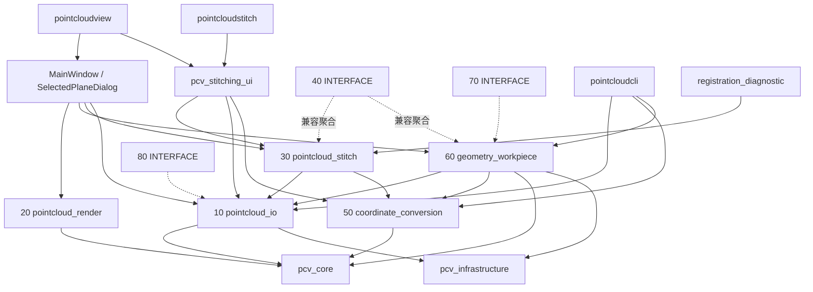
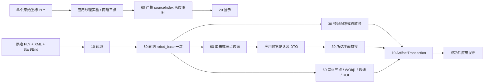
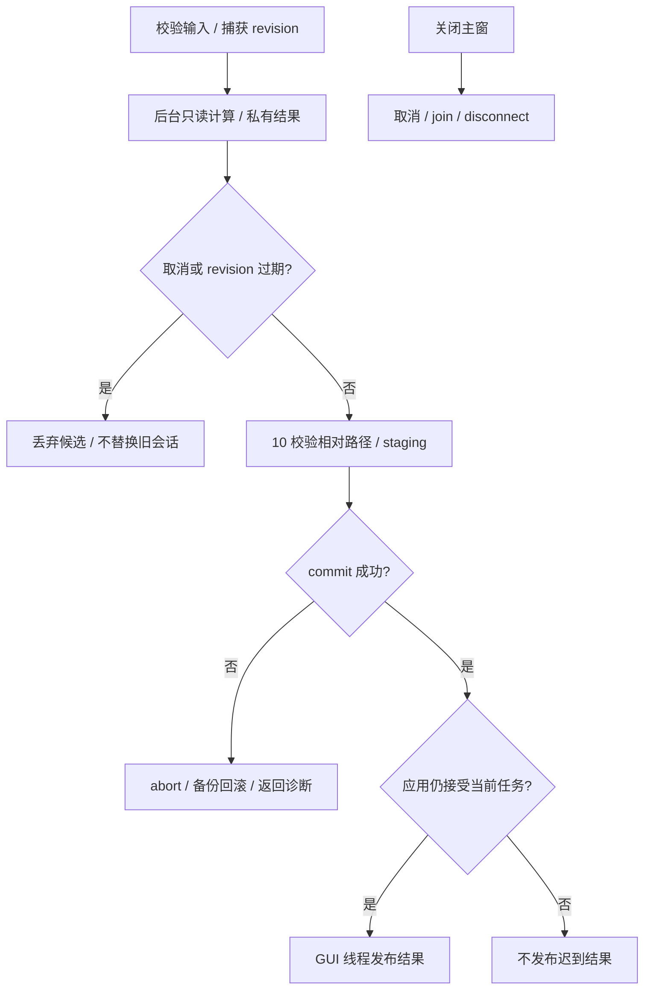

# PointCloudSuite 软件整体架构 v0.5

核对日期：2026-10-15。依据：HEAD `75d3e3b` 加当前未提交/未跟踪实现；本次只静态核对。当前实现和下述待收敛目标必须分开理解。[需求基线](../requirements/pointcloudview_v0.5.md) · [数据契约](../contracts/data_contracts_v0.5.md) · [文档索引](../README.md)。

## 五层结构

| architecture_layer | components | responsibilities |
|---|---|---|
| 应用入口 | pointcloudview、pointcloudstitch、pointcloudcli、registration_diagnostic、intensity_viewer | 启动、命令、用户入口 |
| 应用编排与共享 UI | MainWindow、pcv_stitching_ui、SelectedPlaneDialog、features/adapters、内存监测 | 参数、会话、任务、取消/join、revision、用户提示与发布 |
| 领域模块 | 10/20/30/50/60；40 兼容占位 | IO、渲染、拼接、坐标转换、几何与工件 |
| 基础设施 | pcv_core、pcv_infrastructure、配置/运行路径 | 点类型、公共配置与可写目录 |
| 数据与外部系统边界 | PLY/PNG/JSON/PCVMAP、SDK、外部刀路、机器人文件 | 有版本的输入输出与外部集成 |

第五层表示接口边界，不是一个可链接 target。Qt 和可选相机 SDK 是外部依赖；非渲染领域模块可用 Qt Core/Gui/Concurrent，但不依赖 QWidget。

## 实际 target 与依赖

图突出主要业务边；完整链接事实以各 CMake 为准。诊断工具目前还链接旧 10 target、40 聚合与 50；infrastructure 使用 Qt Core，core 是 INTERFACE，10/20/30/50/60 与共享 UI 为静态库。30 不依赖 60，选面结果由应用 DTO 转换后传入 30。共享模块不得依赖 `apps/`。

| module | target | actual_api_namespace | responsibility |
|---|---|---|---|
| 10 | pcv_m10_pointcloud_io | pcv::detail::io/filtering、pcv::output、pcv::io、pcv::camera | 读取、canonical 缓存、预处理、writer、事务、实验相机 |
| 20 | pcv_m20_pointcloud_render | 全局 PointCloudCanvas、pointcloud DTO | GUI/OpenGL 画布、拾取、渲染 DTO/灰度覆盖 |
| 30 | pcv_m30_pointcloud_stitch | pcv::interface、pointcloud、pcv::stitching | 整帧编排、ICP/seam、所选平面拼接、诊断与产物 |
| 40 | pcv_m40_pointcloud_matching | 兼容转发 | 工件位置确认规划，占位业务未实现 |
| 50 | pcv_m50_coordinate_conversion | pointcloud | 唯一手眼、插值与坐标数学 |
| 60 | pcv_m60_geometry_workpiece | pcv::planefitting/roi/matching/interface/scan/texture | 平面、单击选面、边缘/ROI、WObj1、临时工件、扫描与纹理 |

`pcv/processing/`、`pcv/workpiece/`、`pcv/stitching/` 是头路径，不能据此推断 namespace。规范公共门面目标为 `pcv::io/stitching/coordinates/geometry/workpiece`；其中 ArtifactTransaction 和所选平面入口已采用部分规范命名，其余没有全部迁移。

## 四条业务数据流

| path | coordinate_and_conversion | invalidation | artifacts_and_quality |
|---|---|---|---|
| 整帧拼接 | 相机线扫点经 50 转换一次，30 进行配准；仅转换模式不做 ICP | 输入/参数与任务 revision，成功替换 view 并清派生状态 | 四件正式产物，可选 source/pre/post；完整配准保留当前严格门禁 |
| 所选平面 | 应用逐帧通过 50 转到 robot_base，30 接收已转换所选点，不再手眼 | 位姿变更清对应行，标定变更清全部，参数清候选，重排使旧结果失效 | 独立 PLY/map/manifest；warn_only、strict_validation_status=not_run |
| 临时工件 | 扫描 JSON 或 PLY 参数走 50，再做 60 几何 | 替换源/参数/放弃会话及 revision 控制 | baseline/ROI/Mask/info 四件套，失败不发布部分结果 |
| 原始坐标纹理实验 | 直接保留 PLY XYZ，零次手眼 | 点云/平面/source provenance 变化清覆盖 | 只显示灰度，无 WObj1、无四件套；不能声称 robot_base |

普通亮度映射还可服务有合法单 PLY provenance 的业务点云；扫描轨迹是临时工件后的 60 能力，不能等同外部刀路规划。

## 任务、取消与事务发布

图区分磁盘提交与 GUI 发布：已完成事务的合法文件不会因随后 revision 失效自动删除；应用仍必须阻止迟到显示。共享拼接子窗关闭隐藏，任务可继续；主窗或独立 stitch 退出先取消并等待。选面对话框关闭会取消、join，丢弃会话内选择。

并行 worker 只读 const Qt 容器，返回私有数据，future 全汇合后按输入顺序合并；GUI 线程独占 QWidget/OpenGL。30/60 当前业务入口会编排 staging/commit，并非纯结果 API；最终文件操作归 10。新业务使用 ArtifactTransaction；10 的旧 writePlaneOutput 仍保留自身 staging/backup/rollback 实现，尚未复用该公共类，不能把事务类收敛写成全部完成。

## 当前兼容债务与构建边界

`stitch(request)` 内部仍映射弃用 Options 后调旧实现，新请求覆盖默认 false，旧 Options 默认 true。共享 UI 已调用分组请求；RegistrationDialog 文件仍在但不编译，不能再作为生产迁移任务；诊断工具仍旧入口。view 的 ViewLegacy 私有 DTO 及轻量 launcher 避免旧类型布局冲突，后续迁移不应重新引入第二套算法。

根 CMake 默认两个 GUI ON，选项实际控制 add_subdirectory；“固定接入”注释不能理解为强制开启。20 仅在 View 开启时加入；30 当前仅在 Stitch 或 Tools 开启时加入，但 View/共享 UI 及部分测试会依赖它。View-only、CLI-only/Tests 等组合存在静态依赖疑点，见[开发方案 P0](../development/development_plan_v0.5.md)。本轮未配置或构建，不将疑点写成已复现故障或已修复。

旧 05/10read/20render/30stitch/40registration/50conversion/60plane/70/80 及 src 下的 IO/filtering/interface/registration/output target/header 保留转发。删除代码兼容层需引用归零、弃用期、独立评审及动态/现场验收；此次只删除重复文档。
