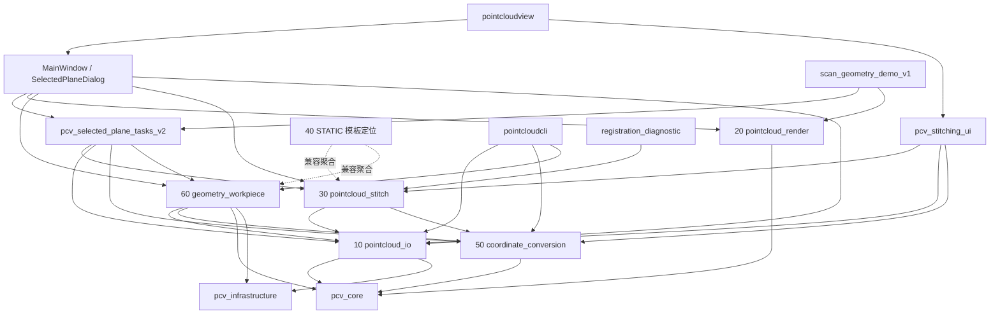
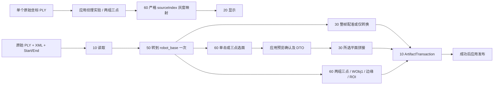
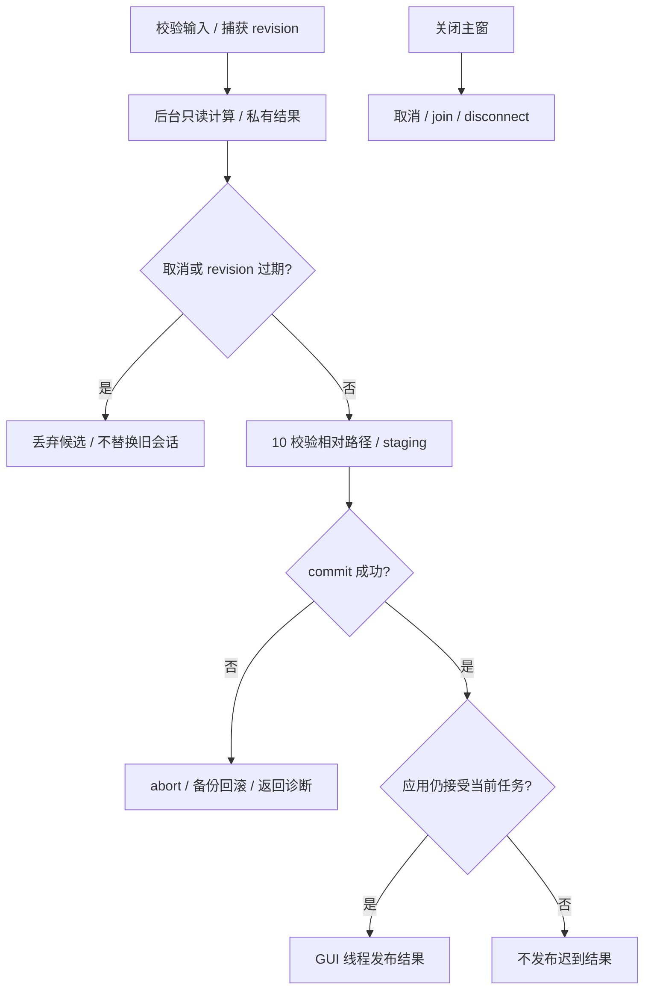
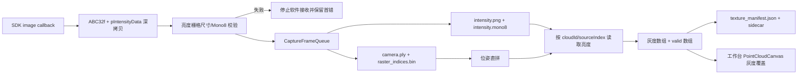
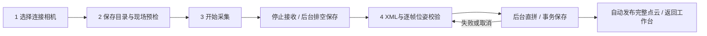
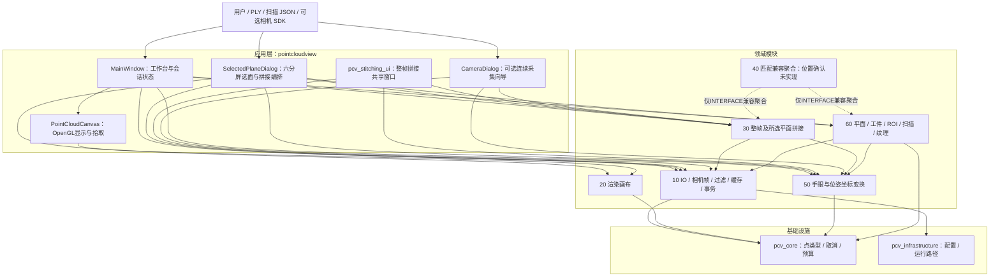
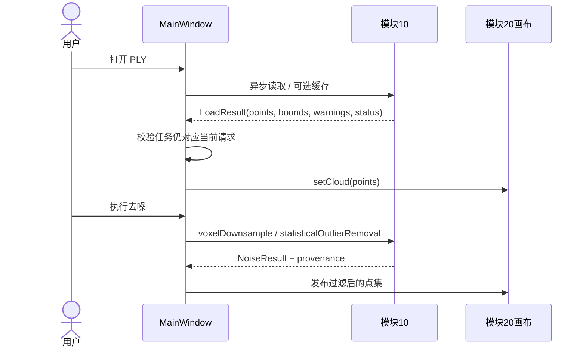
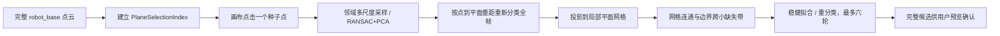
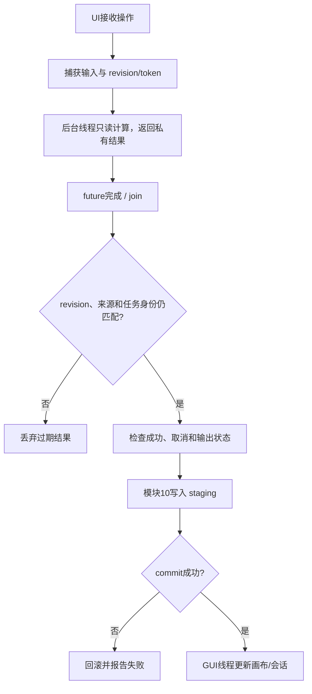

# 历史开发与验证记录

历史证据，原文日期、命令与结果只代表当时状态，不能替代当前工作区验证。源码、公共头和 CMake 为实现事实。

<a id="source-docs-readme-md"></a>

## 来源：`docs/README.md`

### PointCloudSuite 文档索引 v0.5

更新2026-10-15。基线为HEAD75d3e3b加当前未提交/未跟踪实现，非发布声明；源码/公共头/CMake/测试定义实际能力。本轮纯文档静态整理，不执行构建/CTest/GUI。

#### 推荐阅读顺序

1. [target.md](historical-development.md#source-target-md)：业务目标、当前状态、责任和简要更新。
2. [需求基线](historical-development.md#source-docs-requirements-pointcloudview-v0-5-md)：已实现、实验和未实现能力。
3. [软件整体架构](historical-development.md#source-docs-architecture-software-architecture-v0-5-md)：五层、依赖、四条业务链、取消/发布。
   [pointcloudview 架构与算法导读](historical-development.md#source-docs-development-pointcloudview-architecture-analysis-v1-md)：窗口职责、关键函数和算法流程图。
4. [当前数据契约](historical-development.md#source-docs-contracts-data-contracts-v0-5-md)与[UI/模块协同](historical-development.md#source-docs-architecture-module-ui-integration-v0-5-md)。
5. [用户指南](historical-development.md#source-docs-user-guide-pointcloudview-requirements-md)与[Windows构建](historical-development.md#source-docs-development-build-windows-md)。
6. [开发方案](historical-development.md#source-docs-development-development-plan-v0-5-md)与[路线图](historical-development.md#source-docs-development-roadmap-v0-5-md)。
7. [集中版本日志](changelog.md#source-docs-changelog-v0-5-md)、[历史归档](historical-development.md#source-docs-archive-history-pre-v0-5-md)、[每份文档迁移去向](historical-development.md#source-docs-archive-document-migration-v0-5-md)。

连续采集纹理功能的实现、会话格式、外置光源提示和现场验收边界见[连续采集纹理点云 v1](historical-development.md#source-docs-development-camera-capture-texture-v1-md)。

#### 模块与应用

| entry | current_document |
|---|---|
| 10 IO/预处理/事务/实验相机 | [10_pointcloud_io](historical-development.md#source-docs-modules-10-pointcloud-io-md) |
| 20 画布/渲染 | [20_pointcloud_render](historical-development.md#source-docs-modules-20-pointcloud-render-md) |
| 30 整帧/所选平面拼接 | [30_pointcloud_stitch](historical-development.md#source-docs-modules-30-pointcloud-stitch-md) |
| 40 规划占位/兼容聚合 | [40_pointcloud_matching](historical-development.md#source-docs-modules-40-pointcloud-matching-md) |
| 50 唯一坐标数学 | [50_coordinate_conversion](historical-development.md#source-docs-modules-50-coordinate-conversion-md) |
| 60 几何/工件/扫描/纹理 | [60_geometry_workpiece](historical-development.md#source-docs-modules-60-geometry-workpiece-md) |
| CLI | [pointcloudcli](historical-development.md#source-docs-modules-pointcloudcli-md) |
| 原工作台 / 共享UI | [View](../../apps/pointcloudview/README.md) / [stitching_ui](../../apps/stitching_ui/README.md) |
| 独立 STEP 模板制作 v1 | [开发与验收](historical-development.md#source-docs-development-step-template-builder-v1-md) |
| 离线 PLY 单页 / 所选平面拼接 v2 | [操作说明](historical-development.md#source-apps-scan-geometry-demo-v1-readme-v2-md) / [开发与用户验收](historical-development.md#source-docs-development-scan-geometry-real-selected-plane-v2-md) |

70/80只保留兼容公共头，无构建target，详细职责归60/10；90/100并入路线图，不再各建空占位页。应用/无引用target清单和用户构建矩阵见[清理说明](historical-development.md#source-docs-development-application-target-cleanup-v1-md)。[features](../../apps/pointcloudview/features/README.md)与[adapters](../../apps/pointcloudview/adapters/README.md)明确同事工作边界。

#### 历史、研究与示例

v0.1～v0.4需求和v0.4协同旧路径保留短指引；详细历史只维护在归档/版本日志，当前模块页不复制测试记录。研究保留：[相机SDK](historical-development.md#source-docs-research-camera-sdk-direct-canvas-plan-md)、[RZ90跨向拼接](historical-development.md#source-docs-research-rz90-cross-direction-stitching-research-md)，不视为当前稳定功能。示例见[examples](../../examples/README.md)。

基线57份Markdown加1份txt，合并后删除18份Markdown和1份txt，新增10份Markdown，最终49份；无空文档可删。链接/内容迁移与静态结果见版本日志。软件CMake版本和真实schema不改，历史26/26与合成耗时不能当作本轮或现场验收。

- [新GUI加载计时与日志v1](historical-development.md#source-docs-development-scan-geometry-load-performance-v1-md)：分段观测、先显后索引、操作任务日志与用户性能验收（未运行构建测试）。

- [真实日志耗时优化v2](historical-development.md#source-docs-development-scan-geometry-load-performance-v2-md)：匹配结果复用、法向批次/预算回退、映射快路径、切帧计时与日志汇总；用户执行运行验证。

- [点云加载与选面性能v3](historical-development.md#source-docs-development-scan-geometry-load-performance-v3-md)：先预览后校验、法向邻居表、连通缓冲复用、完整面片稠密路径及用户验收。

- [最终工件模板蓝红显示v1](historical-development.md#source-docs-development-scan-geometry-result-regions-v1-md)：结果区域生成、修剪同步、取消重试与用户验收。


#### STEP 模板制作与匹配后端 v1

当前制作入口为独立 `step_template_builder_v1`，提供工件信息、STEP点云、选面修剪和模板草案保存；匹配算法与旧契约保留在模块40/60，暂不提供匹配页。 [制作开发与验收](historical-development.md#source-docs-development-step-template-builder-v1-md) · [历史匹配后端说明](historical-development.md#source-docs-development-step-template-matching-v1-md)。


<a id="source-docs-architecture-module-ui-integration-v0-4-md"></a>

## 来源：`docs/architecture/module_ui_integration_v0.4.md`

### v0.4 模块与 UI 文档迁移指引

当前规范为[模块与 UI 协同 v0.5](historical-development.md#source-docs-architecture-module-ui-integration-v0-5-md)，整体结构见[软件架构](historical-development.md#source-docs-architecture-software-architecture-v0-5-md)。本页保留旧路径，避免外部引用失效。

旧正文的独有决策和历史测试已进入[历史归档](historical-development.md#source-docs-archive-history-pre-v0-5-md)与[版本日志](changelog.md#source-docs-changelog-v0-5-md)，来源去向见[迁移表](historical-development.md#source-docs-archive-document-migration-v0-5-md)。旧记录中的已回滚模式或生产页面不得作为现行事实。更新2026-10-15，本轮未做动态验证。


<a id="source-docs-architecture-module-ui-integration-v0-5-md"></a>

## 来源：`docs/architecture/module_ui_integration_v0.5.md`

### 模块、UI 与交接协同规范 v0.5

2026-11-06 独立 STEP 模板制作应用：`apps/step_template_builder_v1` 依赖20/60和Qt，使用20的投影快照与显示映射，60提供完整CAD采样、平面角色、掩码和ArtifactTransaction；模块不依赖应用。矩形修剪由应用后台按完整点集执行，显示抽样仅用于展示。demo1旧STEP/自动匹配入口移除，40/60底层能力保留。[开发说明](historical-development.md#source-docs-development-step-template-builder-v1-md)。

2026-11-05 应用/target清理：桌面入口保留scan_geometry_demo_v1与pointcloudview，独立拼接/亮度应用及旧模拟源码移除；两个GUI共用真实选面任务，整帧窗口仅随pointcloudview构建。无引用兼容target删除，公共兼容头保留；本轮用户明确授权清理，无须迁移公共头。CLI/Tools保留默认OFF，验证由用户执行。[清单](historical-development.md#source-docs-development-application-target-cleanup-v1-md)。

2026-11-04 配色状态协同：新GUI窗口根据当前帧 `hasCandidate` 显式传 `ScanGeometryCanvasV2::DisplayMode`，原始帧默认高度色、工件拟合后灰点，拼接/修剪结果灰点＋蓝红区域；20只负责既有统一色/高度色参数与蓝红平面绘制。应用缓存完整来源Z范围并在点发布后恢复，不改60拟合或30拼接，不改变marker/拾取默认契约。模式变化不更新点VBO，测试及GUI由用户执行。[说明](historical-development.md#source-docs-development-scan-geometry-real-selected-plane-v2-md)。

2026-11-05 候选几何契约：`apps/scan_geometry_demo_v1/scan_geometry_contract_v1.*`为应用私有适配，不进入模块公共API；应用接收01业务身份、核验02扫描来源并调10事务、50转换及60掩码，30不依赖60。正式结果仅交接候选，不承担01发布或02执行；网页未修改。详见[说明](historical-development.md#source-docs-development-scan-geometry-contract-adapter-v1-md)。

2026-10-30 深度 RAW 采集：应用工作台增加`depth_raw`独立页；设备控制/预览/启停归应用，10拥有帧队列、事务写入及 RAW 数据契约。页面与既有`camera`向导启采互斥，切页不停止任务。[开发说明](historical-development.md#source-docs-development-depth-raw-capture-v1-md)。

2026-10-23 连续采集 v2：默认同步保存亮度、仅发布几何点云；第四步独立纹理开关默认关闭。10 提供兼容的严格/几何读取模式，30 显式只读几何；应用负责分列状态、严格纹理校验、参数恢复及工作台 revision 发布/清除旧覆盖，60 算法不变。`StitchingPublication::intensitySourceDirectory` 传递逐帧目录；不修改已有工序 JSON 业务。[当前说明](historical-development.md#source-docs-development-camera-capture-intensity-decoupling-v2-md)。

日期：2026-10-15。当前基线见[需求](historical-development.md#source-docs-requirements-pointcloudview-v0-5-md)与[软件架构](historical-development.md#source-docs-architecture-software-architecture-v0-5-md)。本文件维护协作规则；详细代码变更集中到[版本日志](changelog.md#source-docs-changelog-v0-5-md)，并在 [target.md](historical-development.md#source-target-md)登记摘要。

#### 职责与依赖

10为读取、过滤、writer/事务和实验相机；20为渲染；30为整帧与所选平面拼接；50为唯一坐标数学；60为几何/工件/扫描/纹理。40为STATIC模板定位实现，PUBLIC保留30/60兼容聚合并依赖50，机器人移动判定未实现；70/80仅保留转发60/10的公共兼容头，已无构建target。90/100进入[路线图](historical-development.md#source-docs-development-roadmap-v0-5-md)。

依赖为 `30→10/50`、`60→10/50`、`40→30/60`、`20→core`。共享 UI 位于 apps，允许依赖算法；模块不得依赖 apps。所选平面通过应用适配 60→30，30 不链接 60。

#### 命名与兼容映射

| legacy_entry | current_entry | future_boundary |
|---|---|---|
| 05、旧 10 read、根 filtering、80 writer | modules/10_pointcloud_io | pcv::io 公共门面 |
| 旧 40 registration、多帧/ICP/seam | modules/30_pointcloud_stitch | pcv::stitching；旧 pointcloud 保留兼容 |
| 旧 50 conversion | modules/50_coordinate_conversion | pcv::coordinates |
| 旧 60 plane、70 ROI | modules/60_geometry_workpiece | pcv::geometry/workpiece |
| 三维工件模板 v1（新增） | modules/60_geometry_workpiece/include/pcv/workpiece/workpiece_template_v1.h | pcv::workpiece::saveWorkpieceTemplate/loadWorkpieceTemplate |
| stitch 应用旧窗口实现 | apps/stitching_ui / pcv_stitching_ui | 当前唯一共享拼接窗口 |
| 旧 namespace/header/target | alias/forwarding 或原接口 | 逐批迁生产调用，不复制实现 |

当前 IO 多数为 `pcv::detail::io`，过滤为 `pcv::detail::filtering`，plane writer 为 `pcv::output`；坐标与整帧算法仍多为 `pointcloud::`，整帧编排为 `pcv::interface`。所选平面是 `pcv::stitching`，单击选面是 `pcv::planefitting`。`pcv::scan/texture/camera` 保留独立领域。实际头和 target 明细见架构与各模块文档。

目录/文件用 lower_snake_case；target 用 pcv_mNN_lower_snake_case（应用共享库沿用 pcv_stitching_ui）；类型 PascalCase；函数/局部变量 lowerCamelCase；常量 kPascalCase。JSON 新字段 snake_case，单位用 _mm/_deg/_ms；不得为统一命名修改既有 schema 字段。

旧类型/函数按兼容批次使用 [[deprecated]]；namespace/forwarding header 采用说明和映射，不能声称已全部标记。公共门面 → 生产调用 → 兼容审计分批记录，删除独立安排；保留旧新默认值差异。

##### target 转发明细

当前保留的INTERFACE转发如下。16个无引用兼容target及旧模拟库已按用户授权删除，清单和外部迁移风险见[清理说明](historical-development.md#source-docs-development-application-target-cleanup-v1-md)。公共兼容头仍保留，不代表所有兼容层均已删除。

| legacy_target | forwards_to |
|---|---|
| pcv_m10_pointcloud_read | pcv_m10_pointcloud_io |
| pcv_m40_pointcloud_matching | pcv_m30_pointcloud_stitch、pcv_m60_geometry_workpiece |

##### header 与实现归属

| legacy_header_or_directory | current_header_or_directory | actual_namespace |
|---|---|---|
| include/pcv/io/*、原 10 read | modules/10_pointcloud_io/include/pcv/io/* | pcv::detail::io；ArtifactTransaction 为 pcv::io |
| include/pcv/filtering/*、src/filtering | modules/10_pointcloud_io/include/pcv/processing/* | pcv::detail::filtering |
| include/pcv/output/plane_output.h、modules/80_plane_output | modules/10_pointcloud_io/include/pcv/io/plane_output.h | pcv::output |
| include/pcv/registration/multiframe_registration.h、原 40 registration | modules/30_pointcloud_stitch/include/pcv/stitching/multiframe_registration.h | pointcloud |
| include/pcv/registration/seam_fusion.h、原 40 seam | modules/30_pointcloud_stitch/include/pcv/stitching/seam_fusion.h | pointcloud |
| include/pcv/registration/handeye_transform.h | modules/50_coordinate_conversion/include/pcv/registration/handeye_transform.h | pointcloud |
| include/pcv/interface/stitching_interface.h | modules/30_pointcloud_stitch/include/pcv/interface/stitching_interface.h | pcv::interface |
| include/pcv/interface/temp_workpiece_interface.h、modules/70_roi_template | modules/60_geometry_workpiece/include/pcv/workpiece/*；interface/roi/matching 路径保留 | pcv::interface、pcv::roi、pcv::matching |
| 整帧拼接窗口（旧独立应用已删除） | apps/stitching_ui/stitchingwindow.h | pointcloudview应用窗口，非领域 namespace |

这些表记录实现迁移关系，旧头仍按实际代码转发；不承诺每个旧符号已经具备编译器弃用属性。未来门面 namespace 与实际 namespace 分开登记。

#### 文件所有权白名单

| owner | allowed_area | boundary |
|---|---|---|
| 陈振佳/主线 | modules、src、公共头、MainWindow、CMake、模块/契约测试、apps/stitching_ui | 数学/API、生命周期、依赖、事务和稳定业务会话 |
| 于海军/前端与外部项目 | apps/pointcloudview/features/**、交接登记的 UI 专属 .ui/资源/样式、UI 测试和交互说明 | feature 组件及外部高点/刀路项目 |
| 双方共同冻结 | DTO/schema、页面形态、跨项目调用、端到端样例 | 未冻结不宣称接入完成 |

现有 shared StitchingWindow 已共用，但本轮不另做 PointCloudStitch 视觉重设计。修改共享 UI 的任务语义、MainWindow 壳或生命周期须由主线处理；同事不能因 UI 改造直接复制窗口或算法。

临时 adapter 只能放在 `apps/pointcloudview/adapters/`，标记 Experimental 或 Deprecated，登记 owner、创建日期、实际替代 API、依赖、删除条件和回滚点。共享模块不得长期依赖应用 adapter；UI 不 include modules/*/src，不提交生成的 ui_*.h。

#### 公共接口与数据发布

2026-10-16 连续采集v2：CameraDialog默认使用SdkImageFrame配置，操作员每会话确认当前设备一门控一整图及门控无效；10保留触发/自动行数/有界队列/v2会话，30/50既有直拼与行序数学复用。无PLC通信，异常仅停止软件接收；不改变主窗口发布/选面生命周期。[当前说明](historical-development.md#source-docs-development-camera-capture-sdk-frame-v2-md)。

2026-10-16 连续采集：CameraDialog内嵌features/camera_capture_panel_v1，10在latest-frame覆盖前独立排队/保存完整扫描，50唯一数学按显式行序进度转换，30唯一编排直拼和事务输出，应用复用stitchingSucceeded发布完整CPU缓存/画布。采集/拼接与主界面处理互斥，停采后填写位姿，失败/取消/过期不发布；选面与共享窗口默认不动。[细节](historical-development.md#source-docs-development-camera-capture-pose-stitch-v1-md)。

整帧共享 UI 调 `pcv::interface::StitchingRequest/stitch()`；所选平面调 `pcv::stitching::stitchSelectedPlanes()`；单击调 `pcv::planefitting::preparePlaneSelectionIndex/selectPlaneAtPoint()`。取消、错误、provenance、坐标/单位及产物见[数据契约](historical-development.md#source-docs-contracts-data-contracts-v0-5-md)。

当前帧展示加速 v2 归 apps：`LoadDisplay` 完整读取/转换并均匀抽取最多 300,000 点，GUI 通过 20 的 `setDisplayCloud()` 发布后，`PrepareIndex` 使用 const 共享完整点云准备 60 的索引。期间允许视角操作，选面/确认/切帧/拼接禁用；索引失败或取消保留展示及已确认选择，可用三点备用。拾取回译完整下标，候选高亮仅显示可见子集。加载首个 frameSwapped 需校验帧、revision 及画布当前点云已绘制，计时仅记会话日志。上一轮 30 私有预览缓存/结果字段已撤回；30 恢复原配准及完整结果，应用用 `setCloud(result.points)` 显示拼接结果，不新增模块依赖。详见[现行开发说明](historical-development.md#source-docs-development-current-frame-display-acceleration-v2-md)。

正式文件由 10 ArtifactTransaction staging/commit；30/60 可以编排事务。应用成功且任务仍有效才发布；共享拼接失败/取消不得清旧画布，成功则更新来源并清旧临时工件/平面/ROI/WObj1/纹理/轨迹。设置并行参数不得改变确定的合并顺序。

#### 工件模板应用接入

工件模板应用接入：MainWindow 维护原始/当前 CloudSourceContextV1、revision、后台任务/取消/关闭 join；workpiece_template_ui_v1.cpp 通过模块 60 公共 API 编排，features/workpiece_template_dialog_v1.* 只实现名称/目录/摘要/基准确认表单。创建和打开入口位于工具菜单；来源状态独立于临时工件/WObj1 会话，普通 PLY 与原始相机/纹理坐标不因文件名而成为 robot_base。读取成功才替换画布及原始缓冲、清理旧派生会话；失败/取消/过期保留旧数据。已有模块依赖与公共契约不改，40 匹配/移动确认仍未实现。

#### 外部刀路与交接包

相机扫描规划已有实现；全剖/点剖刀路、高点标注、路径 PNG 贴合与坐标 JSON 的完整外部闭环尚未冻结。保留版本化 DTO/JSON schema 需求，不发明正式名称或占位字段；先冻结文件/库/CLI/进程调用方式、坐标、结果和错误/取消语义。

交接包必须包含以下内容：

| item | required_content |
|---|---|
| ownership | owner、日期、文件白名单 |
| api_dependencies | 实际公共 API/target、DTO/schema 版本、坐标与单位 |
| interaction | 页面截图或交互说明、QWidget/QDialog 形态、忙碌/取消/失败流程 |
| validation | 构建命令、测试结果、固定样例、未验证项 |
| adapters | 临时 adapter、替代 API、创建日期、删除条件 |
| rollback | 已知问题、影响面、回滚点；不得覆盖后续用户修改 |

验收记录分别标明静态、构建、CTest、启动、GUI、真实数据与现场证据。输出成功不等于质量达标，合成模块耗时不等于用户端耗时；本次仅文档静态审计。

2026-10-16 六分屏整合映射：apps/pointcloudview/selectedplanedialog维护稳定Frame、六Panel、双Job、整轮提交/跳过及结果/模板编排；10可选关闭canonical、50窗口转换、60索引缓存/法向并行共同使用core/processing_budget.h预算。20只做映射显示和绘制revision；30求解/事务不变且不依赖60。模板创建复用features/workpiece_template_dialog_v1和60现有保存，读取复用主窗口入口。同步tests/CMakeLists.txt加入模板表单，静态交付不代表编译/运行通过。见[整合说明](historical-development.md#source-docs-development-batch-plane-selection-template-integration-v1-md)。


2026-10-16 整合v2：应用修正激活格/调度和全局完成门禁；所有任务载荷先通过稳定id/revision/token/kind/当前轮归属检查，过期OOM不阻塞新调度。排队计时包含线程池等待，worker结束至GUI回调另计；10/50/60诊断不写正式manifest。模块边界及模板编排不变，见[当前整合](historical-development.md#source-docs-development-batch-plane-selection-template-integration-v2-md)。

2026-10-16 构建/运行收口：模块60仅修复索引局部变量命名冲突；应用pointcloudview及两个含主窗口资源的测试target显式AUTORCC，未新增模块依赖/公共接口/schema。六画布原生回归作为独立--native-gl模式，常规CTest仍offscreen；全新Debug/Release全量构建、各43项CTest和两个原生桌面入口启动通过。此前静态结论仅作历史，详见[修复说明](historical-development.md#source-docs-development-build-runtime-repair-v1-md)。

#### 相机向导应用映射（2026-10-16）

CameraDialog负责设备源/SDK通知/高级实时预览；CameraCaptureWizard负责四步连续采集UI、状态快照、预检与位姿批量校验，旧CameraCapturePanelV1为同一实现的alias。底层继续复用10 FrameSource/CaptureRecorder、30 StitchingRequest、50坐标数学，无新增领域模块依赖。详细交互、生命周期、验证和回滚见[开发说明](historical-development.md#source-docs-development-camera-capture-ui-simplification-v1-md)。

2026-10-16 SDK启动顺序修复：模块10独占开始测量/清缓存/图像门禁及失败清理，应用仍仅依FrameSource::start返回成功进入取流态；原有错误通道传递阶段、原始状态及处理提示，无新增公共接口/应用依赖。见[说明](historical-development.md#source-docs-development-camera-startup-order-fix-v1-md)。

2026-10-22 连续采集纹理点云 v1：`CameraCaptureWizard` 默认开启同步 Mono8 亮度采集，并记录 `external_light_enabled`/`external_light_operator_confirmed`；外置光源仅由操作员按提示开关，软件不控制硬件。应用从 10 的 `CaptureRecorder` 回读逐帧亮度图，调用 60 的 `mapMultiFrameBrightness`，在拼接事务成功后通过 `StitchingPublication` 和 `PointCloudCanvas::setTextureGrayOverlay()` 发布灰度覆盖；映射失败、亮度缺失或尺寸错误不发布部分结果。高级实时预览不启用纹理保存。[实现说明](historical-development.md#source-docs-development-camera-capture-texture-v1-md)

2026-10-23 STEP/CAD模板v1：主责60私有OCCT解析/采样/独立CAD包，20独立CAD面画布仅依赖core DTO，apps负责导入选面任务、revision、来源和发布。新增来源枚举Unknown/RobotBase/CadModel，CAD禁机器人派生流程；保持30→10/50和60→10/50，40未实现匹配。见[实施说明](historical-development.md#source-docs-development-step-cad-template-v1-md)。


2026-10-23 深度主缓存v1：10拥有C16/辅助元数据、SDK按需转换、session-v3/frame-v2；20提供SDK无关深度画布；应用CameraDepthPreviewV1负责固定帧/悬停/确认、revision/token/join及camera/mm发布；30适配深度来源，50/60数学不改，保留同期CAD/STEP修改。[说明](historical-development.md#source-docs-development-camera-depth-preview-cache-v1-md)。
### 2026-10-23 UI shell v1

`MainWindow` 继续拥有数据读取、任务生命周期、revision 门禁和模块编排。`WorkbenchShellV1` 仅负责主窗口工作页、顶部入口和右侧覆盖抽屉，不拥有算法或后台任务。相机、拼接、六分屏和模板页面由原控制器继续持有，切页只改变显示；工具抽屉隐藏不销毁页面。

模块 20 的 `PointCloudCanvas` 增加绘制层叠加：黑色画布、自动 Z 高度伪彩、无数值彩条、左下 XYZ 轴和右上方向控件。画布仍负责 OpenGL、拾取和渲染 DTO，不依赖应用层。

2026-10-23 六分屏页面紧凑化：`SelectedPlaneDialog` 将参数、帧列表/轮次操作和运行日志置于两个默认收起的可展开容器内，六格画布仍常驻；仅设置 QWidget 可见性，不改变 Frame/Panel/Job、revision、取消/join、日志缓冲及提交行为。自动单测覆盖默认收起和展开/收起。原生 GUI 视觉截图未能在本轮稳定生成，设计对照见根目录 `design-qa.md`，状态 blocked。

#### 独立扫描几何演示映射 v1（2026-10-26）

主责应用层 `apps/scan_geometry_demo_v1`；独立 EXE `scan_geometry_demo_v1`。`.ui`/QSS/QRC 提供 Designer 可编辑主体和原型图标，`ScanGeometryWindowV1` 持有流程模型、按钮状态、QTimer/token 及关闭/重新扫描确认，`DemoCanvasV1` 组合模块 20 并转换显示下标到稳定点 ID，`ScanGeometryModelV1` 维护六段示例、候选审核、修剪历史和确认快照。所有演示事件在 GUI 线程执行；无后台算法 worker 或硬件任务。

运行依赖仅为 core 点类型、Qt 和模块 20，不调用 10/30/50/60 的真实采集、配准或坐标数学。20 仅追加实例 `setAppearance`、既有 `PointColorOverlay` 的公开配色入口及浅底点数提示；默认调用方保留黑底/白选中。方向、相机操作、单点/矩形深度拾取继续复用 20，选面身份和擦除/撤销语义归应用。

本次白名单增量为新应用、新模型/view 测试、根/模块/tests CMake 注册、模块 20 canvas 头/源及配套文档；不覆盖已有主窗口/渲染改动，不更改版本/schema，不提交/push/上传。详细文件、接口、实际验证、最后 CMake 未重配项及回滚边界见[开发说明](historical-development.md#source-docs-development-scan-geometry-demo-v1-md)。用户接手最终 GUI、DPI、Qt Creator target 运行及旧工作台验收，演示 [design-qa](../../apps/scan_geometry_demo_v1/design-qa.md) 保持 blocked，不代表最终视觉已通过。

#### 2026-10-26 离线单页所选平面拼接 v2 协同映射

2026-11-05 画布增量：20 负责实例统一点色及独立控制点十字（`setUniformPointColor`/`clearUniformPointColor`/`setControlPointIndices`），默认兼容；新 GUI 负责灰点/蓝红拟合面、无点高亮修剪、display/region revision 缓存与结果修剪缓存。区域更新不重复发布点云，重载/换帧及修剪使缓存失效；60/30 算法、输出契约和二维深度预览不变。本轮验证由用户执行；见[当前说明](historical-development.md#source-docs-development-scan-geometry-real-selected-plane-v2-md)。

| owner_and_entry | responsibility_and_boundary |
|---|---|
| apps/stitching_ui / pcv_selected_plane_tasks_v2 | 从旧 SelectedPlaneDialog 提取真实读取/50转换/展示抽样/完整索引/选面快照；不拥有 UI 或调度 |
| apps/pointcloudview / SelectedPlaneDialog | 保留原 UI、队列、线程生命周期、模板操作；使用共用任务和兼容类型别名 |
| apps/scan_geometry_demo_v1 / ScanGeometrySessionV2 | 新单页独立会话、输入/参考 revision/token/稳定帧 ID、六帧窗口、固定参考匹配、异常暂停、逐帧/批量审核、拼接和会话修剪 |
| apps/scan_geometry_demo_v1 / 深度帧生命周期 | 模块10读取深度会话帧供预览，显式处理/自动匹配时单帧物化；逐帧或批量确认后释放活动XYZ、索引和展示缓存，保留源深度与确认快照。模块20只显示中立深度DTO；模块50按原像素行插值FullXyz位姿 |
| modules/60 / matchReferencePlaneV2 | robot_base 参考平面辅助候选，复用不可变索引和 selectPlaneAtPoint；不属于 40 位置确认，不自动业务确认 |
| modules/30 / stitchSelectedPlanes | 仍只收完整已确认 robot_base 选面 DTO，30→10/50 不变；不链接60、不重复手眼转换、不接干涉标注 |
| modules/20 / PointCloudCanvas | 复用实例外观/逐点配色、display→full 映射与可见 GPU 拾取；无新渲染算法或默认外观变更 |
| modules/60 / findHighSidePlaneCandidatesV1 | 复用完整选面索引和 selectPlaneAtPoint 提供高侧候选；由 scan_geometry_demo_v1 展示软提醒，模块 30 不接收该状态 |

根 CMake/模块条件补齐新 GUI 单独启用时20/30和共享任务依赖。旧模拟模型/画布源码保留，不在正式窗口运行链路中；target 名称与 Designer 入口保持。主线维护公共任务、会话/生命周期和 CMake；模块 60 只增加匹配 API。细节及未运行验证见 [开发说明](historical-development.md#source-docs-development-scan-geometry-real-selected-plane-v2-md)。

2026-10-30 渲染与高侧提醒增量：原始转换帧使用 pointcloudview 默认高度色/点大小/叠加参数与完整 Z 范围；会话标注为蓝工件、红干涉，未选点保留高度色。模块 60 提供 `findHighSidePlaneCandidatesV1`，仅生成应用软提醒；用户手工确认才进入干涉标注，跳过提醒不会门控拼接。见 [开发说明](historical-development.md#source-docs-development-scan-geometry-real-selected-plane-v2-md)。

2026-10-30 可见性与世界 Z 增量：模块 20 `PointCloudCanvas` 增加独立 marker overlay buffer，扫描几何页对标注点绘制 DPR 缩放的大点及深/浅双边缘，不改变高度色、纹理 overlay 和旧调用方默认值。模块 60 `findHighSidePlaneCandidatesV1` 使用候选中心 Z 减工件面中心 Z，取消法向方向/倾角相关判定。见 [开发说明](historical-development.md#source-docs-development-scan-geometry-real-selected-plane-v2-md)。

2026-10-30 拟合区域显示增量：模块 60 `buildPlaneMaskV1()` 从完整选面点索引生成占用网格三角面与外环/孔洞闭合边界，复用处理预算和取消回调；应用任务携带结果并按输入/frame 生命周期清理。模块 20 `PlanarMaskOverlay` 用动态 VAO/VBO/EBO 绘制 25% 透明蓝/红平面和闭合轮廓，点颜色、拼接 DTO、输出文件和旧轮廓接口不变。详见 [扫描几何 v2 说明](historical-development.md#source-docs-development-scan-geometry-real-selected-plane-v2-md)。

#### 2026-11-05 加载计时与日志 v1 协同

apps/stitching_ui共享任务负责读取转换及计时/高度元数据；新GUI会话负责LoadDisplay/PrepareIndex拆分、每帧attempt门控、优先调度和源码外JSONL；20仅提供可选GUI CPU/GL上传调用计时，领域算法不变。两个帧任务各2workers，前台等待时不再派发预取。无全局Qt日志handler，无新schema。旧GUI30万默认及现有调度保持；测试由用户执行。[接口与验收](historical-development.md#source-docs-development-scan-geometry-load-performance-v1-md)。

计时边界补充：10补headerElapsedMs累计，60公共结果补budgetAcquireMs，应用透传；不迁移算法、不改缓存与输出契约。

#### 2026-11-05 加载耗时优化 v2 协同增量

应用共享任务维护snapshotFromSingleClickV2完整结果后处理，自动匹配复用候选，窗口不复制算法；新GUI选择法向65536批次并保持两帧各两worker，旧选面默认4096。60仅增加法向调度/预算回退与诊断，20内部递增映射采用二分反查，均不反向依赖apps。性能字段只进会话JSONL，不改正式schema。新GUI区分加载首显、切帧等待及可见等待，正常成功说明进入message，质量warning，失败error。SHA/摘要/输出和512MiB保留。公共DTO需完整重编；本轮静态交付，用户执行全部运行验收。[接口与测试](historical-development.md#source-docs-development-scan-geometry-load-performance-v2-md)。

#### 2026-11-05 性能优化 v3 协同

新GUI会话维护SourceVerificationV3和revision/id/attempt/token；PLY先只读预览，摘要+索引共用后续任务槽，未校验不提交旧区域/提醒或审核。60维护临时法向邻接、连通私有workspace和完整面片dense/sparse回退，算法留在模块，20无新业务依赖。共享任务仅透传参数/诊断，新GUI启用邻居表，旧调用方默认直查。总预算/并发不变；运行与等价验收由用户执行。[接口和边界](historical-development.md#source-docs-development-scan-geometry-load-performance-v3-md)。

#### 2026-11-05 最终结果区域协同 v1

应用私有结果区域DTO/Task组织完整点区域与有效帧红色修正，input/reference/result/trim/annotation/token门控；仅复用30 corrections、50刚体校验、60掩码和20叠加。共享任务Kind尾追加BuildResultRegions不改变旧值。60掩码返回有效double间距/原点，可选固定原点默认关闭；公共DTO需全量重编。拼接事务与显示生成分开计时，区域失败不改事务结果，不改schema。[开发说明](historical-development.md#source-docs-development-scan-geometry-result-regions-v1-md)。


#### STEP 模板与自动匹配 v1

2026-11-05 STEP模板协同：新GUI独立Designer对话框编排；20角色显示/掩码，60完整平面/边界及角色包，40改STATIC保留30/60 PUBLIC聚合并实现模板搜索/评分/精化，50唯一刚体数学。30不变，机器人移动判定仍未实现。共用512MiB，模板任务等待扫描后台收敛，revision/token失效、关闭join。 [开发与验收](historical-development.md#source-docs-development-step-template-matching-v1-md)。本轮未执行构建、CTest、GUI/DPI或真实样本验证，由用户执行。

2026-11-13 构建协同v2：三个GUI独立开关和任意组合保留；预设/脚本负责选择，模块依赖边界不改。模块60内部掩码分格统一浮点边界处理，应用测试按实际Designer类型和marker alpha契约验证；公共API/schema不变。Qt Creator本机设置备份后修正，构建/测试/日志放源码外。[当前说明](historical-development.md#source-docs-development-build-runtime-repair-v2-md)。


<a id="source-docs-architecture-overview-md"></a>

## 来源：`docs/architecture/overview.md`

### 架构概览

当前规范已整合为[软件整体架构 v0.5](historical-development.md#source-docs-architecture-software-architecture-v0-5-md)，包括五层、实际依赖图、四条业务链及取消/事务发布流程。本页保留稳定入口，不再复制结构表。

[需求](historical-development.md#source-docs-requirements-pointcloudview-v0-5-md) · [数据契约](historical-development.md#source-docs-contracts-data-contracts-v0-5-md) · [协同规范](historical-development.md#source-docs-architecture-module-ui-integration-v0-5-md) · [后续开发](historical-development.md#source-docs-development-development-plan-v0-5-md)。核对日期2026-10-15，仅静态整理。


<a id="source-docs-architecture-software-architecture-v0-5-md"></a>

## 来源：`docs/architecture/software_architecture_v0.5.md`

### PointCloudSuite 软件整体架构 v0.5

核对日期：2026-10-15。依据：HEAD `75d3e3b` 加当前未提交/未跟踪实现；本次只静态核对。当前实现和下述待收敛目标必须分开理解。[需求基线](historical-development.md#source-docs-requirements-pointcloudview-v0-5-md) · [数据契约](historical-development.md#source-docs-contracts-data-contracts-v0-5-md) · [文档索引](historical-development.md#source-docs-readme-md)。

#### 五层结构

| architecture_layer | components | responsibilities |
|---|---|---|
| 应用入口 | scan_geometry_demo_v1、pointcloudview；可选pointcloudcli、registration_diagnostic及转换工具 | 两个桌面入口、命令、用户入口 |
| 应用编排与共享 UI | MainWindow、pcv_stitching_ui、SelectedPlaneDialog、features/adapters、内存监测 | 参数、会话、任务、取消/join、revision、用户提示与发布 |
| 领域模块 | 10/20/30/50/60；40 兼容占位 | IO、渲染、拼接、坐标转换、几何与工件 |
| 基础设施 | pcv_core、pcv_infrastructure、配置/运行路径 | 点类型、公共配置与可写目录 |
| 数据与外部系统边界 | PLY/PNG/JSON/PCVMAP、SDK、外部刀路、机器人文件 | 有版本的输入输出与外部集成 |

第五层表示接口边界，不是一个可链接 target。Qt 和可选相机 SDK 是外部依赖；非渲染领域模块可用 Qt Core/Gui/Concurrent，但不依赖 QWidget。

#### 实际 target 与依赖



图突出主要业务边；完整链接事实以各 CMake 为准。诊断工具目前还链接旧 10 target、40 聚合与 50；infrastructure 使用 Qt Core，core 是 INTERFACE，10/20/30/40/50/60 与共享 UI 为静态库。40新增模板定位并依赖50刚体数学，PUBLIC保留30/60聚合。30 不依赖 60，选面结果由应用 DTO 转换后传入 30。共享模块不得依赖 `apps/`。

| module | target | actual_api_namespace | responsibility |
|---|---|---|---|
| 10 | pcv_m10_pointcloud_io | pcv::detail::io/filtering、pcv::output、pcv::io、pcv::camera | 读取、canonical 缓存、预处理、writer、事务、实验相机 |
| 20 | pcv_m20_pointcloud_render | 全局 PointCloudCanvas、pointcloud DTO | GUI/OpenGL 画布、拾取、渲染 DTO/灰度覆盖 |
| 30 | pcv_m30_pointcloud_stitch | pcv::interface、pointcloud、pcv::stitching | 整帧编排、ICP/seam、所选平面拼接、诊断与产物 |
| 40 | pcv_m40_pointcloud_matching | 模板定位/兼容聚合 | 平面边界6DoF模板匹配v1；机器人移动判定仍未实现，待用户验证 |
| 50 | pcv_m50_coordinate_conversion | pointcloud | 唯一手眼、插值与坐标数学 |
| 60 | pcv_m60_geometry_workpiece | pcv::planefitting/roi/matching/interface/scan/texture | 平面、单击选面、边缘/ROI、WObj1、临时工件、扫描与纹理 |

`pcv/processing/`、`pcv/workpiece/`、`pcv/stitching/` 是头路径，不能据此推断 namespace。规范公共门面目标为 `pcv::io/stitching/coordinates/geometry/workpiece`；其中 ArtifactTransaction 和所选平面入口已采用部分规范命名，其余没有全部迁移。

#### 四条业务数据流



| path | coordinate_and_conversion | invalidation | artifacts_and_quality |
|---|---|---|---|
| 整帧拼接 | 相机线扫点经 50 转换一次，30 进行配准；仅转换模式不做 ICP | 输入/参数与任务 revision，成功替换 view 并清派生状态 | 四件正式产物，可选 source/pre/post；完整配准保留当前严格门禁 |
| 所选平面 | 应用逐帧通过 50 转到 robot_base，30 接收已转换所选点，不再手眼 | 位姿变更清对应行，标定变更清全部，参数清候选，重排使旧结果失效 | 独立 PLY/map/manifest；warn_only、strict_validation_status=not_run |
| 临时工件 | 扫描 JSON 或 PLY 参数走 50，再做 60 几何 | 替换源/参数/放弃会话及 revision 控制 | baseline/ROI/Mask/info 四件套，失败不发布部分结果 |
| 原始坐标纹理实验 | 直接保留 PLY XYZ，零次手眼 | 点云/平面/source provenance 变化清覆盖 | 只显示灰度，无 WObj1、无四件套；不能声称 robot_base |

普通亮度映射还可服务有合法单 PLY provenance 的业务点云；扫描轨迹是临时工件后的 60 能力，不能等同外部刀路规划。

#### 任务、取消与事务发布



图区分磁盘提交与 GUI 发布：已完成事务的合法文件不会因随后 revision 失效自动删除；应用仍必须阻止迟到显示。共享拼接子窗关闭隐藏，任务可继续；主窗或独立 stitch 退出先取消并等待。选面对话框关闭会取消、join，丢弃会话内选择。

并行 worker 只读 const Qt 容器，返回私有数据，future 全汇合后按输入顺序合并；GUI 线程独占 QWidget/OpenGL。30/60 当前业务入口会编排 staging/commit，并非纯结果 API；最终文件操作归 10。新业务使用 ArtifactTransaction；10 的旧 writePlaneOutput 仍保留自身 staging/backup/rollback 实现，尚未复用该公共类，不能把事务类收敛写成全部完成。

#### 当前兼容债务与构建边界

`stitch(request)` 内部仍映射弃用 Options 后调旧实现，新请求覆盖默认 false，旧 Options 默认 true。共享 UI 已调用分组请求；RegistrationDialog 文件仍在但不编译，不能再作为生产迁移任务；诊断工具仍旧入口。view 的 ViewLegacy 私有 DTO 及轻量 launcher 避免旧类型布局冲突，后续迁移不应重新引入第二套算法。

根 CMake 默认两个 GUI ON，选项实际控制 add_subdirectory；“固定接入”注释不能理解为强制开启。20 仅在 View 开启时加入；30 当前仅在 Stitch 或 Tools 开启时加入，但 View/共享 UI 及部分测试会依赖它。View-only、CLI-only/Tests 等组合存在静态依赖疑点，见[开发方案 P0](historical-development.md#source-docs-development-development-plan-v0-5-md)。本轮未配置或构建，不将疑点写成已复现故障或已修复。

公共兼容头继续保留；16个仓库内无引用的兼容target及仅含定义的CMake文件已按用户授权删除。诊断工具仍使用的10 read及40聚合保留，外部项目若依赖已删除target须改链接规范模块。70/80目录仅保留公共头与说明，不再注册target。本轮不删除或迁移公共头，构建与动态验收由用户执行。[清单](historical-development.md#source-docs-development-application-target-cleanup-v1-md)。


<a id="source-docs-archive-document-migration-v0-5-md"></a>

## 来源：`docs/archive/document_migration_v0.5.md`

### v0.5 文档迁移与删除清单

日期：2026-10-15。基线HEAD：75d3e3b9200664433d2f6edc98e9fea15e129823，加实施前全部工作区修改/未跟踪文件；本次只文档操作。最初build*排除漏掉build-windows.md，最终基线 **57份Markdown + 1份txt**，没有空文件。

#### 处理与恢复规则

共删除18份重复/被替代Markdown及1份旧txt；新增9份v0.5规范/日志/归档与1份共享UI README，最终49份Markdown。旧需求v0.1～v0.4及v0.4协同保留短指引；代码兼容层、源码/CMake/测试和数据均不删除。

先迁内容和更新引用，再删除旧文件。下表destination为当前规范，evidence为原文独有段落/命令/验证去向；字面相同段落只存一次并引用证据编号，不同配置/措辞保留，历史不得作为当前规则。近期日志正文中的旧操作由现行用户指南替代。

当前文档只定义当前行为；完整历史证据集中归档。非文档基线207个文件的SHA256在本轮工具审计中保存，对照结果写[版本日志](changelog.md#source-docs-changelog-v0-5-md)。恢复时按独立diff人工合并，不覆盖后续用户修改。

#### 每份原文件去向

| source_path | action | destination | reason | evidence |
|---|---|---|---|---|
| `README.md` | 重整现行内容 | [当前入口](historical-development.md#source-readme-md) | 去重复历史，按实际实现更新 | [整理记录](changelog.md#source-docs-changelog-v0-5-md)；原当前说明已整合 |
| `AGENTS.md` | 重整现行内容 | [当前入口](historical-development.md#source-agents-md) | 去重复历史，按实际实现更新 | [来源段](historical-development.md#source-docs-archive-history-pre-v0-5-md) / [来源段](changelog.md#source-docs-changelog-v0-5-md)（46段） |
| `DEPENDENCIES.md` | 重整现行内容 | [当前入口](historical-development.md#source-dependencies-md) | 去重复历史，按实际实现更新 | [整理记录](changelog.md#source-docs-changelog-v0-5-md)；原当前说明已整合 |
| `target.md` | 重整现行内容 | [当前入口](historical-development.md#source-target-md) | 去重复历史，按实际实现更新 | [来源段](historical-development.md#source-docs-archive-history-pre-v0-5-md) / [来源段](changelog.md#source-docs-changelog-v0-5-md)（90段） |
| `docs/user-guide/POINTCLOUDVIEW_REQUIREMENTS.md` | 重整现行内容 | [当前入口](historical-development.md#source-docs-user-guide-pointcloudview-requirements-md) | 去重复历史，按实际实现更新 | [整理记录](changelog.md#source-docs-changelog-v0-5-md)；原当前说明已整合 |
| `docs/research/rz90_cross_direction_stitching_research.md` | 保留研究正文/更新状态 | [当前入口](historical-development.md#source-docs-research-rz90-cross-direction-stitching-research-md) | 研究有独立证据，保留原时点 | 研究正文保留 |
| `docs/research/camera_sdk_direct_canvas_plan.md` | 保留研究正文/更新状态 | [当前入口](historical-development.md#source-docs-research-camera-sdk-direct-canvas-plan-md) | 研究有独立证据，保留原时点 | 研究正文保留 |
| `configs/README.md` | 重整现行内容 | [当前入口](../../configs/README.md) | 去重复历史，按实际实现更新 | [整理记录](changelog.md#source-docs-changelog-v0-5-md)；原当前说明已整合 |
| `docs/requirements/pointcloudview_v0.4.md` | 短迁移指引 | [当前入口](historical-requirements.md#source-docs-requirements-pointcloudview-v0-4-md) | 旧路径兼容，正文归档 | [来源段](historical-development.md#source-docs-archive-history-pre-v0-5-md) / [来源段](changelog.md#source-docs-changelog-v0-5-md)（17段） |
| `docs/requirements/pointcloudview_v0.3.md` | 短迁移指引 | [当前入口](historical-requirements.md#source-docs-requirements-pointcloudview-v0-3-md) | 旧路径兼容，正文归档 | [来源段](historical-development.md#source-docs-archive-history-pre-v0-5-md) / [来源段](changelog.md#source-docs-changelog-v0-5-md)（118段） |
| `docs/requirements/pointcloudview_v0.2.md` | 短迁移指引 | [当前入口](historical-requirements.md#source-docs-requirements-pointcloudview-v0-2-md) | 旧路径兼容，正文归档 | [来源段](historical-development.md#source-docs-archive-history-pre-v0-5-md) / [来源段](changelog.md#source-docs-changelog-v0-5-md)（29段） |
| `docs/requirements/pointcloudview_v0.1.md` | 短迁移指引 | [当前入口](historical-requirements.md#source-docs-requirements-pointcloudview-v0-1-md) | 旧路径兼容，正文归档 | [来源段](historical-development.md#source-docs-archive-history-pre-v0-5-md) / [来源段](changelog.md#source-docs-changelog-v0-5-md)（42段） |
| `docs/README.md` | 重整现行内容 | [当前入口](historical-development.md#source-docs-readme-md) | 去重复历史，按实际实现更新 | [整理记录](changelog.md#source-docs-changelog-v0-5-md)；原当前说明已整合 |
| `docs/pointcloudview_phase2_development_handoff_2026-08-25.md` | 合并后删除 | [当前入口](historical-development.md#source-docs-user-guide-pointcloudview-requirements-md) | 重复/被替代，独有内容先迁移 | [来源段](historical-development.md#source-docs-archive-history-pre-v0-5-md) / [来源段](changelog.md#source-docs-changelog-v0-5-md)（48段） |
| `apps/pointcloudview/adapters/README.md` | 重整现行内容 | [当前入口](../../apps/pointcloudview/adapters/README.md) | 去重复历史，按实际实现更新 | [整理记录](changelog.md#source-docs-changelog-v0-5-md)；原当前说明已整合 |
| `apps/pointcloudview/README.md` | 重整现行内容 | [当前入口](../../apps/pointcloudview/README.md) | 去重复历史，按实际实现更新 | [整理记录](changelog.md#source-docs-changelog-v0-5-md)；原当前说明已整合 |
| `include/README.md` | 重整现行内容 | [当前入口](../../include/README.md) | 去重复历史，按实际实现更新 | [整理记录](changelog.md#source-docs-changelog-v0-5-md)；原当前说明已整合 |
| `modules/80_plane_output/README.md` | 重整现行内容 | [当前入口](../modules/pointcloud-io.md) | 去重复历史，按实际实现更新 | [整理记录](changelog.md#source-docs-changelog-v0-5-md)；原当前说明已整合 |
| `apps/pointcloudview/features/README.md` | 重整现行内容 | [当前入口](../../apps/pointcloudview/features/README.md) | 去重复历史，按实际实现更新 | [整理记录](changelog.md#source-docs-changelog-v0-5-md)；原当前说明已整合 |
| `docs/contracts/point_cloud_plane_output_v0.1_proposal.md` | 合并后删除 | [当前入口](historical-development.md#source-docs-contracts-data-contracts-v0-5-md) | 重复/被替代，独有内容先迁移 | [来源段](historical-development.md#source-docs-archive-history-pre-v0-5-md) / [来源段](changelog.md#source-docs-changelog-v0-5-md)（10段） |
| `docs/architecture/overview.md` | 重整现行内容 | [当前入口](historical-development.md#source-docs-architecture-overview-md) | 去重复历史，按实际实现更新 | [整理记录](changelog.md#source-docs-changelog-v0-5-md)；原当前说明已整合 |
| `docs/architecture/module_ui_integration_v0.4.md` | 短迁移指引 | [当前入口](historical-development.md#source-docs-architecture-module-ui-integration-v0-4-md) | 旧路径兼容，正文归档 | [来源段](historical-development.md#source-docs-archive-history-pre-v0-5-md) / [来源段](changelog.md#source-docs-changelog-v0-5-md)（77段） |
| `docs/architecture/io-module.md` | 合并后删除 | [当前入口](historical-development.md#source-docs-modules-10-pointcloud-io-md) | 重复/被替代，独有内容先迁移 | [来源段](historical-development.md#source-docs-archive-history-pre-v0-5-md) / [来源段](changelog.md#source-docs-changelog-v0-5-md)（7段） |
| `docs/architecture/filtering-module.md` | 合并后删除 | [当前入口](historical-development.md#source-docs-modules-10-pointcloud-io-md) | 重复/被替代，独有内容先迁移 | [来源段](historical-development.md#source-docs-archive-history-pre-v0-5-md) / [来源段](changelog.md#source-docs-changelog-v0-5-md)（4段） |
| `docs/architecture/code-composition.md` | 合并后删除 | [当前入口](historical-development.md#source-docs-architecture-software-architecture-v0-5-md) | 重复/被替代，独有内容先迁移 | [来源段](historical-development.md#source-docs-archive-history-pre-v0-5-md) / [来源段](changelog.md#source-docs-changelog-v0-5-md)（10段） |
| `examples/README.md` | 重整现行内容 | [当前入口](../../examples/README.md) | 去重复历史，按实际实现更新 | [整理记录](changelog.md#source-docs-changelog-v0-5-md)；原当前说明已整合 |
| `docs/modules/30_pointcloud_stitch.md` | 重整现行内容 | [当前入口](historical-development.md#source-docs-modules-30-pointcloud-stitch-md) | 去重复历史，按实际实现更新 | [来源段](historical-development.md#source-docs-archive-history-pre-v0-5-md) / [来源段](changelog.md#source-docs-changelog-v0-5-md)（49段） |
| `docs/modules/20_pointcloud_render.md` | 重整现行内容 | [当前入口](historical-development.md#source-docs-modules-20-pointcloud-render-md) | 去重复历史，按实际实现更新 | [来源段](historical-development.md#source-docs-archive-history-pre-v0-5-md) / [来源段](changelog.md#source-docs-changelog-v0-5-md)（38段） |
| `docs/modules/10_pointcloud_read.md` | 合并后删除 | [当前入口](historical-development.md#source-docs-modules-10-pointcloud-io-md) | 重复/被替代，独有内容先迁移 | [来源段](historical-development.md#source-docs-archive-history-pre-v0-5-md) / [来源段](changelog.md#source-docs-changelog-v0-5-md)（22段） |
| `docs/modules/05_camerainput.md` | 合并后删除 | [当前入口](historical-development.md#source-docs-modules-10-pointcloud-io-md) | 重复/被替代，独有内容先迁移 | [来源段](historical-development.md#source-docs-archive-history-pre-v0-5-md) / [来源段](changelog.md#source-docs-changelog-v0-5-md)（39段） |
| `docs/modules/10_pointcloud_io.md` | 重整现行内容 | [当前入口](historical-development.md#source-docs-modules-10-pointcloud-io-md) | 去重复历史，按实际实现更新 | [整理记录](changelog.md#source-docs-changelog-v0-5-md)；原当前说明已整合 |
| `docs/modules/100_qualityreport.md` | 合并后删除 | [当前入口](historical-development.md#source-docs-development-roadmap-v0-5-md) | 重复/被替代，独有内容先迁移 | [来源段](historical-development.md#source-docs-archive-history-pre-v0-5-md) / [来源段](changelog.md#source-docs-changelog-v0-5-md)（8段） |
| `docs/modules/60_geometry_workpiece.md` | 重整现行内容 | [当前入口](historical-development.md#source-docs-modules-60-geometry-workpiece-md) | 去重复历史，按实际实现更新 | [来源段](historical-development.md#source-docs-archive-history-pre-v0-5-md) / [来源段](changelog.md#source-docs-changelog-v0-5-md)（25段） |
| `docs/modules/50_coordinate_conversion.md` | 重整现行内容 | [当前入口](historical-development.md#source-docs-modules-50-coordinate-conversion-md) | 去重复历史，按实际实现更新 | [来源段](historical-development.md#source-docs-archive-history-pre-v0-5-md) / [来源段](changelog.md#source-docs-changelog-v0-5-md)（19段） |
| `docs/modules/40_pointcloud_matching.md` | 重整现行内容 | [当前入口](historical-development.md#source-docs-modules-40-pointcloud-matching-md) | 去重复历史，按实际实现更新 | [来源段](historical-development.md#source-docs-archive-history-pre-v0-5-md) / [来源段](changelog.md#source-docs-changelog-v0-5-md)（40段） |
| `docs/modules/70_roi_template.md` | 合并后删除 | [当前入口](historical-development.md#source-docs-modules-60-geometry-workpiece-md) | 重复/被替代，独有内容先迁移 | [来源段](historical-development.md#source-docs-archive-history-pre-v0-5-md) / [来源段](changelog.md#source-docs-changelog-v0-5-md)（5段） |
| `docs/modules/60_plane_fitting.md` | 合并后删除 | [当前入口](historical-development.md#source-docs-modules-60-geometry-workpiece-md) | 重复/被替代，独有内容先迁移 | [来源段](historical-development.md#source-docs-archive-history-pre-v0-5-md) / [来源段](changelog.md#source-docs-changelog-v0-5-md)（34段） |
| `docs/modules/80_plane_output.md` | 合并后删除 | [当前入口](historical-development.md#source-docs-modules-10-pointcloud-io-md) | 重复/被替代，独有内容先迁移 | [来源段](historical-development.md#source-docs-archive-history-pre-v0-5-md) / [来源段](changelog.md#source-docs-changelog-v0-5-md)（8段） |
| `docs/development/stitching_ui_integration_v1.md` | 合并后删除 | [当前入口](changelog.md#source-docs-changelog-v0-5-md) | 重复/被替代，独有内容先迁移 | [来源段](changelog.md#source-docs-changelog-v0-5-md)（19段） |
| `docs/development/single_click_plane_selection_v2.md` | 合并后删除 | [当前入口](changelog.md#source-docs-changelog-v0-5-md) | 重复/被替代，独有内容先迁移 | [来源段](changelog.md#source-docs-changelog-v0-5-md)（22段） |
| `docs/development/single_click_plane_selection_v1.md` | 合并后删除 | [当前入口](changelog.md#source-docs-changelog-v0-5-md) | 重复/被替代，独有内容先迁移 | [来源段](changelog.md#source-docs-changelog-v0-5-md)（7段） |
| `docs/development/selected_plane_stitch_v1.md` | 合并后删除 | [当前入口](changelog.md#source-docs-changelog-v0-5-md) | 重复/被替代，独有内容先迁移 | [来源段](changelog.md#source-docs-changelog-v0-5-md)（24段） |
| `docs/development/pointcloudview_memory_monitor_v1.md` | 合并后删除 | [当前入口](changelog.md#source-docs-changelog-v0-5-md) | 重复/被替代，独有内容先迁移 | [来源段](changelog.md#source-docs-changelog-v0-5-md)（15段） |
| `docs/development/module_convergence_v0.4.md` | 合并后删除 | [当前入口](historical-development.md#source-docs-development-development-plan-v0-5-md) | 重复/被替代，独有内容先迁移 | [来源段](historical-development.md#source-docs-archive-history-pre-v0-5-md)（20段） |
| `modules/70_roi_template/README.md` | 重整现行内容 | [当前入口](../modules/geometry-workpiece.md) | 去重复历史，按实际实现更新 | [整理记录](changelog.md#source-docs-changelog-v0-5-md)；原当前说明已整合 |
| `examples/jobs/minimal_plane_output_v0.1/README.md` | 重整现行内容 | [当前入口](../../examples/jobs/minimal_plane_output_v0.1/README.md) | 去重复历史，按实际实现更新 | [整理记录](changelog.md#source-docs-changelog-v0-5-md)；原当前说明已整合 |
| `modules/30_pointcloud_stitch/README.md` | 重整现行内容 | [当前入口](../../modules/30_pointcloud_stitch/README.md) | 去重复历史，按实际实现更新 | [整理记录](changelog.md#source-docs-changelog-v0-5-md)；原当前说明已整合 |
| `modules/20_pointcloud_render/README.md` | 重整现行内容 | [当前入口](../../modules/20_pointcloud_render/README.md) | 去重复历史，按实际实现更新 | [整理记录](changelog.md#source-docs-changelog-v0-5-md)；原当前说明已整合 |
| `modules/10_pointcloud_io/README.md` | 重整现行内容 | [当前入口](../../modules/10_pointcloud_io/README.md) | 去重复历史，按实际实现更新 | [整理记录](changelog.md#source-docs-changelog-v0-5-md)；原当前说明已整合 |
| `modules/60_geometry_workpiece/README.md` | 重整现行内容 | [当前入口](../../modules/60_geometry_workpiece/README.md) | 去重复历史，按实际实现更新 | [整理记录](changelog.md#source-docs-changelog-v0-5-md)；原当前说明已整合 |
| `src/README.md` | 重整现行内容 | [当前入口](../../src/README.md) | 去重复历史，按实际实现更新 | [整理记录](changelog.md#source-docs-changelog-v0-5-md)；原当前说明已整合 |
| `modules/40_pointcloud_matching/README.md` | 重整现行内容 | [当前入口](../../modules/40_pointcloud_matching/README.md) | 去重复历史，按实际实现更新 | [整理记录](changelog.md#source-docs-changelog-v0-5-md)；原当前说明已整合 |
| `apps/pointcloudstitch/README.md` | 重整现行内容 | `当前入口` | 去重复历史，按实际实现更新 | [整理记录](changelog.md#source-docs-changelog-v0-5-md)；原当前说明已整合 |
| `docs/modules/90_interferenceplane.md` | 合并后删除 | [当前入口](historical-development.md#source-docs-development-roadmap-v0-5-md) | 重复/被替代，独有内容先迁移 | [来源段](historical-development.md#source-docs-archive-history-pre-v0-5-md) / [来源段](changelog.md#source-docs-changelog-v0-5-md)（8段） |
| `docs/modules/pointcloudcli.md` | 重整现行内容 | [当前入口](historical-development.md#source-docs-modules-pointcloudcli-md) | 去重复历史，按实际实现更新 | [来源段](historical-development.md#source-docs-archive-history-pre-v0-5-md) / [来源段](changelog.md#source-docs-changelog-v0-5-md)（15段） |
| `modules/50_coordinate_conversion/README.md` | 重整现行内容 | [当前入口](../../modules/50_coordinate_conversion/README.md) | 去重复历史，按实际实现更新 | [整理记录](changelog.md#source-docs-changelog-v0-5-md)；原当前说明已整合 |
| `docs/pointcloudview_ply_line_handoff_2026-09-20.txt` | 合并后删除 | [当前入口](historical-development.md#source-docs-user-guide-pointcloudview-requirements-md) | 重复/被替代，独有内容先迁移 | [来源段](historical-development.md#source-docs-archive-history-pre-v0-5-md)（49段） |
| `docs/development/build-windows.md` | 重整现行内容 | [当前入口](historical-development.md#source-docs-development-build-windows-md) | 去重复历史，按实际实现更新 | [来源段](historical-development.md#source-docs-archive-history-pre-v0-5-md) / [来源段](changelog.md#source-docs-changelog-v0-5-md)（39段） |

#### 新增入口

需求、整体架构、v0.5协同、当前数据契约、开发方案、路线图、版本日志、本历史档案与迁移清单为9份版本文档；另新增apps/stitching_ui/README.md。其余模块/应用README使用稳定路径，不为版本号重复创建。

#### 实施前工作区

下列状态属于本次文档整理开始之前，不能归为本次源码修改。最终任务增量需结合非文档SHA256对照判断，不能只看最终git status。

```text
M AGENTS.md
 M CMakeLists.txt
 M apps/pointcloudstitch/CMakeLists.txt
 M apps/pointcloudstitch/README.md
 M apps/pointcloudstitch/main.cpp
 M apps/pointcloudstitch/stitchingwindow.cpp
 M apps/pointcloudstitch/stitchingwindow.h
 M apps/pointcloudview/CMakeLists.txt
 M apps/pointcloudview/mainwindow.cpp
 M apps/pointcloudview/mainwindow.h
 M apps/pointcloudview/pointcloudprocessor.cpp
 M apps/pointcloudview/pointcloudprocessor.h
 M docs/README.md
 M docs/architecture/module_ui_integration_v0.4.md
 M docs/modules/30_pointcloud_stitch.md
 M docs/modules/60_geometry_workpiece.md
 M docs/requirements/pointcloudview_v0.3.md
 M modules/20_pointcloud_render/include/pcv/render/pointcloud_canvas.h
 M modules/20_pointcloud_render/src/pointcloud_canvas.cpp
 M modules/30_pointcloud_stitch/CMakeLists.txt
 M modules/30_pointcloud_stitch/include/pcv/interface/stitching_interface.h
 M modules/30_pointcloud_stitch/src/multiframe_registration.cpp
 M modules/30_pointcloud_stitch/src/stitching_interface.cpp
 M modules/60_geometry_workpiece/CMakeLists.txt
 M modules/60_geometry_workpiece/src/plane_fitting.cpp
 M target.md
 M tests/CMakeLists.txt
?? apps/pointcloudview/README.md
?? apps/pointcloudview/process_memory_usage_v1.cpp
?? apps/pointcloudview/process_memory_usage_v1.h
?? apps/pointcloudview/selected_plane_launcher.h
?? apps/pointcloudview/selectedplanedialog.cpp
?? apps/pointcloudview/selectedplanedialog.h
?? apps/stitching_ui/
?? docs/development/pointcloudview_memory_monitor_v1.md
?? docs/development/selected_plane_stitch_v1.md
?? docs/development/single_click_plane_selection_v1.md
?? docs/development/single_click_plane_selection_v2.md
?? docs/development/stitching_ui_integration_v1.md
?? modules/30_pointcloud_stitch/include/pcv/stitching/selected_plane_stitch.h
?? modules/30_pointcloud_stitch/src/selected_plane_refinement.h
?? modules/30_pointcloud_stitch/src/selected_plane_stitch.cpp
?? modules/60_geometry_workpiece/include/pcv/planefitting/single_click_plane_selection_v1.h
?? modules/60_geometry_workpiece/src/plane_connectivity_v2.h
?? modules/60_geometry_workpiece/src/plane_eigen_v1.h
?? modules/60_geometry_workpiece/src/single_click_plane_selection_v1.cpp
?? tests/unit/planefitting/single_click_plane_selection_tests_v1.cpp
?? tests/unit/planefitting/single_click_plane_selection_tests_v2.cpp
?? tests/unit/pointcloudview/process_memory_usage_tests_v1.cpp
?? tests/unit/pointcloudview/selected_plane_dialog_tests_v1.cpp
?? tests/unit/pointcloudview/stitching_ui_tests_v1.cpp
?? tests/unit/registration/selected_plane_stitch_tests_v1.cpp
```

#### 验证记录

执行本地链接/锚点、标题、围栏、替换字符/UTF-8、空文档、旧路径和记录迁移检查；原文件到证据段覆盖与非文档SHA256必须一致，再完成删除。本轮不运行构建、CTest、GUI或性能测试。[最终静态结果](changelog.md#source-docs-changelog-v0-5-md)。


<a id="source-docs-archive-history-pre-v0-5-md"></a>

## 来源：`docs/archive/history_pre_v0.5.md`

### v0.5 之前的决策与历史证据

归档日期：2026-10-15。当前规则见[需求](historical-development.md#source-docs-requirements-pointcloudview-v0-5-md)、[架构](historical-development.md#source-docs-architecture-software-architecture-v0-5-md)与[契约](historical-development.md#source-docs-contracts-data-contracts-v0-5-md)。本文件不是当前能力声明；详细来源去向见[迁移表](historical-development.md#source-docs-archive-document-migration-v0-5-md)。

#### 决策时间线

| period | decisions_and_supersession |
|---|---|
| 2026-08～09 相机与交接 | DP2240模式/SDK转换/扫描组装多轮试验，真机SDK失败禁止近似坐标，05最终并入10；保留试验日期，不能合并成一种同时生效的配置 |
| 2026-09 模块整理 | 40旧配准归30，ROI/临时工件归60，70→60、80/filtering/05→10；旧target/header保留 |
| 2026-09-18 2.5D试验 | 高程图与结构可见性等受控迭代曾有真实回放；后续已回滚，只是历史证据 |
| 2026-09-20～21 临时工件 | PLY与JSON统一尾段，随后修会话状态机；早期静态与后续15/15属于不同验证 |
| 2026-09-22～30 扫描 | 中心/范围从人工参数变为WObj投影，最终保留Global/LocalRoi；“删除全局”不是现行规则 |
| 2026-09-24 手眼 | 统一T_base_flange*T_flange_depth和LineProfileXz语义；真实样本4389670点逐点误差0只对应当次来源 |
| 2026-10-06～08 纹理/性能 | 映射由几何投影/裁剪改为严格原始sourceIndex；原始坐标实验独立；平面提速与0.1mm单线容差有各自验证 |
| 2026-10-08～09 快速模式与回滚 | PoseOverlapFine曾实现并测试，75d3e3b定向恢复6329426整帧算法；保留50当前数学及覆盖确认 |
| 2026-10-09以后 | 独立所选平面、共享UI、内存、单击v1/v2详见版本日志，不以它们恢复旧整帧模式 |

#### 去重和追溯规则

以下证据段保留原始段落/表格/命令，不把历史“当前”“本轮”“通过”解释为2026-10-15当前软件。相同内容忽略空白/排版差异只存一次；其他来源给重复段落编号。不同措辞或不同配置保留，避免删除独有参数、日志、风险与回滚依据。历史文档里的版本、旧路径和过时声明是原时点事实，现行文档另行定义。

<a id="source-01"></a>

#### AGENTS.md

原始来源：`AGENTS.md`（整理前工作区文本）；正文描述当次状态，当前细节可能已替代。

<a id="evidence-0088"></a>

**10. 变更记录（追加，不修改以上规则）**

<a id="evidence-0089"></a>

**2026-09-20（PLY 线路：打开 PLY → robot_base → 四件套）**

<a id="evidence-0090"></a>

- 主模块 `60_geometry_workpiece`；协作 `50_coordinate_conversion`、`10_pointcloud_io`；UI 编排 `apps/pointcloudview`。
- 现有“打开 PLY”入口接入临时工件流程：手眼 XML + 手工 Start/End 位姿 → 转换到 `robot_base` → 第一组三点自动平面拟合 → 第二组三点同面校验 → 自动 WObj1、边缘分割、ROI、Mask → `ArtifactTransaction` 一次性提交四件套。两组三点是唯一人工步骤。
- 模块 60 追加 `TempWorkpieceOptions::useInMemoryScan` / `scanInfo` 与 `TempWorkpiecePreparation` 诊断字段（`inputYMinimum`、`inputYMaximum`、`signedTravel`、`dominantTravelAxis`、`cancelled`），JSON 入口行为与公共 JSON schema、四件套文件名/格式、错误码均未变化；兼容 target 与 forwarding header 未改动。
- 本轮未执行 Git 操作、未执行 Debug/Release 构建、未执行 CTest 和 GUI 验收；结论仅覆盖代码级与静态检查。

<a id="evidence-0091"></a>

**2026-09-21（PLY/JSON 临时工件状态机排错修复）**

<a id="evidence-0092"></a>

- `apps/pointcloudview` 新增 `None/Json/Ply` 单一临时工件来源状态、统一会话失效、旧会话替换确认和自动链失败出口；参数对话框取消或 JSON 解析失败不再遗留 `WaitingForParameters` 锁死状态。
- 主动放弃取点保留转换点云和会话，可重新取点；WObj1、边缘、ROI/Mask、四件套前置校验等同步失败统一进入 `Failed`，保留结果并允许重试；打开新源前确认是否放弃旧会话。
- JSON 位姿摘要统一显示 `[X,Y,Z,Rx,Ry,Rz]`，与 `[X,Y,Z,A,B,C]`、`A=Rx/B=Ry/C=Rz` 契约一致；公共 schema、四件套格式和错误码未改动。
- 验证：源码树外 Debug/Release 全量构建成功，Debug/Release CTest 均为 `15/15` 通过；GUI smoke、真实 PLY/XML 和生产夹具未验证。

<a id="evidence-0093"></a>

**2026-09-21（代码验收与发布边界）**

<a id="evidence-0094"></a>

- 代码验收通过：源码树外 Debug/Release 构建成功，双配置全量 CTest 均为 `15/15`，`git diff --check` 通过。
- 本次发布只包含 PLY/JSON 临时工件线路修复、模块 60 接口/实现、对应回归测试和文档；已有 `30_pointcloud_stitch`、PointCloudStitch、临时脚本等工作区修改保留，不混入提交。
- GUI smoke、真实 PLY/XML 和生产夹具现场验收仍未完成，不能以自动化测试替代。

<a id="evidence-0095"></a>

**2026-09-22（扫描路径规划修订与 UI 接入）**

<a id="evidence-0096"></a>

- 主模块 `60_geometry_workpiece`；UI 编排 `apps/pointcloudview`；JSON 正式写入复用 `10_pointcloud_io::ArtifactTransaction`。
- 扫描规划固定 WObj1 X 横向/Y 行程：全局中心由用户输入 `XYZABC`，局部中心由 ROI 三维质心投影到 WObj1 XY 后沿 `+Z` 偏移并继承 ABC；目标宽度、行程长度、相机宽度和重叠距离均为 mm。
- 扫描线按 `-X → +X` 编号，所有线使用用户选择的同一 Y 方向，输出连续 `P0→P1`、`P2→P3`。`scan_trajectory_v1` 记录最终中心、请求/实际重叠、间距、方向、P 点与段。
- `pointcloudview` 增加第五步“扫描规划”、后台取消与 revision 门禁、P 点显示、覆盖确认和事务 JSON 导出；画布、WObj1、ROI 或参数变化后旧结果立即失效。
- 自动化与风险结论以本轮最终验证为准；不把软件轨迹计算等同于真实机器人可达性、相机有效宽度、安全距离、碰撞或干涉验收。
- 本轮验证：源码树外 Debug/Release 构建成功，双配置全量 CTest 均 `16/16`，`POINTCLOUDVIEW_SELFTEST_CLOSE=1` 启动冒烟通过，`git diff --check` 通过；Release `windeployqt` 缺少本机 Visual Studio release redistributable，未做便携部署。未执行真实点云/ROI 的全流程 GUI 手工验收。

<a id="evidence-0097"></a>

**2026-09-22（全局与局部扫描路径规划统一）**

<a id="evidence-0098"></a>

- 恢复 `pcv::scan::ScanPlanningMode::{Global,LocalRoi}`；全局使用拟合平面索引，局部使用 ROI 索引，均从 WObj1 XY 投影包围盒计算中心、范围，统一沿 `+Z` 偏移 `scanHeightMm`。
- 扫描带固定 50% 重叠，UI 删除人工宽度/行程/重叠/ABC 输入，增加模式切换、范围显示、项目 JSON 与 InoRobot `P.json` 两个事务导出；InoRobot 使用 `sr2026-p-json-mvp-2`、`wobj_num=1`、P[10] 起始和 `[X,Y,Z,RZ,RY,RX]`。
- 本轮扫描单元测试通过，pointcloudview Debug 目标编译通过；Release、全量 CTest 和真实点云 GUI 全流程尚未在本轮重复验证。真实机器人可达性、相机有效宽度、安全距离、碰撞与干涉仍是现场风险。

<a id="evidence-0099"></a>

**2026-09-24（模块 50 手眼标定统一与点云倒转修复）**

<a id="evidence-0100"></a>

- 主模块 `50_coordinate_conversion`；调用方清理 `apps/pointcloudstitch/regressionrunner.cpp`、`apps/pointcloudview/pointcloudprocessor.cpp`；复用入口核对 `apps/pointcloudview`（扫描 JSON、PLY 临时工件）、`modules/60_geometry_workpiece`、`modules/30_pointcloud_stitch`、`apps/pointcloudstitch` UI 与回归路径。
- 黄金基准与统一契约：扫描 JSON 路径是手眼标定黄金基准；`RTmatDepth2robot` = `T_flange_depth`（flange_from_depth）；`p_robot_base = T_base_flange(Start/End 插值) * T_flange_depth * p_camera`，即 `T_base_depth = T_base_flange * T_flange_depth`。禁止默认求逆，禁止固定 Z 翻转、镜像或 180° 补丁。`LineProfileXz` 的相机点为 `[X,0,Z]`，输入 Y 只表示扫描进度（`ratio = input.y / signedTravel`，负行程是合法反向扫描，方向由 Start/End 决定）；`FullXyz` 保留完整 XYZ；点与法向共用同一旋转且法向不平移。
- 根因与修复：反转风险来自重复实现与 LineProfileXz 语义不一致。模块 50 新增 `composeBaseFromDepth()`、`computeScanTravel()`、`lineProfileCameraPoint()`、`lineProfileScanRatio()`、`RobotCloudStatus`/`robotCloudStatusCode()`/`robotCloudStatusText()`，`transformPointToRobotBase()` 追加可选 `QString *error` 尾参；删除回归工具的重复 XML 解析与 `poseMatrix()`、view 应用的重复刚体校验/SLERP/进度启发式/内联矩阵乘法，改调模块 50。既有矩阵方向、位姿约定、单位、PLY/PNG/JSON 契约与错误码不变；view 应用合并缓存版本提升为 9。
- 测试：`handeye_transform_tests` 覆盖乘法方向、JSON 黄金链路、LineProfileXz 的 `[X,0,Z]` 与 Y 语义、正负行程与反向扫描点序、FullXyz、法向、位姿往返、非有限/非正交/非单位/行列式非 +1 的拒绝、无行程/空点云/全部无效/超范围/取消与状态码；`temp_workpiece_interface_tests` 增加 JSON 入口与多帧入口的 robot_base 逐点一致性。
- 验证：源码树外 Debug/Release 构建成功，双配置全量 CTest 均 `16/16`，4 项手眼/临时工件/拼接/多帧定向测试 `4/4`，`pointcloudview` 双配置启动冒烟 `ExitCode=0`。真实样本转换有效点 `4,389,670`，JSON 输出与历史 baseline、多帧入口逐点比对的最大绝对误差和 RMS 均为 `0`。Release `windeployqt` 提示缺少本机 Visual Studio release redistributable，便携部署未验收。
- 未验证：真实 XML 物理方向、机器人 A/B/C 与现场控制器定义、相机实际安装方向、实时相机预览统一（不在本轮范围）以及真实机器人安全/可达性/碰撞/干涉；结论只来自本轮实际执行的构建、回归和启动冒烟。

<a id="evidence-0101"></a>

**2026-09-30（扫描路径与 InoRobot P.json 规则修订）**

<a id="evidence-0102"></a>

- 主模块 `60_geometry_workpiece`；UI `apps/pointcloudview`；正式 JSON 仍复用 `10_pointcloud_io::ArtifactTransaction`。
- `Global`/`LocalRoi` 双模式保留，UI 默认 LocalRoi，局部模式直接使用 `localRoiIndices` 且不重新拟合。扫描高度、相机宽度、重叠默认分别为 50/100/50 mm；横向按 `cameraWidthMm-overlapMm` 均匀分布，首尾覆盖贴合 ROI X 边界，固定 `-X→+X` 排序和 `+Y→-Y` 行程，每条线两端各延长 50 mm。
- `ScanPlanningOptions` 增加 `overlapMm`/`travelExtensionMm`；结果明确报告原始/最终行程、扩展值、请求/实际重叠、实际间距和线数。InoRobot 限制最多 9990 点，`source_workpiece_info=temp_workpiece_info.json`；P.json 使用 `P[10]...`，姿态 `[X,Y,Z,RZ,RY,RX]`，不写控制器。
- UI 删除方向选择、增加重叠参数和固定延长提示，显示规划摘要及内部 `P0/P1` 与导出 `P[10]/P[11]` 的编号映射；保留后台取消、窗口关闭等待、revision 门禁、内部 JSON 导出和覆盖确认。
- 验证：本轮定向 `scan_planner_tests` 通过；Debug/Release 构建、全量 CTest、启动冒烟与真实点云 GUI 操作结果记录在本轮最终验收条目。机器人可达性、碰撞/干涉与真实控制器导入不属于软件验证。

<a id="evidence-0103"></a>

**2026-09-30（扫描规划最终验证）**

<a id="evidence-0104"></a>

- 追加测试覆盖：实际重叠不低于请求值、两端固定延长、倾斜 WObj1 的 P.json 局部 XYZ、无效坐标轴、退化 ROI 投影和 9990 点边界；UI 的 overlap 最大值随 cameraWidth 联动。
- 验证：源码树外 Debug/Release 构建成功，双配置全量 CTest 均 `16/16`，双配置 `scan_planner_tests` 通过，`POINTCLOUDVIEW_SELFTEST_CLOSE=1` 启动冒烟双配置退出码均为 `0`，`git diff --check` 通过。
- 未验证：GUI 人工 LocalRoi 单线/多线、参数修改、P.json 导出和旧结果失效；computer-use connector 返回 `unsupported Codex auth method: apikey`。真实相机、机器人可达性、碰撞/干涉和控制器导入仍需现场验收。

<a id="evidence-0105"></a>

**2026-10-06（离线 PLY + 亮度图纹理点云）**

<a id="evidence-0106"></a>

- 主模块 `60_geometry_workpiece` 新增 `pcv::texture::mapPlaneBrightness()`；当前契约输入现有点云、`planeIndices`、原始 PLY `sourceIndices`/点数和 `QImage`，输出等长灰度/有效标记、栅格尺寸、映射统计、取消和诊断。
- 映射固定为 `Format_Grayscale8`、忽略 alpha、不增强对比度、最近邻、等比中心裁剪；图像左→右对应局部 `+X`，顶部→局部 `Y` 最小值；不生成网格、UV、纹理文件、带颜色 PLY 或项目 JSON。
- `20_pointcloud_render` 增加 `PointColorOverlay` 校验、纹理灰度颜色模式和 GUI 线程 OpenGL 上传；非平面点/无效点回退原颜色模式，点云/平面/坐标系变化清理旧覆盖，切换颜色模式保留缓存。
- `apps/pointcloudview` 增加亮度图选择、后台映射、取消/revision 门禁、替换保护和状态栏统计；失败或取消不发布半成品。
- 验证：源码树外 Debug/Release 构建成功，双配置全量 CTest 均 `17/17`；纹理映射和渲染契约定向测试通过。
- 未验证：真实 PLY/亮度图 GUI 手工流程、视觉方向/中心裁剪效果、无 WObj1 现场方向和大点云性能；实时取流不在本轮范围。Release `windeployqt` 仍缺本机 Visual Studio release redistributable。

<a id="evidence-0107"></a>

**2026-10-06（严格 PLY 栅格索引亮度纹理修正）**

<a id="evidence-0108"></a>

- `pcv::texture::mapPlaneBrightness()` 改为严格原始 PLY `sourceIndex` 采样：原始点数必须等于亮度图像素数，点序固定为左上角起始的 row-major；仅 `planeIndices` 对应点接收灰度。
- `pointcloudview` 保存单个 PLY 的 `declaredPointCount`、`sourceIndices` 和转换过滤统计；过滤、降采样、拼接、文件夹 PLY 或无 provenance 点云禁用纹理入口并显示诊断。
- 纹理不再依赖 WObj1，WObj1 修改不清除纹理；点云/平面索引/source provenance 变化清除纹理；同一平面索引的边缘结果更新保留纹理。
- 不生成网格、UV、纹理文件、带颜色 PLY 或项目 JSON；未实现实时取流纹理接入。
- 最终验证：`C:\pcv-build\texture-raster-debug` 与 `C:\pcv-build\texture-raster-release` 构建成功，双配置 CTest 均 `17/17`；纹理定向测试、`pointcloudview` 自关闭启动冒烟和 `git diff --check` 均通过。真实 PLY/亮度图视觉验收、现场 row-major 一致性和实时取流仍未验证；Release `windeployqt` 缺少本机 Visual Studio release redistributable。

<a id="evidence-0109"></a>

**2026-10-08（PLY 原始坐标纹理实验入口）**

<a id="evidence-0110"></a>

- `apps/pointcloudview` 增加“PLY 纹理实验（原始坐标）”独立来源状态：单个 PLY 直接保留 XYZ、原始点序、`declaredPointCount` 和 identity `sourceIndex`，不经过手眼转换，不建立 WObj1，不生成临时工件四件套。
- 实验流程复用两组三点和同面校验；第一组三点使用任意平面方向的垂直距离拟合，第二组三点通过后才启用亮度图选择，复用严格 `source_raster_index` 映射。
- 新增 `tests/unit/pointcloudview/texture_experiment_tests_v1.cpp` headless 契约测试，并在 `tests/CMakeLists.txt` 注册；覆盖声明点数、source index、垂直平面、同面校验、严格 row-major 映射、取消和尺寸不匹配拒绝。
- 本轮 Debug 构建和全量 CTest `18/18` 已通过；Release 构建/CTest、真实 PLY/亮度图 GUI 视觉验收、现场 row-major 一致性和实时取流仍需验证。

<a id="evidence-0111"></a>

**2026-10-08（扫描规划单线容差修复）**

<a id="evidence-0112"></a>

- 主模块 `60_geometry_workpiece`；扫描线判定增加模块内固定 `0.1 mm` 容差，投影宽度 `<= cameraWidthMm + 0.1 mm` 时只生成 `P0/P1`，超过阈值才按实际覆盖要求生成多条线。
- 结果 DTO 增加 `singleLineWidthToleranceMm`，内部 `scan_trajectory_v1` 增加 `single_line_width_tolerance_mm`；保留原始宽度和单线重叠字段兼容值，不新增 UI 参数，不改变 InoRobot P.json 契约。
- 回归覆盖 Global/LocalRoi 单线/超容差多线边界、独立段数、P.json 点数和编号；真实相机有效视野、ROI 边界及现场机器人行为仍需验收。
- 验证：源码树外 Debug/Release 完整构建成功，全量 CTest 双配置均 `18/18`；扫描定向 Debug 测试通过，双配置全量测试均包含扫描回归；双配置 `pointcloudview` 自关闭启动冒烟退出码 `0`，`git diff --check` 通过。未使用真实 ROI 做 GUI 复验；Release `windeployqt` 仍缺本机 Visual Studio release redistributable。

<a id="evidence-0113"></a>

**2026-10-08（三点平面拟合等价提速 v2）**

<a id="evidence-0114"></a>

- 主模块 `60_geometry_workpiece`，UI `apps/pointcloudview`；保留渲染算法、手眼转换、阈值、300 轮 RANSAC、随机种子、20000 点模型采样上限和两组三点流程。
- `Options` 追加 `parallelEnabled=false`、`maxParallelTasks=4`，任务数限制为 1～4（含协调线程）；`Result` 追加 `cancelled` 和 `StageTimings timings`，记录候选筛选、RANSAC、PCA、分类、连通域、组装及总耗时，既有 JSON/PLY 输出格式不变。并行取消回调必须可并发调用。
- RANSAC 依原序生成候选、评分只计数、数量相同保留最早模型；逐点分类按连续输入区间分配并按输入顺序合并。worker 仅读取 const Qt 容器、返回私有输出，全部任务汇合后才发布；PCA/RMS 累加保持串行和原浮点顺序。
- 连通域保留原投影、自动半径、九邻格与精确距离判定；栅格只保留未访问点，发现后移除，每格预缓存九邻格指针以减少重复查找；连通域编号及最终索引仍按输入顺序生成。
- wrapper 仅透传参数、取消和诊断；UI 在点数不少于 100000 时启用最多四个任务，输入 revision 变化、关闭和析构先取消，再等待 worker。日志记录三点索引、阶段时间、GUI 发布时间及下一次 `frameSwapped` 的总耗时；自动 PLY/原始纹理流程从第三点选中开始计时，手动入口从执行拟合开始计时。
- 新增 `plane_fitting_equivalence_tests_v2`：密集/重复/不均匀密度、断开和临界连接、噪声倾斜、垂直、控制点跨域、非法输入与 deferred 路径；保留额外共享副本，对比串行与 1/2/4 任务完整结果，覆盖取消及 join 后生命周期。原算法 Debug/Release 生成的完整字段黄金摘要用于同工具链严格回归。
- 基准、输入副本、优化前源码/程序和完整结果位于 `C:\pcv-build\fitbench-baseline`；6300000 点原始 PLY 的 SHA256 为 `BE0552A1ADD1D64208F53B3D0F460CF9AC6BA3087EF332998D91F22F4AF246A1`。固定测试组覆盖上表面不同位置和低平面，每组预热一次、正式五次，不计读取/转换/结果序列化耗时。
- 验收尚未完成：用户确认实际控制点和 Start/End 参数未确定，暂不能保存真实 robot_base 测试输入或验收临时工件 PLY/JSON GUI。模块性能不能替代从第三点到完整显示的 GUI 验收；最终构建、CTest、性能数据及风险以本轮最终验证记录为准。

<a id="evidence-0115"></a>

**2026-10-08（PointCloudStitch 位姿粗配准＋重叠区快速精配准）**

<a id="evidence-0116"></a>

- 主模块 `30_pointcloud_stitch`；保留 `Legacy` 完整配准和仅位姿直拼入口，新增 `RegistrationProfile::PoseOverlapFine`。新模式以模块 50 的 `robot_base` 位姿为初值，仅在相邻帧机器人初值重叠区执行两层受限 point-to-plane ICP（体素 `0.5/0.2 mm`、对应距离 `3.0/0.6 mm`、迭代 `20/15`），每对修正预算 `10 mm / 1°`。
- 新模式跳过旧平面跟踪、切向/宽范围搜索、恢复重试、2.5D 和 legacy 双跑；仅更新可观测方向，退化、低覆盖、结构不足和无有效解按警告处理。无重叠、超预算或取消时回退机器人位姿或终止任务，按扫描顺序累计 pair 矩阵；不混用已修正目标，不重复累计。
- 新模式默认关闭 seam fusion 与 preview，保留全量有效点、`cloudIds`、`sourceIndices`、`scanRatios` 和事务化正式输出。manifest/诊断记录 `fine_applied`、`pose_fallback`、层数、对应数量、残差、退化状态、pair/cumulative matrix 及累计漂移；`formal_output` 只表示文件事务提交成功，质量策略为 `warn_only`。
- GUI 默认选择 `PoseOverlapFine`，公共 API 默认仍为 `Legacy`；`regressionrunner` 增加 `--pose-overlap-fine` 和 `--interface-pipeline`。未修改手眼矩阵、坐标约定、窗口生命周期、原始输入或提交/推送行为。
- 本轮源码树外构建目录：`C:\pcv-build\pose-overlap-fine-debug-v1`、`C:\pcv-build\pose-overlap-fine-release-v1`，生成器 `NMake Makefiles`，MSVC `19.51.36252.0`，Qt `C:\Qt\6.8.3\msvc2022_64`。Debug/Release 定向构建已成功；Debug 定向 `stitching_interface_tests`、`seam_fusion_tests`、`multiframe_registration_tests`、`pose_overlap_fine_tests` 已通过，100 次重复回归正在/已执行，以最终命令结果为准。
- 结构平面路径补充修复 `structuralOverlapPlane()` 返回结构平面时初始化 `axisU/axisV`，避免局部重叠范围退化为 `[0,0]`。测试覆盖水平、`30°/60°/75°`、纯平面可观测自由度、链累计、回退、取消、预算、低覆盖警告及串并行等价。
- `D:\stitch_test` 当前可见 `hand_eye_convert.xml` 和 PLY，但缺少可安全重放所需的 Start/End 位姿 JSON/TXT 或历史报告；因此 `1/test_1`、`5_40/test`、`6_50/test` 及真实倾斜夹具本轮未作真实回放，不以合成测试替代现场结论。GUI 人工拼接、真实输出质量、PageHeap 和 Release 便携部署仍需补验；Release `windeployqt` 可能受本机 Visual Studio release redistributable 缺失影响。

<a id="evidence-0117"></a>

**2026-10-09（PointCloudStitch 算法定向回滚到 6329426）**

<a id="evidence-0118"></a>

- 主模块 30；用户明确授权 Git 定向回滚。起始工作区干净，基线为 `6329426`（2026-09-18 09:27:46 +08:00），使用 `git restore --source=6329426 --worktree -- <paths>`，不重置项目历史。
- 模块 CMake、公共头、multiframe/stitching 实现、UI 模式文件及两份拼接测试恢复基线；seam 算法本就与基线一致。删除后续新增 heightmap 源/头，移除 pose_overlap_fine 专属测试注册与 heightmap/fine/interface-pipeline 回放参数。GUI 恢复完整配准/仅手眼转换两种模式。
- 必要差异：保留模块 50 当前统一手眼实现、regressionrunner 参数适配和 GUI 报告的统一坐标组合调用，保留已有输出覆盖确认。其他模块、其他测试注册及历史文档记录保留。同步应用/模块 README、v0.3/v0.4 契约、协同文档、开发方案与 target.md。
- 验证：`C:\pcv-build\stitch-rollback-6329426-debug-v1` 完整 Debug 构建成功；定向 stitching_interface/seam_fusion/multiframe 测试 `3/3` 通过，全量 CTest `19/19` 通过。核心模块文件、UI 与对应测试对 `6329426` 的 `git diff --exit-code` 为 `0`，`git diff --check` 通过。
- 启动冒烟：首次指定 offscreen 时 pointcloudstitch 停在 Runtime Library 弹窗，未算成功；结束本轮测试进程后，显式使用当前 Qt plugins/platforms 与 windows 平台重试，pointcloudstitch/pointcloudview 自关闭启动退出码均为 `0`。未影响已有用户运行的 pointcloudview。
- 未验证：Release 构建/部署、真实 PLY/XML/Start-End 回放与 GUI 全流程、现场质量/性能/机器人安全。模块 50 保持当前版本，因此不是整个项目逐字回退；恢复旧算法也恢复其既有质量/性能限制。
- 回滚点：本轮前完整版本仍为 `ca0adc7`。本轮作为独立本地 Git 提交保存，不进行远程上传或强制推送。

<a id="evidence-0119"></a>

**本轮最终验证**

<a id="evidence-0120"></a>

- 源码外 `selected-plane-debug-v1` / `selected-plane-release-v1`完整构建成功，双配置CTest21/21；Debug拼接相关5项各100次（500次）全部通过；pointcloudview双配置自关闭启动ExitCode=0。完整命令/日志在开发记录。
- 新入口MainWindow采用轻量launcher，避开旧processor和模块30的同名ICP DTO头文件冲突，不重构旧接口。offscreen测试显式当前Qt插件搜索路径，首次初始化超时不当作已证实堆损坏。
- 用户确认现场选面另验；真实质量/性能、GUI点选、PageHeap、生产夹具及Release便携部署未验证。旧目录未删除，代码未提交/推送/上传；最后检查执行git diff --check和git status --short。

<a id="source-02"></a>

#### target.md

原始来源：`target.md`（整理前工作区文本）；正文描述当次状态，当前细节可能已替代。

<a id="evidence-0134"></a>

**2026-10-08：PointCloudStitch 位姿＋重叠精配准迭代**

<a id="evidence-0135"></a>

- 用户确认优先观察全量拼接结果与提速：位姿粗配准、重叠区两层小幅 6DoF 精配准、质量仅警告、失败回退位姿继续正式输出；每对 10 mm/1°，累计不限，seam 默认关闭，无预览。
- 实现位于模块 30，UI 默认新模式，公共 API 默认 Legacy；复用 50 和 10，不修改手眼或原始点云，不提交/推送。矩阵按原相邻样本求解、帧序累计、失败锚点重置；Qt worker const 访问和来源映射保持。
- 报告区分 `fine_applied/pose_fallback` 与严格质量状态，旧验收未执行不写成通过。正式输出仍用 stitched 文件名，GUI 覆盖前确认，事务成套提交。
- 测试登记：倾斜纯平面/小旋转、无重叠和超预算、链重置、非有限、取消、串并行1/2/4等价、无预览、事务覆盖保护。旧 coarse 夹具要求恢复4 mm却继承2 mm默认预算，本轮使其平移预算显式化，不修改算法质量阈值。
- 验证与风险以本轮最终记录为准；真实 PLY/XML 存在但 Start/End 位姿和历史报告缺失，不能宣称现场速度/双平面问题已验收。

<a id="evidence-0136"></a>

**一、北极星目标**

<a id="evidence-0137"></a>

将 `pointcloudview` 建设为点云处理、局部标注、刀路规划结果接入和用户展示的统一入口，形成从输入数据到可视化业务结果的完整软件闭环。

<a id="evidence-0138"></a>

本目标以 `pointcloudview` 主流程为中心，覆盖必要的点云读取、渲染、点选、几何处理、坐标转换、结果输出和外部项目接入能力。陈振佳与于海军分别负责后端和前端/外部项目，并共同完成跨边界联调和端到端验收。

<a id="evidence-0139"></a>

**二、目标业务闭环**

<a id="evidence-0140"></a>

**1. 全剖流程**

<a id="evidence-0141"></a>

```text
.ply 文件
  → 点云处理程序
  → png 文件
  → 全剖刀路规划程序
  → 全剖路径 PNG
  → 贴合到纹理点云并由 pointcloudview 展示
```

<a id="evidence-0142"></a>

**2. 点剖流程**

<a id="evidence-0143"></a>

```text
.jpg 文件
  → 高点标注程序
  → high_point_overlay.png
  → 点剖刀路规划程序
  → 点剖路径 PNG
  → 贴合到纹理点云并由 pointcloudview 展示
```

<a id="evidence-0144"></a>

两条流程均应输出坐标 JSON，用于描述结果位置、坐标关系和后续接入所需的元数据。`high_point_overlay.png` 是点剖流程中的中间输入和可视化产物；路径 PNG 是最终贴合到对应纹理点云的业务结果。

<a id="evidence-0145"></a>

最终用户应能够在 `pointcloudview` 中查看点云、纹理、overlay、路径和相关坐标结果，并能够识别处理成功、取消、失败和输入不合规等状态。

<a id="evidence-0146"></a>

**三、共同交付边界**

<a id="evidence-0147"></a>

**陈振佳：后端负责人**

<a id="evidence-0148"></a>

- 负责点云处理算法、共享模块及其稳定公共接口。
- 负责版本化 DTO/API、PLY/PNG/JSON 数据契约和 `ArtifactTransaction` 事务输出。
- 负责错误码、诊断信息、取消语义、失败回滚和结果发布边界。
- 负责构建配置、自动化测试、后端回归和对前端接入所需的稳定能力支持。
- 不直接承担前端页面和用户交互实现。

<a id="evidence-0149"></a>

**于海军：前端与外部项目负责人**

<a id="evidence-0150"></a>

- 负责 `pointcloudview` 前端页面、交互流程和用户展示体验。
- 负责高点标注程序、全剖/点剖刀路规划项目，以及这些项目与 `pointcloudview` 的接入实现。
- 负责将后端输出转换为清晰可操作的界面状态、结果预览和用户提示。

<a id="evidence-0151"></a>

**双方共同负责**

<a id="evidence-0152"></a>

- 确认跨项目输入、输出和版本兼容关系。
- 完成接口联调、固定样例和契约内现场数据回归。
- 共同处理跨边界缺陷、变更影响和最终端到端演示验收。

<a id="evidence-0153"></a>

**四、接口与数据原则**

<a id="evidence-0154"></a>

- 继续沿用现有 PointCloudView 数据契约：binary little-endian PLY、Grayscale8 PNG、`snake_case` JSON、`robot_base` 坐标约定和 `ArtifactTransaction` 成套提交语义。
- 新增字段、产物或外部项目接口必须版本化，不破坏既有契约；具体 schema 以对应模块公共头、模块文档和数据契约为准。
- 后端通过稳定 DTO/API、结果状态、错误码、取消标记和诊断信息向前端及外部项目提供能力；前端不得直接依赖共享模块内部实现或 `modules/*/src`。
- 外部项目的最终接入形态暂不冻结。CLI、库、进程或其他方式作为后续共同决策项；在形态确定前，先保持版本化文件契约和 adapter 边界。
- 取消、失败或输入不合规时，不得发布部分结果、复用旧正式输出或伪造成功状态。

<a id="evidence-0155"></a>

**五、完成定义与验收门槛**

<a id="evidence-0156"></a>

本目标完成的最低条件是：

<a id="evidence-0157"></a>

- 满足已发布输入、标定、质量和规模约束的现场数据，能够完成全剖或点剖对应流程。
- 点云处理、高点标注、刀路规划、坐标 JSON、路径 PNG、纹理点云和统一展示之间的调用链能够端到端运行。
- 在相同输入、参数和契约条件下，结果可重复，关键产物和诊断可追溯。
- 输入校验、取消、处理失败、外部项目失败和事务回滚均有可见、可定位的状态反馈。
- 不满足契约的数据必须被明确拒绝并给出诊断，不以“成功但结果不可信”的方式继续发布。
- 双方完成接口联调、回归验证和一次可复现的端到端业务演示。

<a id="evidence-0158"></a>

真实设备、机器人、现场生产部署、长期稳定性和性能扩展属于后续验收门槛；本目标首先保证契约内现场数据的软件闭环。

<a id="evidence-0159"></a>

**六、范围边界**

<a id="evidence-0160"></a>

本目标默认不新增以下独立交付范围：

<a id="evidence-0161"></a>

- `pointcloudstitch`、`pointcloudcli` 和实验相机能力，除非后续确认它们是本闭环的必要依赖。
- `90_interferenceplane` 和 `100_qualityreport`，当前仍按未实现模块处理。
- 未经双方确认的刀路 JSON schema、外部项目部署方式或机器人执行/坐标修正下发能力。

<a id="evidence-0162"></a>

现有 `AGENTS.md`、`docs/architecture/module_ui_integration_v0.4.md`、`docs/requirements/pointcloudview_v0.3.md`、源码、CMake 和测试是实现约束与事实来源；本文件不替代这些文档，也不把流程图中的目标步骤表述为已经完成的功能。

<a id="evidence-0163"></a>

**七、轻量状态记录**

<a id="evidence-0164"></a>

| 日期 | 状态 | 说明 |
|---|---|---|
| 2026-09-18 | 目标基线已建立 | 已确认两条业务流程、双方职责、统一展示入口、契约内现场数据验收口径；外部项目接入形态待共同决策。 |
| 2026-09-20 | PLY 线路已实现（代码级） | 现有“打开 PLY”入口改造为手眼转换 + 临时工件线路，两组三点后自动生成四件套；未执行构建、CTest 与 GUI 验收，详见第九节。 |

<a id="evidence-0165"></a>

**2026-09-22（删除全局扫描，仅保留局部 ROI）**

<a id="evidence-0166"></a>

- 主模块 `60_geometry_workpiece`，UI 编排 `apps/pointcloudview`；删除 `ScanPlanningMode`、全局中心和人工 ABC 输入，扫描 API 始终使用当前 ROI。
- ROI 三维质心投影到 WObj1 XY 后沿 `+Z` 偏移生成中心 XYZ，P 点 ABC 直接取 WObj1 `poseA/poseB/poseC`；JSON 固定 `mode=local_roi`，不再提供全局分支或全局回退。
- 更新扫描单元测试、模块/架构/需求文档和 UI 参数转换；保留后台取消、revision 门禁、P 点显示和 `ArtifactTransaction` 导出。
- 本轮验证待执行；风险仍包括真实机器人可达性、相机有效宽度、安全距离、碰撞/干涉和真实 ROI GUI 流程。

<a id="evidence-0167"></a>

**八、2.5D 高程图配准迭代记录**

<a id="evidence-0168"></a>

**2026-09-22（60 扫描路径规划修订与 UI 接入）**

<a id="evidence-0169"></a>

- 主模块 `60_geometry_workpiece`，UI 编排 `apps/pointcloudview`，事务输出复用 `10_pointcloud_io`；修订 `pcv::scan::planScanTrajectory()`、`scanTrajectoryToJson()` 及尚未发布的 `scan_trajectory_v1`。
- WObj1 X/Y 固定为横向/行程轴；全局采用人工中心 `XYZABC`，局部采用 ROI 三维质心投影与 `+Z` 高度并继承 ABC；输入人工目标尺寸、相机宽度和毫米重叠距离。扫描线按 `-X → +X` 编号，全部使用选定的同一 Y 方向，输出 `P0→P1`、`P2→P3` 独立线段。
- `pointcloudview` 新增第五步“扫描规划”，后台执行、逐行显示 P 点、revision 变化自动失效，默认导出 `scan_trajectory.json`；覆盖前确认，写入由 `ArtifactTransaction` 原子提交。
- 文件：`modules/60_geometry_workpiece/include/pcv/scan/scan_planner.h`、`modules/60_geometry_workpiece/src/scan_planner.cpp`、`modules/60_geometry_workpiece/CMakeLists.txt`、`apps/pointcloudview/mainwindow.h/.cpp`、`tests/unit/scan/scan_planner_tests.cpp`、`tests/CMakeLists.txt`、模块/架构/需求文档、`AGENTS.md`。
- 验证：源码树外 `scan-ui-debug-20260922` / `scan-ui-release-20260922` 构建成功；Debug/Release 全量 CTest 均 `16/16`，扫描/平面/ROI/事务定向测试通过；`POINTCLOUDVIEW_SELFTEST_CLOSE=1` Debug/Release 启动冒烟通过；`git diff --check` 通过。Release `windeployqt` 提示本机缺少 Visual Studio release redistributable，便携部署未验收。
- 风险：真实相机有效宽度、机器人可达性、现场安全距离、碰撞和干涉未验证；未用真实点云/ROI 完成人工 GUI 全流程（全局/局部/导出/旧结果失效）冒烟。

<a id="evidence-0170"></a>

**2026-09-30（扫描规划参数与 P.json 契约修订）**

<a id="evidence-0171"></a>

- 主模块：`60_geometry_workpiece`；UI：`apps/pointcloudview`；事务输出：`10_pointcloud_io::ArtifactTransaction`。
- 保留 `Global`/`LocalRoi`，UI 默认 LocalRoi；LocalRoi 直接使用当前 ROI 索引，不重新拟合。默认 `scanHeightMm=50`、`cameraWidthMm=100`、`overlapMm=50`、两端 `travelExtensionMm=50`，固定 `-X→+X` 线序和 `+Y→-Y` 行程，首尾覆盖贴合 ROI X 边界。
- 增加原始/最终 Y 行程、延长距离、请求/实际重叠、实际间距、线数结果字段；限制 P.json 最多 9990 个点，来源字段为 `temp_workpiece_info.json`，点号从 `P[10]` 连续递增，姿态为 `[X,Y,Z,RZ,RY,RX]`，不调用控制器 API。
- UI 删除方向下拉框，增加重叠输入和固定延长提示，显示内部 P0/P1 与 P.json P[10]/P[11] 区别；点云、WObj1、ROI 或参数 revision 变化立即取消并清空旧结果，导出继续使用 ArtifactTransaction 和覆盖确认。
- 文件：`modules/60_geometry_workpiece/include/pcv/scan/scan_planner.h`、`modules/60_geometry_workpiece/src/scan_planner.cpp`、`apps/pointcloudview/mainwindow.h`、`apps/pointcloudview/mainwindow.cpp`、`tests/unit/scan/scan_planner_tests.cpp`、相关模块/架构/需求文档与 `AGENTS.md`。
- 验证：本轮 `scan_planner_tests` 通过；完整构建、全量 CTest、启动冒烟和 GUI 手工验证以最终汇报的实际结果为准。机器人可达性、碰撞/干涉、控制器导入和真实工件 GUI 全流程仍需现场验证。

<a id="evidence-0172"></a>

- 补充 `scan_planner_tests`：固定 Y 延长和最终行程、实际重叠下限、倾斜 WObj1 P.json 局部坐标、无效 WObj1/退化投影、P[10] 到 P[9999] 边界及无 `wobj` 字段。
- 验证：源码树外 Debug/Release 构建成功，双配置全量 CTest 均 `16/16`；双配置定向扫描测试通过；`POINTCLOUDVIEW_SELFTEST_CLOSE=1` 启动冒烟双配置退出码均为 `0`；`git diff --check` 通过。
- GUI 人工验证未完成：computer-use connector 报 `unsupported Codex auth method: apikey`；真实 ROI、相机视野、机器人可达性、安全距离、碰撞/干涉和控制器导入仍需现场验证。

<a id="evidence-0173"></a>

- 主模块：`60_geometry_workpiece`；UI 编排：`apps/pointcloudview`；输出复用 `10_pointcloud_io::ArtifactTransaction`。
- 修改：恢复 `Global`/`LocalRoi` 双模式；两种模式均从平面或 ROI 有效点的 WObj1 XY 投影包围盒计算中心、X 宽度和 Y 行程，沿 WObj1 `+Z` 使用统一 `scanHeightMm`，固定 50% 带间重叠并输出同向 `P0→P1...`。
- 接口/文件：修订 `scan_planner.h/.cpp`、双 JSON 序列化（项目 `scan_trajectory_v1` 与 InoRobot `sr2026-p-json-mvp-2`）、`mainwindow.h/.cpp` 双模式 UI 与两个原子导出按钮；扫描测试改为覆盖全局/局部、倾斜 WObj1、方向、编号、错误和 JSON 契约。
- 验证：源码树外 Debug 扫描测试构建与 `scan_planner_tests` 通过；`pointcloudview` Debug 目标编译通过；`git diff --check`、Release 全量 CTest、GUI 全流程本轮尚未完成。
- 风险：未验证真实相机有效宽度、机器人可达性、控制器写入、现场安全距离、碰撞和干涉；现有无关 `30_pointcloud_stitch` 修改保留。

<a id="evidence-0174"></a>

补充验证：完成源码树外 Debug/Release `pointcloudview` 目标构建、双配置全量 CTest（均 `16/16`）、双配置扫描规划定向测试和 `POINTCLOUDVIEW_SELFTEST_CLOSE=1` 启动冒烟；扫描测试另补充 WObj1 ABC 继承、空 ROI 拒绝和 InoRobot 局部 XYZ 转换断言。真实点云 GUI 全流程及机器人现场验收仍未完成。

<a id="evidence-0175"></a>

| 日期 | 主模块 | 变更与验证 | 风险/未完成 |
|---|---|---|---|
| 2026-09-18 | `30_pointcloud_stitch`（同步 `40_pointcloud_matching`） | 新增默认关闭的 2.5D 高程图路径、受限 coarse-to-fine 搜索、有效掩膜/去趋势/网格诊断、legacy 回退与 `visibility_hard_rejected`；应用 JSON/GUI 状态透传。Debug 全量 CTest 15/15，Debug/Release 定向测试各 2/2。源码树外真实回放：`1/test_1` 2.5D 退化后回退 `legacy_icp` 并生成正式 PLY；`5_40/test` 可见比例 `0.2246`，来源 `none`，硬拒绝且不生成正式合并 PLY。 | 未实现 pose graph、硬件时间戳、`Δt`、40 的工件移动判定；GUI 人工冒烟、PageHeap、现场夹具和便携 Release 部署未完成。Release 环境未找到 Visual Studio redist 子目录。 |

<a id="evidence-0176"></a>

重大目标、职责、数据契约或验收口径发生变化时，应在本节追加日期和简短说明，并同步更新受影响的架构、模块或接口文档。

<a id="evidence-0177"></a>

**九、PLY 临时工件线路迭代记录**

<a id="evidence-0178"></a>

主模块：`60_geometry_workpiece`；协作模块：`50_coordinate_conversion`、`10_pointcloud_io`；UI 编排：`apps/pointcloudview`。

<a id="evidence-0179"></a>

| 日期 | 主模块 | 变更与验证 | 风险/未完成 |
|---|---|---|---|
| 2026-09-20 | `60_geometry_workpiece`（协作 `50_coordinate_conversion`、`10_pointcloud_io`、`apps/pointcloudview`） | 现有“打开 PLY”入口改造为 PLY 临时工件线路：PLY 线路参数对话框（手眼 XML、Start/End 各 6 个位姿、输出目录、只读 LineProfileXz、手眼矩阵校验状态）→ 按 LineProfileXz 转换到 `robot_base` → 人工第一组三点后自动平面拟合 → 人工第二组三点同面校验 → 自动建立 WObj1、边缘分割、ROI、Mask → 由 `ArtifactTransaction` 一次性提交四件套。模块 60 新增内存扫描描述符路径并合并共享转换尾段，坐标数学完全复用模块 50，正式输出仍只经模块 10。 | 未执行 Debug/Release 构建、全量 CTest 与 GUI 人工验收；真实线扫 PLY、手眼 XML 和生产夹具未验证；Start/End 插值方向、标定方向与 WObj1 朝向仍需真实样件确认。 |
| 2026-09-21 | `apps/pointcloudview`（PLY/JSON 临时工件状态机） | 修复参数对话框取消后状态锁死、自动链同步失败悬空、旧会话串线和 JSON 位姿摘要顺序；新增 `None/Json/Ply` 单一会话来源、替换确认、统一会话失效和自动失败出口；文件夹扫描、多帧配准等新画布入口也遵循确认后失效旧临时工件会话的规则。源码树外 Debug/Release 全量构建成功，Debug/Release CTest 均为 `15/15` 通过。 | GUI smoke、真实线扫 PLY/XML 与生产夹具仍待执行。 |

<a id="evidence-0180"></a>

新增行为要点：

<a id="evidence-0181"></a>

- “打开单个 PLY”进入 PLY 线路；文件夹扫描 PLY 仍是只读预览入口，行为不变。
- 每次打开 PLY 都要求重新选择手眼标定 XML，并在选择/变更时立即执行 `loadHandEyeCalibration()` 与 `validateRigidTransform()`。
- 输出目录在流程开始前校验：非空、非盘符根目录、非构建/缓存/源码树目录、且不存在四件套同名冲突；PLY 线路固定 `allowOverwrite = false`，不在自动执行中途询问覆盖。
- 两组三点是 PLY 线路唯一的人工步骤；第一组三点选满后自动拟合平面并自动进入第二组，第二组校验通过后自动完成剩余步骤。
- 现有扫描 JSON 入口、公共 JSON schema、四件套文件名与输出格式保持兼容。

<a id="evidence-0182"></a>

本轮交接记录（纯文本、含未验证项与接手建议）：`docs/pointcloudview_ply_line_handoff_2026-09-20.txt`。

<a id="evidence-0183"></a>

**2026-09-21（代码验收与发布准备）**

<a id="evidence-0184"></a>

- 验收范围：PLY/JSON 会话状态机、手眼转换成功/取消语义、PLY 读取取消透传、两组三点及自动 WObj1/边缘/ROI/Mask/四件套失败出口、JSON 位姿摘要顺序。
- 自动化结果：源码树外 Debug/Release 构建成功；Debug 和 Release 全量 CTest 均为 `15/15`；`git diff --check` 通过。
- 发布边界：本次仅提交上述 PLY/JSON 排错修复、相关测试和 Markdown 文档；工作区既有 `30_pointcloud_stitch`、PointCloudStitch、临时脚本和其他未提交修改不纳入本次提交。
- 未完成验收：GUI smoke、真实线扫 PLY/手眼 XML、机器人运动方向、WObj1 朝向和生产夹具现场数据仍需人工确认。

<a id="evidence-0185"></a>

**十、手眼标定统一与点云倒转修复迭代记录（2026-09-24）**

<a id="evidence-0186"></a>

主模块：`50_coordinate_conversion`；调用方清理：`apps/pointcloudstitch/regressionrunner.cpp`、`apps/pointcloudview/pointcloudprocessor.cpp`；复用入口核对：`apps/pointcloudview`（扫描 JSON、PLY 临时工件）、`modules/60_geometry_workpiece`、`modules/30_pointcloud_stitch`、`apps/pointcloudstitch` UI 与回归。

<a id="evidence-0187"></a>

- **黄金基准**：扫描 JSON 路径（`prepareTempWorkpiece()` → `transformLineScanToRobotBase()`）是手眼标定黄金基准；离线 JSON、PLY、多帧和拼接路径必须与它逐点一致。
- **根因**：点云上下/法向反转风险来自“重复实现 + LineProfileXz 语义不一致”，不是矩阵方向问题：回归工具自带 XML 解析与 `poseMatrix()`，view 应用自带刚体校验、SLERP 插值、进度轴/`EmbeddedMotion` 启发式和内联 `baseFromFlange * flangeFromDepth`，旧合并路径还把输入 Y 当相机坐标保留。
- **修复**：模块 50 成为唯一数学实现（`composeBaseFromDepth()`、`computeScanTravel()`、`lineProfileCameraPoint()`、`lineProfileScanRatio()`、`RobotCloudStatus` 状态码）；两个调用方的重复解析、重复插值和内联矩阵乘法删除并改调模块 50。未使用矩阵求逆、Z 翻转或镜像作为修复手段。
- **契约**：`RTmatDepth2robot` = `T_flange_depth`；坐标链 `p_robot_base = T_base_flange(Start/End 插值) * T_flange_depth * p_camera`；位姿 `[X,Y,Z,A,B,C]`、`A=Rx/B=Ry/C=Rz`、`Rz(C)*Ry(B)*Rx(A)`、mm/deg、PLY/PNG/JSON 格式与既有错误码均未变化。
- **测试**：`handeye_transform_tests` 覆盖 12 项契约（乘法方向、黄金链路、LineProfileXz 的 `[X,0,Z]` 与 Y 语义、正负行程与反向扫描、FullXyz、法向同旋转不平移、位姿往返、非法矩阵拒绝、无行程/空点云/全无效/超范围/取消、状态码）；`temp_workpiece_interface_tests` 增加 JSON 入口与多帧入口的 robot_base 逐点一致性断言。
- **验证**：源码树外 Debug/Release 构建成功；Debug/Release 全量 CTest 均 `16/16`；`handeye_transform_tests`、`temp_workpiece_interface_tests`、`stitching_interface_tests`、`multiframe_registration_tests` 定向运行 `4/4`；`pointcloudview` Debug/Release 自关闭启动冒烟均 `ExitCode=0`。真实样本共声明 `6,300,000` 点、有效转换 `4,389,670` 点、无进度越界点；JSON robot_base 与历史 baseline、多帧入口逐点比对的最大绝对误差和 RMS 均为 `0`。Release `windeployqt` 因本机缺少 Visual Studio release redistributable 发出警告，未完成便携部署验收。
- **风险/未验证**：真实手眼 XML 的物理方向、机器人 A/B/C 与现场控制器定义、相机实际安装方向、实时相机预览统一、真实机器人安全/可达性/碰撞与干涉均未验证；本轮所有结论只来自源码树外构建、单元/接口回归和启动冒烟。

<a id="evidence-0188"></a>

- 主模块：`60_geometry_workpiece`；渲染模块：`20_pointcloud_render`；UI 编排：`apps/pointcloudview`。
- 新增 `pcv::texture::mapPlaneBrightness()`：读取同次扫描 PNG/JPG/BMP，转换 `QImage::Format_Grayscale8`，按原始 PLY `sourceIndex` 的左上角 row-major 像素直接采样；只为现有 `planeIndices` 点生成灰度/有效标记，严格校验原始点数、source index 和过滤统计，不执行局部坐标投影或裁剪。
- `PointCloudCanvas` 新增 per-point 颜色覆盖与“纹理灰度”模式；有效纹理点使用灰度，非平面点/无效点回退当前颜色模式；点云、平面和坐标系更新会清理旧纹理缓存，切换其他颜色模式后可复用缓存。
- `pointcloudview` 增加“选择亮度图并贴到平面”入口，后台映射、取消/revision 门禁、替换保护和状态栏统计；不生成网格、UV、纹理文件、带颜色 PLY 或项目 JSON。
- 文件：`modules/60_geometry_workpiece/include/pcv/texture/texture_mapping.h`、`modules/60_geometry_workpiece/src/texture_mapping.cpp`、`tests/unit/texture/texture_mapping_tests.cpp`、渲染契约/画布、`apps/pointcloudview/mainwindow.*`、对应 CMake/UI 和文档。
- 验证：源码树外 `C:\pcv-build\texture-full-debug` Debug 构建成功，CTest `17/17` 通过；`C:\pcv-build\texture-full-release` Release 构建成功，CTest `17/17` 通过；纹理映射和渲染契约定向测试均通过。
- 风险/未完成：真实 PLY + 亮度图 GUI 方向、中心裁剪视觉效果、无 WObj1 回退轴和大点云性能未人工验收；Release `windeployqt` 提示缺少本机 Visual Studio release redistributable；未接入实时相机取流。

<a id="evidence-0189"></a>

- 将亮度纹理从局部坐标覆盖整张图改为严格 `sourceIndex -> image pixel` 映射。仅支持单个 PLY 临时工件流程；亮度图必须与原始 PLY 同次扫描、同尺寸、同 row-major 点序。
- 映射只读取 `planeIndices` 对应的原图像素，使用原始 PLY 点数校验图像像素数，拒绝过滤点、缺失/重复/越界 source index、点数变化和当前点序回退；不再执行局部坐标投影、包围盒覆盖、中心裁剪、缩放、翻转或配准。
- WObj1 不参与纹理采样；WObj1 建立/修改不会清除已有纹理。点云、平面索引或 source provenance 变化仍会清除纹理；边缘结果在平面索引不变时保留纹理。
- 验证：源码树外 `C:\pcv-build\texture-raster-debug` Debug 构建成功，CTest `17/17` 通过；`C:\pcv-build\texture-raster-release` Release 构建成功，CTest `17/17` 通过；两配置 `texture_mapping_tests.exe` 均退出码 `0`；两配置 `pointcloudview.exe` 在 `POINTCLOUDVIEW_SELFTEST_CLOSE=1` 下启动冒烟均退出码 `0`；`git diff --check` 通过。
- 统计修正：映射结果的 `skippedPointCount` 按平面点总数减成功映射数报告；严格栅格校验失败时不发布覆盖。
- 风险/未完成：未使用真实 PLY 与同次扫描亮度图进行人工 GUI 视觉验收，无法在本轮确认现场图像与 PLY 的 row-major 起点/点序确实一致；未接入实时相机取流；Release `windeployqt` 仍提示缺少本机 Visual Studio release redistributable。

<a id="evidence-0190"></a>

**2026-10-07（点云预览工作台 UI 简化）**

<a id="evidence-0191"></a>

- 主模块：`apps/pointcloudview` UI 编排；不修改模块 10、30、50、60 的算法和公共 API。
- 主窗口删除左侧常驻总控中心、步骤导航和文件列表可见布局，顶部保留“打开点云”“打开扫描 JSON”和“工具”菜单；深色 3D 画布占据主体，文件名、点数和任务状态通过状态栏显示。
- 现有 Designer 控件被迁移到五个独立、无模式且可同时打开的工具窗口：数据源、点云清理、平面与 WObj1、边缘与输出、扫描规划；窗口关闭只隐藏，参数、结果和后台任务仍由 `MainWindow` 保留。渲染设置继续复用 `RenderDialog`，相机和多帧配准保留原业务入口。
- 取点或边缘选择时自动隐藏对应工具窗口，主窗口底部显示状态、计数、撤销、取消和确认/完成操作条；Esc、Backspace 及自动 PLY/扫描 JSON 流程继续使用原状态机和 revision 门禁。
- 验证：`C:\pcv-build\ui-simplify-debug`、`C:\pcv-build\ui-simplify-release` 构建成功；Debug/Release 全量 CTest 均 `17/17`；两配置 `POINTCLOUDVIEW_SELFTEST_CLOSE=1` 启动冒烟退出码均为 `0`。
- 风险/未完成：本轮未使用真实点云逐一人工验收多窗口布局、预览占客户区 85% 的像素比例、工具窗口关闭恢复和取点交互；真实相机、机器人可达性、碰撞/干涉及现场数据仍需验收；Release `windeployqt` 仍提示缺少本机 Visual Studio release redistributable。

<a id="evidence-0192"></a>

- 增加“PLY 纹理实验（原始坐标）”来源：单个 PLY 直接保留原始 XYZ、点序、`declaredPointCount` 和 identity `sourceIndex`，不读取 XML，不执行手眼转换、Start/End 位姿、WObj1 或临时工件四件套。
- 实验模式复用两组三点和同面校验；第一组三点按任意平面方向的垂直距离拟合，第二组通过后直接选择同次扫描亮度图。
- 复用严格 `source_raster_index` 映射：图像像素数必须等于 PLY 声明点数，固定左上角起始 row-major；仅 `planeIndices` 对应点显示灰度，失败、尺寸不符或取消不发布新纹理。
- 新增 headless `texture_experiment_tests`，覆盖声明点数、identity source index、垂直平面、同面校验、严格像素映射、取消和尺寸错误拒绝。
- 本轮验证：源码树外 Debug 构建成功，Debug 全量 CTest `18/18` 通过。Release 构建、Release CTest、真实 PLY/亮度图 GUI 视觉验收和现场 row-major 一致性仍待完成。

<a id="evidence-0193"></a>

**2026-10-08（扫描规划单线误生成双线修复）**

<a id="evidence-0194"></a>

- 主模块 `60_geometry_workpiece`；修改 `scan_planner.h/.cpp`、`scan_planner_tests.cpp` 和模块/架构/数据契约文档。
- 原严格比较 `requiredWidth > cameraWidthMm` 在 ROI 投影宽度略超过视野时立即增加第二条线；新增固定 `0.1 mm` 容差，宽度不超过 `cameraWidthMm + 0.1 mm` 只输出 `P0/P1`，超过阈值仍按实际覆盖要求规划多条线。
- 原始 `requiredWidthMm` 不截断；结果和内部 JSON 记录 `singleLineWidthToleranceMm` / `single_line_width_tolerance_mm`，不新增 UI 参数，不改变 P.json 的 schema、编号和姿态顺序；单线重叠字段沿用请求值，不表示存在相邻扫描带。
- 测试覆盖 Global/LocalRoi 的 `99.9/100/100.099/100.1/100.1001/101 mm`、单线段数、P.json 点数/编号以及多线首尾覆盖与重叠保证；真实相机有效视野和现场 ROI 边界误差仍需验收。
- 本轮验证：复用源码树外 `C:\pcv-build\texture-experiment-debug-v1` / `C:\pcv-build\texture-experiment-release-v1` 执行完整 Debug/Release 构建成功；Debug 扫描定向测试通过，双配置全量 CTest 均 `18/18`（Debug `82.23 s`、Release `8.36 s`），均含扫描边界与 JSON 回归；`POINTCLOUDVIEW_SELFTEST_CLOSE=1` 双配置启动冒烟退出码 `0`，`git diff --check` 通过。
- 验证边界：未使用触发问题的真实 ROI 进行 GUI 复验；容差最多接受总宽 `0.1 mm` 的视野超出，真实相机有效宽度仍需现场确认。Release `windeployqt` 仍提示缺少本机 Visual Studio release redistributable，便携部署未验收。现有无关修改保留，未提交。

<a id="evidence-0195"></a>

**十一、2026-10-09：文档整理与下一阶段开发登记**

<a id="evidence-0196"></a>

- 范围：全仓既有 47 个 Markdown 文档（含本文件）核对，新增正式 v0.4 需求基线、10/60 规范模块文档及 v0.4 收敛开发方案；本轮没有代码或 CMake 更新。
- 当前状态：10/20/30/50/60 已有实现，40 仅兼容聚合、移动判定未实现；扫描规划与外部全剖/点剖刀路规划分开；原始坐标纹理仍属实验。生产 namespace/API 与工具 target 迁移尚未收敛。
- 文档治理：当前文档顶部给出规范入口、日期与状态；历史正文、旧目录/target 和历史测试结论保留追溯。新接口只能在实际实现后标记完成。
- 后续顺序：公共边界与兼容映射 → 生产调用方迁移 → 兼容引用审计与独立验收；方案见 [module_convergence_v0.4.md](historical-development.md#source-docs-development-development-plan-v0-5-md)。本次仅交付方案，不实施代码迁移或删除兼容层。
- 验证：51 份 Markdown 落盘内容核对一致，161 个本地 Markdown 链接目标存在；一级标题、代码围栏和替换字符检查通过，未发现锚点链接；`git diff --check` 通过。不运行构建、CTest 或 GUI。历史记录中的 `15/15`、`16/16`、`17/17`、`18/18` 等不代表本次验证，也不代表当前所有配置的测试数量。
- 工作区：本次仅产生 Markdown 修改及新增，未提交；检查时另见 `.pcv_tmp_build.bat`、`.pcv_tmp_configure.bat`、`.pcv_tmp_ctest.bat`、`.pcv_tmp_run.bat` 删除状态，本次未操作这些文件。
- 风险：真实点云 GUI 全流程、实际控制点与 Start/End、现场 row-major 一致性、手眼物理方向、机器人可达性/碰撞、Release 便携部署和外部刀路 schema/页面形态仍待验收或冻结。整理记录不改变这些结论。

<a id="evidence-0197"></a>

**本轮最终验收**

<a id="evidence-0198"></a>

- 源码外Debug/Release完整构建成功，NMake Makefiles、MSVC19.51.36252.0、Qt6.8.3；双配置全量CTest均21/21。拼接接口/seam/多帧/新算法/新会话5项各100次，合计500次无失败，1156.95 s。命令和日志见上述开发记录。
- pointcloudview双配置windows平台自关闭启动ExitCode=0。新worker const共享副本串并行1/2/4等价、来源映射及取消/revision/关闭测试通过。
- 用户已明确真实点选留待现场；样本1几何质量、≤0.1 mm目标及性能中位数未验证，真实GUI、PageHeap、生产夹具和便携部署也未验证。保留测量起伏及潜在残余错位，不宣称消除双层。工作区只保留本任务代码/测试/文档修改，不提交/推送/上传。

已合并的重复证据：[evidence-0103](historical-development.md#source-docs-archive-history-pre-v0-5-md)、[evidence-0097](historical-development.md#source-docs-archive-history-pre-v0-5-md)、[evidence-0105](historical-development.md#source-docs-archive-history-pre-v0-5-md)、[evidence-0107](historical-development.md#source-docs-archive-history-pre-v0-5-md)、[evidence-0109](historical-development.md#source-docs-archive-history-pre-v0-5-md)、[evidence-0113](historical-development.md#source-docs-archive-history-pre-v0-5-md)、[evidence-0114](historical-development.md#source-docs-archive-history-pre-v0-5-md)、[evidence-0117](historical-development.md#source-docs-archive-history-pre-v0-5-md)、[evidence-0118](historical-development.md#source-docs-archive-history-pre-v0-5-md)。

<a id="source-03"></a>

#### docs/requirements/pointcloudview_v0.4.md

原始来源：`docs/requirements/pointcloudview_v0.4.md`（整理前工作区文本）；正文描述当次状态，当前细节可能已替代。

<a id="evidence-0208"></a>

**1. 文档职责与目标**

<a id="evidence-0209"></a>

源码、CMake、公共头和测试定义实际能力。本文件负责当前范围、实现状态与完成条件；[模块/UI 协同文档](historical-development.md#source-docs-architecture-module-ui-integration-v0-4-md) 负责命名、依赖、所有权与交接；[v0.3 数据契约](historical-requirements.md#source-docs-requirements-pointcloudview-v0-3-md) 保留既有 schema、文件名、坐标、错误码及历史增量；[target.md](historical-development.md#source-target-md) 负责业务目标与追加式变更记录。[开发方案](historical-development.md#source-docs-development-development-plan-v0-5-md) 登记尚未实施的收敛任务。

<a id="evidence-0210"></a>

`pointcloudview` 的目标是统一点云处理、局部标注、外部全剖/点剖刀路结果接入与展示。后端负责人为陈振佳，前端/外部项目负责人为于海军；两方共同负责接口冻结与端到端验收。目标链路中的外部项目步骤不能写为本仓库已实现。

<a id="evidence-0211"></a>

**2. 模块与能力状态**

<a id="evidence-0212"></a>

| module | target | current_state | target_state |
|---|---|---|---|
| 10 `pointcloud_io` | `pcv_m10_pointcloud_io` | PLY/缓存、过滤、相机帧、writer、事务已有实现；相机实验受开关控制 | 规范 IO API 与生产调用收敛 |
| 20 `pointcloud_render` | `pcv_m20_pointcloud_render` | Qt/OpenGL 画布、点选、纹理灰度覆盖已有实现 | 完成真实桌面交互和纹理视觉验收 |
| 30 `pointcloud_stitch` | `pcv_m30_pointcloud_stitch` | 2026-10-09 算法恢复到 `6329426`：ICP、多帧、seam、manifest 与事务编排；后续 2.5D/快速模式已回滚 | 分组请求成为主实现，旧入口仅适配 |
| 40 `pointcloud_matching` | `pcv_m40_pointcloud_matching`（`INTERFACE`） | 仅聚合 30/60；业务未实现 | 后续版本定义位置确认与移动判定 |
| 50 `coordinate_conversion` | `pcv_m50_coordinate_conversion` | 唯一手眼、插值与坐标数学实现 | `pcv::coordinates` 公共门面与生产调用收敛 |
| 60 `geometry_workpiece` | `pcv_m60_geometry_workpiece` | 平面/边缘/ROI/WObj、临时工件、扫描规划、严格栅格纹理已有实现 | `geometry/workpiece` 公共门面与交接收敛 |
| 70/80（历史模块） | 兼容 `INTERFACE` target | 分别转发 60/10 | 保留兼容周期，独立审查后才可清理 |
| 90/100 | 无功能 target | 干涉平面/质量报告未实现 | 后续独立需求与验收 |

<a id="evidence-0213"></a>

依赖为 `30 -> 10/50`、`60 -> 10/50`、`40(兼容) -> 30/60`、`20 -> core`。共享模块不依赖 `apps/`；最终文件操作由 10 `ArtifactTransaction` 实施。现有 30/60 入口仍会编排事务，并非全部是纯结果接口。

<a id="evidence-0214"></a>

**3. 当前业务链与契约**

<a id="evidence-0215"></a>

- PLY/扫描 JSON 临时工件：读取 → 50 转换到 `robot_base` → 两组三点拟合/同面校验 → WObj1、边缘、ROI/Mask → 10 原子提交 `baseline_robot_base.ply`、`roi_template_robot_base.ply`、`plane_mask.png`、`temp_workpiece_info.json`。会话取消、输入 revision 变化与同步失败不可发布部分四件套。
- 手眼链固定为 `T_base_depth = T_base_flange * T_flange_depth`，`RTmatDepth2robot=T_flange_depth`。`LineProfileXz` 用 `[X,0,Z]`，输入 Y 仅表示 `y/signedTravel`；`FullXyz` 保留完整 XYZ。控制器位姿 `[X,Y,Z,A,B,C]`，`A=Rx/B=Ry/C=Rz`，`Rz(C)*Ry(B)*Rx(A)`；长度 mm、角度 deg。
- 扫描规划是相机扫描轨迹，支持 `Global/LocalRoi`，UI 默认 LocalRoi；范围来自 WObj1 XY 投影，默认高度/相机宽度/重叠/两端延长为 `50/100/50/50 mm`，单线容差 `0.1 mm`，产品固定 `-X→+X` 线序与 `+Y→-Y` 行程。输出项目 `scan_trajectory_v1` 与 InoRobot `sr2026-p-json-mvp-2`；P[10] 起始、最多 9990 点、XYZ 为 WObj1 局部坐标，姿态 `[X,Y,Z,RZ,RY,RX]`，不写控制器。
- 纹理采用严格 `source_raster_index`：原始 PLY 点数等于亮度图像素数，左上角 row-major，仅当前平面点接收灰度；不裁剪/缩放/翻转/配准，无合法 provenance 或经过过滤/降采样/拼接时拒绝。`PLY 纹理实验（原始坐标）` 是独立实验入口，不转换到 `robot_base`、不建立 WObj1、不输出四件套。
- 拼接算法与公共类型恢复到 `6329426`；GUI 默认完整配准，保留仅手眼转换，恢复原严格质量判定、seam/preview 和事务输出策略。共享模块 50 当前手眼实现及输出覆盖确认保留；2.5D/快速模式增量已回滚。
- 输出 PLY 为 binary little-endian；正式 Mask PNG 为 Grayscale8 0/255，显示用亮度灰度可为 0～255。JSON 字段、文件名、错误码和原有默认值以已发布契约与对应公共头为准；本次整理不修改 schema。新增扫描诊断字段和拼接模式是各日期记录的增量，不是本次新增能力。

<a id="evidence-0216"></a>

**4. 未实现边界与 UI 交接**

<a id="evidence-0217"></a>

40 正式目标声明：对经过点云处理和平面/坐标转换后的数据，生成含 `robot_base` 坐标信息的平面点云数据和坐标元数据，用于确定机器人坐标系中的工件信息；后续可通过基准模板或参考扫描比较，判断工件是否被挪动。

<a id="evidence-0218"></a>

40 当前为“规划目标，未实现”：无基准模板持久化、基准比较、移动阈值/6DoF 判定、机器人执行/修正下发或新输出闭环。现有临时工件的 baseline 文件不构成已经实现的 40 移动判定。

<a id="evidence-0219"></a>

主线维护 `MainWindow` 壳、生命周期、共享模块与稳定 API。同事工作区为 `features/**`、登记的 UI 专属 `.ui`/资源/样式以及 UI 测试/说明；临时 adapter 仅在 `adapters/**`，带 owner、日期、替代 API 与删除条件。外部高点标注、全剖/点剖刀路项目由同事负责，其 schema、部署接入方式与页面形态仍待冻结；扫描规划不替代刀路规划。

<a id="evidence-0220"></a>

**5. 完成条件与验证状态**

<a id="evidence-0221"></a>

文档整理完成条件：全仓 Markdown 均登记状态/规范入口，链接与目录映射有效，当前/目标/历史明确，更新记录进入 `target.md`。

<a id="evidence-0222"></a>

代码收敛完成条件：生产调用迁移到正式公共 API、旧入口仅适配、无重复算法，取消/错误/事务与来源映射保持兼容，迁移批次与回滚点有记录。完整软件验收还需独立执行源码树外 Debug/Release 构建、CTest、GUI smoke、真实数据与高倾角基线回放；本轮按用户要求只静态检查，不执行这些命令。

<a id="evidence-0223"></a>

历史验证数量仅对应当时源码/选项。当前源码新增的测试与未完成性能/真实数据验收不能借用旧结论；相机、机器人可达性/碰撞、便携部署和外部项目联调仍需独立验收。

<a id="source-04"></a>

#### docs/requirements/pointcloudview_v0.3.md

原始来源：`docs/requirements/pointcloudview_v0.3.md`（整理前工作区文本）；正文描述当次状态，当前细节可能已替代。

<a id="evidence-0225"></a>

**2026-10-09：PointCloudStitch 算法契约回滚**

<a id="evidence-0226"></a>

- 模块 30 的公共类型与 PLY/preview/映射/manifest 输出编排恢复到 `6329426`；后续 heightmap/fine 参数、诊断和报告增量不再属于当前实现。下方对应增量记录保留追溯。
- 坐标约定、模块 50 统一手眼数学、模块 10 事务契约及其他模块保持当前版本。具体范围、验证和风险见 `docs/modules/30_pointcloud_stitch.md` 本轮记录。

<a id="evidence-0227"></a>

**2026-10-08：位姿粗配准＋重叠区快速精配准增量契约（已回滚）**

<a id="evidence-0228"></a>

- `RegistrationProfile::{Legacy,PoseOverlapFine}` 及 fine 两层/迭代/预算选项追加到 `IcpOptions` 尾部，API 默认 Legacy；默认数值为体素 0.5/0.2 mm、距离 3.0/0.6 mm、20/15 迭代、10 mm/1°。只解可观测 6DoF，不改变手眼/ABC/单位/PLY/provenance。
- 新路径的质量政策为 warn-only；至少 100 个有效对应是求解条件，不是正式输出的旧结构门槛。无解/越界/无重叠回退机器人位置并记录锚点重置；非有限输入、取消、映射和输出错误仍硬失败。Legacy 原验收保持不变。
- `fineApplied/poseFallback/chainAnchorReset/structuralMetricsComputed/fineReason/pairCorrection/cumulativeCorrection` 追加诊断尾部。`accepted` 保留旧质量含义，不用它表示新模式文件提交权限；新模式严格验收未执行，旧覆盖指标报告未计算。
- `StitchingArtifactGroup.writePreview=true` 兼容旧调用，GUI 新模式关闭。正式输出沿用 `stitched_robot_base.ply/.pcvmap` 与 `stitching_manifest.json`，报告新增模式、质量政策、严格状态、逐对两层指标/矩阵、完成与回退数、输入位姿/过滤统计和阶段计时；全部有效点保留。
- 不设置累计漂移上限，不以正式文件生成证明正确对齐。真实样本回放缺 Start/End 位姿时必须标为未验证。构建/测试结果见本轮最终验证记录。

<a id="evidence-0229"></a>

版本：v0.3
最后核对日期：2026-10-09（文档静态核对）
状态：数据契约基线（v0.3）；架构和 UI 交接已进入 v0.4，发布验收待完成

<a id="evidence-0230"></a>

**1. 目标和事实来源**

<a id="evidence-0231"></a>

v0.3 继续作为 JSON、PLY、坐标、错误码和默认数值的数据契约基线；模块职责、目录、target 和 UI 交接以 `docs/architecture/module_ui_integration_v0.4.md` 为准。源码、CMake 和测试优先于历史文档。

<a id="evidence-0232"></a>

当前未实现模块为 `90_interferenceplane` 和 `100_qualityreport`。本版本不为这两个模块建立功能 target，也不报告虚假成功。

<a id="evidence-0233"></a>

**2. 模块基线**

<a id="evidence-0234"></a>

| 模块 | 职责 | 规范 target | 状态 |
|---|---|---|---|
| `10_pointcloud_io` | PLY/缓存、相机输入、过滤、PNG/PLY/JSON writer、`ArtifactTransaction` | `pcv_m10_pointcloud_io` | 已实现；相机为可选实验能力 |
| `20_pointcloud_render` | Qt/OpenGL 画布、VBO、点选 | `pcv_m20_pointcloud_render` | 已实现，桌面验收待完成 |
| `30_pointcloud_stitch` | 多帧拼接唯一编排：读取、ICP/多帧配准、坐标转换调用、seam fusion、manifest 与事务提交 | `pcv_m30_pointcloud_stitch` | 已实现 |
| `40_pointcloud_matching` | 工件位置确认规划占位；本版不实现移动判定或新输出闭环 | `pcv_m40_pointcloud_matching`（`INTERFACE`） | 规划中，未实现 |
| `50_coordinate_conversion` | 手眼标定、位姿插值、坐标转换（唯一数学实现） | `pcv_m50_coordinate_conversion` | 已实现 |
| `60_geometry_workpiece` | 平面、边缘、ROI、WObj、临时工件流程、扫描路径规划 | `pcv_m60_geometry_workpiece` | 已实现 |
| 历史 `70_roi_template` | 实现已并入 60，保留兼容转发 | `pcv_m70_roi_template` | 兼容入口 |
| 历史 `80_plane_output` | writer/事务已并入 10，保留兼容转发 | `pcv_m80_plane_output` | 兼容入口 |
| 相机能力（原 `05_camerainput`） | 海康相机取流（实验扩展），已并入 `10_pointcloud_io` | 同 `pcv_m10_pointcloud_io` | 实验中，不纳入发布基线 |
| `90_interferenceplane` | 干涉平面检查 | 无 | 未实现 |
| `100_qualityreport` | 质量报告 | 无 | 未实现 |

<a id="evidence-0235"></a>

迁移期兼容 target：旧模块名 `pcv_m05_camerainput`、`pcv_m10_pointcloudread`、`pcv_m20_pointcloudrender`、`pcv_m30_pointcloudstitch`、`pcv_m40_pointcloudregistration`、`pcv_m50_coordinateconversion`、`pcv_m60_planefitting`、`pcv_m80_planeoutput`，以及 `pcv_io`、`pcv_registration`、`pcv_interface`、`pcv_output`（仅转发）。兼容层在所有调用方迁移并完成独立审计前保留。

<a id="evidence-0236"></a>

**3. 数据流程**

<a id="evidence-0237"></a>

**2026-09-18：2.5D 高程图配准增量契约**

<a id="evidence-0238"></a>

- `30_pointcloud_stitch` 新增可选 2.5D 高程图配准路径，`IcpOptions.heightMapRegistrationEnabled` 默认 `false`；关闭时旧 ICP 行为和输出保持不变。
- 新路径只允许受限 `Δx/Δy` 与小范围 `Δz/yaw`，网格分辨率自动估计并限制 `0.5~2.0 mm`，有效掩膜缺失网格不参与评分。`IcpDiagnostics` 和回归/GUI JSON 透传网格、有效比例/点数、评分前后、改善率、受限 ICP 层数、来源和拒绝原因。
- 选择规则固定为：2.5D 全部验收通过选 `heightmap_restricted_icp`；2.5D 失败且旧 ICP 通过选 `legacy_icp`；两者失败选 `none`。最终有效可见比例 `<0.25` 时设置 `visibility_hard_rejected` 并阻止正式输出，不能用命中点内覆盖率绕过。
- 本增量不改变手眼矩阵、机器人位姿语义、PLY 编码、`robot_base` 坐标约定，也不实现 pose graph、硬件时间戳、`Δt` 估计或 40 的工件移动判定。
- 验证记录：Debug 全量 CTest 15/15；Debug/Release 定向 `multiframe_registration_tests` 与 `stitching_interface_tests` 各 2/2。源码树外回放中 `1/test_1` 成功并回退 `legacy_icp`；`5_40/test` 以可见比例 `0.2246` 硬拒绝且无正式合并 PLY。GUI 人工、生产夹具和便携 Release 部署尚未验收。

<a id="evidence-0239"></a>

```text
10 输入/相机采集/预处理
    ↓
20 渲染与交互
    ↓
60 平面、边缘与工件几何
    ↓
60 ROI/WObj/临时工件
    ↓
50 坐标转换与 60 领域结果
    ↓
30 多帧拼接、ICP、seam fusion、manifest
    ↓
10 ArtifactTransaction 成套提交
```

<a id="evidence-0240"></a>

单帧处理：输入校验 → `10` 读取/缓存/预处理 → `20` 渲染和点选 → `50` 坐标转换 → `60` 平面/边缘/ROI/WObj/临时工件 → `10` 事务成套输出。

<a id="evidence-0241"></a>

多帧处理：`30` 是唯一拼接编排：组织输入并读取 PLY，调用 `50` 转换，执行 ICP/多帧配准和 seam fusion，生成 manifest 后由 `10` 提交正式文件。取消或失败时不得发布部分结果或复用旧正式输出。

<a id="evidence-0242"></a>

**4. 稳定契约**

<a id="evidence-0243"></a>

- 长度单位为 mm，角度单位为 deg。
- 位姿数组固定为 `[X,Y,Z,A,B,C]`，其中 `A=Rx`、`B=Ry`、`C=Rz`。
- 旋转矩阵约定为 `Rz(C)*Ry(B)*Rx(A)`。
- 手眼标定方向为 `RTmatDepth2robot` = `T_flange_depth`（flange_from_depth），坐标链固定为
  `p_robot_base = T_base_flange(Start/End 插值) * T_flange_depth * p_camera`（即 `T_base_depth = T_base_flange * T_flange_depth`）。
  禁止默认对手眼矩阵求逆，禁止固定 Z 轴翻转、镜像或 180° 旋转补丁。
- 扫描 JSON 路径是手眼标定的黄金基准；离线 JSON、PLY 临时工件、多帧和拼接路径必须复用模块 50 的同一实现并与它逐点一致。
- `LineProfileXz` 的相机点为 `[X,0,Z]`，输入 Y 只表示扫描进度（`ratio = input.y / signedTravel`，负行程表示反向扫描）；
  `FullXyz` 保留完整 XYZ。点和法向使用同一刚体旋转，法向不做平移。
- 平面输出为 Grayscale8 PNG（背景 0、前景 255）、binary little-endian robot_base PLY 和 `sr2026-temp-workpiece-info-mvp-2` JSON。
- PNG、PLY、JSON 先写入 staging 目录，全部成功后成套提交；任一失败必须回滚。
- 共享库不弹窗、不访问 QWidget；应用负责提示和线程生命周期。
- `PointCloudCanvas` 实现位于 `modules/20_pointcloud_render/src/pointcloud_canvas.cpp`。
- 诊断工具优先通过 `pcv::interface::StitchingRequest` / `stitch()` 使用统一拼接接口；`stitchRawLineProfiles` 仅为兼容入口。
- 40 的正式目标是生成含 `robot_base` 的平面点云和坐标元数据以支持未来移动比较；当前不实现模板持久化、比较、阈值、机器人下发或新闭环。

<a id="evidence-0244"></a>

**4.1 扫描路径 JSON 增量契约（2026-09-30）**

<a id="evidence-0245"></a>

- schema 为 `scan_trajectory_v1`，`kind=robot_scan_trajectory`，字段使用 `snake_case`。
- 机器人位姿数组固定为 `[X,Y,Z,A,B,C]`，单位分别为 mm/deg。WObj1 X 是横向相机覆盖轴，Y 是扫描行程轴；扫描线按 `-X → +X` 编号并全部同向。全局使用拟合平面有效点，局部使用当前 ROI 有效点。
- `center_pose` 是投影包围盒中心沿 WObj1 `+Z` 偏移 `scanHeightMm` 后的最终中心位姿；`required_area.width_mm`、`required_area.travel_length_mm` 由有效点自动计算，另有 `travel_extension_mm` 与 `final_travel_length_mm`；默认 `camera_width_mm=100`、`requested_overlap_mm=50`，`actual_overlap_mm`、`line_spacing_mm` 和 `scan_line_count` 描述扫描带。
- `travel_direction` 产品固定为 `positive_y_to_negative_y`；每条线起点为 `vMax+50`、终点为 `vMin-50`。`points` 按 P 点顺序保存 `point_id`、`point_name`、`robot_pose`、`scan_line_index`、`line_endpoint`；`segments` 保存每条线的起止 P 点。
- 项目 JSON 使用 `scan_trajectory_v1`；InoRobot 兼容 `P.json` 使用 `sr2026-p-json-mvp-2`、`source_workpiece_info=temp_workpiece_info.json`、`wobj_num=1`、点号从 10 开始且最多 9990 点，XYZ 转为 WObj1 局部坐标，姿态重排为 `[X,Y,Z,RZ,RY,RX]`。本期不调用控制器写入 API。
- 两种扫描 JSON 都由 `ArtifactTransaction` 原子提交。失败、取消或 revision 过期不得发布旧结果或部分文件，覆盖必须由用户明确确认。

<a id="evidence-0246"></a>

验证记录：2026-09-30 源码树外 Debug/Release 构建成功，`scan_planner_tests` 双配置通过，全量 CTest 双配置均 `16/16`，`pointcloudview` 双配置自关闭启动冒烟退出码 `0`，`git diff --check` 通过。人工 GUI 流程因 computer-use connector 初始化错误（`unsupported Codex auth method: apikey`）未完成；真实点云 ROI 和设备现场行为仍需验收。

<a id="evidence-0247"></a>

详细字段和错误码以模块公共头、模块文档和测试源码为准。

<a id="evidence-0248"></a>

**5. 开发和验收**

<a id="evidence-0249"></a>

每次需求登记主模块编号，修改公共头、CMake 或跨模块接口时列出影响模块和回归测试。模块文档追加日期、需求、文件、行为、验证和风险。

<a id="evidence-0250"></a>

验证顺序：模块测试 → 直接依赖构建 → 应用构建 → Debug/Release 全量 CTest → GUI 或真实夹具验收 → 文档和 Git 检查。

<a id="evidence-0251"></a>

当前自动化测试用于验证共享算法和接口。Windows 桌面点选、矩形选区、旋转/平移/缩放、关闭生命周期以及真实生产拼接夹具仍需单独验收。

<a id="evidence-0252"></a>

**6. 兼容层清理条件**

<a id="evidence-0253"></a>

只有在所有公共 include 和生产调用方切换到规范模块路径、诊断工具仅使用模块 API、应用不再包含重复算法、Debug/Release 构建和全量 CTest 通过，并完成 GUI/夹具验收后，才能单独删除兼容 target 和 forwarding header。

<a id="evidence-0254"></a>

**7. 发布状态**

<a id="evidence-0255"></a>

当前状态为“迁移完成，发布验收待完成”。未完成真实 GUI 验收和生产夹具逐字段比对前，不标记为 Release Candidate。

<a id="evidence-0256"></a>

**8. 变更记录**

<a id="evidence-0257"></a>

- 单线判定改为 `requiredWidthMm <= cameraWidthMm + 0.1 mm`，吸收严格浮点比较造成的单线/双线边界跳变；超过阈值仍按实际宽度保证多带覆盖。
- 内部 `scan_trajectory_v1` 增加 `single_line_width_tolerance_mm`，保留原始范围；单线时 `actual_overlap_mm` 沿用请求值，扫描线数为 1 时没有相邻带的实际重叠。InoRobot `P.json` 字段、编号和姿态顺序保持兼容。
- 回归覆盖两种模式的 `99.9/100/100.099/100.1/100.1001/101 mm`、P 点与段数量及 P.json 点数；真实相机有效视野和现场 ROI 边界仍需设备验收。
- 验证：源码树外 Debug/Release 完整构建成功，双配置全量 CTest 均 `18/18`（含扫描边界回归），双配置应用启动冒烟退出码 `0`，`git diff --check` 通过；真实 ROI GUI 复验及 Release 便携部署未完成。

<a id="evidence-0258"></a>

- 登记主模块 `50_coordinate_conversion`；调用方清理涉及 `apps/pointcloudstitch/regressionrunner.cpp` 与 `apps/pointcloudview/pointcloudprocessor.cpp`；相关入口 `apps/pointcloudview`（扫描 JSON、PLY 临时工件）、`modules/60_geometry_workpiece`、`modules/30_pointcloud_stitch`。
- 根因：坐标转换存在重复实现（回归工具自带的 `RTmatDepth2robot` 解析与 `poseMatrix()`、view 应用自带的刚体校验/SLERP/进度启发式/内联矩阵乘法），且旧合并路径的 LineProfileXz 语义与 JSON 黄金路径不同（把输入 Y 当相机坐标保留、按进度轴与 `EmbeddedMotion` 启发式可选位姿）。点云上下/法向反转风险来自这两点，而不是矩阵方向。
- 修复：模块 50 成为唯一数学实现，新增 `composeBaseFromDepth()`（固定 `T_base_depth = T_base_flange * T_flange_depth`）、`computeScanTravel()`（带符号行程）、`lineProfileCameraPoint()`/`lineProfileScanRatio()`（`[X,0,Z]` 与 `y/signedTravel`）、`RobotCloudStatus` 状态码；两个调用方的重复实现删除，改为调用模块 50。未使用求逆、Z 翻转或镜像作为修复手段。
- 契约影响：位姿顺序 `[X,Y,Z,A,B,C]`、旋转约定、单位、PLY/PNG/JSON 文件格式、四件套文件名和既有错误码均未变化；模块 50 的改动为增量符号，`transformPointToRobotBase()` 仅追加可选 `QString *error` 尾参；`apps/pointcloudview/pointcloudprocessor.cpp` 的合并缓存版本号从 8 提升到 9 以失效旧算法缓存。
- 验证：源码树外 Debug/Release 构建成功，双配置全量 CTest 均 `16/16`；4 项直接相关测试定向运行 `4/4`；`pointcloudview` Debug/Release 启动冒烟均 `ExitCode=0`。真实样本有效转换 `4,389,670` 点，JSON robot_base 与历史 baseline、多帧入口逐点比对的最大绝对误差和 RMS 均为 `0`。Release `windeployqt` 因缺少本机 Visual Studio release redistributable 发出警告，便携部署未验收。
- 未验证：真实手眼 XML 的物理方向、机器人 A/B/C 与现场控制器定义、相机实际安装方向、实时相机预览统一、真实机器人安全/可达性/碰撞与干涉，均未在本轮范围内。

<a id="evidence-0259"></a>

**2026-09-20（PLY 临时工件线路接入：打开 PLY → robot_base → 四件套）**

<a id="evidence-0260"></a>

- 登记主模块 `60_geometry_workpiece`；协作 `50_coordinate_conversion`（唯一坐标转换实现）、`10_pointcloud_io`（`ArtifactTransaction` 与 PLY 读写）、`apps/pointcloudview`（参数收集、状态编排与结果展示）。
- 数据契约不变：四件套文件名 `baseline_robot_base.ply`、`roi_template_robot_base.ply`、`plane_mask.png`、`temp_workpiece_info.json`；binary little-endian PLY；Grayscale8 PNG 且像素只取 0/255；JSON 仍为 `sr2026-temp-workpiece-info-mvp-2`，字段名、精度（WObj1 六元组保留 3 位小数）与错误码未变化；未创建新的 PLY 专用 schema。
- 位姿与坐标约定不变：`[X,Y,Z,A,B,C]`，`A=Rx`、`B=Ry`、`C=Rz`，旋转 `Rz(C)*Ry(B)*Rx(A)`，长度 mm、角度 deg；PLY 线路固定按 `LineProfileXz` 解释，不提供 `FullXyz` 切换。
- 新增行为：现有“打开单个 PLY”入口改为 PLY 线路（文件夹扫描 PLY 仍是只读预览）。参数对话框强制选择手眼 XML、手工输入 Start/End，并显示标定绝对路径、有效性、`camera -> robot_base` 方向与失败原因；输出目录在流程开始前校验（非空、非盘符根、非构建/缓存/源码树目录、无四件套同名冲突），PLY 线路固定 `allowOverwrite = false`。第一组三点选满后自动平面拟合并自动进入第二组，第二组同面校验通过后自动建立 WObj1、边缘分割、ROI、Mask 并一次性提交四件套。
- 模块 60 新增 `TempWorkpieceOptions::useInMemoryScan` / `scanInfo` 与 `TempWorkpiecePreparation` 的转换诊断字段；JSON 入口行为、公共头既有字段和 `temp_scanning_info.json` 读取逻辑保持兼容。
- 验证：仅完成代码级与测试代码级修改和静态检查；本轮未执行 Debug/Release 构建、CTest 和 GUI 人工验收，不得把上述功能记为已通过验收。

<a id="evidence-0261"></a>

- 根因：参数对话框取消或 JSON 解析失败会遗留 `WaitingForParameters`；自动链同步前置失败只返回；`m_tempWorkpieceSessionActive` 与 PLY 来源标记分离维护，可能让旧会话和覆盖策略串线；JSON 位姿摘要显示顺序错误。
- 修复：应用层改用 `None/Json/Ply` 单一来源状态，参数确认后才启动新任务；旧会话替换需确认，统一失效不删除磁盘文件；主动放弃取点保留会话，自动链失败统一进入 `Failed` 并允许重试/切换；JSON 显示改为 `[X,Y,Z,Rx,Ry,Rz]`。
- 契约：JSON schema、四件套文件名/格式、坐标转换数学和阶段错误码保持不变，取消由 `cancelled=true` 区分。
- 验证：源码树外 Debug/Release 全量构建成功，Debug/Release CTest 均为 `15/15` 通过；GUI smoke、真实线扫 PLY/XML 和生产夹具未验证。

<a id="evidence-0262"></a>

- PLY/JSON 临时工件状态机和底层取消/成功语义完成代码验收：Debug/Release 构建成功，双配置全量 CTest 均为 `15/15`。
- JSON schema、四件套文件名/格式、坐标旋转约定和阶段错误码保持不变。
- GUI smoke、真实线扫 PLY/XML、机器人运动方向和生产夹具验收仍待执行。

<a id="evidence-0263"></a>

**2026-09-17（PointCloudStitch 高倾角配准修复第一轮：命中口径 + 鲁棒粗对齐 + 提速）**

<a id="evidence-0264"></a>

- 登记主模块 `40_pointcloud_matching`，配套 `30_pointcloud_stitch` 选项透传与失败信息细化；未改动坐标链、手眼矩阵、PLY 读写、渲染与平面输出模块。
- 证据基线与根因：现网 `stitching_report.json` 显示失败数据集的结构点 15 mm 命中率只有 0.182 / 0.229 / 0.376 / 0.487，而旧验收把 3 mm 覆盖率除以全部裁剪区结构点（门槛 0.65），在这些数据上任何刚体变换都无法满足；同期命中点内覆盖率为 0.633 / 0.639 / 0.519 / 0.716。另外 `5_40` 的切向粗对齐已找到约 8 mm 的正确候选，却因 5 mm 覆盖率增益只有 1.55% 低于 5% 门槛被丢弃。
- 契约变更（已确认）：默认验收口径改为“命中点分母 + 证据门槛（命中点 ≥ max(minimumStructuralPoints, 10% 裁剪区结构点数)）”，命中率不再作为硬门槛，低于 0.25 只输出警告；失败原因码区分为 `structural_points_insufficient` 与 `structural_coverage_insufficient`；`structuralCoverageOfMatched=false` 可逐位复现旧行为。对外错误码仍为 `PCV_STITCH_001`，fail-closed 语义不放松。
- 配准质量：切向粗对齐目标函数默认改为 trimmed 最近邻目标（最小 K 个距离均值，K=25%），旧覆盖率目标保留可切换；新增可选 trim 加权（默认关，实测在平面主导配对上会拉走已恢复位姿）、预对齐 p90 > 2 mm 时首层对应半径放宽到 4 mm、法向一致性门控与按主结构方向的裁剪框路由（两者均实现但**默认关闭**，见下条回放证据）。
- 提速：ICP 内对应搜索分块并行（块序合并，与串行逐位一致）、步长试探改为不落地的变换计数、relaxed retry 增加证据预判并记录跳过原因。速度指标按确认结论不设硬指标，以“判定一致 + 可测变快”为准。
- 文件：`modules/40_pointcloud_matching/include/pcv/registration/multiframe_registration.h`、`modules/40_pointcloud_matching/src/multiframe_registration.cpp`、`modules/30_pointcloud_stitch/include/pcv/interface/stitching_interface.h`、`modules/30_pointcloud_stitch/src/stitching_interface.cpp`、`tests/unit/registration/multiframe_registration_tests.cpp`、`docs/modules/30_pointcloud_stitch.md`、`docs/modules/40_pointcloud_matching.md`。
- 验证：Debug 构建成功、`ctest -C Debug` 14/14 通过（含 4 组新增用例：命中口径与证据门槛、4 mm 切向偏移下 trimmed/legacy 判定差异、结构裁剪框路由、稠密夹具上 ICP 内并行逐位等价）。
- 真实数据回放结果（Release `registration_diagnostic`，输入为原 PLY 硬链接 + 由报告反解位姿）：`1/test_1` 仍接受，修正与基线差 0.008 mm / 0.0009 度（在 0.01 mm/0.005 度预算内）；`5_40/test` **由拒绝转为接受**（命中率 0.2246、命中点内 3 mm 0.6566、修正 (-3.7708, -2.7613, 1.6065)/0.1154 度，严格档直接通过）；`6_50/test` 仍拒绝（命中率 0.3703、命中点内 3 mm 0.4989），按停止判据不放宽门槛。法向门控与结构路由在 `1` 组上把修正漂移到约 1.8 mm，故两者默认关闭、仅作为显式开关保留。
- 未验证项（不得视为已通过）：`4_30` 与 `3` 两组未回放；提速与基线报告不是同一构建配置，同配置 A/B 未执行；法向门控/结构路由在真实数据上只有“会改变结果”的证据、没有“更好”的证据；Release 全量 CTest 与 GUI 人工冒烟未执行。

<a id="evidence-0265"></a>

**2026-09-15（PointCloudStitch 间歇 0xc0000005：并行路径 Qt 隐式共享容器并发 detach）**

<a id="evidence-0266"></a>

- 登记主模块 `30_pointcloud_stitch`，同步审计 `40_pointcloud_matching`；未提交、未推送、未删除任何旧构建目录，陡峭平面相关未提交修改（`apps/pointcloudstitch/*`、`docs/modules/40_pointcloud_matching.md`、`modules/40_pointcloud_matching/{include,src}`、`tests/unit/registration/multiframe_registration_tests.cpp`）全部保留。
- 根因一（已动态复现）：`applyTrajectorySeamFusionKernel` 用 `merge.points = *points` 与调用方共享容器（GUI 入口 `apps/pointcloudstitch/seamfusion.cpp` 即此路径），并行 worker 随后以非 `const` 的 `merge->points[...]`、`merge->cloudIds[...]`、`buckets[i]`、`centers[i]`、`directions[i]` 读取；Qt 非 `const operator[]` 会 `detach()`，多个 worker 并发 detach 同一 refcount > 1 缓冲时并发改写同一指针成员并重复 deref 旧缓冲，造成堆破坏，随后在任意分配点（表面为 `QVector<SeamFusionDiagnostic>` 扩容）表现为 `0xc0000005`。在未修复源码上运行新增用例，100 次中第 34 次以 `-1073741819`（`0xC0000005`）退出。
- 根因二（ABI 风险，已量化并排除）：工作区在 `IcpOptions` **结构体中部**插入 6 个字段、在 `IcpDiagnostics` 中部插入 23 个字段，实测 `sizeof(IcpOptions)` 280 → 304、`offsetof(maximumCorrectionTranslation)` 96 → 120、`sizeof(IcpDiagnostics)` 896 → 1080、`offsetof(planePrealignmentAttempted)` 500 → 688。若沿用 `NMake Makefiles JOM` 这类不跟踪头文件依赖的增量构建，旧 object 与新 object 会按不同布局访问同一结构体（与 2026-09-01 记录同类）。本轮全部使用**全新**源码树外构建目录 + `NMake Makefiles`（CMake 自带依赖扫描），构建脚本的头文件依赖检查通过，不存在新旧对象混用。
- 修复行为：seam fusion 引入只读 `SeamWorkerView`（const 指针集合）与稳定 const 视图，worker 只调用 const API、只返回私有 `SeamBandTask`/`CoreChunk`，共享结果与诊断在显式 join 屏障后按确定顺序串行提交，`merge->*` 仅在所有 future 结束后改写；registration 并行 overlap 改为 `cloudView->at()` 只读访问与显式捕获，ICP 修正矩阵累计保持串行。`result.diagnostics.reserve(...)` 仅作确定性/防御性措施，不作为根因修复。
- 行为与契约不变：输入长度、`cloudId` 范围、取消语义、失败回滚、输出点序与来源映射、串并行结果一致性、`IcpOptions/IcpDiagnostics/SeamFusionDiagnostic` 字段与 JSON schema、共享 `CancellationToken` 生命周期均未改变；未引入对 GUI 对象或临时 lambda 的悬空引用。
- 验证：
  - Debug 清洁构建（新目录 `C:\pcv-build\stitch-crash-debug-clean-caf0b46`，`NMake Makefiles`，MSVC 19.51.36252.0 / 14.51.36231，SDK 10.0.28000.0，全 target 100%，退出码 0）。修复后另用全新目录 `C:\pcv-build\stitch-crash-debug-clean-v2-caf0b46` 全量重建（100%，退出码 0）。
  - `ctest --test-dir <debug-v2> -C Debug -R "seam_fusion_tests|multiframe_registration_tests|stitching_interface_tests" --repeat until-fail:100 --output-on-failure` → 3/3 通过，0 失败，用时 344.32 s，退出码 0（无 `0xc0000005`）。
  - `ctest --test-dir <debug-v2> -C Debug --output-on-failure` → 14/14 通过，0 失败，退出码 0。
  - Release 全量构建（`C:\pcv-build\stitch-crash-release-caf0b46`，100%，退出码 0）后 `ctest -C Release -R "seam_fusion_tests|multiframe_registration_tests|stitching_interface_tests"` → 3/3 通过，退出码 0。
- 未验证项（不得视为已通过）：
  - 真实夹具重放**未验证**。`D:\stitch_test` 下 `1/2/3/4_30/5_40/6_50` 只有 PLY、`hand_eye_convert.xml` 与上一次运行的输出；驱动 `registration_diagnostic stitch` / GUI 所必需的 `--pose-info`（`A<n> Start … ; END …`）位姿 TXT 不存在，且 PLY 文件名（如 `4_X565.ply`）不含工具要求的 `A<n>` 扫描编号，因此本轮**没有**以任何合成姿态替代真实夹具验收。
  - GUI 人工复测（PointCloudStitch 走 30° 数据并观察不崩溃）未执行。
  - PageHeap / Application Verifier / WinDbg 首次堆损坏捕获未执行：本机 `D:\Windows Kits\10\Debuggers\x64` 为空，未安装调试器；改用“未修复版本 100 次复现 + 修复版本 100 次通过 + 事件日志故障偏移”作为证据。
  - 用户旧的 `build\Desktop_Qt_6_8_3_MSVC2022_64bit_Debug` 目录已不存在，无法核对其生成器与 `.obj.d` 是否为空，因此“用户 GUI 崩溃是否由 JOM 陈旧对象引起”仍属未证实假设。
- 剩余风险：`isCancelled` 回调在并行 worker 中会被多线程调用，调用方必须保证其线程安全（`CancellationToken` 为原子量，安全）；新增测试中的取消回调已改用 `std::atomic`。

<a id="evidence-0267"></a>

**2026-09-15（PointCloudStitch 陡峭平面配准修正）**

<a id="evidence-0268"></a>

- 登记主模块 `40_pointcloud_matching`，配套报告/状态字段位于 `apps/pointcloudstitch`；未修改坐标链、手眼矩阵、原始 PLY、`workpiece_list.json` 或窗口生命周期。
- 主平面拟合保留浅倾角 Z 高度带兼容路径；当该路径不适用时采用 1 mm 采样、固定候选序列的方向无关 RANSAC + PCA 精化。正式上限为相对 robot-base Z 轴 75 deg，超过上限按 `plane_tilt_exceeds_limit` 拒绝。
- 陡峭面使用目标平面的 `u/v/n` 局部重叠框，统一用于重叠计数、三层 ICP、步进保留、宽候选后的重建及结构验收。非平面结构和局部 `u/v` 边界点提供 Point-to-Point 辅助残差，主平面继续使用 Point-to-Plane。陡峭面必须具备两侧至少 100 个非平面结构特征点、`observableDof >= 3`、三层完成以及既有双向 3 mm 覆盖率阈值；纯平面/低特征情形按 `steep_plane_feature_insufficient` fail-closed。
- `stitching_report.json` 记录平面拟合方式、法向/倾角/RMS/内点、局部重叠、可观测性及陡峭面拒绝原因；坐标链异常继续只报警。
- 验证：Debug 构建 `multiframe_registration_tests`、`stitching_interface_tests`、`seam_fusion_tests`、`pointcloudstitch` 成功；新增 60/75 deg 特征面通过、76 deg 限制拒绝、60 deg 纯平面拒绝的回归。全量 CTest、GUI 人工操作及真实 `D:\stitch_test\6_50`/陡峭夹具重放待完成。

<a id="evidence-0269"></a>

**2026-09-09（亮度图取流验证 GUI）**

<a id="evidence-0270"></a>

- `10_pointcloud_read` 增加 `extractIntensityImage()`，并在扫描组帧中同步保留 `CameraFrame::intensityData`。
- 新增实验性独立 target `intensity_viewer`：固定 `Range_Image=7` 和 `MV3D_LP_RegisterImageDataCallBack`，支持实时 `Mono8` 预览及非覆盖 PNG 保存。
- 自动化验证：Debug 构建及 CTest `19/19` 通过；真实设备亮度帧、多批次同步和 GUI 人工操作仍待现场验收。

<a id="evidence-0271"></a>

**2026-09-07（PointCloudStitch 配准与拼接耗时优化）**

<a id="evidence-0272"></a>

- 登记主模块 `30_pointcloud_stitch`、`40_pointcloud_matching`，应用配套为 `apps/pointcloudstitch`。本次仅优化多帧配准/拼接路径及其诊断输出，不改变手眼坐标转换、`robot_base` 输出坐标系、点源映射和 seam fusion 参数合同。
- `40_pointcloud_matching` 增加配准阶段耗时统计：`IcpDiagnostics` 记录预处理、粗搜索、三层 ICP、结构校验、严格尝试和最终尝试耗时及各层迭代次数；`MultiFrameRegistrationResult` 聚合预处理、粗搜索、各 ICP 层、结构校验、retry 和注册总耗时。严格尝试与 relaxed retry 共用 `PairPreprocessCache`（crop、平面、距离诊断、分层采样基点）；step factor 试算复用 scratch buffer，变换与重叠计数合并并支持达到阈值提前退出；每层增加无改善提前收敛，最终安全/结构验收保持不变。
- 采用平衡模式默认值：`tangentCoarseAlignmentEnabled=false`、`wideStructureDiagnosticEnabled=false`；新增 `tangentCoarseAlignmentAuto`，仅在机器人初值未满足现有覆盖/重叠条件时自动触发切向粗对齐。relaxed retry 仅针对 `safety_boundary`、`prealignment_boundary`、`structural_validation` 触发，取消、无重叠和输入错误不重试；诊断模式可显式重新开启完整粗搜索。
- `30_pointcloud_stitch` 的 seam fusion 改为按 `cloudId` 一次分桶，每条 seam 只处理相邻两帧点；融合带匹配标记使用局部数组，keep/核心点判定保持单次全量扫描。原有 `halfWidth`、`mutualDistance`、`decisionCellSize`、真实投影重叠、未匹配点保留、fail-closed、取消语义和输出点序保持不变。
- `pointcloudstitch` 增加“诊断输出模式”：标准模式不写逐帧来源及 pre/post ICP 诊断 PLY，诊断模式才写出；来源点按 cloud bucket 单次遍历生成，避免按帧反复扫描合并点云。`stitching_report.json` 新增 `timings` 汇总以及逐帧/逐层计时字段。
- 验证：`multiframe_registration_tests`、`seam_fusion_tests` 连续 8 次通过；真实 `robot_base` 数据（3 帧、约 90 万至 246 万点、`stride=8`）平衡模式与诊断模式修正矩阵逐位一致，wide 粗搜索由诊断模式约 414 ms/对降至平衡模式约 8 ms/对；阶段聚合耗时、逐对层级迭代和报告字段已核对。`stitching_interface_tests` 完成编译链接，当前沙箱因 `QTemporaryDir` 目录创建限制无法运行；GUI 仅完成 `uic+cl` 语法编译，未完成人工冒烟。
- 风险/待验收：用户环境需复验完整 Debug/Release CTest、GUI 标准/诊断模式切换、真实多帧 seam 输出点序/计数等价性，以及粗搜索和 retry 在生产夹具上的触发比例；历史 `seam_fusion_tests` 间歇性访问违规风险仍需持续关注。

<a id="evidence-0273"></a>

**2026-09-07（ROI 匹配接口收敛）**

<a id="evidence-0274"></a>

- `modules/70_roi_template/src/temp_workpiece_interface.cpp` 不再直接按索引复制 ROI 点，改为调用 `pcv::matching::matchRoiToRobotBase`；准备阶段已在 `robot_base` 的临时工件路径使用 identity transform 复用统一 fail-closed 校验，输出点数取匹配结果的 `matchedPointCount`。
- `pcv_m40_pointcloud_matching` 的 `RoiMatchResult` 继续提供完整性统计、覆盖率、缺失/拒绝计数、取消状态和错误原因；`roi_matching_tests` 纳入 CTest，覆盖有效输入及失败关闭路径。
- 本次仅同步源码事实和文档，未在当前会话重新执行构建或 CTest；GUI、真实相机和生产夹具验收仍未完成。

<a id="evidence-0275"></a>

**2026-09-06（模块重命名、相机并入 10 与 30/40 职责重划）**

<a id="evidence-0276"></a>

- 模块重命名：`05_camerainput` 并入 `10_pointcloud_read`；`10_pointcloudread`、`20_pointcloudrender`、`30_pointcloudstitch`、`40_pointcloudregistration`、`50_coordinateconversion`、`60_planefitting`、`80_planeoutput` 分别改为 `10_pointcloud_read`、`20_pointcloud_render`、`30_pointcloud_stitch`、`40_pointcloud_matching`、`50_coordinate_conversion`、`60_plane_fitting`、`80_plane_output`；旧 target 保留为迁移期兼容入口（仅转发）。
- 相机输入并入 10：相机公共头、帧转换、`LatestFrameSlot`、Mock 源、扫描组帧与可选 `Mv3dLp` 实现位于 `modules/10_pointcloud_read`；`PCV_BUILD_EXPERIMENTAL_CAMERA` 仍为可选实验能力，无 SDK 时可构建纯函数转换与 Mock 路径。
- 30/40 职责重划：`30_pointcloud_stitch` 收敛为唯一拼接编排模块（读取、坐标转换/多帧匹配调用、seam fusion、诊断、正式输出与失败回滚）；seam fusion 公共类型与实现迁入其 stitching 目录；`40_pointcloud_matching` 改为平面/ROI 点匹配与 `robot_base` 完整回传模块，新增 `pcv::matching::{RoiMatchInput,RoiMatchResult,matchRoiToRobotBase}`（fail-closed、覆盖率与取消诊断），保留 `registerRobotBaseFrames()` 等兼容包装；`70_roi_template` 的 ROI 匹配改调 40 统一接口；50 仍是坐标转换唯一数学实现。
- 文档同步：docs 索引、架构概览、代码构成、模块文档与本文件同步新目录/target 名、相机并入说明、30/40 新职责、数据流与兼容层说明；历史研究文档仅修正仍被当作当前规范的引用并加“历史名称”说明。
- 验证：Windows Debug 三种配置（相机 OFF、相机 ON 无 SDK、相机 ON 真实 SDK）配置、构建与全量 CTest 通过；Release（相机 OFF）构建与 CTest 待执行。GUI 人工验收、真实生产夹具与旧 target 外部使用情况仍待独立验收。

<a id="evidence-0277"></a>

**2026-09-04（拼接报告元数据真实化与方向自检）**

<a id="evidence-0278"></a>

- 配准/拼接报告元数据真实化：`RobotBaseFrame` 携带 `flangeFromDepth`，GUI 路径补传 `signedTravel`/`dominantTravelAxis`，修复 `stitching_report.json` 中 flange=identity、signed_travel=0、dominant_travel_axis=-1 的失真；`stitching_report.json` 新增 `orientation_check`（净旋转 Z 系数 + 台面上下采样分布），辅助真机核对输出上下方向。
- 已知问题（本次未改拼接算法）：实测本机拼接输出净旋转 Z 系数为 -1（台面≈820.75 时工件主体 z≈716~819 位于台面下方，相对 +Z 向上约定整体上下颠倒），根源指向扫描位姿 A/B/C 与手眼标定 z 方向约定的组合，修正需真机判定（候选见 30/40 模块变更记录）。
- 验证：本会话沙箱禁止外部程序，未编译；待 Debug 构建、全量 CTest 与真实数据验收。

<a id="evidence-0279"></a>

**2026-09-04（渲染包围盒轴线和整数刻度）**

<a id="evidence-0280"></a>

- 深色 `PointCloudCanvas` 将 X/Y/Z 彩色轴固定到包围盒最小角点的三条正向边，三轴以该角点共点；交点不标识坐标数字，包围盒、网格和刻度只属于当前会话的显示层；
- 网格按包围盒归一化比例生成，每个坐标轴固定 10 个区间；轴标签使用加粗大字号，映射到实际 mm 坐标后显示为整数；点云数据、拾取索引、平面流程、PLY、JSON、PNG 和四件套输出契约不变。

<a id="evidence-0281"></a>

**2026-09-04（全量 Markdown 中文同步）**

<a id="evidence-0282"></a>

- 按当前源码、CMake 和测试同步全部项目 Markdown：补充 `pointcloudcli`、实验相机和 `registration_diagnostic` 的功能边界，统一模块 target、构建生成器和验收口径；
- 历史 v0.1/v0.2、交接、契约和研究文档保留原始版本语义，仅修正当前状态提示、失效路径和中文说明；
- 本次仅完成文档检查，未运行 Debug/Release 构建或 CTest，因此不新增本次构建或测试通过结论。

<a id="evidence-0283"></a>

**2026-09-03（CLI 构建路径骨架）**

<a id="evidence-0284"></a>

- 新增 `PCV_BUILD_CLI`（默认 `OFF`）和独立 `pointcloudcli` target；开启后可在关闭 `pointcloudview`、`pointcloudstitch` 的配置中单独构建 CLI，CLI-only 路径仅配置 `Qt6::Core`、`Qt6::Gui`、`Qt6::Concurrent` 及 CLI 所需共享模块，不配置 Widgets/OpenGL，既有 GUI target、UI 和默认构建行为不变；
- `pointcloudcli temp-workpiece run <job.json>` 已登记为首期临时工件业务入口：复用扫描校验、坐标转换、三点平面拟合、第二组三点验证、自动 WObj1、ROI/Mask 和四件套原子输出；实时相机采集、拼接、干涉平面和质量报告不在本期范围；
- `pointcloudcli inspect ply <file.ply>` 和 `pointcloudcli read ply <file.ply>` 已接入 10 模块 PLY 读取接口；前者只检查 Header，后者输出完整读取摘要，均不默认写出文件；
- CLI 的早期骨架阶段仅提供 `--help`、`--version`、空参数及未知参数契约；当前实现已在此基础上接入 PLY Header/完整读取摘要和 `temp-workpiece run`，仍不接入 Qt Widgets、OpenGL 或 GUI 事件循环；
- `pointcloudcli` 不链接 `Qt::Widgets`、`Qt::OpenGL`、`PointCloudCanvas` 或 GUI application target；`PCV_BUILD_CLI=ON` 与 `PCV_BUILD_TESTS=ON` 时注册 15 项 CLI CTest，覆盖参数契约、PLY Header/完整读取、三种 PLY 格式、Bounds、临时工件矩形/索引 ROI、覆盖保护和路径穿越拒绝；
- 验收范围：独立 CLI target 构建与参数测试，及默认 GUI 配置回归。GUI 人工操作和真实生产夹具不属于本项自动化验收。

<a id="evidence-0285"></a>

**2026-09-13（CLI 一键构建与便携部署）**

<a id="evidence-0286"></a>

- `scripts/build_windows.ps1` 新增 `-CliOnly`、`-Deploy`、`-DeployDir`；CLI-only 自动探测 CMake、MSVC 和 Qt，显式关闭两个 GUI 应用，`-Deploy` 仅允许 Release 并执行 Qt/VC 运行库部署、依赖检查和清空 PATH 的 15 项契约测试。部署目标必须在源码树外且不能是盘符根目录；已有目标目录会在安全检查后清空重建。
- `pointcloudcli temp-workpiece run` 新增 `--data-dir`/`PCV_DATA_DIR`/exe 同级 `data`/`%LOCALAPPDATA%\\PointCloudSuite\\data` 可写目录回退，缓存不再依赖固定盘符；GUI 数据目录和默认 `PCV_BUILD_CLI=OFF` 保持不变。
- 新增 `scripts/build_pointcloudcli_release.bat` 作为 Release 便携构建入口；便携目录不包含业务输入文件，不提供安装程序或签名。

<a id="evidence-0287"></a>

**2026-09（相机取流扩展，风险收敛）**

<a id="evidence-0288"></a>

- 登记实验模块 `05_camerainput`（`pcv_m05_camerainput`，历史名称：2026-09-06 起并入 `10_pointcloud_read`，见本模块变更记录）：`PCV_BUILD_EXPERIMENTAL_CAMERA` 默认 `ON`，默认构建包含相机扩展，仍可显式关闭；SDK 存在时链接真实 `Mv3dLp`，否则保留 Mock 演示路径；
- `20_pointcloudrender` 新增 `PointCloudCanvas::setCloudStreaming`（实时流式刷新，保留覆盖层）；
- `apps/pointcloudview` 新增 `CameraDialog`（相机实时取流页面）与 `live_pipeline`（JSON pipeline 执行器，camera.nextFrame/filter.voxel/canvas.publish）；
- 实时路径仍为实验链路；`live_pipeline` 尚未接入生产相机链；
- 验证：实验开关 OFF 的 Debug CTest `13/13`，开关 ON 且 SDK 存在的 Debug CTest `17/17`；完整 SHA-256 缓存回归通过；
- 未验证项：真实相机 GUI、`SDKCoordinateType` 坐标映射、实机软触发/重连、关闭时序和 130 万点性能，均为发布阻断项。

<a id="evidence-0289"></a>

**2026-09（采集工作台 Designer UI）**

<a id="evidence-0290"></a>

- `apps/pointcloudview` 使用 Qt Designer 增加顶部工具栏、中央画布工作区及采集、清理、平面、输出四步导航；既有算法和输出契约不变；
- 实验相机对话框显示当前 `DeviceInfo` 字段和 Mock 源，未实现的相机参数以禁用控件显式提示，不纳入 v0.3 稳定能力；
- 图标资源仅服务 UI，不引入共享模块依赖。相机 GUI 使用 SDK 回调取流，默认请求 `Range_Image=7`；实时帧仅预览，冻结有效帧后进入既有点云处理和输出流程。

<a id="evidence-0291"></a>

**2026-09（全界面浅色主题补强）**

<a id="evidence-0292"></a>

- 主窗口与相机对话框补充嵌套面板、菜单、弹出列表、滚动条、SpinBox 和复选框的浅色样式，避免系统调色板导致深色残留；
- OpenGL 画布继续使用浅灰白清屏色和深色叠加文字，不改变渲染公共接口。

<a id="evidence-0293"></a>

**2026-09（浅色 UI + 深色 OpenGL 画布）**

<a id="evidence-0294"></a>

- 主窗口、工具栏、面板和对话框保持浅色视觉基线；中央 OpenGL 画布采用深色背景，以提高彩色点云、边缘和坐标轴的识别度；
- 画布叠加文字同步使用浅色高对比度，不改变渲染公共接口或数据契约。

<a id="evidence-0295"></a>

**2026-09-04（独立渲染设置窗口）**

<a id="evidence-0296"></a>

- `apps/pointcloudview` 新增 Qt Designer `RenderDialog`，通过工具栏打开“渲染 / 内容”双页设置窗口；原有点尺寸、颜色模式、透明度和映射范围与窗口双向同步；
- 支持坐标轴、XY 地板网格、坐标标签、法向量、包围盒和统计信息显示开关；设置仅作用于当前会话的 `PointCloudCanvas`，不影响 PLY、JSON、PNG 或四件套输出。

<a id="evidence-0297"></a>

**2026-09-01（当前差异风险收敛）**

<a id="evidence-0298"></a>

- P0：帧槽通知改为加锁 setter/clear；FrameSource 默认拒绝不支持能力；转换单飞、仅保留最新待处理帧，按 generation 丢弃旧结果；关闭先清通知并等待转换和 SDK callback；
- P0：真实异常回调映射 `FrameKind::Exception`、异常类型和描述；callback 注册返回码检查；SDK lease 保证一次 Initialize 对应一次 Finalize；
- P0：PLY 缓存恢复完整 SHA-256，缓存版本升至 3；同尺寸同时间戳的未采样区域修改必须 cache miss；
- P0：移除 `CMAKE_DEPENDS_USE_COMPILER OFF`，统一 `VSLANG=1033` 并对 MSVC ABI/64 位探测失败硬失败；
- P1：生产链统一 `PipelineRunner`、canonical warning 透传、PLY 完整回读、换帧清除点索引覆盖层；P2：DP2240 实测坐标/软触发/重连/性能后再定帧率目标。

<a id="evidence-0299"></a>

**2026-09-01（P1 生产链与契约补强）**

<a id="evidence-0300"></a>

- `CameraDialog` 的实时帧统一经 `PipelineRunner` 执行，内置链为 `camera.nextFrame → filter.voxel（可选） → canvas.publish`；生产链携带 `frameNumber`、时间戳和 stream generation，旧 generation 不得发布。
- 外部 pipeline 使用 `pointcloudview-live-pipeline-v1`，支持命令行/`PCV_LIVE_PIPELINE_FILE`/应用目录配置文件；解析、顺序、重复 ID、节点类型和参数任一失败时回退内置链并记录 warning。
- `CachedCloudResult`/`LoadResult` 增加 warnings；canonical PLY 写入失败保持主读取成功，但 warning 透传到日志和状态栏。
- binary PLY writer 增加 `Point3D` 标准布局、可平凡复制、字段偏移和大小约束；非 little-endian 使用逐字段编码。
- 新增 pipeline 严格校验、预转换帧透传、warning 及 binary writer 回读回归；实验相机 Debug CTest `17/17` 通过。

<a id="evidence-0301"></a>

**9. 风险与验收门槛**

<a id="evidence-0302"></a>

**2026-09-02（registration_diagnostic 通用 CLI）**

<a id="evidence-0303"></a>

- `registration_diagnostic` 保留 `pointcloudview` GUI，并支持通用 `--input`/`--input-dir` 多帧输入、`--pose-info` 位姿匹配及 `inspect` PLY header `format` 检查；底层仍统一调用 `pcv::interface::stitchRawLineProfiles`。
- 验证：Windows Debug 工具构建通过；全量 CTest `13/13` 通过。真实 PLY/XML 拼接夹具和 GUI 点击验收未执行。

<a id="evidence-0304"></a>

**2026-09-02（Unicode 路径与 Binary PLY 门禁）**

<a id="evidence-0305"></a>

- 移除构建脚本和 CMake 的 ASCII-only 路径拒绝；保留 MSVC `VSLANG=1033` 与 header dependency 检查。
- 外部输入兼容 ASCII、binary little-endian 和 binary big-endian；所有成功输入必须生成并校验 binary little-endian canonical PLY，失败时主流程停止。正式、预览、诊断、平面和临时工件 PLY 均通过共享 Binary writer 输出。

<a id="evidence-0306"></a>

- 核心门槛：实验开关 OFF/ON 均可配置，Debug/Release 全量 CTest 通过；Windows 使用 `NMake Makefiles` 并验证公共头依赖，JOM/Ninja 不作为当前支持生成器；
- 相机门槛：Mock 连接/首帧/停止/断开/重开、`POINTCLOUDVIEW_SELFTEST_CLOSE=1` smoke 及 DP2240 实机 GUI/坐标/重连证据；当前未完成；
- 不将 `live_pipeline` 单测或 DLL 部署视为生产链路验收。

<a id="evidence-0307"></a>

**2026-09-01（扫描 JSON 主线路崩溃修复：构建依赖跟踪）**

<a id="evidence-0308"></a>

- 现象：`pointcloudview.exe` 打开扫描 JSON 时弹出 `Run-Time Check Failure #2 - Stack around the variable 'canonical' was corrupted`，主线路无法跑通；
- 根因：Qt Creator 的 `NMake Makefiles JOM` 构建树未跟踪头文件依赖（全部 `*.obj.d` 为 0 字节），`modules/10_pointcloudread`（历史目录名，2026-09-06 起为 `modules/10_pointcloud_read`）的 `ply_reader.h` 扩展了 `PlyReadOptions`/`PlyReadResult` 后，`cloud_cache.cpp.obj`、`ply_writer.cpp.obj` 未重新编译，与新编译的 `ply_reader.cpp.obj` 按不同结构体布局链接，`readPly()` 返回值写穿了 `readPlyCached` 的栈槽；
- 影响面：扫描 JSON 线路（`prepareTempWorkpiece` → `readPlyCached`）、普通"打开点云"与 `pointcloudstitch` 的读取路径；单元测试因可执行文件在头文件变更之后重建而全部通过，无法暴露该问题；
- 历史处置已被 2026-09-01 的 `VSLANG=1033` 策略替代；不再使用 `CMAKE_DEPENDS_USE_COMPILER OFF`，以恢复 ABI 探测并保持 `/showIncludes` 依赖解析；
- 验证：新建 `NMake Makefiles` 构建目录 Debug 构建通过，`.obj.d` 记录 `ply_reader.h`，全量 CTest 13/13 通过；相机开关 ON 的独立构建和 CTest 17/17 通过。`NMake Makefiles JOM` 实测生成空 `.obj.d`，脚本现已拒绝该生成器；Ninja 在中文 MSVC 下依赖同样失效。
- 未验证项：GUI 人工复测（打开扫描 JSON 与打开点云）需在重建后的可执行文件上执行；用户现有的 `build/Desktop_Qt_6_8_3_MSVC2022_64bit_Debug` 目录需重新配置并重新构建后才恢复正常。

<a id="evidence-0309"></a>

**2026-09（DP2240 实机 scan-height 无效帧修复）**

<a id="evidence-0310"></a>

- 现象：Range_Image 深度图回调（完整 3000 行）被 ScanFrameAssembler 以 Height=1060 误判丢弃，UI 显示帧：无效；
- 根因：Height 参数（1060）是传输窗口高度，非完整扫描行数（3000 来自 SDK 内部 max_scan_rows）；深度图模式回调本就是整幅扫描；
- 修复：装配器无活动分片时整幅 chunk 直接发布并自适应行数（动态提升 expectedRows）；活动分片期间的高度异常仍拒绝；Height 参数改为仅诊断，装配器以 expectedRows=0 首帧自适应；
- 验证：frame_source_tests 更新整幅放行/活动分片拒绝/自适应用例，单测 17/17 通过；实机确认 startup.log 出现 complete scan rows=3000/3000 fragments=1 discarded=0 size=2100x3000，无 valid=false 空帧；
- 已知限制：实时预览 pipeline 默认 maxPoints=300000，完整 630 万点被截断到 30 万点显示，画布完整点数渲染待评估。

<a id="evidence-0311"></a>

**2026-09（对齐 3DMVS 取流方式）**

<a id="evidence-0312"></a>

- 依据 3DMVS V3.1.4 实测日志与用户手册：真实相机 DP2240 取流 ImageMode=7（深度图）+ SDK 深度图转点云；虚拟相机走同一流程；缓存节点/重发包为 SDK 内部默认；
- 实现：默认 ImageMode=7；事件驱动取帧（onFramePublished）；转换移出 GUI 线程（QtConcurrent）；异常事件（FrameKind::Exception）+ 自动重连；软触发（SoftTrigger）；虚拟相机识别；
- 验证：frame_source_tests 增补通知/异常/深度分派用例，全量 17/17 通过；应用构建通过；
- 未验证项：真实相机软触发/重连/深度图实机复测待执行。

<a id="evidence-0313"></a>

**2026-09（DP2240 实机取流修复）**

<a id="evidence-0314"></a>

- 现象：DP2240（MV-DP2240-01P）接入取流返回"无效帧"；
- 根因：SDK 日志确认设备为 HFR 线激光轮廓传感器，ImageMode=4（点云）下实际回传深度图帧（ImageType_Depth C16）；原转换器只接受 ABC32f；
- 修复：转换器新增 C16/ABC16 分派；FrameSource::convertFrame 真机 SDK 权威转换（MapDepthToPointCloud/ImageConvert）回退手写公式；ImageMode 自适应（不强制）；对话框取流模式选项 + 帧类型诊断日志；
- 验证：frame_converter_tests 增补 C16/ABC16 用例，全量 17/17 通过；应用构建通过；实机 DP2240 复测待执行。

<a id="evidence-0315"></a>

**2026-09-02（DP2240 无效帧：ABC32f 默认链路）**

<a id="evidence-0316"></a>

- 诊断：`startup.log` 的 Range C16 回调为有效帧（`ImageType_Depth=0x011000b8`、`2100x3000`、`12600000` 字节），但深拷贝后调用 `MV3D_LP_MapDepthToPointCloud` 返回 `0x8006000c (MV3D_LP_E_ALGORITHM)`；SDK 日志 `TO_PROFILE_S32 config[0] [0,0,0,0,0,0]` 后内部错误，不能以手写 scale/offset 推导替代；
- 实现：`Mv3dLpCamera` 和 `CameraDialog` 默认请求 `ImageMode_PointCloud_Image=4`；SetParam、GetParam 和回读模式必须全部成功，否则按回调关闭、等待、StopMeasure、CloseDevice、Finalize 路径清理。模式 4 仅接收 `ImageType_PointCloud=0x026000c0` 的 ABC32f；C16/Profile 和非法 payload/bValid=false 直接拒绝；
- 保留：`Range_Image=7` 是显式诊断选项，仍仅可调用 SDK 转换且失败 fail-closed；实时预览、latest-frame-wins、后台转换、冻结后处理和正式输出契约不变；
- 验证边界：自动化覆盖模式/类型策略与 ABC32f 长度/尺寸门禁。`DB1723975 / MV-DP2240-01P` 仍须现场确认模式 `4`、类型 `0x026000c0`、`width * height * 12`、持续预览、冻结、软触发、断线重连、关闭时序和目标帧率；若模式 4 仍输出 C16，保持失败并单独评估原始 SDK 回调内转换方案。

<a id="evidence-0317"></a>

**2026-09-02（DP2240 完整扫描回调链）**

<a id="evidence-0318"></a>

- 根因：实机 `ImageMode=4` 的 `Profile -> PointCloud` 转换成功，但每个回调仅为 `3200x24~30` 行，且 `nFrameNum` 与分片高度连续组成一次约 3000 行扫描；最新帧槽逐批覆盖造成画布只显示线轮廓；
- 实现：默认恢复 3DMVS `Range_Image=7`，严格 Set/Get 回读后读取设备 `Height`。SDK 原始回调内完成 C16/ABC16 到 ABC32f 的权威转换；内部组帧器以首批 `nFrameNum` 作为运行序号锚点，仅在后续编号连续、宽度一致且累计高度等于 `Height` 时发布完整扫描；不假定首批编号为 0；
- 边界：组帧失败、丢包、停止、断线与重连均清空未完成扫描。`LatestFrameSlot`、实时 canvas、冻结及既有输出只接收完整 ABC32f；冻结按钮拒绝残缺扫描；
- 验证：自动化覆盖完整帧、连续/末批、跳行、重复、宽度变化、重置和内存上限。DP2240 仍须现场确认 `ImageMode=7` C16 回调、`MV3D_LP_MapDepthToPointCloud=MV3D_LP_OK`、约 `2100x3000` 完整扫描、冻结、停止、重连及坐标方向。

<a id="evidence-0319"></a>

**2026-09-03（DP2240 TriggerMode 兼容）**

<a id="evidence-0320"></a>

- 现象：连续取流启动在 `MV3D_LP_GetParam("TriggerMode")` 返回 `0x80060004 (MV3D_LP_E_PARAMETER)`，回调尚未注册，界面无帧信息。
- 根因：当前实现把可选触发节点当作所有设备的启动前置条件；3DMVS `SimpleView_Callback` 官方示例打开设备后直接注册回调并 `StartMeasure`，未要求读取 `TriggerMode`。
- 修复：连续模式对 `MV3D_LP_E_PARAMETER`/`MV3D_LP_E_SUPPORT` 按 SDK 默认自由采集兼容并继续启动；节点存在时尽力设置并回读 `TriggerMode=0`，失败仅告警。软触发仍须完整探测 `TriggerMode=1`、设备支持的 `TriggerSource` 并 Set/Get 回读，否则 fail-closed；不猜测 `TriggerSelector` 枚举值。
- GUI：软触发按钮仅在本次设备探测成功后启用；连续模式超过 5 秒未收到完整扫描时提示可能仍处于硬件触发配置。
- 验证边界：自动化覆盖触发策略分类；真实 DP2240 仍须确认连续回调、软触发能力和设备端触发配置。

<a id="evidence-0321"></a>

**2026-09-03（DP2240 完整扫描高度判断）**

<a id="evidence-0322"></a>

- 修正 `Height` 目标选择：优先使用 SDK `nMax`（完整扫描容量），仅在不可用时回退 `nCurValue`，不硬编码扫描高度。
- 组帧错误记录实际 chunk/累计行数与目标行数；GUI 区分无回调与已有回调但尚未完成完整扫描。
- 单测覆盖 `nCurValue=24,nMax=3000` 选择、3000 行完整帧直发及高度不匹配诊断。
- 实机仍需确认 DP2240 的 `Height` 参数语义、完整扫描输出、坐标方向、软触发和断线重连。

<a id="evidence-0323"></a>

**2026-09-02（DP2240 Profile 原始回调转换）**

<a id="evidence-0324"></a>

- 新证据：`DB1723975 / MV-DP2240-01P` 已确认请求/回读 `ImageMode=4`，但稳定回传有效 `ImageType_Profile=0x023000b9`，例如 `3200x26x6=499200` 字节；SDK 定义明确支持 `ImageType_Profile -> ImageType_PointCloud`，且帧 scale/offset 为零，禁止手写坐标换算；
- 实现：在 `Mv3dLpCamera` SDK 回调内对原始 Profile 调用 `MV3D_LP_ImageConvert`，对 Range 深度调用 `MV3D_LP_MapDepthToPointCloud`，成功后立即复制 ABC32f 到 `LatestFrameSlot`。后台、实时预览、冻结和正式输出只处理拥有式 ABC32f；
- 门禁与风险：状态必须为 `MV3D_LP_OK`，输出类型 `0x026000c0` 且长度 `width * height * 12`；失败 fail-closed。实机仍需确认回调内 SDK 转换无重入/关闭死锁、坐标方向和性能；若直接 Profile 转换失败，后续仅评估 SDK 两步 `Profile -> Profile_ABC32 -> PointCloud`，不自动启用近似算法。

<a id="evidence-0325"></a>

**2026-08-31**

<a id="evidence-0326"></a>

- 完成 v0.3 模块目录、规范 target、UI 独立文件和模块文档治理。
- 完成共享 seam fusion、平面拟合和渲染组件实现迁移。
- 完成 `registration_diagnostic` 到模块接口的迁移。
- Debug/Release 构建和全量 CTest 已执行；GUI 人工验收、生产夹具验收和兼容层删除仍待完成。

已合并的重复证据：[evidence-0111](historical-development.md#source-docs-archive-history-pre-v0-5-md)、[evidence-0099](historical-development.md#source-docs-archive-history-pre-v0-5-md)、[evidence-0091](historical-development.md#source-docs-archive-history-pre-v0-5-md)、[evidence-0093](historical-development.md#source-docs-archive-history-pre-v0-5-md)、[evidence-0113](historical-development.md#source-docs-archive-history-pre-v0-5-md)、[evidence-0114](historical-development.md#source-docs-archive-history-pre-v0-5-md)。

<a id="source-05"></a>

#### docs/requirements/pointcloudview_v0.2.md

原始来源：`docs/requirements/pointcloudview_v0.2.md`（整理前工作区文本）；正文描述当次状态，当前细节可能已替代。

<a id="evidence-0337"></a>

**1. 版本定位**

<a id="evidence-0338"></a>

v0.2 以 v0.1 的可运行功能和输出契约为基线，包含维护清理、文档同步以及第一组 n 点平面拟合增强。当前实现仍以源码、CMake 和测试为真相源；历史 v0.1 文档保留为基线归档。

<a id="evidence-0339"></a>

**2. v0.1 功能基线（保持不变）**

<a id="evidence-0340"></a>

- 读取 ASCII、Binary Little Endian、Binary Big Endian PLY，并在 Qt/OpenGL 画布中查看。
- 支持真实点选择、第一组 n 点（`n >= 3`）平面提取、RANSAC/PCA 精拟合、连通域过滤和 WObj1 坐标系计算。
- 第一组全部控制点参与初始 PCA/最小二乘平面拟合；少于 3 点、重复、越界、非有限或近似共线的控制点被拒绝。RANSAC 候选和最终连通域必须包含全部控制点。
- 第二组固定 3 点只用于验证第一拟合平面，不替换模型；验证保留 `1.0°` 法向夹角和 `0.4 mm` 最大距离阈值。
- 输出 Grayscale8 的 PNG Mask、robot_base 平面 PLY 以及 `sr2026-temp-workpiece-info-mvp-2` JSON。
- 读取临时扫描 JSON，执行 camera 到 `robot_base` 的转换，并生成临时工件四件套。
- 共享模块保持 `pcv_output`、`pcv_registration`、`pcv_interface` 的依赖边界；工作线程不得访问 QWidget/OpenGL。

<a id="evidence-0341"></a>

**3. v0.2 变更**

<a id="evidence-0342"></a>

本版本删除以下不参与编译或无仓库内引用的内容：

<a id="evidence-0343"></a>

- `src/interface/temp_workpiece_interface.cpp` 中的历史 `#if 0` 实现、`vectorArray` 和 `matrixArray`；
- `tests/unit/interface/temp_workpiece_interface_tests.cpp` 中的历史 `#if 0` 测试块和旧 `main`；
- `apps/pointcloudview/mainwindow.cpp` 中的 `buildUiLegacy()` 历史 UI；
- `include/pcv/interface/temp_workpiece_interface.h` 中的 `kTempPlaneName`。

<a id="evidence-0344"></a>

上述删除不得改变活动 API 的运行逻辑、输出字段、路径规则、错误码或测试语义。源码、头文件、测试和 CMake 构建范围必须不再出现这些符号和 `#if 0`；版本文档可保留删除记录。

<a id="evidence-0345"></a>

第一组平面取点在达到 3 点后继续保持 Picking 状态，用户可继续添加任意数量的控制点，点击“确定平面”后才启动后台拟合；撤销每次移除最后一个控制点。拟合失败保留当前控制点并恢复选择，允许继续取点或撤销后重试。

<a id="evidence-0346"></a>

**4. 接口、契约与兼容性**

<a id="evidence-0347"></a>

- 临时工件输入继续使用 `sr2026-temp-scanning-info-mvp-2`；输出继续使用 `sr2026-temp-workpiece-info-mvp-2`。
- 位姿数组保持 `[X,Y,Z,A,B,C]`，其中 `A=Rx`、`B=Ry`、`C=Rz`；矩阵约定为 `Rz(C)*Ry(B)*Rx(A)`。
- PNG 前景为 `255`、背景为 `0`，像素尺寸默认为 `0.05 mm/px`；四件套采用临时目录成套提交和失败回滚。
- `kTempPlaneName` 是公开头文件符号。本版本假设不存在仓库外编译消费者；若发现外部依赖，应在后续兼容性修订中恢复弃用别名，不得静默破坏外部构建。

<a id="evidence-0348"></a>

**5. 非目标与延期事项**

<a id="evidence-0349"></a>

- 不统一 `apps/pointcloudstitch/handeye_transform.{h,cpp}` 与共享 `pcv_registration` 的 P3 副本语义。
- 不决定 `plane.wobj_num=1` 与 `plane.name="WObj1"` 的 P4 正式契约。
- 不新增机器人控制、手眼标定求解、ICP、数据库或生产追溯功能。

<a id="evidence-0350"></a>

**6. 验收要求**

<a id="evidence-0351"></a>

**静态验收**

<a id="evidence-0352"></a>

- `git diff --check` 通过；
- `pointcloudprocessor_obstacle_tests` 覆盖 3 点兼容入口、n 点拟合、控制点退化/越界/非有限值、控制点容差和 n 点参考组三点验证；
- 在 `apps/`、`src/`、`include/`、`tests/` 和 CMake 文件中扫描不到 `vectorArray`、`matrixArray`、`kTempPlaneName`、`buildUiLegacy` 和 `#if 0`；
- staged diff 仅包含本次 4 个代码文件及 v0.2 文档文件；
- 不产生源码树内构建、缓存、日志或点云文件。

<a id="evidence-0353"></a>

**构建与测试验收**

<a id="evidence-0354"></a>

在 Windows Developer PowerShell 或具备授权的本机环境执行：

<a id="evidence-0355"></a>

```powershell
.\scripts\build_windows.ps1 -Config Debug -BuildTests
.\scripts\run_tests.ps1
cmake --preset windows-msvc-debug
cmake --build --preset build-debug
ctest --preset test-debug --output-on-failure
.\scripts\build_windows.ps1 -Config Release
```

<a id="evidence-0356"></a>

Debug 全量构建、全部 CTest（重点是 `temp_workpiece_interface_tests`）和 Release 构建均成功后，才可创建本地发布 commit。GUI 手工点击流程仍需人工验收，不能由单元测试替代。

<a id="evidence-0357"></a>

**7. 构建错误处理**

<a id="evidence-0358"></a>

若系统找不到 `cmake.exe`、`ctest.exe` 或 Qt 6，应使用本机 Qt Creator Kit/Developer PowerShell，或通过 `-QtDir`、`CMAKE_PREFIX_PATH` 或 `Qt6_DIR` 指定 Qt。`cl.exe` 不在 PATH 时构建脚本会通过 `vswhere.exe` 初始化 MSVC。若出现编译器、链接器或 CTest 错误，须保留完整错误文本并在修复前暂停提交。

<a id="evidence-0359"></a>

**8. 本地 Git 发布边界**

<a id="evidence-0360"></a>

- 在当前 `master` 分支创建一个本地 commit，建议消息为 `chore: clean dead code and document v0.2 maintenance baseline`。
- 不创建 tag，不执行 `git push`，不操作任何 remote。
- 提交前后均检查 `git status --short`、提交统计和最近一次 commit；不得使用 `git reset --hard` 覆盖用户修改。

<a id="evidence-0361"></a>

**9. v0.2 版本结论**

<a id="evidence-0362"></a>

v0.2 保持既有输出契约，并将第一组平面拟合增强为 n 点控制。其发布条件是静态残留检查、Debug/Release 构建和 CTest 全部通过；在构建工具权限或其他错误未闭环时，版本状态必须标记为未验证。

<a id="evidence-0363"></a>

**10. 变更记录**

<a id="evidence-0364"></a>

- 2026-08-27：删除历史死代码和零引用符号，新增 v0.2 维护需求与本地上传清单，补充构建权限错误处理和兼容性风险说明。
- 2026-08-28：第一组平面提取改为手动结束的 n 点控制，全部控制点参与初始 PCA/最小二乘拟合；第二组继续固定三点验证。

<a id="source-06"></a>

#### docs/requirements/pointcloudview_v0.1.md

原始来源：`docs/requirements/pointcloudview_v0.1.md`（整理前工作区文本）；正文描述当次状态，当前细节可能已替代。

<a id="evidence-0366"></a>

**1. 项目背景**

<a id="evidence-0367"></a>

PointCloudSuite 面向机器人/工业视觉点云数据的查看、平面提取和二维图像导出。v0.1 的目标是建立一个可运行、可验证、可扩展的点云处理基线：输入 PLY 点云，经过真实点选择和算法处理后，输出平面结果、边缘结果及可追溯的运行文件。

<a id="evidence-0368"></a>

本版本不是机器人控制器或自动加工系统，不包含机器人运动控制、手眼标定求解、轨迹规划或生产数据库。

<a id="evidence-0369"></a>

**2. 产品目标与边界**

<a id="evidence-0370"></a>

**2.1 已实现目标**

<a id="evidence-0371"></a>

- 读取 ASCII、Binary Little Endian、Binary Big Endian PLY。
- 在 Qt/OpenGL 画布中旋转、平移、缩放和重置视角。
- 通过 GPU Picking 选择真实点，使用三点提取目标平面。
- 使用 RANSAC/PCA、距离分类和连通域过滤获得有效平面。
- 建立工件坐标系，将平面点映射为二维 Mask 并导出 PNG。
- 对 ASCII 读取提供后台、内存映射及自适应 `1/2/4` worker 分块解析路径；紧凑
  binary `float x/y/z` 布局使用内部映射快速路径。
- 通过 `pcv_output` 统一写出 PNG、robot_base 平面 PLY 和 JSON 三件套，并使用
  稳定错误码和 JSON 原子提交。
- 通过 `pcv_registration` 读取 Eye-in-Hand XML 并完成线扫点云到 `robot_base` 的刚体变换。
- 通过 `pcv_interface` 读取临时扫描信息，生成临时工件平面、ROI 和成套交换文件。
- 主界面提供“打开扫描 JSON”入口，后台执行临时工件生成并展示统计；该动作不替换当前画布缓存。

<a id="evidence-0372"></a>

**2.2 系统边界**

<a id="evidence-0373"></a>

| 范围内 | 范围外 |
|---|---|
| PLY 读取、缓存、显示、点云清理、平面/边缘处理 | 机器人通讯与运动执行 |
| 工件坐标计算与坐标变换记录 | 手眼标定求解与标定设备控制 |
| PNG、JSON、机器人基坐标平面 PLY 导出 | CUDA、PCL、VTK、Open3D |
| CMake 构建、单元测试和启动日志 | 多工位协同、MES/数据库追溯 |

<a id="evidence-0374"></a>

**3. 技术架构与代码说明**

<a id="evidence-0375"></a>

- `apps/pointcloudview/`：桌面程序入口、`MainWindow`、Qt Designer UI、OpenGL 画布和业务流程。
- `src/io/` + `include/pcv/io/`：PLY 头解析、ASCII/二进制读取、取消、进度和缓存文件。
- `src/filtering/` + `include/pcv/filtering/`：体素处理和统计离群值去除。
- `src/infrastructure/`：运行时目录（缓存、日志、导出）的平台无关管理。
- `src/output/` + `include/pcv/output/`：平面输出上下文校验、PNG/PLY/JSON 契约。
- `src/registration/` + `include/pcv/registration/`：手眼标定和线扫坐标转换。
- `src/interface/` + `include/pcv/interface/`：临时扫描输入和临时工件输出接口。
- `tests/`：PLY 读取、缓存、滤波、输出、临时工件接口和手眼转换测试。

<a id="evidence-0376"></a>

主程序的 `m_points` 是后续处理唯一输入。新点云发布时必须先替换画布缓存，再清除旧平面、边缘和选点状态。

<a id="evidence-0377"></a>

**4. 默认用户流程**

<a id="evidence-0378"></a>

1. 启动程序并初始化 Qt Desktop OpenGL、运行目录和日志。
2. 打开单个 PLY，或递归扫描文件夹建立数据源列表。
3. 后台读取并校验点云，完成后发布到画布和 VBO。
4. 可选执行体素处理、统计离群值去除。
5. 开启取点，依次 GPU Picking 选择 P1/P2/P3，确认候选平面。
6. RANSAC/PCA 精拟合、距离分类和连通域过滤，显示平面与统计信息。
7. 按机器人基坐标轴投影自动生成右手工件坐标系。
8. 执行边缘分割和二维 Mask 生成，保存 PNG；同时可保存同名 JSON 和机器人基坐标平面 PLY。

<a id="evidence-0379"></a>

异步任务只在工作线程读取和计算，不访问 QWidget 或 OpenGL；结果返回时校验画布版本，过期结果直接丢弃。

<a id="evidence-0380"></a>

**5. 核心功能与默认参数**

<a id="evidence-0381"></a>

**5.1 点云读取与缓存**

<a id="evidence-0382"></a>

按属性名称读取 `x/y/z`，可选 `nx/ny/nz`，不依赖列顺序；缺少必需属性、类型不支持、非有限值或数据截断时拒绝发布。ASCII 优先使用 `QFile::map`，映射失败回退分块缓冲；根据数据规模自适应使用 `1/2/4` 个 worker 写入预分配数组的不重叠区间，保持点顺序。缓存和日志位于 `%LOCALAPPDATA%/PointCloudSuite/pointcloudview/`，不写入源码树。

<a id="evidence-0383"></a>

**5.2 点云清理**

<a id="evidence-0384"></a>

默认体素尺寸 `0.25 mm`；统计邻域 `K=45`、标准差倍数 `1.30`。每个体素保留真实输入点，不生成质心；结果为空或参数无效时保留原缓存并提示。

<a id="evidence-0385"></a>

**5.3 平面**

<a id="evidence-0386"></a>

三点计算初始平面，RANSAC 抵抗离群点，PCA/最小二乘完成精拟合，再按距离阈值分类并做 UV 连通域过滤。

<a id="evidence-0387"></a>

**5.4 工件坐标系**

<a id="evidence-0388"></a>

自动建立 WObj1：最终提取平面 XYZ 包围盒中心作为 O/WObj1 原点；根据机器人基坐标 X/Y 轴投影自动选取 X+/Y+ 辅助点，再使用 O/X+/Y+ 三点法计算最终坐标系。Z 轴使用拟合平面法向并调整至机器人基坐标 +Z 同向。输出 `T_base_workpiece`、逆矩阵及控制器 `[X,Y,Z,A,B,C]` 姿态角（A=Rx、B=Ry、C=Rz，矩阵为 `Rz(C)×Ry(B)×Rx(A)`），JSON `plane.equation` 只取该三点法最终结果。

<a id="evidence-0389"></a>

**5.5 边缘与二维输出**

<a id="evidence-0390"></a>

确认平面与 WObj1 后，导出矩形由平面点 WObj1 XY 范围自动计算，四边增加 `50 mm`，向上取整到 `10 mm`，固定 `1 px = 0.05 mm`。JSON 流程的 `plane_mask.png` 使用工件坐标系下的边缘分割 `Format_Grayscale8` Mask：背景为 `0`，边缘前景为 `255`。边缘分割完成后自动进入四件套事务提交。

<a id="evidence-0391"></a>

**5.6 临时工件接口**

<a id="evidence-0392"></a>

接口读取 `temp_scanning_info.json`（schema `sr2026-temp-scanning-info-mvp-2`），要求扫描坐标系为 `camera`、标定方向为 `camera -> robot_base`，并校验点云、XML、位姿、三点索引和必填的 ISO 8601 `created_at`。临时扫描接口只接受 `LineProfileXz`；缺少 `point_cloud_layout` 时默认该布局并提示，显式使用 `FullXyz` 时拒绝输入。转换使用点内 `y` 作为扫描比例，并按 Start/End 位姿插值；无效点、行程范围外点、无效刚体矩阵或缺少时间戳分别按稳定错误码拒绝。用户完成平面二次验证和 WObj1 后，边缘分割与四件套提交自动执行，输出 `baseline_robot_base.ply`、`roi_template_robot_base.ply`、边缘 `plane_mask.png` 和 `temp_workpiece_info.json`。四个文件先写入临时目录，再一次性提交；任一失败均回滚。

<a id="evidence-0393"></a>

**6. 输出与数据契约**

<a id="evidence-0394"></a>

- 二维 PNG：平面或边缘 Mask，左上角为像素原点，前景 `255`、背景 `0`。
- JSON：统一 schema `sr2026-temp-workpiece-info-mvp-2`，只允许顶层字段 `schema_version`、`kind`、`created_at`、`plane`、`image`、`roi`、`outputs`。`plane` 只包含 `name`、`equation`，`image` 只包含名称、像素尺寸、物理尺寸和像素尺寸，`roi` 固定为字符串 `rectangle`，`outputs` 只包含三条规范化绝对路径；`plane.equation` 顺序为控制器格式 `[X, Y, Z, A, B, C]`，A=Rx、B=Ry、C=Rz，矩阵约定为 `Rz(C)×Ry(B)×Rx(A)`。临时工件 `created_at` 原样沿用扫描 JSON，普通平面输出使用生成时间。
- `_plane_robot_base.ply`：最终连通域平面点，binary little-endian，顶点属性仅为 `float x/y/z`，坐标保持机器人基坐标；来源和坐标系元数据通过 PLY `comment` 与同名 JSON 保存。
- 输出由 `pcv_output` 统一写出；PNG、PLY、JSON 先写临时目录后成套提交并支持回滚，任一文件失败均视为整体失败。
- `cache/*.pcvbin`：运行缓存；`logs/startup.log`：启动诊断日志。

<a id="evidence-0395"></a>

**7. 构建、测试与验证**

<a id="evidence-0396"></a>

环境为 Windows 10/11、Qt 6.8.3 MSVC x64、C++17、OpenGL 3.3 Core。构建入口为 `scripts/build_windows.ps1`，测试入口为 `scripts/run_tests.ps1`；根目录还提供 `windows-msvc-debug` CMake preset。当前工作区包含 `pcv_output`、`pcv_registration`、`pcv_interface` 及对应测试。

<a id="evidence-0397"></a>

**8. 非功能需求与已知限制**

<a id="evidence-0398"></a>

- 设备/文件错误不能导致界面崩溃；耗时操作不得阻塞主线程。
- 共享模块不得依赖 Qt Widgets，运行文件不得写入源码树。
- 千万级点云受 CPU 内存和显存限制；ASCII 首次读取仍可能较慢。
- Designer 存在历史重复 `objectName` 警告；平坦 2.5D 表面可能缺少 XY 方向约束。

<a id="evidence-0399"></a>

**9. 待确认事项**

<a id="evidence-0400"></a>

1. 手眼标定和机器人基坐标输入的正式接口。
2. 平面/边缘输出与下游 OpenCV 或机器人程序的最终验收格式。
3. 超大图像分块写出、缓存清理周期和运行数据保留策略。
4. 生产环境的误差阈值、点云规模和显卡配置。

<a id="evidence-0401"></a>

**10. v0.1 版本结论**

<a id="evidence-0402"></a>

v0.1 已形成从 PLY 输入、OpenGL 查看、真实点选、平面/边缘处理到 PNG/JSON/PLY 输出的完整点云处理基线，为后续算法增强、机器人接口和产品化追溯提供稳定文档契约。

<a id="evidence-0403"></a>

**11. 本版本变更记录**

<a id="evidence-0404"></a>

- 建立 PointCloudSuite 主程序与共享模块的产品边界和代码说明。
- 固化 PLY 读取、后台解析、平面/边缘算法及默认参数。
- 固化工件坐标、PNG/JSON/机器人基坐标 PLY 输出契约。
- 增加临时扫描到临时工件的手眼转换和四件输出契约。
- 汇总当前构建、测试、限制和下一版本待确认事项。

<a id="evidence-0405"></a>

**2026-08-24：接口、边缘 Mask 与统一 JSON 契约**

<a id="evidence-0406"></a>

- 删除障碍检测及其非阻断告警，不再把障碍状态写入主程序流程或文档验收项。
- 新增 `pcv_registration` 和 `pcv_interface`，统一临时扫描输入、手眼转换、平面/ROI 提取和输出提交。
- 平面输出 JSON 使用 `sr2026-temp-workpiece-info-mvp-2`，输出路径为规范化绝对路径，姿态顺序固定为控制器格式 `[X,Y,Z,A,B,C]`。
- 用户选择输出目录时直接写入该目录；PNG、PLY、JSON 以及临时工件四件套均采用临时目录提交和失败回滚。

<a id="source-07"></a>

#### docs/pointcloudview_phase2_development_handoff_2026-08-25.md

原始来源：`docs/pointcloudview_phase2_development_handoff_2026-08-25.md`（整理前工作区文本）；正文描述当次状态，当前细节可能已替代。

<a id="evidence-0408"></a>

**新对话接续提示**

<a id="evidence-0409"></a>

以下接续提示保留用于历史复盘；本阶段已完成时无需再次执行：

<a id="evidence-0410"></a>

```text
继续 PointCloudView 第二阶段开发。请先阅读：
D:\workpiece\pointcloudview\pointcloudview\docs\pointcloudview_phase2_development_handoff_2026-08-25.md

必须先执行 git status --short，保留用户修改，不修改 workpiece_list.json。
按交接记录完成“平面二次验证与 WObj1 坐标系”，然后进行完整 Debug 构建、CTest 和 git diff --check。
不要开始第三阶段 ROI、2D 正式输出或四件套提交。
```

<a id="evidence-0411"></a>

**阶段目标和边界**

<a id="evidence-0412"></a>

第二阶段接收第一阶段已经转换到 `robot_base` 的 `LineProfileXz` 点云，完成：

<a id="evidence-0413"></a>

```text
第一组三点取平面
    -> 候选/全量平面分类
    -> 第二组三点强制验证
    -> 平面包围盒中心作为 WObj1 原点
    -> 按机器人基坐标轴投影自动建立 WObj1
    -> 建立并显示 WObj1
```

<a id="evidence-0414"></a>

本阶段禁止自动执行矩形 ROI、2D 图像正式输出和临时工件四件套提交；不得自动调用 `finalizeTempWorkpiece()`。

<a id="evidence-0415"></a>

第一阶段约束已经调整为只采用 `LineProfileXz`，不采用 `FullXyz`。手眼转换公式仍为：

<a id="evidence-0416"></a>

```text
p_robot_base = T_base_flange(t) * T_flange_depth * p_depth
```

<a id="evidence-0417"></a>

**冻结的业务规则**

<a id="evidence-0418"></a>

- 二次验证适用于临时扫描和普通 PLY 的全部三点取平面流程。
- 第一组三点是平面种子，第二组三点只用于平面一致性验证；WObj1 轴不依赖任何取点方向。
- 第二组三点内部不得重复且不能共线。
- 法向夹角使用 `acos(abs(dot(normal1, normal2)))`，方向相反视为同一法向。
- 法向夹角阈值固定为 `1.0 deg`。
- 第二组三点到第一拟合平面的最大距离阈值固定为 `0.4 mm`。
- 共线、非法输入或复用点：只清除第二组三点，允许重新选择第二组。
- 夹角或距离超限：清除第一平面候选、第二组三点和 WObj1，强制返回第一组三点流程。
- 快速候选和全量分类生成新平面结果时都必须重置二次验证状态。
- WObj1 原点固定为最终平面点 XYZ 包围盒中心 `m_planeCenter`；原点 `[0,0,0]` 合法。
- 自动辅助点仅用于显示和距离诊断，不参与 WObj1 轴计算。
- Z 轴使用最终拟合平面单位法向，继续复用现有右手系和 Y 点定向逻辑。
- WObj1 失败时保留已经通过的平面二次验证，但禁止进入后续流程。

<a id="evidence-0419"></a>

**阶段实现变更（已提交）**

<a id="evidence-0420"></a>

执行 `git status --short` 时共有以下 10 个修改文件：

<a id="evidence-0421"></a>

```text
M apps/pointcloudview/mainwindow.cpp
M apps/pointcloudview/mainwindow.h
M apps/pointcloudview/pointcloudprocessor.cpp
M apps/pointcloudview/pointcloudprocessor.h
M docs/contracts/point_cloud_plane_output_v0.1_proposal.md
M docs/requirements/pointcloudview_v0.1.md
M include/pcv/interface/temp_workpiece_interface.h
M src/interface/temp_workpiece_interface.cpp
M tests/unit/interface/temp_workpiece_interface_tests.cpp
M tests/unit/pointcloudview/pointcloudprocessor_obstacle_tests.cpp
```

<a id="evidence-0422"></a>

这些文件包含用户已有的第一阶段和临时流程改动。禁止 `git reset`、`git restore` 或覆盖式回退。

<a id="evidence-0423"></a>

**已落地并完成自动化验证的第二阶段改动**

<a id="evidence-0424"></a>

**纯几何 API**

<a id="evidence-0425"></a>

`apps/pointcloudview/pointcloudprocessor.h` 已新增：

<a id="evidence-0426"></a>

- `PlaneConsistencyStatus`
- `PlaneConsistencyResult`
- `PlaneBoundsCenterResult`
- `validatePlaneConsistency(...)`
- `calculatePlaneBoundsCenter(...)`

<a id="evidence-0427"></a>

`apps/pointcloudview/pointcloudprocessor.cpp` 已初步实现：

<a id="evidence-0428"></a>

- 两组三点索引、有限值、组内重复和跨组复用校验；
- 第二组三点共线校验；
- `abs(dot)` 法向夹角计算；
- `1.0 deg` 和 `0.4 mm` 阈值判断；
- 最终平面点 XYZ 包围盒中心计算，并允许中心为 `[0,0,0]`。

<a id="evidence-0429"></a>

实现尚未编译。继续开发时优先收敛参考平面的归一化和距离计算：

<a id="evidence-0430"></a>

```cpp
const float planeNorm = referenceNormal.length();
const float normalizedD = referencePlane.d / planeNorm;
referenceNormal /= planeNorm;
distance = std::abs(QVector3D::dotProduct(referenceNormal, point) + normalizedD);
```

<a id="evidence-0431"></a>

**UI 门禁**

<a id="evidence-0432"></a>

`MainWindow::updatePlaneExtractionUi()` 已部分修改：

<a id="evidence-0433"></a>

- `verificationPassed = m_secondPlaneValidated && m_secondPlaneSamePlane`；
- 第二组三点按钮依赖候选存在，不应依赖候选已经确认；
- X/Y 轴点按钮不再作为 WObj1 建立条件；
- “确定候选平面”只要求候选平面和二次验证通过。

<a id="evidence-0434"></a>

此部分尚未编译，也尚未完成周边状态同步。

<a id="evidence-0435"></a>

**尚未完成的实现**

<a id="evidence-0436"></a>

按以下顺序继续，避免状态机死锁。

<a id="evidence-0437"></a>

1. 修正 `validatePlaneConsistency()` 的平面归一化和距离实现，然后先编译处理器测试目标。
2. 重写 `MainWindow::validateSecondPlaneSelection()`，统一调用 `pointcloud::validatePlaneConsistency(...)`。
3. 实现验证结果分流：
   - `Passed`：保存角度/距离并允许按机器人基坐标轴投影自动建立 WObj1；
   - `Collinear`、`InvalidInput`、`ReusedPoint`：只清除第二组三点；
   - `AngleExceeded`、`DistanceExceeded`：清除当前候选、两组三点相关状态、WObj1、边缘/图像状态并回到第一组三点选择。
4. 在 `startPlanePointSelection()`、`abandonPlanePointSelection()`、`runPlaneExtraction()` 或 `planeExtractionFinished()`、`cancelPlaneCandidate()` 和新画布发布路径中统一重置二次验证状态；删除目前明显重复的 reset 语句。
5. 修改 `startSecondPlanePointSelection()`：候选存在即可开始，不能再要求 `m_planeCandidateConfirmed`；开始时关闭轴点模式并重置旧验证状态。
6. 修改 `handleCanvasPointPicked()`：轴点额外排除 `m_secondPlanePointIndices`，画布标记保留第一组、第二组和 X/Y 轴点。
7. 修改 `startWorkpieceAxisSelection()`：要求二次验证通过；使用候选存在和中心有限值判断，不能使用 `m_planeCenter.isNull()`。
8. 修改 `clearWorkpieceAxisSelection()`：只清除轴点和 WObj1，保留第一/第二组三点及验证通过状态。
9. 在 `planeExtractionFinished()` 中调用 `calculatePlaneBoundsCenter()`，失败时拒绝候选；新候选必须重置二次验证和 WObj1。
10. 修改 `confirmPlaneCandidate()`：所有会话统一要求二次验证和独立 X/Y 轴点；删除临时会话用第一组三点的 `P1/P2/P3` 自动建立 WObj1 的旧分支；统一调用：

<a id="evidence-0438"></a>

```cpp
pointcloud::buildWorkpieceCoordinateSystem(
    m_points,
    m_planeCenter,
    fittedNormal,
    m_xAxisPointIndex,
    m_yAxisPointIndex,
    true);
```

<a id="evidence-0439"></a>

11. 删除 `confirmPlaneCandidate()` 成功后自动调用 `extractPlaneImage()` 的临时会话分支。
12. 删除 `planeImageExtractionFinished()` 中临时会话自动调用 `finalizeTempWorkpiece()` 的逻辑；保留函数本体给第三阶段显式调用。

<a id="evidence-0440"></a>

**当前代码中已确认的旧逻辑问题**

<a id="evidence-0441"></a>

- `startSecondPlanePointSelection()` 仍要求 `m_planeCandidateConfirmed`，与新状态机冲突。
- `validateSecondPlaneSelection()` 仍在 UI 层手工计算，角度阈值仍为旧值，且失败行为未按结构化状态区分。
- `startWorkpieceAxisSelection()` 仍使用 `m_planeCenter.isNull()`，会错误拒绝合法原点 `[0,0,0]`。
- 轴点选择只排除了第一组三点，尚未排除第二组三点。
- 轴点清除后画布只恢复第一组三点标记，未保留第二组三点。
- `planeExtractionFinished()` 仍手工计算中心，尚未调用纯几何 API。
- `confirmPlaneCandidate()` 仍允许临时会话复用第一组三点建立 WObj1。
- `planeImageExtractionFinished()` 仍会自动调用 `finalizeTempWorkpiece()`。
- 多个状态重置位置存在重复的 `m_secondPlaneValidated = false` 和 `m_secondPlaneSamePlane = false`。

<a id="evidence-0442"></a>

**后续验证与测试**

<a id="evidence-0443"></a>

在现有 `tests/unit/pointcloudview/pointcloudprocessor_obstacle_tests.cpp` 中补充纯几何覆盖：

<a id="evidence-0444"></a>

- 同向同平面通过；
- 反向点序产生反向法向仍通过；
- 夹角 `0.99 deg` 通过；
- 夹角 `1.01 deg` 返回 `AngleExceeded`；
- 最大距离 `0.4 mm` 通过；
- 最大距离大于 `0.4 mm` 返回 `DistanceExceeded`；
- 第二组三点共线返回 `Collinear`；
- 两组复用点返回 `ReusedPoint`；
- 空输入和索引越界返回 `InvalidInput`；
- 包围盒中心计算正确；
- 包围盒中心为 `[0,0,0]` 时仍 `ok == true`；
- 使用独立 X/Y 点建立 WObj1，原点、Z 轴、矩阵及逆矩阵正确；
- X/Y 点过近、轴向退化或共线时拒绝。

<a id="evidence-0445"></a>

角度用例可令第一平面为 `z = 0`，第二组三点满足 `z = tan(theta) * x`。

<a id="evidence-0446"></a>

**验证要求**

<a id="evidence-0447"></a>

由于修改了 P0 级 `apps/pointcloudview/pointcloudprocessor.{h,cpp}` 和 UI 状态机，完成后必须完整 Debug 重编译和全量 CTest。

<a id="evidence-0448"></a>

当前可用命令：

<a id="evidence-0449"></a>

```powershell
cmd.exe /d /s /c 'call "C:\Program Files\Microsoft Visual Studio\18\Community\VC\Auxiliary\Build\vcvars64.bat" && "C:\Qt\Tools\CMake_64\bin\cmake.exe" -S . -B .codex-build-debug -G "NMake Makefiles" -DCMAKE_BUILD_TYPE=Debug -DCMAKE_PREFIX_PATH="C:\Qt\6.8.3\msvc2022_64" -DPCV_BUILD_TESTS=ON -DPCV_BUILD_TOOLS=ON && "C:\Qt\Tools\CMake_64\bin\cmake.exe" --build .codex-build-debug'

& 'C:\Qt\Tools\CMake_64\bin\ctest.exe' --test-dir .codex-build-debug --output-on-failure

git diff --check
git status --short
```

<a id="evidence-0450"></a>

最低验收目标包括：

<a id="evidence-0451"></a>

```text
handeye_transform_tests
temp_workpiece_interface_tests
pointcloudprocessor_obstacle_tests
ply_reader_tests
cloud_cache_tests
```

<a id="evidence-0452"></a>

2026-08-26 已在 `.codex-build-debug` 重新配置并完整构建；CTest 当前结果为 `8/8 通过`。
该结果覆盖自动化测试，不包含真实 GUI 点选和现场设备数据验收。

<a id="evidence-0453"></a>

**风险和人工验收**

<a id="evidence-0454"></a>

- 当前改动量较大且夹杂第一阶段未提交代码，继续开发必须逐段检查 `git diff`。
- 真实 GUI 点击流程仍需使用可控 PLY 夹具 人工验证：候选生成、二次验证失败回退、二次验证通过、独立轴点选择、WObj1 显示。
- 关闭窗口时后台任务和 QWidget/OpenGL 线程约束仍需烟测。
- 未使用真实 XML/PLY 夹具 验证数值精度时，不得宣称生产级验证。
- 不修改 `workpiece_list.json`，不开始第三阶段 ROI 和正式四件套输出。

<a id="source-08"></a>

#### docs/contracts/point_cloud_plane_output_v0.1_proposal.md

原始来源：`docs/contracts/point_cloud_plane_output_v0.1_proposal.md`（整理前工作区文本）；正文描述当次状态，当前细节可能已替代。

<a id="evidence-0456"></a>

**目录和成套文件**

<a id="evidence-0457"></a>

默认在 `runtime_data/jobs/<job_id>/point_cloud/plane/` 下生成同一 `base_name` 的三个文件；
当 `JobContext.destinationDirectory` 非空时，直接写入该目录：

<a id="evidence-0458"></a>

* `<base>.png`：`Grayscale8`、8 位单通道、背景 `0`、前景 `255`。
* `<base>.json`：当前 schema 的 `plane/image/roi/outputs` 元数据。
* `<base>_plane_robot_base.ply`：`binary_little_endian`，坐标为 `robot_base`。

<a id="evidence-0459"></a>

JSON 只包含 `schema_version`、`kind`、`created_at`、`plane`、`image`、`roi` 和 `outputs`。`plane` 只包含 `name` 与控制器格式 `[X, Y, Z, A, B, C]` 形式的 `equation`；其中 A=Rx、B=Ry、C=Rz，`R = Rz(C) × Ry(B) × Rx(A)`，equation 的 XYZ 来自 WObj1 原点 O，ABC 只来自 O/X+/Y+ 三点法最终计算结果。`image` 只包含名称、像素尺寸、物理尺寸和像素尺寸；`roi` 固定为字符串 `rectangle`；三个 `outputs` 路径均为规范化绝对路径。诊断、平面模型、轴、矩阵、统计和来源扫描元数据不属于正式 JSON。

<a id="evidence-0460"></a>

图像记录 `width_px`、`height_px`、`width_mm`、`height_mm` 和 `pixel_size_mm`。

<a id="evidence-0461"></a>

写入顺序是临时目录中的 PNG、PLY、JSON，再依次提交正式文件；任一步失败都会回滚。稳定错误码包括 `PCV_CONTRACT_001`、`PCV_IMAGE_001`、`PCV_PLANE_001`、`PCV_FRAME_001`、`PCV_OUTPUT_001` 和 `PCV_OUTPUT_002`。

<a id="evidence-0462"></a>

**临时工件四件套**

<a id="evidence-0463"></a>

`pcv_interface::prepareTempWorkpiece` 读取 `sr2026-temp-scanning-info-mvp-2` 扫描 JSON 和 XML 标定，要求有效的 `created_at`，按 `LineProfileXz` 完成手眼转换并发布临时画布。用户完成平面二次验证和 WObj1 后，JSON 流程自动执行工件坐标系下的边缘分割和矩形 ROI，并由 `finalizeTempWorkpiece` 输出 `baseline_robot_base.ply`、`roi_template_robot_base.ply`、边缘 `plane_mask.png` 和 `temp_workpiece_info.json`；该 JSON 的 `created_at` 原样使用扫描输入时间。四件文件全部先写入临时目录，再一次性提交；输入缺失、路径穿越、标定无效、平面失败或写入不完整时不留下部分正式结果。

<a id="source-09"></a>

#### docs/architecture/module_ui_integration_v0.4.md

原始来源：`docs/architecture/module_ui_integration_v0.4.md`（整理前工作区文本）；正文描述当次状态，当前细节可能已替代。

<a id="evidence-0466"></a>

**2026-10-09：PointCloudStitch 算法回滚到 6329426**

<a id="evidence-0467"></a>

- 主模块 30 的算法、公共类型、编排与测试恢复到 `6329426`，依赖仍为 `30 -> 10/50`；共享模块 50 当前实现保留，应用继续调用统一手眼入口。
- GUI 恢复完整配准/仅手眼转换两种模式，保留输出覆盖确认；后续 heightmap/fine 源码、字段、回放参数和专属测试注册移除。输出与严格失败策略恢复基线，其他模块不回滚。
- 以下快速模式与 2.5D 记录仅保留历史追溯。本轮实际验证见 `docs/modules/30_pointcloud_stitch.md` 文末。

<a id="evidence-0468"></a>

**2026-10-08：PointCloudStitch 快速重叠精配准接入（已回滚）**

<a id="evidence-0469"></a>

- 30 唯一实现 `RegistrationProfile::PoseOverlapFine`，50/10 的数学与事务契约不变，40 仍仅兼容转发。API 默认 Legacy；PointCloudStitch UI 默认位姿粗配准＋两层重叠区精配准。
- 原始 robot_base 相邻样本求 pair 矩阵，按帧序累计后作用整帧；失败回退当前原机器人位姿，重置链锚点。每对 10 mm/1°，累计不限但报告。worker 只读、主线程顺序提交不变。
- 新模式质量仅警告，不执行旧结构验收/2.5D/seam；`fine_applied` 与 `pose_fallback` 不能被 UI 显示为“严格通过”。正式 PLY/映射/manifest 事务提交，无预览，报告 `strict_validation_status=not_run`；输出身份与几何质量分开。
- GUI 参数与模式/覆盖确认允许变更，窗口生命周期和异步调度不变。文件、位姿、转换、取消或写出错误仍不发布部分结果。验收与未验证项参见模块 30 当次记录。

<a id="evidence-0470"></a>

状态：v0.4 协同约束与迁移记录（2026-10-09 静态核对）。正式需求与实现状态见 [v0.4 基线](historical-requirements.md#source-docs-requirements-pointcloudview-v0-4-md)，后续批次见 [开发方案](historical-development.md#source-docs-development-development-plan-v0-5-md)，业务目标与代码变更追加到 [target.md](historical-development.md#source-target-md)。源码、CMake、公共头和测试是实现事实来源；本次未构建、未运行 CTest/GUI，下方带日期的验证只对应当次变更。

<a id="evidence-0471"></a>

**1. 六模块职责与数据流**

<a id="evidence-0472"></a>

| 模块 | 规范目录/target | 职责 | 依赖 |
|---|---|---|---|
|10 pointcloud_io|`modules/10_pointcloud_io` / `pcv_m10_pointcloud_io`|PLY/缓存、相机输入、过滤、PNG/PLY/JSON writer、`ArtifactTransaction`|core/infrastructure/Qt Core+Gui|
|20 pointcloud_render|`modules/20_pointcloud_render` / `pcv_m20_pointcloud_render`|OpenGL、画布、点选、渲染 DTO|core|
|30 pointcloud_stitch|`modules/30_pointcloud_stitch` / `pcv_m30_pointcloud_stitch`|多帧拼接编排、ICP、多帧配准、seam fusion、诊断、manifest|10/50|
|40 pointcloud_matching|`modules/40_pointcloud_matching` / `pcv_m40_pointcloud_matching`|规划中的工件位置确认占位；本版不实现移动判定|30/60（兼容聚合）|
|50 coordinate_conversion|`modules/50_coordinate_conversion` / `pcv_m50_coordinate_conversion`|手眼标定、位姿插值、坐标变换唯一实现（`T_base_depth = T_base_flange * T_flange_depth`）|core|
|60 geometry_workpiece|`modules/60_geometry_workpiece` / `pcv_m60_geometry_workpiece`|平面拟合、平面/边缘几何、ROI、WObj、临时工件、扫描路径规划、严格栅格纹理|10/50|

<a id="evidence-0473"></a>

数据流固定为：输入 PLY/相机帧 → 10 读取/预处理 → 50 转换到 `robot_base` → 30 拼接或 60 几何处理 → 10 事务 staging/commit → 应用/UI 展示。共享模块不得依赖 `apps/`。

<a id="evidence-0474"></a>

**2. 40 模块正式声明**

<a id="evidence-0475"></a>

对经过点云处理和平面/坐标转换后的数据，生成含 `robot_base` 坐标信息的平面点云数据和坐标元数据，用于确定机器人坐标系中的工件信息；后续可通过基准模板或参考扫描比较，判断工件是否被挪动。

<a id="evidence-0476"></a>

当前状态：**规划目标，未实现**。本版不实现基准模板持久化、当前/基准比较、移动阈值和 6DoF 判定、机器人执行/坐标修正下发或新的正式输出闭环。`pcv_m40_pointcloud_matching` 与旧 registration/matching header 仅为 `INTERFACE` 转发入口。

<a id="evidence-0477"></a>

**3. 旧名称映射**

<a id="evidence-0478"></a>

| 旧 | 新/状态 |
|---|---|
|`modules/10_pointcloud_read`, `pcv_m10_pointcloud_read`|`modules/10_pointcloud_io`, `pcv_m10_pointcloud_io`；旧 target 转发|
|`modules/40_pointcloud_matching` 的 multiframe/ICP|物理迁入 30；旧 registration header 转发|
|`modules/40_pointcloud_matching` 的 ROI|物理迁入 60；旧 matching header 转发|
|`modules/60_plane_fitting`|`modules/60_geometry_workpiece`；`pcv_m60_plane_fitting`/`pcv_m60_planefitting` 转发|
|`modules/70_roi_template`|实现迁入 60，target/header 兼容转发|
|`modules/80_plane_output`|实现迁入 10，target/header 兼容转发|
|`src/filtering` / `pcv_filtering`|实现迁入 10；头路径 `pcv/processing/`，实际 namespace `pcv::detail::filtering`；旧 target/header 转发|
|`pcv::detail::io`、`pointcloud::`|保留一个版本周期；新 API 优先 `pcv::io/stitching/coordinates/geometry/workpiece`|

<a id="evidence-0479"></a>

**当前 API 与目标 namespace（迁移未完成）**

<a id="evidence-0480"></a>

| current_header | current_namespace | target_namespace | migration_state |
|---|---|---|---|
| `pcv/io/ply_reader.h`、`cloud_cache.h`、`ply_writer.h` | `pcv::detail::io` | `pcv::io` | 生产调用仍使用旧 namespace |
| `pcv/processing/*` | `pcv::detail::filtering` | `pcv::io` 预处理门面 | 路径已迁，namespace 未迁 |
| `pcv/io/plane_output.h` | `pcv::output` | `pcv::io` | 正式 writer 实现在 10，旧 namespace 保留 |
| `pcv/io/artifact_transaction.h` | `pcv::io` | `pcv::io` | 已落地 |
| `pcv/interface/stitching_interface.h` | `pcv::interface` | `pcv::stitching` | 分组请求已落地，内部仍映射旧 Options |
| `pcv/stitching/multiframe_registration.h`、seam/heightmap 头 | `pointcloud::` | `pcv::stitching` 门面 | 底层类型暂保留兼容 |
| `pcv/registration/handeye_transform.h` | `pointcloud::` | `pcv::coordinates` | 数学已统一，namespace 未迁 |
| `pcv/planefitting/plane_fitting.h` | `pcv::planefitting` | `pcv::geometry` | 待提供公共门面 |
| `pcv/workpiece/temp_workpiece_geometry.h`、`roi_matching.h` | `pcv::roi`、`pcv::matching` | `pcv::geometry/workpiece` | 路径不等于 namespace |
| `pcv/workpiece/temp_workpiece_interface.h` | `pcv::interface` | `pcv::workpiece` | 待迁生产调用 |
| `pcv/scan/*`、`pcv/texture/*`、`pcv/camera/*` | `pcv::scan/texture/camera` | 同当前 | 保持独立领域接口 |

<a id="evidence-0481"></a>

本轮确定策略：生产调用迁到新门面，底层旧类型/namespace 通过 alias/forwarding 保留；不进行底层全部改名。代码迁移按公共边界 → 应用/UI → 兼容审计分批，清理删除独立安排。编译验证属于后续验收；2026-10-09 仅执行文档静态检查。

<a id="evidence-0482"></a>

**命名与弃用规则**

<a id="evidence-0483"></a>

- 目录和文件：`lower_snake_case`；target：`pcv_mNN_lower_snake_case`；namespace：`pcv::<domain>`。
- 类型：`PascalCase`；函数和局部变量：`lowerCamelCase`；常量：`kPascalCase`。
- JSON 字段：`snake_case`，单位写入字段名，例如 `_mm`、`_deg`、`_ms`。
- 新公共 API 使用 `pcv::io`、`pcv::stitching`、`pcv::coordinates`、`pcv::geometry`、`pcv::workpiece`。
- 旧 `pointcloud::`、`pcv::detail::*`、旧 target 和旧 header 保留一个版本周期，按迁移批次以 `[[deprecated]]` 或 forwarding/说明标记；当前并非全部标记完成。namespace 本身不用统一弃用属性，兼容层不得新增实现。
- 每批重命名必须更新本映射表、直接依赖构建结果和回滚点，禁止无记录的全文批量替换。

<a id="evidence-0484"></a>

**4. 公共 API 与数据约定**

<a id="evidence-0485"></a>

- 30 提供分组式 `pcv::interface::StitchingRequest`（`input`、`registration`、`seam`、`artifacts`）和 `stitch()`；旧 `StitchingOptions` 已标记 `[[deprecated]]`，但当前 `stitch(request)` 内部仍映射 Options 并调用旧入口；反向适配是待实施任务。registrationdialog 与 registration_diagnostic 仍调用旧入口。
- 10 提供 `pcv::io::ArtifactTransaction`：`stageBinaryPly`、`stageGrayscalePng`、`stageJson`、`commit`、`abort`。相对路径必须位于输出根目录；默认拒绝覆盖，可选 `allowOverwrite`；取消、失败时回滚并清理 staging/backup。
- PLY 正式输出为 binary little-endian；正式 Mask PNG 为 `Grayscale8` 0/255，显示亮度纹理保留 0～255。`stageGrayscalePng` 会二值化，不能作为保真亮度 writer；`stageJson` 写序列化 bytes，schema 校验由领域调用方承担。JSON 命名规范为 `snake_case` + 单位后缀，但既有字段不因命名整理而改名。
- 坐标约定：`robot_base`；控制器位姿 `[X,Y,Z,A,B,C]`，`A=Rx`、`B=Ry`、`C=Rz`，旋转 `Rz(C)*Ry(B)*Rx(A)`；长度 mm、角度 deg。
- 手眼链：`RTmatDepth2robot` = `T_flange_depth`（flange_from_depth）；`p_robot_base = T_base_flange(Start/End 插值) * T_flange_depth * p_camera`。禁止默认求逆，禁止固定 Z 翻转/镜像/180° 补丁。`LineProfileXz` 的相机点是 `[X,0,Z]`，输入 Y 只表示扫描进度（`ratio = y / signedTravel`）；`FullXyz` 保留完整 XYZ；法向与点共用同一旋转且不平移。
- 当前 30/60 业务入口会编排领域计算与 10 事务 staging/commit；最终文件操作归 10。纯结果/manifest 与提交编排的进一步分离属于目标状态，现有便利入口继续保持行为。取消不得发布部分结果或复用旧正式输出。

<a id="evidence-0486"></a>

**5. 文件所有权白名单**

<a id="evidence-0487"></a>

后端 owner：陈振佳；前端/外部项目 owner：于海军（职责基线见 target.md）。新增文件必须在交接包登记实际 owner。

<a id="evidence-0488"></a>

主线维护：`modules/**`、`src/**`、`apps/pointcloudview/mainwindow.*`、根 CMake、稳定公共头、模块测试和本文件。

<a id="evidence-0489"></a>

UI 同事限定：`apps/pointcloudview/features/**`、`apps/pointcloudview/ui/` 中经交接登记的 UI 专属 `.ui`、UI 专属资源/样式文件、UI 测试与交互说明。主线持有 `MainWindow` 壳、生命周期、模块依赖和稳定 API。现有 `pointcloudstitch` 视觉本轮不纳入统一。

<a id="evidence-0490"></a>

临时 adapter 只能位于 `apps/pointcloudview/adapters/**`，文件头必须标记 `Experimental` 或 `Deprecated`，并注明 owner、创建日期、替代 API、删除条件和截止版本；不得成为模块间长期依赖。

<a id="evidence-0491"></a>

**6. UI 与刀路规划接入边界**

<a id="evidence-0492"></a>

扫描轨迹是现有相机采集路径；高点标注、全剖/点剖刀路算法和外部项目接入由同事负责，后端只提供公共能力与版本化契约边界。外部 schema 名称/DTO 版本/调用方式以及 QWidget/QDialog 页面形态在同事交接包冻结后接入；未冻结前不得声明完成。本轮不统一 pointcloudstitch 视觉。

<a id="evidence-0493"></a>

扫描路径规划属于 60 模块领域 API。`pcv::scan::planScanTrajectory()` 支持 `Global`（拟合平面有效点）和 `LocalRoi`（当前 ROI 有效点，规划阶段不重新拟合），固定使用 WObj1 X 作为横向覆盖轴、Y 作为行程轴，产品方向固定为 `+Y → -Y`。默认 `scanHeightMm=50`、`cameraWidthMm=100`、`overlapMm=50`、两端延长 `travelExtensionMm=50`；模块从 WObj1 XY 投影包围盒自动计算中心、原始/最终行程和扫描带。P 点 ABC 直接取 WObj1 姿态，返回连续 `P0/P1...` 轨迹点、独立扫描线段、项目 `scan_trajectory_v1` JSON 和 InoRobot `sr2026-p-json-mvp-2` 兼容 JSON。应用/UI 只负责参数转换、结果展示和文件接入，不实现第二套路径算法；本版不做 IK、关节限位、碰撞或干涉平面检查。

<a id="evidence-0494"></a>

`pointcloudview` 主工作流在“边缘处理”后增加第五步“扫描规划”。页面默认局部 ROI，支持全局/局部模式、扫描高度、相机宽度和重叠距离，方向和“两端各延长 50 mm”只读显示；只读显示模块计算的中心、X 宽度、原始/最终 Y 行程、扫描线数量、实际间距和实际重叠。规划通过 `QtConcurrent` 调用领域 API，关闭窗口会取消并等待；发布前核对画布、平面、WObj1、ROI 和请求 revision。页面逐行显示内部 `P0=[X,Y,Z,A,B,C]`，并明确 P.json 的 `P[10]` 起始编号，分别以默认名 `scan_trajectory.json` 和 `P.json` 导出，覆盖前由 UI 明确确认，正式写入只通过模块 10 `ArtifactTransaction`。UI 不直接包含 `modules/*/src`，不调用应用 processor、seam fusion 或私有 writer。

<a id="evidence-0495"></a>

**7. 交接包格式与验收清单**

<a id="evidence-0496"></a>

交接包必须包含：文件白名单、API 依赖表、页面截图或交互说明、构建命令、测试结果、已知问题、临时 adapter 替代 API、owner、创建日期、删除条件、回滚点。

<a id="evidence-0497"></a>

建议交接目录清单：

<a id="evidence-0498"></a>

```text
handoff/
  ownership.md          文件白名单、owner、创建日期
  api_dependencies.md   稳定 API、DTO 版本、临时 adapter 与替代 API
  interaction.md        页面截图或交互说明、错误/取消行为
  verification.md       构建命令、实际测试结果、未验证项
  risks_and_rollback.md 已知问题、删除条件、回滚点
```

<a id="evidence-0499"></a>

当前门禁：文档链接/状态/API/target 静态一致性和 `git diff --check`。本次不运行 Debug/Release 构建、CTest 或 GUI；历史 `16/16` 等计数仅对应下方各日期。后续软件验收需要源码树外可写构建、动态回归、主窗/feature GUI smoke 与真实数据；40 移动判定、刀路算法和现场机器人验收不属于已完成能力。Release 便携部署风险参见历史 windeployqt 记录，不宣称本次已重新检查。

<a id="evidence-0500"></a>

**2026-09-30 扫描规划验收补充**

<a id="evidence-0501"></a>

- Debug/Release 构建成功；双配置全量 CTest 均 `16/16`，`scan_planner_tests` 双配置通过；`pointcloudview` 双配置自关闭启动冒烟均退出码 `0`；`git diff --check` 通过。
- GUI 人工 LocalRoi 单线/多线、参数修改、固定方向、P.json 导出和旧结果失效未完成，原因是 computer-use connector 返回 `unsupported Codex auth method: apikey`；真实相机、机器人可达性、碰撞/干涉和控制器导入仍需现场验收。

<a id="evidence-0502"></a>

**8. 历史记录：2026-09-20 PLY 临时工件线路接入**

<a id="evidence-0503"></a>

主模块 `60_geometry_workpiece`；协作 `50_coordinate_conversion`、`10_pointcloud_io`；UI 编排 `apps/pointcloudview/mainwindow.*`（仍属主线维护白名单）。

<a id="evidence-0504"></a>

- 现有“打开单个 PLY”入口改造为 PLY 临时工件线路，不新增独立一键入口；文件夹扫描 PLY 保持只读预览。
- 应用层只做参数收集、状态编排、异步生命周期和结果展示：PLY 线路参数对话框直接调用模块 50 的 `loadHandEyeCalibration()` 与 `validateRigidTransform()` 做即时校验，主窗口内不新增手眼转换、平面拟合、ROI 或输出算法。
- 模块 60 的 `prepareTempWorkpiece()` 新增内存扫描描述符分支（`TempWorkpieceOptions::useInMemoryScan` + `scanInfo`），与 JSON 分支共用同一段“读取 PLY → 加载手眼标定 → `transformLineScanToRobotBase()`”实现；JSON 入口行为不变。
- 两组三点是 PLY 线路唯一的人工步骤：第一组选满后自动拟合平面并自动进入第二组；第二组同面校验通过后由既有 JSON 后半段编排自动完成 WObj1、边缘分割、ROI、Mask 与四件套提交，两线路共用同一条自动链，未复制算法。
- 应用层新增工作流状态约束（Idle/ReadingPly/Transforming/SelectingPrimaryPlanePoints/ValidatingPrimaryPlane/SelectingSecondaryPlanePoints/ValidatingSecondaryPlane/Completed/Failed/Cancelled 语义），自动与 worker 阶段禁止重复打开数据源，画布 revision 改变即失效旧会话，取消结果不得发布为成功。
- 四件套契约与错误码未变化；PLY 线路默认禁止覆盖已有正式文件，不在自动执行中途询问覆盖。

<a id="evidence-0505"></a>

验证状态：2026-09-21 源码树外 Debug/Release 全量构建成功，Debug/Release CTest 均为 `15/15` 通过。GUI smoke 和真实夹具仍未验收。

<a id="evidence-0506"></a>

**2026-09-21：状态机排错与验证记录**

<a id="evidence-0507"></a>

- `apps/pointcloudview` 将临时工件来源收拢为 `None/Json/Ply` 单一状态；参数对话框取消、JSON 解析失败不再切换工作流状态。
- 旧 `Cancelled/Failed` 会话在新源参数确认后必须经过替换确认；确认后失效旧会话但保留画布，取消则完整保留旧会话。
- 自动链同步失败统一进入 `Failed`，保留当前转换点云和已完成几何结果，允许重试和打开新源；不发布部分四件套。
- JSON 位姿摘要按 `[X,Y,Z,Rx,Ry,Rz]` 显示，公共坐标转换契约不变。
- 验证：源码树外 Debug/Release 全量构建成功，Debug/Release CTest 均为 `15/15` 通过；GUI smoke 和真实夹具未执行。

<a id="evidence-0508"></a>

**2026-09-21：代码验收与发布边界**

<a id="evidence-0509"></a>

- 代码验收：Debug/Release 源码树外构建成功，双配置全量 CTest 均为 `15/15`，`git diff --check` 通过。
- 发布边界：本次仅发布 PLY/JSON 临时工件状态机、取消/失败语义、模块 60 共享转换路径、对应测试和文档；既有模块 30/PointCloudStitch 工作区修改不纳入。
- GUI smoke、真实线扫 PLY/XML、机器人夹具和 WObj1 朝向仍需人工现场验收。

<a id="evidence-0510"></a>

**9. 历史记录：2026-09-24 手眼标定统一与点云倒转修复**

<a id="evidence-0511"></a>

主模块 `50_coordinate_conversion`；调用方清理：`apps/pointcloudstitch/regressionrunner.cpp`、`apps/pointcloudview/pointcloudprocessor.cpp`。

<a id="evidence-0512"></a>

- **黄金基准**：扫描 JSON 路径（`pcv::interface::prepareTempWorkpiece()` → `transformLineScanToRobotBase()`）是手眼标定的黄金基准，其余离线 JSON、PLY 临时工件、多帧和拼接路径必须与它逐点一致。
- **根因**：点云上下/法向反转风险来自“重复实现 + LineProfileXz 语义不一致”，不是矩阵方向问题。旧 `apps/pointcloudview/pointcloudprocessor.cpp` 自带刚体校验、SLERP 插值、进度轴与 `EmbeddedMotion` 启发式和内联 `baseFromFlange * flangeFromDepth`，旧 `regressionrunner.cpp` 自带 XML 解析与 `poseMatrix()`；旧合并路径还把输入 Y 当相机坐标保留。
- **修复**：50 成为唯一数学实现，新增 `composeBaseFromDepth()`、`computeScanTravel()`、`lineProfileCameraPoint()`、`lineProfileScanRatio()`、`RobotCloudStatus` 状态码；两个调用方的重复解析、重复插值和内联矩阵乘法全部删除，改调 50 的公共函数。**没有**通过矩阵求逆、Z 翻转或镜像来“修”方向。
- **调用链**：`apps/pointcloudview` 的扫描 JSON 与 PLY 临时工件路径（经 60）、`modules/60_geometry_workpiece`（`transformScanToRobotBase()`、`roi_matching`）、`modules/30_pointcloud_stitch`（`stitching_interface.cpp`、`multiframe_registration.cpp`）、`apps/pointcloudstitch` UI 与回归路径全部复用 50；调用方只保留参数转换和结果映射。
- **验证**：源码树外 Debug/Release 构建成功，双配置全量 CTest 均 `16/16`，`handeye_transform_tests`、`temp_workpiece_interface_tests`（含 JSON 入口 vs 多帧入口逐点一致性）、`stitching_interface_tests`、`multiframe_registration_tests` 定向测试 `4/4`，`pointcloudview` 双配置启动冒烟均 `ExitCode=0`。真实样本有效转换 `4,389,670` 点，JSON robot_base 与历史 baseline、多帧入口逐点比对的最大绝对误差和 RMS 均为 `0`。Release `windeployqt` 因缺少本机 Visual Studio release redistributable 发出警告，便携部署未验收；真实 XML 物理方向、机器人 A/B/C 现场定义、相机安装方向和实时相机预览仍未完成现场验证。

<a id="evidence-0513"></a>

**10. 已知问题与回滚点**

<a id="evidence-0514"></a>

- 当前工作区原有用户未提交修改作为迁移基线保留；不执行远程提交、上传、删除旧兼容层或真实机器人联调。文件数量以实时 `git status --short` 为准，不在文档中冻结。
- 既有构建目录权限不足，本轮使用新的源码树外可写目录；GUI smoke 和真实夹具未在本次自动化验证中执行。
- 回滚以本文件映射表和三批迁移边界为准：优先恢复对应模块目录/CMake/转发 header，保留用户原有 8 个文件，不使用破坏性 reset/checkout。

<a id="evidence-0515"></a>

**12. 2026-10-06：离线 PLY + 亮度图纹理点云**

<a id="evidence-0516"></a>

- **范围**：在 `pointcloudview` 增加离线测试链路：打开现有 PLY，沿用三点平面提取，选择 PNG/JPG/BMP 亮度图，将图像灰度映射到现有平面点并在 3D 画布显示；不接入实时取流，不生成网格、UV、纹理文件、带颜色 PLY 或项目 JSON。
- **60 模块**：新增 `pcv::texture::mapPlaneBrightness()`。当前版本要求单个 PLY 保留原始 `sourceIndex`，亮度图像素数必须等于原始 PLY 点数，按左上角起始 row-major 直接采样；仅 `planeIndices` 对应点着色，图像 `Format_Grayscale8`、忽略 alpha，不做投影、裁剪、缩放、翻转或配准；source provenance 不完整时拒绝并返回诊断。
- **20 模块**：新增 per-point 灰度覆盖 DTO 与校验，增加纹理灰度颜色模式和 OpenGL 上传缓冲。有效平面点显示纹理灰度，非平面点/无效点回退当前颜色模式；点云、平面或坐标系变化清除旧覆盖，模式切换保留缓存。
- **应用/UI**：增加“选择亮度图并贴到平面”入口。图像读取、映射和取消在后台执行，完成后由 GUI 线程发布覆盖并切换纹理灰度；revision 变化、取消或失败不发布半成品，新图成功前不替换旧纹理。状态栏显示尺寸、平面点数、成功/跳过数和映射方式。
- **验证**：源码树外 Debug/Release 构建成功；双配置全量 CTest 均 `17/17`；新增 `texture_mapping_tests` 与扩展后的 `pointcloud_canvas_contract_tests` 通过；`git diff --check` 需在提交前执行。
- **未完成验收**：真实 PLY + 亮度图 GUI 手工流程（方向、中心裁剪、模式切换、替换、取消、无效图片和无 WObj1 回退）、大点云性能、真实相机取流和现场机器人验收仍未完成。Release `windeployqt` 因本机缺少 Visual Studio release redistributable 未完成便携部署。

<a id="evidence-0517"></a>

**13. 2026-10-06：亮度图改为严格 PLY 栅格对应**

<a id="evidence-0518"></a>

- 离线纹理流程限定为单个 PLY 临时工件。转换阶段保留原始 PLY `declaredPointCount`、当前点到原始点的 `sourceIndices` 和过滤统计；文件夹 PLY、过滤/降采样后的点云和无 provenance 点云禁用纹理。
- 亮度图像素数必须等于原始 PLY 点数，固定使用左上角起始 row-major 索引：`x = sourceIndex % width`、`y = sourceIndex / width`。仅 `planeIndices` 对应像素映射到当前平面点；非平面像素完全忽略。
- 亮度图只做 `Format_Grayscale8` 转换，禁止局部坐标投影、包围盒覆盖、中心裁剪、缩放、翻转、配准和对比度增强。任何过滤点、缺失/重复/越界 source index 或点数变化都会使整次映射失败。
- WObj1 不参与纹理采样，WObj1 变化不清除已有纹理；点云或平面索引变化清除纹理，同一平面索引的边缘结果更新保留纹理。
- 最终验证：源码树外 Debug/Release 构建成功，双配置全量 CTest 均 `17/17`；两配置纹理定向测试和 `pointcloudview` 自关闭启动冒烟通过；`git diff --check` 通过。真实 PLY/亮度图的 GUI 视觉验收、现场 row-major 对应关系和实时取流仍未验证。

<a id="evidence-0519"></a>

**14. 2026-10-07：点云预览工作台 UI 简化**

<a id="evidence-0520"></a>

- **主窗口职责**：`apps/pointcloudview/mainwindow.*` 保留后台任务生命周期、取消、revision 门禁、PLY/JSON/相机/多帧业务流程和状态栏；左侧“采集与处理总控中心”、步骤导航、上一步/下一步和常驻文件列表不再作为主窗口可见布局。顶部仅保留两个数据入口和“工具”菜单，3D 预览为客户区主体，验收目标为无工具窗口时至少占客户区 85%。
- **工具窗口职责**：复用现有 Designer 控件建立五个 `Qt::NonModal` 窗口：数据源（文件列表和当前文件信息）、点云清理、平面与 WObj1、边缘与输出、扫描规划。窗口设置为不自动删除，关闭只隐藏；参数、结果和后台 watcher 仍归 `MainWindow` 管理，可同时打开多个窗口。渲染设置继续使用 `RenderDialog`，相机和多帧配准入口未移除。
- **取点交互**：开始第一组三点、第二组三点或边缘选择时隐藏对应工具窗口并显示主窗口底部临时操作条；操作条按当前模式提供计数、撤销、取消和确认/完成，Esc、Backspace、PLY 自动流程和扫描 JSON 流程复用既有语义。操作完成、取消或失败后恢复对应窗口。
- **数据源迁移**：`m_fileList` 仍是既有加载逻辑的唯一列表来源，但控件归属数据源窗口；单文件、文件夹扫描、扫描 JSON 和多帧结果继续更新同一列表和状态栏，不改变输入路径、来源状态或临时工件会话保护。
- **验证与边界**：Debug/Release 构建和全量 CTest 均通过（各 `17/17`），两配置 `POINTCLOUDVIEW_SELFTEST_CLOSE=1` 启动冒烟退出码为 `0`。真实点云 GUI 人工验收、85% 实际像素测量、相机和机器人现场验证仍待完成；Release `windeployqt` 缺少 Visual Studio release redistributable。

<a id="evidence-0521"></a>

- `pointcloudview` 的数据源选择增加独立“PLY 纹理实验（原始坐标）”分支。它只读取单个 PLY，保留原始 XYZ、声明点数和 identity source index，不进入模块 50 手眼转换、WObj1 建立或模块 60 临时工件四件套自动链。
- 实验分支仍复用三点平面拟合和第二组三点同面校验；实验拟合固定使用任意平面方向的垂直距离。校验成功后才开放同次扫描亮度图选择。
- 亮度图显示继续由模块 60 `mapPlaneBrightness()` 和模块 20 per-point overlay 完成：图像像素数必须等于 PLY 声明点数，左上角起始 row-major，只有 `planeIndices` 对应点着色；取消、失败、尺寸不符或 provenance 不完整均不得发布新覆盖。
- 新增 `texture_experiment_tests` 为无 QWidget/OpenGL 的应用契约测试，覆盖读取、平面、同面和严格映射；真实 GUI 视觉验收与现场 PLY/亮度图点序一致性仍需人工完成。

<a id="evidence-0522"></a>

- `60_geometry_workpiece` 的扫描线判定增加固定 `0.1 mm` 单线容差，ROI/WObj1 投影宽度不超过 `cameraWidthMm + 0.1 mm` 时只发布一条扫描线 `P0/P1`。
- 只有超过容差才按实际宽度、相机覆盖和请求重叠计算多条线；内部 `scan_trajectory_v1` 增加 `single_line_width_tolerance_mm` 诊断字段，InoRobot `P.json` 契约保持不变。
- 测试补充单线容差边界和超容差多线边界；真实相机有效视野、ROI 边界误差和机器人现场行为仍需验收。
- 验证：源码树外 Debug/Release 完整构建成功，双配置全量 CTest 均 `18/18`；`pointcloudview` 双配置启动冒烟退出码 `0`，`git diff --check` 通过。真实 ROI GUI 复验未完成；Release 便携部署仍缺本机 Visual Studio release redistributable。

<a id="evidence-0523"></a>

**10. 2026-10-09：文档整理与后续开发登记**

<a id="evidence-0524"></a>

- 统一正式 v0.4 基线、10/60 规范入口和目标/实际 namespace 映射；旧文档保留正文，当前入口与历史记录分开。
- 当前待办：分组请求反向适配、registrationdialog/诊断工具生产调用迁移、10/50/60 公共门面与工具 target 收敛；没有在本次文档整理中实施代码迁移。
- 回滚点：本轮开始时工作区干净，变更全部为 Markdown 独立 diff；不触及源码、CMake、数据产物、提交或远端。
- 验证：本轮仅静态核对与 diff 检查，未运行构建、CTest 或 GUI。所有代码更新继续追加到 target.md 和对应模块文档。

已合并的重复证据：[evidence-0109](historical-development.md#source-docs-archive-history-pre-v0-5-md)、[evidence-0111](historical-development.md#source-docs-archive-history-pre-v0-5-md)、[evidence-0113](historical-development.md#source-docs-archive-history-pre-v0-5-md)、[evidence-0114](historical-development.md#source-docs-archive-history-pre-v0-5-md)。

<a id="source-10"></a>

#### docs/architecture/io-module.md

原始来源：`docs/architecture/io-module.md`（整理前工作区文本）；正文描述当次状态，当前细节可能已替代。

<a id="evidence-0535"></a>

**支持格式**

<a id="evidence-0536"></a>

- ASCII PLY；
- binary little-endian PLY；
- binary big-endian PLY；
- 任意标量属性顺序；
- 可选 `nx`、`ny`、`nz` 法向属性。

<a id="evidence-0537"></a>

读取器按属性名读取 `x`、`y`、`z`，拒绝缺坐标、不支持的类型、vertex list、坏 header、坏数字、非有限值和截断 payload。

<a id="evidence-0538"></a>

**缓存与取消**

<a id="evidence-0539"></a>

`pcv::detail::io::readPly` 和 `readPlyCached` 保持点序、bounds、source index、取消和错误语义。缓存校验格式版本、源文件状态、点数和 payload 长度，并使用 `QSaveFile` 写入。

<a id="evidence-0540"></a>

共享读取器不访问 QWidget/OpenGL。过滤、PNG/PLY/JSON writer 和 `pcv::io::ArtifactTransaction` 同属本模块；事务提供 staging、相对路径校验、覆盖策略、取消、备份、提交和回滚。具体字段、计时和并行解析约束见 v0.3 数据契约与公共头文件。

<a id="source-11"></a>

#### docs/architecture/filtering-module.md

原始来源：`docs/architecture/filtering-module.md`（整理前工作区文本）；正文描述当次状态，当前细节可能已替代。

<a id="evidence-0542"></a>

**算法边界**

<a id="evidence-0543"></a>

- 比例降采样按输入顺序保留真实点。
- 体素降采样明确区分 `FirstInputPoint` 和 `Centroid`。
- 统计滤波保留有效点和 source index；邻域不足或结果为空时按接口约定回退并返回诊断。
- 非法参数不得悄悄生成虚拟点。
- 共享过滤模块不得依赖应用或 Qt Widgets。

<a id="evidence-0544"></a>

详细参数、默认值和测试入口以 `modules/10_pointcloud_io`、`include/pcv/processing` 和 `tests/` 为准。

<a id="source-12"></a>

#### docs/architecture/code-composition.md

原始来源：`docs/architecture/code-composition.md`（整理前工作区文本）；正文描述当次状态，当前细节可能已替代。

<a id="evidence-0546"></a>

**规范模块**

<a id="evidence-0547"></a>

| target | 主要职责 | 依赖边界 |
|---|---|---|
| `pcv_m10_pointcloud_io` | PLY 读写、缓存、相机帧、过滤、PNG/PLY/JSON writer、`ArtifactTransaction`（05/80/filtering 已并入） | `pcv_core`、`pcv_infrastructure`、Qt Core/Gui |
| `pcv_m20_pointcloud_render` | OpenGL context、VBO/FBO、绘制和点选 | `pcv_core`、Qt GUI/Widgets/OpenGL |
| `pcv_m30_pointcloud_stitch` | 多帧输入、ICP/多帧配准、坐标转换调用、seam fusion、诊断和 manifest（唯一拼接编排） | 10、50、Qt Core/Gui/Concurrent |
| `pcv_m40_pointcloud_matching` | 规划中的工件位置确认占位；当前为 30/60 的 `INTERFACE` 兼容聚合 | 30、60 |
| `pcv_m50_coordinate_conversion` | XML 标定、位姿插值、坐标转换（唯一数学实现） | `pcv_core`、Qt Core/Gui |
| `pcv_m60_geometry_workpiece` | 平面/边缘几何、ROI、WObj、临时工件、扫描规划、严格栅格纹理和诊断 | 10、50、Qt Core/Gui |

<a id="evidence-0548"></a>

实验相机能力由 `PCV_BUILD_EXPERIMENTAL_CAMERA` 控制，位于 `pcv_m10_pointcloud_io`
（`pcv::camera` 头与实现）。无 SDK 时仍可构建纯函数转换与 Mock 源；真实 Mv3dLp 编译
仅在 SDK 存在时启用。相机取流不属于 v0.4 稳定发布基线。

<a id="evidence-0549"></a>

`pcv::io::ArtifactTransaction` 是 PNG、PLY、JSON 和 manifest 的唯一提交边界。30/60 的现有业务入口也会编排事务 staging/commit；最终文件操作由 10 实施。将领域计算与提交编排进一步分离属于目标状态，不把现有入口描述为纯返回结果。

<a id="evidence-0550"></a>

历史目录名 `05_camerainput`、`10_pointcloudread`、`20_pointcloudrender`、
`30_pointcloudstitch`、`40_pointcloudregistration`、`50_coordinateconversion`、
`60_planefitting`、`80_planeoutput` 仅在兼容层与历史文档中出现。

<a id="evidence-0551"></a>

**应用和工具**

<a id="evidence-0552"></a>

- `pointcloudview`：界面、异步读取、画布生命周期、业务状态和 DTO 转换。
- `pointcloudstitch`：界面、输入组织、进度和结果展示。
- `intensity_viewer`：实验性相机亮度图预览与非覆盖 PNG 保存；仅在实验相机开关开启且至少构建一个桌面应用时生成。
- `registration_diagnostic`：仅链接模块 target，调用 `stitchRawLineProfiles`。
- `pointcloudcli`：独立 C++17 命令行入口，使用 Qt Core/Gui/Concurrent 及所需共享模块，提供 PLY Header/完整读取摘要与临时工件四件套流程；不链接 Widgets、OpenGL 或 GUI application target。
- `tests/`：注册模块单元测试、接口测试和必要的兼容入口测试。

<a id="evidence-0553"></a>

**兼容层**

<a id="evidence-0554"></a>

`pcv_m05_camerainput`、`pcv_m10_pointcloudread`、`pcv_m20_pointcloudrender`、
`pcv_m30_pointcloudstitch`、`pcv_m40_pointcloudregistration`、
`pcv_m50_coordinateconversion`、`pcv_m60_planefitting`、`pcv_m80_planeoutput`，
以及 `pcv_io`、`pcv_registration`、`pcv_interface`、`pcv_output` 和旧 forwarding
header 在迁移期保留，只做 target/header 转发，不再增加新功能。删除前必须完成引用审计、
全量构建、CTest、GUI 和真实夹具验收，并单独提交。

<a id="source-13"></a>

#### docs/modules/30_pointcloud_stitch.md

原始来源：`docs/modules/30_pointcloud_stitch.md`（整理前工作区文本）；正文描述当次状态，当前细节可能已替代。

<a id="evidence-0556"></a>

**当前算法版本（2026-10-09 回滚）**

<a id="evidence-0557"></a>

按用户要求恢复 `6329426`（2026-09-18 09:27:46 +08:00）的拼接算法。模块 CMake、`multiframe_registration.h/.cpp`、`stitching_interface.h/.cpp`、多帧与接口测试源码直接由 Git 恢复；seam 实现在该提交后未变化。移除后续新增的 heightmap 源/头与 `pose_overlap_fine_tests` 注册。GUI 恢复两种模式，默认“配准与融合”，回归工具移除后续 heightmap/fine/interface-pipeline 参数。

<a id="evidence-0558"></a>

保留共享模块 50 当前手眼数学与应用调用统一入口，并保留已有输出覆盖确认；未回滚其他模块或项目提交历史。以下 2.5D/快速精配准记录为历史实现，不代表当前能力。本轮实际验证与风险在文末追加。

<a id="evidence-0559"></a>

**2026-10-08（位姿粗配准＋重叠区快速精配准，已回滚）**

<a id="evidence-0560"></a>

- 主模块 30，复用 50 坐标转换及 10 `ArtifactTransaction`；40 不新增实现。`IcpOptions.profile` 默认为 `RegistrationProfile::Legacy`，GUI 默认新 `PoseOverlapFine`，旧完整配准和仅位姿转换入口保留。
- 新路径只在原 robot_base 相邻帧样本的重叠区域执行两层 point-to-plane ICP：体素 `0.5/0.2 mm`、距离 `3.0/0.6 mm`、迭代上限 `20/15`；连续三次增量 `<=0.005 mm/0.0005°` 提前结束。法向邻域至少 `1.5 mm`，避免细层体素小于输入间距时无法估计法向。特征值阈值仍为 `1e-3`，只解可观测方向；低对应比例/退化仅警告。
- 包围盒候选窗增加首层匹配半径容差，允许水平面的零厚度 Z 范围；有效求解仍需至少 100 个真实近邻对应。每对 `10 mm/1°`，越界、无重叠或无解弃用修正，当前帧恢复原机器人位姿并重置链锚点。成功矩阵按 `C[i]=C[i-1]*P[i]` 顺序累计，样本不累计变换，整帧只变换一次；累计不设上限但记录矩阵/漂移。
- 跳过平面身份、平面预对齐、粗/宽搜索、恢复、2.5D、旧验收和 ICP 诊断帧；新模式不执行 seam fusion。`accepted` 不冒充旧验收通过；新字段 `fineApplied/poseFallback/chainAnchorReset/fineReason/pairCorrection/cumulativeCorrection` 区分计算与质量。
- `artifacts.writePreview` 兼容默认 `true`，新 GUI profile 设 `false`。正式输出仍为 `stitched_robot_base.ply`、`.pcvmap`、`stitching_manifest.json`，全量有效点、点序和来源映射保留。报告 `processing_mode=pose_overlap_fine`、`quality_policy=warn_only`、`strict_validation_status=not_run`、`structural_metrics_status=not_computed`；逐对保存矩阵、层数、迭代/对应/残差、退化及回退，汇总完成/回退数量。
- 并行 worker 沿用 const 视图和私有结果、顺序提交。文件/标定/位姿/非有限/映射、内存、取消和事务失败仍为硬失败；GUI 写入已有结果前统一确认覆盖，不修改窗口生命周期。
- 回放工具增加 `--pose-overlap-fine` 和 `--interface-pipeline`，走模块 30 的事务输出；同配置对照可用后者或结合 `--transform-only`，新接口回放不自动覆盖已有输出。
- 本轮验证结果见文末追加的最终验收记录。真实 `D:\stitch_test` 只有原 PLY/XML，位姿 TXT 和历史回放报告缺失，不能据此声称 `1/5_40/6_50` 效果或速度已验收。双平面、局部误配与累计漂移仍可能出现，正式输出成功不代表严格几何验证。

<a id="evidence-0561"></a>

状态：已实现。本模块为多帧拼接的唯一编排模块：读取（10）、坐标转换调用（50）、多帧 ICP/结构校验、seam fusion、拼接诊断和 manifest 均在此收敛；最终文件统一通过 10 的 `pcv::io::ArtifactTransaction` 提交。规范实现位于 `modules/30_pointcloud_stitch`，模块 target 为 `pcv_m30_pointcloud_stitch`；旧 target `pcv_m30_pointcloudstitch` 保留为迁移期兼容入口（仅转发）。

<a id="evidence-0562"></a>

seam fusion 实现与公共类型位于本模块 `include/pcv/stitching/`（`seam_fusion.h/.cpp`、`seam_fusion_kernel.h`、`seam_fusion_types.h`）；模块 40 的 `include/pcv/registration/seam_fusion*.h` 仅为转发头。

<a id="evidence-0563"></a>

接口：分组式 `pcv::interface::StitchingRequest`（`input`、`registration`、`seam`、`artifacts`）、`StitchingResult`、`stitch()` 和 `applyTrajectorySeamFusion`。旧 `StitchingOptions` / `stitchRawLineProfiles` 为弃用兼容入口。测试：`stitching_interface_tests`、`multiframe_registration_tests`、`seam_fusion_tests` 和并行等价测试。应用只负责输入组织、进度、窗口状态和结果展示。

<a id="evidence-0564"></a>

**历史变更与验证记录**

<a id="evidence-0565"></a>

**2026-09-18（2.5D 高程图配准受控迭代）**

<a id="evidence-0566"></a>

- 需求登记：主模块 `30_pointcloud_stitch`，配套公共匹配类型仍由 40 的规划占位承载；未修改 `modules/50_coordinate_conversion`、手眼矩阵、机器人 `[X,Y,Z,A,B,C]` 语义、原始 PLY 或 `workpiece_list.json`。
- 新增 `pcv::stitching::HeightMap` / `HeightMapRegistrationResult`（`heightmap_registration.h/.cpp`）：按机器人初值重叠框与候选框交集构建 2.5D 高程图，保存有效掩膜、网格计数、源点索引、原始/去趋势高程、局部范围和网格原点；分辨率由中位间距估计并限制在 `0.5~2.0 mm`，异常返回 `heightmap_grid_resolution_invalid` 或 `heightmap_insufficient_data`。
- 搜索为无外部依赖的受限 coarse-to-fine：第一阶段仅 `Δx/Δy`，第二阶段仅小范围 `Δz/yaw`，严格预算 `10 mm/1°`；使用有效重叠鲁棒高程残差、有效掩膜和候选唯一性/实际重叠检查，保留轨迹诊断和取消语义。不引入 pose graph、硬件时间戳或 `Δt` 估计。
- `IcpOptions.heightMapRegistrationEnabled` 默认 `false`，新增网格、有效比例/点数、改善率、预算、受限自由度等字段均追加在结构体末尾；`IcpDiagnostics` 追加 2.5D 尝试、评分、网格、受限 ICP、回退、来源和拒绝字段。开关关闭时沿用旧 ICP。
- 开关开启时每个相邻 pair 同时保留 legacy baseline：2.5D 通过全部新验收且受限 ICP 三层完成时来源为 `heightmap_restricted_icp`；2.5D 失败且 legacy 通过时为 `legacy_icp`；两者失败为 `none`。最终有效可见比例 `<0.25` 优先硬拒绝，报告 `visibility_hard_rejected=true`，不得以命中点内覆盖率放行。
- 应用层 `stitchingwindow.cpp` / `regressionrunner.cpp` 仅透传和序列化上述字段，并显示“2.5D 配准通过 / 失败回退旧 ICP / 低可见性拒绝 / 候选歧义 / 受限 ICP 退化”等状态；未改变窗口生命周期、异步调度或取消对象管理。
- 验证：Debug 定向构建 `cmake --build C:\pcv-build\heightmap-iteration-debug-v1 --config Debug --target multiframe_registration_tests stitching_interface_tests pointcloudstitch` 成功；定向测试 2/2 通过；Debug 全量 CTest 15/15 通过。Release 定向构建 `C:\pcv-build\heightmap-iteration-release-v1` 的三个目标成功，定向测试 2/2 通过。
- 真实回放（源码树外 `D:\pcv-replay\heightmap-v1`，输入为原始 PLY 同盘硬链接，未覆盖原始数据）：`1/test_1` 报告 `heightmap_registration_report_v2.json` 成功，网格 `1.91765 mm`、有效比例 source/target=`0.5623/0.7987`、有效点=`6709/9530`、评分改善 `10.42%`，但受限 ICP 标记退化（3 层完成），故安全回退 `legacy_icp`，生成正式 `regression_registered_robot_base.ply`；`5_40/test` 网格 `1.93265 mm`、有效比例=`0.6691/0.8358`、评分改善 `5.47%`，legacy baseline 虽报告可用，但最终比例 `0.2246` 触发 `visibility_hard_rejected`，来源 `none`，未生成正式合并 PLY。
- Release 部署未做独立便携验收：构建环境未找到 Visual Studio redist 子目录；GUI 人工冒烟、PageHeap、真实生产夹具和现场同步仍未验证。

<a id="evidence-0567"></a>

**2026-09-17（配准新选项透传与失败信息细化）**

<a id="evidence-0568"></a>

- 需求登记：主模块 `30_pointcloud_stitch`（配套 40 模块的验收口径与鲁棒性改动）。
- `pcv::interface::StitchingOptions` 增加透传字段：`structuralCoverageOfMatched`、`minimumStructuralMatchedRatio`、`visibilityWarningRatio`、`tangentCoarseTrimmedScore`、`correspondenceParallelTasks`；`stitchRawLineProfiles` 在组装 `IcpOptions` 时逐项赋值，默认值与 `IcpOptions` 保持一致，不改动既有调用方的行为。
- 失败信息：帧配准未通过时，`message` 现在同时给出机器可读 `failureCode`、原因文本、双向命中率与命中点内双向 3 mm 覆盖率，用于区分“数据不可比（视场重叠很少）”与“算法没对好”。
- 接缝融合本轮无功能改动：现网报告 `seam_fusion_ms=0`（未启用），按方案先测量再决定是否另立子项；`decisionCellSize` 维持“仅校验、保留位”。
- 验证：Debug 构建与全量 CTest 通过（`stitching_interface_tests`、`seam_fusion_tests` 未回归）。
- 风险：新选项默认值即使与 40 模块一致，仍需在真实数据回放中确认 `1/2` 组判定与修正不漂移。

<a id="evidence-0569"></a>

**2026-09-15（seam fusion 并行路径 Qt 隐式共享容器并发 detach 修复）**

<a id="evidence-0570"></a>

- 现象：PointCloudStitch 间歇性 `0xc0000005` 读访问违规，读取地址为 `0xFFFFFFFFFFFFFFFF`，表面故障点在 `QVector<SeamFusionDiagnostic>` 扩容。按“上游堆损坏”处理，未修补崩溃行。Windows 事件日志中 `pointcloudstitch.exe`（2026-09-03/07/08/15）与 `seam_fusion_tests.exe`（2026-09-03 多次）存在同类 `0xc0000005` 历史记录。
- 根因：`applyTrajectorySeamFusionKernel` 以 `merge.points = *points` 形式与调用方共享容器（GUI 路径 `apps/pointcloudstitch/seamfusion.cpp` 正是此入口），随后并行 worker 通过**非 const** 的 `merge->points[...]`、`merge->cloudIds[...]`、`buckets[i]`、`centers[i]`、`directions[i]` 读取。Qt 的非 `const` `operator[]` 会 `detach()`；多个 worker 同时对同一个 refcount > 1 的 `QArrayDataPointer` detach 时，会并发改写同一个指针成员并对旧缓冲重复 deref，造成堆破坏，随后在任意分配点（这里是 diagnostics 扩容）表现为 `0xc0000005`。
- 动态复现：在未修复源码上运行新增回归用例（`seam_fusion_tests`，每次进程独立），连续 100 次中第 34 次以 `-1073741819`（`0xC0000005`）退出；其余 99 次通过。修复后同一用例 100 次全部通过。
- 修复：新增 `SeamWorkerView`（只持有 const 指针），在启动任何任务前一次性建立 `inputPoints/inputCloudIds/inputSourceIndices/inputScanRatios/inputFrameMetadata/inputCorrections` 与 `buckets/centers/directions/seams/usable/options` 的稳定只读视图；`buildSeamBand`/`buildCoreChunk` 的捕获由宽泛的 `[&]` 改为按值捕获该视图，worker 内只使用 `.at()`/`->at()` 等 const API。seam 与 core 两波并行都保留显式 join 屏障，`seams/left/right/usable/handled/diagnostics` 等共享结果全部在串行汇合阶段按确定顺序提交，`merge->*` 只在所有 future 结束后一次性改写。`result.diagnostics.reserve(...)` 仅作为确定性与防御性措施，不作为根因修复。
- 行为不变：输入长度校验、`cloudId` 范围校验、取消粒度与取消语义、失败回滚、输出点序与来源映射、串并行结果一致性、`SeamFusionDiagnostic` 字段与 JSON schema 均未改变；未引入悬空引用。
- 测试：`seam_fusion_tests` 新增 9 帧重叠链夹具（每帧 40 × 200 点，合并 72000 点，跨 2 个 core chunk、8 条 seam），并刻意保留额外共享副本使 Qt refcount > 1。覆盖 `parallelEnabled=false` 与 `maxParallelTasks=1/2/4` 的点数/点序/来源映射/全部诊断字段一致性、重复调用确定性、共享输入缓冲未被改写、并行途中取消、无重叠结构化拒绝、空融合带、以及 30° 倾斜链的“成功或结构化失败”。

<a id="evidence-0571"></a>

**2026-09-07（第二轮性能优化 P1：seam 每 cloud 索引与接口选项）**

<a id="evidence-0572"></a>

- seam fusion：新增 SeamFusionResult::seamIndexBuildMs（按 seam 右侧融合带网格构建累计）。按 cloud 一次性建立 mutualDistance 空间索引并跨 seam 复用的变体已实现并以真实数据（438 万点合并、3 帧）评测：线性链中每 cloud 只服务一条 seam，整 cloud 索引构建 358 ms 明显高于按带网格（约 20 ms 量级），属净回归，已回退并保留按带网格实现（带内候选语义与点序不变）；若未来出现同一 cloud 参与多条 seam 的 X/Y 拓扑，每 cloud 索引才值得重估。
- 接口选项：pcv::interface::StitchingOptions::collectDiagnosticFrames（默认 true 兼容）透传至 40 模块 IcpOptions，标准输出调用方可关闭诊断帧收集。
- 验证（手工 cl 构建）：seam_fusion_tests 连续重复通过（含中途取消输入不被修改用例）；stitching_interface_tests 编译链接通过（沙箱 QTemporaryDir 限制仍阻断运行）；GUI 报告新增 timings 键（target_level_cache_ms/cache_build_ms/correspondence_ms/boundary_check_ms/diagnostic_frame_ms/seam_index_build_ms/formal_output_write_ms）与 diagnostic_frames_collected，uic+cl 语法编译通过。
- 风险：每 cloud 索引在带占比小且多 seam 场景可能高于原按带网格成本，待生产多帧数据复核；输出文件格式写入仍以模块 10 writer 为唯一权威，formal 输出与 pcvmap/preview 的完全单遍融合需流式 writer API（超出本轮模块范围）。

<a id="evidence-0573"></a>

**2026-09-07（seam fusion 分桶优化与接口计时）**

<a id="evidence-0574"></a>

- 阶段 4 seam fusion：applyTrajectorySeamFusionImpl 改为按 cloudId 一次分桶（buckets），每条 seam 只遍历相邻两个 cloud（投影范围、融合带均从桶内计算），keep/核心点单次全量扫描内联判定，每条 seam 的 matched 标记改为左/右融合带局部数组（不再为每条 seam 分配全量点数 QVector<bool>）；保持 halfWidth/mutualDistance/decisionCellSize、真实投影重叠判定、未匹配点保留与 fail-closed、取消粒度与输出点序语义不变。
- 阶段 1 计时：SeamFusionResult 增加 seamFusionMs；pcv::interface::StitchingResult 增加 readMs/transformMs/registrationMs/seamFusionMs/outputMs/totalMs，stitchRawLineProfiles 累计并在 diagnostics 附加 timings_ms 汇总行（含模块 40 各阶段聚合）。
- 验证（手工 cl 构建）：seam_fusion_tests 连续 8 次通过（含中途取消输入不被修改用例）；stitching_interface_tests 编译链接通过，沙箱内 QTemporaryDir 限制导致运行不可用（环境限制，非代码回归）；GUI pointcloudprocessor.cpp/seamfusion.cpp/stitchingwindow.cpp uic+cl 语法编译通过。
- 风险：输出点序/计数与旧实现的等价性通过 seam 单测核对有限；用户环境全量 CTest 待复验。

<a id="evidence-0575"></a>

**2026-09-06（模块重命名与 30/40 职责重划）**

<a id="evidence-0576"></a>

- 目录重命名：`modules/30_pointcloud_stitch`，target 改为 `pcv_m30_pointcloud_stitch`；旧 `pcv_m30_pointcloudstitch` 保留为兼容 INTERFACE，转发到新 target。
- 本模块成为多帧拼接的唯一编排模块：读取、坐标转换调用、多帧匹配调用、seam fusion、拼接诊断、正式输出与失败回滚均在此收敛。
- seam fusion 实现与公共类型迁入本模块 `include/pcv/stitching/`（`seam_fusion.h/.cpp`、`seam_fusion_kernel.h`、`seam_fusion_types.h`）；模块 40 的 `include/pcv/registration/seam_fusion*.h` 降为转发头。
- `40_pointcloudregistration` 更名为 `40_pointcloud_matching`，改为平面/ROI 点匹配与 `robot_base` 完整回传，不再负责 seam fusion 编排与最终拼接输出。

<a id="evidence-0577"></a>

**2026-09-04（元数据补全）**

<a id="evidence-0578"></a>

- `stitchRawLineProfiles` 路径为 `RobotBaseFrame` 填入 `flangeFromDepth = calibration.flangeFromDepth`，配合模块 40 使报告/诊断记录真实标定矩阵。
- 验证：未编译；待 Debug 构建与 `stitching_interface_tests`。

<a id="evidence-0579"></a>

**2026-08-31（M5.1 seam pipeline）**

<a id="evidence-0580"></a>

- M5.4：`registration_diagnostic` 已改用 `pcv::interface::stitchRawLineProfiles`，工具不再编译应用 processor；固定四帧输入、no-seam/seam 两套输出均由同一接口流水线执行。
- 验证：工具 Debug 构建通过；真实夹具运行和 GUI/接口逐字段比对待现场数据。

<a id="evidence-0581"></a>

- 移除 `seamEnabled` 的“暂时禁用”入口占位判断，使 `stitchRawLineProfiles` 可以调用共享 seam fusion。
- 无真实投影重叠时允许 fail-closed 保留完整点云并返回诊断；真实重叠但无可用互相对应点时仍返回 `PCV_STITCH_001`，禁止生成正式输出。
- 验证：接口错误安全测试覆盖启用 seam 时的非法 PLY 输入和正式输出不被替换。
- 应用 seam 适配器已改用 `pcv_m40_pointcloudregistration` 的共享结果类型别名，保留旧包装入口但移除第二套数据模型。
- `stitchingwindow.ui` 已移动至 `apps/pointcloudstitch/ui/`，CMake AUTOUIC 继续生成 `ui_stitchingwindow.h`。
- 新增 `pcv::stitching::WorldCloudInput` 纯数据 DTO；应用 `pointcloud::WorldCloudInput` 改为兼容别名，建立拼接输入类型的模块所有权。

<a id="evidence-0582"></a>

**2026-08-31（M5.1 输入 DTO 下沉）**

<a id="evidence-0583"></a>

- `WorldCloudInput` 已移入 `modules/30_pointcloudstitch/include/pcv/stitching/world_cloud_types.h`。
- 应用头仅保留 `pointcloud::WorldCloudInput` 兼容别名；`pointcloudstitch` Debug 构建和完整 CTest（14/14）通过。

<a id="evidence-0584"></a>

接口/测试：`stitching_interface`、`applyTrajectorySeamFusion`；`stitching_interface_tests`、`seam_fusion_tests`。

<a id="evidence-0585"></a>

**registration_diagnostic 通用输入**

<a id="evidence-0586"></a>

工具支持 `registration_diagnostic stitch`（省略子命令时保持兼容）以及 `inspect`。拼接可重复传入 `--input <file>`，或使用 `--input-dir <directory>` 扫描当前目录 `*.ply`；两者可混用并按规范化绝对路径去重。每个文件名需包含 `A<n>` 扫描编号，并通过 `--pose-info` 的 `A<n> Start ... ; END ...` 行匹配 `[X,Y,Z,A,B,C]` 位姿。`inspect` 支持 `--json`，报告原始 `format`、`requires_conversion` 和固定的 `canonical_format=binary_little_endian`；拼接入口仅在 canonical Binary 准备完成后继续。

<a id="evidence-0587"></a>

**变更记录**

<a id="evidence-0588"></a>

- 建立模块边界和 `pcv_m30_pointcloudstitch` 兼容入口；保留现有应用流程。
- M3/M4：`stitching_interface` 已迁移到模块源码，target 负责流程编排并依赖配准、坐标转换和读写模块。
- M5.1：应用 seam fusion 入口已增加 `ok/error/cancelled` 状态并在正式输出前 fail-closed；GUI 仍保留应用数据模型适配，待公共拼接类型完全收敛后删除适配层。

已合并的重复证据：[evidence-0325](historical-development.md#source-docs-archive-history-pre-v0-5-md)、[evidence-0117](historical-development.md#source-docs-archive-history-pre-v0-5-md)、[evidence-0118](historical-development.md#source-docs-archive-history-pre-v0-5-md)。

<a id="source-14"></a>

#### docs/modules/20_pointcloud_render.md

原始来源：`docs/modules/20_pointcloud_render.md`（整理前工作区文本）；正文描述当次状态，当前细节可能已替代。

<a id="evidence-0599"></a>

**2026-09-06（模块重命名）**

<a id="evidence-0600"></a>

- 目录重命名：`modules/20_pointcloud_render`，target 改为 `pcv_m20_pointcloud_render`；旧 `pcv_m20_pointcloudrender` 保留为兼容 INTERFACE，转发到新 target。职责与依赖边界不变（Qt Widgets/OpenGL 画布、点选与视角交互）。

<a id="evidence-0601"></a>

**2026-09-04（包围盒轴线与整数刻度）**

<a id="evidence-0602"></a>

- 覆盖层的 X/Y/Z 在包围盒最小角点 `(minX,minY,minZ)` 共点，分别沿正 X、正 Y、正 Z 包围盒边延伸；使用红、绿、蓝着色，普通包围盒边不再重复绘制这些有效彩色边；
- 地板网格按 `t=i/10` 归一化后映射到当前包围盒范围（每轴 10 个区间、11 条边界线），彩色 X 边不再以灰色网格重复绘制；
- 轴标题固定为 `X(mm)`、`Y(mm)`、`Z(mm)`，刻度由实际毫米值四舍五入为整数；共点处不绘制坐标数字或刻度短线，同值标签去重，并以屏幕空间矩形跳过重叠或越界标签；
- 新增仅供渲染模块使用的 `overlay_geometry.h` 纯几何助手和回归覆盖，未扩展公共 DTO、点云数据、点选或输出契约。

<a id="evidence-0603"></a>

**2026-09-04（渲染设置覆盖层）**

<a id="evidence-0604"></a>

- `RenderOverlayOptions` 为坐标轴、地板网格、坐标标签、法向量、包围盒和统计信息提供显示开关；默认启用坐标轴、XY 地板、标签、包围盒和统计信息，默认关闭法向量；
- `PointCloudCanvas` 在深色画布上绘制有限网格、包围盒及最多 2,000 条有效法向量，辅助显示不改变点云数据、点选索引或输出契约；
- `RenderDialog` 由应用层编排，渲染模块不依赖 `apps/` 或 Qt Designer 生成代码。

<a id="evidence-0605"></a>

**2026-09（实时预览 MVP）**

<a id="evidence-0606"></a>

- `setCloudStreaming()` 的点云 VBO 改为 `StreamDraw` + 容量复用，避免每帧重新分配 GPU 缓冲；
- 流式换帧继续清除点索引覆盖层、保留视角和世界坐标覆盖层；
- 新增状态缓冲容量复用，上传失败时保持 fail-closed；
- 与 `05_camerainput` 的实时链路保持 GUI 线程上传、后台线程转换的边界；
- 未验证：真实 Windows 桌面交互和 DP2240 约 15 FPS 性能。

<a id="evidence-0607"></a>

- M5.3 收尾：`PointCloudCanvas` 全部构造、OpenGL、VBO/FBO、绘制、拾取、交互和资源释放方法已移入 `src/pointcloud_canvas.cpp`；公共头仅保留声明、信号回调和字段。
- 验证：`pcv_m20_pointcloudrender`、`pointcloudview` Debug 构建通过；完整 Debug CTest 14/14 通过。
- 未验证：Windows 桌面真实点选、矩形选区、旋转/平移/缩放和关闭生命周期。

<a id="evidence-0608"></a>

- M5.3：新增 `src/pointcloud_canvas.cpp` 作为渲染模块独立编译单元，`pcv_m20_pointcloudrender` 继续保持静态库和 Qt/OpenGL 依赖。
- 当前 `PointCloudCanvas` 方法体仍以内联形式保留在公共头中，以维持现有调用方兼容；真实桌面点选、矩形选区和视角交互尚未完成发布验收。
- `registration_diagnostic` 不依赖渲染模块；`pcv_m20_pointcloudrender` 已有独立 `pointcloud_canvas.cpp` 编译单元，后续可在不改变 DTO 的前提下继续收紧 ABI。
- 自动关闭烟测在 offscreen 环境下 15 秒超时；需要 Windows 桌面人工运行验证真实窗口关闭、点选、矩形选区和视角交互。

<a id="evidence-0609"></a>

- 建立模块边界和 `pcv_m20_pointcloudrender` 兼容入口；未移动应用代码。
- M5.3 首轮：`pcv_m20_pointcloudrender` 已从 `INTERFACE` 改为静态库，新增渲染快照版本/点状态契约和独立测试；`PointCloudCanvas` 实现仍待从 `mainwindow.cpp` 抽取。
- M5.3 第二轮：确认 `PointCloudCanvas` 直接持有 `WorkpieceCoordinateSystem`、`PlaneContour` 等应用 processor 类型；在这些类型下沉到公共头前不迁移实体，避免共享模块反向依赖 `apps/`。

<a id="evidence-0610"></a>

**2026-08-31（M5.3 快照集成）**

<a id="evidence-0611"></a>

- `PointCloudCanvas::setCloud()` 和 `setPlaneResult()` 接入 `RenderSnapshot` 校验，并在每次画布数据更新时递增渲染版本号。
- 快照校验失败时拒绝发布点云或平面状态，保留当前画布内容并记录 `qWarning`；未改变 Qt/OpenGL 线程边界。
- 验证：`pointcloud_canvas_contract_tests` 和完整 Debug CTest（14/14）通过。

<a id="evidence-0612"></a>

**2026-08-31（M5.3 DTO 下沉）**

<a id="evidence-0613"></a>

- 新增 `pcv::render::CoordinateFrame` 和 `pcv::render::Contour` 渲染 DTO。
- `PointCloudCanvas` 不再直接接收 `WorkpieceCoordinateSystem`、`PlaneContour`；应用入口负责显式转换，渲染模块保持独立依赖方向。
- OpenGL 实体仍暂留 `mainwindow.cpp`，后续可在不引入 processor 依赖的前提下迁移。
- 验证：`pointcloudview` Debug 构建、完整 Debug CTest（14/14）通过。

<a id="evidence-0614"></a>

**2026-08-31（M5.3 DTO 边界校验）**

<a id="evidence-0615"></a>

- 新增 `validateCoordinateFrame()` 和 `validateContours()`，拒绝渲染坐标系/轮廓中的非有限值。
- `PointCloudCanvas` 在更新坐标系或轮廓前执行 fail-closed 校验，失败时不改变当前 OpenGL 状态。
- `pointcloud_canvas_contract_tests` 新增 NaN/Inf 边界覆盖；完整 Debug CTest（14/14）通过。

<a id="evidence-0616"></a>

**2026-08-31（M5.3 画布实体迁移）**

<a id="evidence-0617"></a>

- `PointCloudCanvas` 实体已从 `apps/pointcloudview/mainwindow.cpp` 移至 `modules/20_pointcloudrender/include/pcv/render/pointcloud_canvas.h`。
- 画布继续使用既有 OpenGL/FBO/VBO 生命周期和 Qt 线程检查；`MainWindow` 仅保留业务编排与 DTO 转换。

<a id="evidence-0618"></a>

**2026-09（全界面浅色主题）**

<a id="evidence-0619"></a>

- 画布清屏与叠加文字保持浅色高对比显示，主窗口和相机对话框的 Designer 样式统一为白色视觉基线；
- 未改变 `PointCloudCanvas` 公共 API、点云数据、点选和覆盖层契约。

<a id="evidence-0620"></a>

**2026-09（画布深色显示区）**

<a id="evidence-0621"></a>

- OpenGL 画布恢复深色清屏背景，叠加标题、统计信息、坐标和状态文字使用浅色高对比度；
- 主窗口外围控件仍保持浅色主题，未改变 `PointCloudCanvas` 公共 API。
- 当前实现以内联形式迁移，后续可在接口稳定后拆分为 `.cpp`；真实 GUI 点选/矩形选区验收仍待执行。
- 验证补充：`pointcloudview`、`pointcloudstitch` Release 构建通过，Release CTest 14/14 通过。
- UI 资源已独立存放于 `apps/pointcloudview/ui/mainwindow.ui`，可直接使用 Qt Designer 编辑；业务源码不再与 `.ui` 文件混放。

<a id="evidence-0622"></a>

**2026-10-06（纹理灰度 per-point 覆盖）**

<a id="evidence-0623"></a>

- 新增 `PointColorOverlay` 及长度、有限值、范围和有效标记校验；`PointCloudCanvas::setTextureGrayOverlay()` 只接受与当前点云等长的数据，并在 GUI 线程提交 OpenGL 缓冲。
- 增加“纹理灰度”颜色模式：有效纹理点显示每点灰度，非平面点和无效点使用当前彩色高度、灰阶或法向量模式；切换模式保留覆盖缓存，点云/平面/坐标系更新清理覆盖。
- 不修改 `pointcloud::Point3D`、PLY 契约或点云算法接口；纹理覆盖只用于当前画布显示。
- 验证：`pointcloud_canvas_contract_tests` 覆盖长度不匹配、非有限颜色、有效标记和模式契约；Debug/Release 全量 CTest 均 `17/17`。
- 未验证：真实 OpenGL 桌面上的纹理方向、点密度和大点云上传性能。

<a id="evidence-0624"></a>

**2026-10-06（严格栅格纹理显示）**

<a id="evidence-0625"></a>

- 画布继续接收等长 per-point 灰度覆盖，但覆盖来源改为原始 PLY `sourceIndex` 对应的亮度图像素；非平面点和无效标记继续回退当前颜色模式。
- 同一 `planeIndices` 的边缘结果更新不清除纹理；点云或平面索引变化清除纹理。坐标系/WObj1 更新不影响纹理覆盖。
- 渲染层不执行图像裁剪、缩放、翻转或空间配准，纹理缓存仅用于当前画布显示。

<a id="evidence-0626"></a>

**2026-10-08（PLY 原始坐标纹理实验显示）**

<a id="evidence-0627"></a>

- 原始坐标实验入口复用现有 per-point 灰度覆盖和“纹理灰度”模式；实验点云不建立 WObj1，渲染层只接收当前平面点对应的严格 source raster 映射结果。
- 非平面点和无效标记继续使用当前颜色模式；映射失败、取消或尺寸不符时 GUI 不提交新的覆盖缓冲。
- 新增 headless 应用契约测试验证覆盖输入，不把 OpenGL/真实样本视觉方向当作自动化测试结论。

已合并的重复证据：[evidence-0587](historical-development.md#source-docs-archive-history-pre-v0-5-md)、[evidence-0325](historical-development.md#source-docs-archive-history-pre-v0-5-md)。

<a id="source-15"></a>

#### docs/modules/10_pointcloud_read.md

原始来源：`docs/modules/10_pointcloud_read.md`（整理前工作区文本）；正文描述当次状态，当前细节可能已替代。

<a id="evidence-0634"></a>

- `ScanFrameAssembler` 同步拼接几何与 `intensityData`，拒绝亮度缺失、长度不匹配或不完整扫描。
- 新增 `extractIntensityImage()` 纯函数和 `intensity_image_tests`，覆盖 Mono8 提取、无效/短负载拒绝及 PNG 回读。
- 新增独立 `intensity_viewer`，复用 `Mv3dLpCamera` 生命周期、回调和 `LatestFrameSlot`，支持设备刷新、连接、Range_Image 取流、预览和非覆盖 PNG 保存。
- Debug 验证：`intensity_viewer` 构建成功，全量 CTest `18/18` 通过；无设备 GUI offscreen 启动烟测通过。真实设备亮度帧、多批次同步和坐标/高度定义仍待现场验收。

<a id="evidence-0635"></a>

**2026-09-06（模块重命名与相机能力并入）**

<a id="evidence-0636"></a>

- 目录重命名：`modules/10_pointcloud_read`，target 改为 `pcv_m10_pointcloud_read`；旧 `pcv_m10_pointcloudread` 保留为兼容 INTERFACE，转发到新 target。
- 原 `05_camerainput` 并入本模块：相机公共头 `pcv/camera/*`、帧转换、`LatestFrameSlot`、Mock 源、扫描组帧与可选 Mv3dLp 实现均随目录迁入；相机作为 `PCV_BUILD_EXPERIMENTAL_CAMERA` 可选实验能力保留，无 SDK 时纯函数转换与 Mock 源仍可构建，真实 Mv3dLp 编译需 SDK。`pcv_m05_camerainput` 保留为兼容 INTERFACE，转发到 `pcv_m10_pointcloud_read`。相机详细历史与验收记录见 `05_camerainput.md`。

<a id="evidence-0637"></a>

**2026-09-01**

<a id="evidence-0638"></a>

- binary 读取并行快速路径泛化：原 compactFloatXyz 仅支持"恰好 3 个 float 且顺序为 x,y,z"，现扩展为"全部属性固定宽度 + x/y/z 为 float32"即按固定 stride mmap + 多线程按列偏移解码，覆盖 4-float（x,y,z,intensity）、6-float（x,y,z,nx,ny,nz，含 canonical 缓存文件）与乱序属性，worker 数沿用自适应选择（上限 4 核），并支持 PlyReadOptions::binaryWorkerCount 显式指定。
- 新增可选强度通道：PlyReadOptions::readIntensity 开启且文件声明 intensity 属性时，PlyReadResult::intensity（与 points 等长的 QVector<float>）被填充；ASCII 与 binary（快速/慢速）路径语义一致，uchar/ushort/double 等类型归一化为 float。未开启或文件无 intensity 时保持空数组，不改变 Point3D 布局与既有结果结构。
- PlyReadResult::binaryWorkerCount 记录 binary 快速路径实际 worker 数（慢速路径为 1）。
- 测试：ply_reader_tests 新增 4-float LE/BE、乱序属性、6-float 法向、uchar/ASCII intensity 与显式/自适应多线程 worker 用例。

<a id="evidence-0639"></a>

性能优化（同日）：

<a id="evidence-0640"></a>

- P0：PlyReadResult 新增 fastPath 标记，明确区分并行固定 stride 路径与串行保底路径，便于诊断是否走快速路径。
- P1：selectWorkerCount 阈值放宽——点数 >= 10 万或 payload >= 4MB 直接使用全部 4 核；>= 2 万点或 >= 1MB 使用 2 核；低于阈值仍单线程避免线程启动开销。
- P2：decodeBinaryFloat 内联；连续 float32 x,y,z 且 little-endian、stride 4 对齐时按 float[3] 块直接读取（去逐列调用）；标量/intensity 解码改为按整数 kind 预分派的 switch（去除每点 QByteArray 字符串比较）；并行 chunk 的进度原子计数从每点一次降为每 1 万点一次（尾部余数补计）。
- P3：固定宽度属性统一走并行解码——mmap 失败时改为整块读入后仍按 stride 分块并行，非 float32 x/y/z（如 double）同样并行；仅 list 等非常规布局保留串行保底。
- 测试：ply_reader_tests 为各快速路径用例新增 fastPath 断言，并新增 double x,y,z 并行解码用例。

<a id="evidence-0641"></a>

缓存读取优化（同日）：

<a id="evidence-0642"></a>

- P0：sourceFingerprint 使用完整文件 SHA-256；`readPlyCached()` 单次生成 `SourceIdentity` 并复用到路径、校验和写入，缓存版本升至 3，避免未采样区域修改返回旧点云。
- P1：writeBinaryPly 使用整块写；`Point3D` 增加 standard-layout/六个连续 `float` 的 `static_assert`，带/不带 normals 的完整字段回读测试列入后续路线图。
- P2b：readPlyCached 中 canonical PLY 写失败不再清空结果/整体失败；结果保持 `ok=true`，并通过 `CachedCloudResult.warnings` 透传到应用层，同时记录 `qWarning`。
- 测试：cloud_cache_tests 覆盖首次解析、canonical 生成、二次缓存命中和完整指纹失效；PLY writer 回归覆盖 binary little-endian 带/不带 normals 的逐字段回读。

<a id="evidence-0643"></a>

ABI 与事故记录（同日）：

<a id="evidence-0644"></a>

- 本次对 `PlyReadOptions`（新增 binaryWorkerCount、readIntensity）和 `PlyReadResult`（新增 intensity、binaryWorkerCount、fastPath）的扩展改变了结构体尺寸，属于**破坏性 ABI 变更**：仍按旧布局编译的调用方目标文件与新的 `ply_reader.cpp.obj` 链接在一起时，`readPly()` 按新尺寸写入返回值，会越过调用方为返回值预留的栈槽。
- 实际故障：`pointcloudview.exe` 打开扫描 JSON 时弹出 `Run-Time Check Failure #2 - Stack around the variable 'canonical' was corrupted`。`canonical` 是 `cloud_cache.cpp` 中 `readPlyCached` 的局部变量，位于返回值槽相邻位置；调用链为 `openTempScanningInfo` → `prepareTempWorkpiece` → `readPlyCached` → `readPly`。
- 根因不在算法逻辑，而在构建树：Qt Creator 的 `NMake Makefiles JOM` 目录未跟踪头文件依赖（全部 `*.obj.d` 为 0 字节，`compiler_depend.make` 中每个目标文件只依赖同名 `.cpp`），`ply_reader.h` 变更后 `cloud_cache.cpp.obj`、`ply_writer.cpp.obj` 没有重新编译，与新编译的 `ply_reader.cpp.obj` 混装进同一个 `.lib`。单元测试可执行文件在头文件变更之后重建，自身布局自洽，因此全部通过、无法暴露该问题。
- 历史处置已被 `VSLANG=1033` 策略替代：配置和构建阶段统一固定 MSVC `/showIncludes` 语言，并保留依赖数据库护栏。详见 `docs/development/build-windows.md`。
- 验证：新建 `NMake Makefiles` 构建目录后，`.obj.d` 中出现 `ply_reader.h`；基线全量 CTest 13/13 通过，相机开关 ON 的全量 CTest 17/17 通过。`NMake Makefiles JOM` 在当前环境生成空 `.obj.d`，不作为支持生成器。
- 约束：今后扩展 `PlyReadOptions`/`PlyReadResult` 必须把新字段追加在结构体末尾，并在本文件变更记录中显式标注"需要全量重建"。

<a id="evidence-0645"></a>

- 建立模块边界和 `pcv_m10_pointcloudread` 兼容入口；源码暂留 `src/io`，未移动用户未提交修改。
- M2：PLY 读写、缓存和 writer 已迁移到 `modules/10_pointcloudread/{include,src}`，旧 `pcv_io` 与头文件作为兼容层保留。

已合并的重复证据：[evidence-0269](historical-development.md#source-docs-archive-history-pre-v0-5-md)、[evidence-0587](historical-development.md#source-docs-archive-history-pre-v0-5-md)、[evidence-0325](historical-development.md#source-docs-archive-history-pre-v0-5-md)。

<a id="source-16"></a>

#### docs/modules/05_camerainput.md

原始来源：`docs/modules/05_camerainput.md`（整理前工作区文本）；正文描述当次状态，当前细节可能已替代。

<a id="evidence-0653"></a>

**DP2240 Height 语义修正（2026-09-03，终版：仅诊断 + 自适应组帧）**

<a id="evidence-0654"></a>

- 实机证据：DP2240（Range_Image=7）回调经 SDK 转换后为完整 2100x3000 扫描，而 `GetParam("Height")` 返回 current=max=1060——Height 是传输窗口高度，不是完整扫描行数（完整行数 3000 来自 SDK 内部 `max_scan_rows`）。
- 终版行为：`configureExpectedScanHeight()` 仅读取并记录 `Height` 的 current/max/min/increment 用于诊断（不注入组帧器）；组帧器以 expectedRows=0 自适应启动，首个完整回调确定行数；无活动分片时整幅 chunk 直接发布并动态提升期望行数；仅活动分片期间的高度异常（超当前期望且非完整帧）才拒绝。
- 启动日志记录 `Height` current/max/min/inc、`ImageMode` 与诊断扫描高度，不硬编码 3000；GUI 看门狗区分完全没有回调和已收到回调但未形成完整扫描。

<a id="evidence-0655"></a>

**1. 职责**

<a id="evidence-0656"></a>

- 封装海康 3D 激光轮廓传感器 SDK（`Mv3dLpApi.h` / `Mv3dLpDefine.h` / `Mv3dLpImgProc.h`，链接 `Mv3dLp.lib`）；
- 按开发指南 V1.3.2 **回调取图流程**取流：`Initialize → 枚举 → OpenDeviceBySN/IP → （可选参数）→ （可选异常回调）→ RegisterImageDataCallBack → StartMeasure → StopMeasure → CloseDevice → Finalize`；
- **DP2240 默认 Range_Image=7**：启动和重连均必须 SetParam 成功且 GetParam 回读为 `7`；`Height` 仅作诊断读取（其值如 1060 不代表完整扫描行数），组帧器以自适应模式确定行数；C16 仅在原始 SDK 回调内调用 `MV3D_LP_MapDepthToPointCloud`，成功后深拷贝 ABC32f；
- **完整扫描门禁**：回调完整帧直接发布（无活动分片时即使高度超过初始期望也按实际高度放行并提升期望）；分片帧以首个 `nFrameNum` 锚定并按连续轮廓序号组装至自适应目标行数。该字段是设备运行序号，不要求应用启动后从 0 开始。活动分片期间的宽度变化、跳行、重复、倒序、越界、超高或内存超过 256 MiB 时丢弃当前扫描，不发布残缺线轮廓；
- **PointCloud_Image=4 仅用于显式诊断**：Profile 回调仍可在原始 SDK 回调内调用 `MV3D_LP_ImageConvert` 后交给同一组帧器。若实机确认跨批 Y 坐标不连续，保持明确诊断，不按帧号伪造毫米坐标；所有 SDK 转换均验证 ABC32f 类型、尺寸和长度，手写 scale/offset 只供 Mock/离线测试；
- **事件驱动取帧**：帧槽通过加锁 `setFramePublishedCallback`/`clearFramePublishedCallback` 通知；转换在单个 QtConcurrent watcher 中单飞执行，GUI 零阻塞；
- **异常事件与自动重连**：断线发布 `FrameKind::Exception` 事件，UI 触发自动重连（StopMeasure → CloseDevice → 重试 Open → 重新注册 → StartMeasure）；
- **软触发**：`MV3D_LP_SoftTrigger` 支持软触发模式出图；
- **触发参数兼容**：连续模式优先探测 `TriggerMode=0`；DP2240/部分固件对 `GetParam("TriggerMode")` 返回 `0x80060004 (MV3D_LP_E_PARAMETER)` 或 `MV3D_LP_E_SUPPORT` 时，按 3DMVS 回调示例保留 SDK 默认自由采集并继续启动，不把可选节点当作硬失败；若节点存在但设置 `0` 失败，仅记录兼容警告。软触发模式仍必须成功探测、设置并回读 `TriggerMode=1` 与设备支持的 `TriggerSource`，否则明确报告“不支持软触发”并拒绝启动；
- **虚拟相机识别**：3DMVS 虚拟相机（SN 前缀 Vir）按真实设备流程取流，用于无实机验证；
- 回调线程只做 SDK 原始帧的必要转换、结果深拷贝和完整扫描组帧，再发布到最新帧槽（latest-frame-wins）；不执行 QWidget 或项目点云算法；ABC32f 解析、无效点过滤、预览下采样和画布发布在后台/GUI 后续阶段完成；
- 帧转换（含空点/非有限值过滤）为纯函数，单测可覆盖三类帧类型；
- 提供 mock 帧源（含异常事件模拟），无相机环境可跑通同一转换/渲染路径。

<a id="evidence-0657"></a>

**2. 文件与 target**

<a id="evidence-0658"></a>

| 文件 | 说明 |
|---|---|
| `include/pcv/camera/frame_data.h` | `CameraFrame`（SDK 帧的拥有式拷贝）、`ImageMode`/`FrameType` 枚举、`DeviceInfo`、`CameraError` |
| `include/pcv/camera/frame_converter.h` + `src/frame_converter.cpp` | `convertPointCloudToPoints`（ABC32f）、`convertDepthToPoints`（C16）、`convertProfileToPoints`（ABC16）→ `QVector<Point3D>`，可单测纯函数 |
| `include/pcv/camera/frame_source.h` + `src/latest_frame_slot.cpp` | `LatestFrameSlot`（生产者/消费者最新帧槽）、`FrameSource` 抽象接口 |
| `include/pcv/camera/mock_frame_source.h` + `src/mock_frame_source.cpp` | 合成点云帧源（正弦曲面），模拟 SDK 回调契约 |
| `include/pcv/camera/mv3d_lp_camera.h` + `src/mv3d_lp_camera.cpp` | 真机封装（pimpl 隔离 SDK 类型）；回调内将 Profile/Depth 以 SDK 权威转换归一化为 ABC32f，并只发布完整扫描；后台只解析拥有式点云；仅 `PCV_CAMERA_HAVE_HIKSDK` 时编译 |
| `CMakeLists.txt` | 探测 `PCV_HIKSDK_ROOT`，无 SDK 时跳过真机源、mock 单测仍可运行 |

<a id="evidence-0659"></a>

target（并入前）：`pcv_m05_camerainput` 曾为 STATIC（依赖 `pcv_core` + `Qt::Core`；真机源额外链接 `Mv3dLp.lib`）；2026-09-06 起该 target 保留为兼容 INTERFACE，转发到 `pcv_m10_pointcloud_read`。

<a id="evidence-0660"></a>

**3. 稳定契约**

<a id="evidence-0661"></a>

- 帧单位：真机点云坐标仅以 SDK 转换的真实 mm 值为准；`CameraFrame::xScale/yScale/zScale` 仅供 Mock/离线转换测试使用；
- 空点：`SDKEmptyPoint` 控制的无效点以 NaN/零坐标出现，转换时默认跳过非有限值（`skipNonFinite=true`），零坐标可选跳过（`skipZero`，默认 false）；
- 丢包：`CameraFrame::valid`（`bValid`）为 false 时转换器拒绝该帧；SDK 原始 Profile/Depth 与归一化 ABC32f 都要求非零尺寸且 payload 分别严格等于 `width * height * 6/2/12`；
- 回调线程安全：`LatestFrameSlot::publish`、callback setter/clear 和 `take()` 均加锁；停止时先清 callback；SDK callback context 通过 `accepting` 与在途计数隔离关闭期回调；
- 异常事件：`FrameKind::Exception` 帧携带 `exceptionDescription`，转换器拒绝该类事件并给出明确错误；
- 重连：`reconnectOnce()` 单次重连尝试，由 UI 定时器按间隔驱动；
- SDK 生命周期：模块内引用计数管理 `Initialize/Finalize`；每次成功 lease 只对应一次 `Finalize`，`stop()` 幂等；启动或重连失败也会先停止回调、等待在途回调，再关闭设备并释放 lease；
- 共享库不弹窗、不访问 QWidget；`Mv3dLpCamera` 不依赖 Qt Widgets/OpenGL。
- 诊断：真实帧按状态变化首次和每 120 帧记录一次请求/回读 ImageMode、原始/输出类型、尺寸、长度、`bValid`、scale/offset、完整扫描行数/分片数/丢弃扫描数；SDK 状态码同时记录名称，例如 `MV3D_LP_E_ALGORITHM`。

<a id="evidence-0662"></a>

**4. CMake**

<a id="evidence-0663"></a>

- 变量 `PCV_HIKSDK_ROOT`：默认 `C:/Program Files (x86)/3DMVS/Development`；`PCV_BUILD_EXPERIMENTAL_CAMERA` 默认 `ON`，仍可显式关闭；
- 找到 `Includes/Mv3dLpApi.h` 且 `Libraries/win64/Mv3dLp.lib` 时定义 `PCV_CAMERA_HAVE_HIKSDK=1` 并编译真机源；
- 运行时 DLL：`Mv3dLp.dll` 位于 `C:/Program Files (x86)/Common Files/Mv3dLpSDK/Runtime/Win64_x64`，由应用 POST_BUILD 拷贝（见 `apps/pointcloudview/CMakeLists.txt`）。

<a id="evidence-0664"></a>

**5. 测试**

<a id="evidence-0665"></a>

- `tests/unit/camera/frame_converter_tests.cpp`：ABC32f→Point3D、C16 深度→Point3D（scale/offset）、ABC16 轮廓→Point3D、非有限值过滤、skipZero、bValid=false 拒绝、跨类型拒绝、长度校验；
- `tests/unit/camera/frame_source_tests.cpp`：mock 启停、最新帧槽 latest-frame-wins、take 清槽、加锁 callback setter/clear 通知、异常事件（FrameKind/描述）、convertFrame 深度帧分派，以及完整帧/连续分片/末批/跳行/重复/宽度变化/重置/内存上限/整幅高于初始期望放行/自适应首帧的组帧门禁；
- `tests/unit/pointcloudview/live_pipeline_tests.cpp`：JSON pipeline 全链（mock→voxel→publish）、未知节点拒绝、按需节点过滤。

<a id="evidence-0666"></a>

验证：实验开关 ON 的 Debug 构建、`Mv3dLp.dll` 部署和全量 CTest `17/17` 通过；实验开关 OFF 的核心 CTest `13/13` 通过。
已验证（实机 DP2240，2026-09-03）：Range_Image=7 完整扫描组帧（3000/3000 行，2100x3000=630 万点）、Height 诊断适配、连续取流出帧。
未验证项：坐标系方向（`SDKCoordinateType`）、软触发、重连、关闭时序、性能目标与画布完整点数渲染（当前预览 pipeline 默认 maxPoints=300000 截断到 30 万点显示）；`live_pipeline` 尚未接入生产相机链。

<a id="evidence-0667"></a>

**6. 变更记录**

<a id="evidence-0668"></a>

**2026-09-02（DP2240 完整扫描组装）**

<a id="evidence-0669"></a>

- 根因：`ImageMode=4` 的实际 Profile 回调为 `3200x24~30` 分片，`nFrameNum` 按分片高度递增，最后 `2976 + 24 = 3000`；逐分片发布到 `LatestFrameSlot` 只会渲染最后一批线轮廓。实机日志进一步确认首批序号可非 0，因此首批只作为连续序列锚点；
- 实现：真实设备默认恢复 `Range_Image=7`，启动和重连读取 `Height`；回调中的原始 C16 先由 SDK 转为 ABC32f，再由内部组帧器按 `nFrameNum/nHeight` 合成完整扫描，只有完整扫描进入 `LatestFrameSlot`、后台转换、画布和冻结；
- 门禁：分片缺失、重复、倒序、宽度变化、超高或超过 256 MiB 时清空当前扫描并发布明确错误；断线和停止同样清空未完成扫描；
- GUI：默认选择 Range；完整扫描显示行数、分片数和丢弃扫描数；冻结仅接受完整扫描；
- 验证：组帧单测覆盖完整帧、连续分片、末批、跳行、重复、宽度变化、重置和内存上限；DP2240/虚拟相机完整扫描、坐标方向、软触发和重连仍需现场验收。

<a id="evidence-0670"></a>

- `LatestFrameSlot` 增加发布/丢帧统计和复位接口，保持 latest-frame-wins 与线程安全语义；
- `CameraDialog` 增加“冻结当前帧”，冻结结果显式交给主窗口普通点云处理缓存，取流帧仍只用于预览；
- 实时 pipeline 增加 `filter.voxel.maxPoints`（默认 300000）显示预算，超限时确定性截断；
- 真实 C16 深度帧继续只允许 SDK `MV3D_LP_MapDepthToPointCloud` 转换，SDK 失败 fail-closed；
- 未验证：真实 DP2240 坐标方向、软触发、重连和 15 FPS 性能。

<a id="evidence-0671"></a>

**2026-09-02（DP2240 ABC32f 回调修复）**

<a id="evidence-0672"></a>

- 诊断：`DB1723975 / MV-DP2240-01P` 的 Range C16 回调有效（`2100x3000`、`12600000` 字节），但深拷贝后调用 `MV3D_LP_MapDepthToPointCloud` 返回 `0x8006000c (MV3D_LP_E_ALGORITHM)`；SDK 日志中的 `TO_PROFILE_S32 config[0] [0,0,0,0,0,0]` 表明转换上下文不完整；
- 行为：真实设备默认 `ImageMode_PointCloud_Image=4`，严格回读；仅 ABC32f 进入实时预览和冻结后的既有处理。Range 保留为显式 SDK 转换诊断，失败不发布近似坐标；
- 测试：模式 4 的 ABC32f 接收、C16/Profile 明确拒绝、ABC32f 的 `bValid=false` 与长度/尺寸门禁；
- 未验证：实机需确认模式回读为 `4`、回调为 `0x026000c0`、长度为 `width * height * 12`，以及预览、冻结、软触发、断线重连和关闭时序。

<a id="evidence-0673"></a>

- 现场证据：模式请求和回读均为 `4`，但 `DB1723975 / MV-DP2240-01P` 回传有效 `ImageType_Profile=0x023000b9`；例如 `3200x26`、`499200` 字节，严格等于 `width * height * 6`，且 scale/offset 为零；
- 修复：`MV3D_LP_ImageConvert(rawProfile, PointCloud)` 移入 SDK 回调，原始结构有效期间完成后立即深拷贝输出 ABC32f；Range 深度诊断同样在回调内调用 `MV3D_LP_MapDepthToPointCloud`。后台不再重建 SDK 图像结构或调用 SDK 转换；
- 门禁：转换状态必须为 `MV3D_LP_OK`，输出类型为 `0x026000c0`，输出长度为 `width * height * 12`。失败发布无效数据帧供 GUI 显示原因，不触发断线重连，也不发布近似坐标；
- 验证：单测覆盖原始帧动作分派和既有 ABC32f 门禁；真实设备仍需验证 `Profile -> PointCloud` SDK 调用的成功状态、坐标范围、持续帧率、冻结、停止和重连。

<a id="evidence-0674"></a>

**2026-09（本模块创建）**

<a id="evidence-0675"></a>

- 需求：相机点云图取流直连 OpenGL 画布，减少 PLY 落盘/磁盘缓存中间步骤，处理链以 JSON pipeline 编排；
- 文件：本模块全部文件；`apps/pointcloudview`（cameradialog、live_pipeline、mainwindow 相机菜单）；`modules/20_pointcloudrender`（`setCloudStreaming`）；
- 行为：回调帧 → 最新帧槽 → GUI 拉帧 → 后台转换 → `LiveFrame` → `PipelineRunner` → `setCloudStreaming` 渲染；
- 验证：实验开关 ON 的 Debug 构建和 CTest `17/17` 通过；生产链使用 Mock 的回归已覆盖，真实 DP2240 仍未验证；
- 风险：真实相机验收、坐标系映射、回调生命周期关闭时序待实机确认。

<a id="evidence-0676"></a>

**2026-09（DP2240 无效帧修复）**

<a id="evidence-0677"></a>

- 现象：DP2240（MV-DP2240-01P）接入后对话框显示"帧：无效"；
- 诊断：SDK 日志（Mv3dLpLog）显示设备为 HFR 线激光轮廓传感器，`LSLRIOutImageType=2` 且 HFR 管线缓冲为深度图+亮度图——点云模式下实际回传深度图帧（ImageType_Depth C16），而转换器此前只接受 ABC32f；
- 修复：转换器新增 C16/ABC16 路径；`FrameSource::convertFrame` 真机走 SDK 权威转换（MapDepthToPointCloud/ImageConvert）回退手写公式；ImageMode 自适应不强制；对话框加取流模式选项与帧类型诊断日志（startup.log）；
- 验证：frame_converter_tests 增补 C16/ABC16 用例，全量 17/17 通过，应用构建通过；
- 风险：实机 DP2240 复测待执行；深度/轮廓手写公式为近似（SDK 转换优先）。

<a id="evidence-0678"></a>

- 现象：DP2240（ImageMode=7 Range_Image）StartMeasure 成功后回调被装配器丢弃，UI 显示 帧：无效；
- 日志：configured scan Height=1060（GetParam(Height) nMax=1060），回调经 MapDepthToPointCloud 输出完整 2100x3000 扫描（3000 行），装配器报 scan chunk height 3000 exceeds configured Height 1060；
- 根因：DP 系列 HFR 的 Height 参数（1060）是传输窗口高，非完整扫描行数（3000，来自 SDK 内部 max_scan_rows）；深度图模式回调本就是整幅扫描，无需行拼接；
- 修复：
  - scan_frame_assembler.h：无活动分片时整幅 chunk（高度大于 configured）按实际高度直接发布并动态提升 expectedRows；仅活动分片期间的高度异常才拒绝；
  - mv3d_lp_camera.cpp：configureExpectedScanHeight 改为仅诊断（Height 不注入装配器），装配器以 expectedRows=0 自适应，首帧确定行数；
- 验证：frame_source_tests 更新整幅放行/活动分片拒绝/自适应用例，全量 17/17 通过；应用构建通过；
- 实机确认（startup.log 2026-09-03 11:40）：complete scan rows=3000/3000 fragments=1 discarded=0 size=2100x3000，不再出现 valid=false 空帧；完整扫描 2100x3000=630 万点进入后台转换；
- 已知限制（预览显示预算）：实时 pipeline 的 filter.voxel 默认 maxPoints=300000，超限确定性截断到 30 万点显示；如需画布复现完整 630 万点，需提高/移除该上限并评估 OpenGL VBO 与渲染性能。

<a id="evidence-0679"></a>

- 依据：3DMVS V3.1.4 日志（Mv3dLpLog）确认真实相机取流 ImageMode=7（Range_Image）、虚拟相机（Vir 前缀）走同一流程；用户手册确认重发包/缓存节点/触发模式；
- 行为：默认 ImageMode=7；事件驱动取帧（callback setter/clear）；转换移出 GUI 线程（QtConcurrent）；异常事件 + 自动重连（reconnectOnce + 2s 定时器）；软触发（SoftTrigger）；虚拟相机识别与标记；
- 验证：frame_source_tests 增补通知/异常/深度分派用例，全量 17/17 通过；应用构建通过；
- 未验证：真实相机软触发/重连/深度图取流实机复测待执行；重发包为 SDK 内部默认（Mv3dLpApi 未公开 SetResend 接口，已在文档记录）。

<a id="evidence-0680"></a>

**2026-09（DP2240 安全回归）**

<a id="evidence-0681"></a>

- 真机 C16/ABC16 SDK 转换失败改为 fail-closed，禁止静默发布近似坐标；Mock/离线路径仍保留纯函数换算用于自动化测试。
- 深度/轮廓帧新增非零尺寸及 `payload == width * height` 校验；停止流程清除帧通知后再等待回调和释放 SDK。
- 清洁 `NMake Makefiles` Debug/Release 构建验证：SDK ON 全量 CTest `17/17`，SDK OFF 基线全量 CTest `13/13`；实机 DP2240 GUI/坐标/断线验收待现场执行。

<a id="evidence-0682"></a>

**2026-09（Designer 采集工作台升级）**

<a id="evidence-0683"></a>

- `CameraDialog` 改为 Designer 驱动的设备详情页：设备选择会显示型号、序列号、IP 与真实/虚拟设备状态，并保留 Mock 合成点云源用于无相机演示；
- 主窗口增加 Designer 工具栏和四步向导导航（采集、清理、平面、输出），工具栏仅转发到既有取流、扫描 JSON、文件输入与画布重置入口；
- 激光器、ROI、采集帧率和灵敏度以置灰控件明确标记“SDK 参数接口待接入”，不保存本地假状态、不下发设备；
- 未改变 `DeviceInfo`、`FrameSource`、转换器、实时 Pipeline 或共享模块 API；真实相机 GUI、软触发、重连和坐标仍须现场验收。

<a id="evidence-0684"></a>

**2026-09-06（并入 10_pointcloud_read）**

<a id="evidence-0685"></a>

- 2026-09-06 模块重命名：`05_camerainput` 并入 `10_pointcloud_read`（`modules/10_pointcloud_read`，target `pcv_m10_pointcloud_read`），本模块不再作为独立模块。
- 相机公共头 `pcv/camera/*`、帧转换、`LatestFrameSlot`、Mock 源、扫描组帧与可选 Mv3dLp 实现迁入该模块；相机为 `PCV_BUILD_EXPERIMENTAL_CAMERA` 可选实验能力，无 SDK 仍可构建纯函数转换与 Mock 源，真实 Mv3dLp 编译需 SDK。
- 旧 target `pcv_m05_camerainput` 保留为兼容 INTERFACE，转发到 `pcv_m10_pointcloud_read`。本文档转为历史记录，不再作为当前规范；既有验证结论与历史 CTest 计数仅用于追溯。

已合并的重复证据：[evidence-0605](historical-development.md#source-docs-archive-history-pre-v0-5-md)、[evidence-0323](historical-development.md#source-docs-archive-history-pre-v0-5-md)、[evidence-0309](historical-development.md#source-docs-archive-history-pre-v0-5-md)、[evidence-0311](historical-development.md#source-docs-archive-history-pre-v0-5-md)。

<a id="source-17"></a>

#### docs/modules/100_qualityreport.md

原始来源：`docs/modules/100_qualityreport.md`（整理前工作区文本）；正文描述当次状态，当前细节可能已替代。

<a id="evidence-0688"></a>

**2026-09-17**

<a id="evidence-0689"></a>

- v0.4 仍保持未实现状态，不报告虚假质量结果；报告 DTO 和 JSON schema 待后续版本冻结。

<a id="evidence-0690"></a>

- 建立未实现模块占位和后续需求入口。
- 最后核对日期：2026-10-09（文档静态核对）；本轮不实现功能。

已合并的重复证据：[evidence-0587](historical-development.md#source-docs-archive-history-pre-v0-5-md)、[evidence-0325](historical-development.md#source-docs-archive-history-pre-v0-5-md)。

<a id="source-18"></a>

#### docs/modules/60_geometry_workpiece.md

原始来源：`docs/modules/60_geometry_workpiece.md`（整理前工作区文本）；正文描述当次状态，当前细节可能已替代。

<a id="evidence-0694"></a>

**1. 职责与当前接口**

<a id="evidence-0695"></a>

本模块负责平面拟合、边缘/ROI、WObj1、临时工件、扫描轨迹与严格栅格亮度映射，依赖 10/50、core/infrastructure 和 Qt Core/Gui；不依赖 `apps/` 或 QWidget。

<a id="evidence-0696"></a>

| header | current_api | target_state |
|---|---|---|
| `pcv/planefitting/plane_fitting.h` | `pcv::planefitting::fit` | `pcv::geometry` 公共门面 |
| `pcv/workpiece/temp_workpiece_geometry.h` | `pcv::roi` | `pcv::geometry/workpiece` 门面 |
| `pcv/workpiece/roi_matching.h` | `pcv::matching::matchRoiToRobotBase` | 规范几何门面，旧匹配头保留转发 |
| `pcv/workpiece/temp_workpiece_interface.h` | `pcv::interface::prepareTempWorkpiece/finalizeTempWorkpiece` | `pcv::workpiece` 门面 |
| `pcv/scan/scan_planner.h` | `pcv::scan::planScanTrajectory` 与两种 JSON 序列化 | 保留独立扫描领域接口 |
| `pcv/texture/texture_mapping.h` | `pcv::texture::mapPlaneBrightness` | 保留独立纹理领域接口 |

<a id="evidence-0697"></a>

`pcv/workpiece/` 是当前 header 路径，不表示 `pcv::workpiece` namespace 已落地。旧 60/70 target 与 interface/roi/matching 转发头保留兼容周期。

<a id="evidence-0698"></a>

**2. 平面、ROI 与临时工件**

<a id="evidence-0699"></a>

**3. 扫描轨迹与严格纹理**

<a id="evidence-0700"></a>

扫描规划支持 `Global`（拟合平面）/`LocalRoi`（当前 ROI，不重拟合），UI 默认 LocalRoi；WObj1 XY 投影包围盒定义中心/范围，中心沿 `+Z` 偏移。默认 `scanHeightMm=50`、`cameraWidthMm=100`、`overlapMm=50`、`travelExtensionMm=50`，产品方向固定 `+Y→-Y`、线序 `-X→+X`。宽度 `<= cameraWidthMm + 0.1 mm` 为一条线，超过容差再计算均匀扫描带，实际重叠不低于请求值。

<a id="evidence-0701"></a>

内部点为 `P0/P1...` 的独立扫描段，ABC 继承 WObj1；项目 JSON 为 `scan_trajectory_v1`。InoRobot JSON 为 `sr2026-p-json-mvp-2`，`source_workpiece_info=temp_workpiece_info.json`、`wobj_num=1`，P[10] 起始、最多 9990 点，XYZ 为 WObj1 局部坐标、姿态顺序 `[X,Y,Z,RZ,RY,RX]`。应用负责后台取消/revision、展示与通过 10 事务导出，不写控制器，不实现 IK/碰撞或全剖/点剖刀路算法。

<a id="evidence-0702"></a>

亮度映射固定 `source_raster_index`，原始 PLY 点数必须等于图像像素数，原点序为左上角 row-major，`pixelX=sourceIndex%width`、`pixelY=sourceIndex/width`。只有平面索引对应点着色；缺失/重复/越界 source index、过滤或点数变化使整次映射失败。不裁剪/缩放/翻转/配准/增强，只转 Grayscale8，忽略 alpha。WObj1 不参与采样，也不因 WObj1 变化清除纹理。

<a id="evidence-0703"></a>

原始坐标纹理实验入口直接保留 PLY XYZ 与 identity source index，两组三点同面校验后接入相同映射；它不转换到 `robot_base`、不建立 WObj1、不生成四件套。显示灰度可为 0～255，不等于正式 Mask 的二值 0/255。

<a id="evidence-0704"></a>

**4. 开发与验收记录**

<a id="evidence-0705"></a>

已有测试为 `plane_fitting_tests`、`plane_fitting_equivalence_tests_v2`、`roi_matching_tests`、`temp_workpiece_interface_tests`、`scan_planner_tests`、`texture_mapping_tests`；实验应用入口另有 `texture_experiment_tests`。

<a id="evidence-0706"></a>

2026-10-09 仅整理规范文档，不运行构建/CTest/GUI。等价提速的性能与第三点到完整显示的 GUI 验收、真实控制点/Start/End、row-major 一致性、WObj1 朝向、机器人可达性与碰撞仍需按各任务独立验收。

<a id="evidence-0707"></a>

历史正文及变更保留在 [60_plane_fitting.md](historical-development.md#source-docs-modules-60-geometry-workpiece-md) 和 [70_roi_template.md](historical-development.md#source-docs-modules-60-geometry-workpiece-md)。当前需求见 [v0.4 基线](historical-requirements.md#source-docs-requirements-pointcloudview-v0-4-md)，接口/owner 见 [协同文档](historical-development.md#source-docs-architecture-module-ui-integration-v0-4-md)，后续任务见 [开发方案](historical-development.md#source-docs-development-development-plan-v0-5-md)。

<a id="source-19"></a>

#### docs/modules/50_coordinate_conversion.md

原始来源：`docs/modules/50_coordinate_conversion.md`（整理前工作区文本）；正文描述当次状态，当前细节可能已替代。

<a id="evidence-0716"></a>

**2026-09-24（手眼标定统一与点云倒转修复）**

<a id="evidence-0717"></a>

- 需求：以“打开扫描 JSON”路径为手眼标定黄金基准，统一离线 JSON、PLY、多帧和拼接路径的
  camera→robot_base 坐标转换，消除因重复实现或 LineProfileXz 语义不一致造成的点云上下/法向反转风险。
- 根因（两条，都不是矩阵方向问题）：
  1. 坐标转换存在第二套实现：`apps/pointcloudstitch/regressionrunner.cpp` 自带 `RTmatDepth2robot` XML 解析和
     `poseMatrix()`；`apps/pointcloudview/pointcloudprocessor.cpp` 自带 `validateRigidTransform()`、
     `interpolateRigidTransform()`、`RigidTransformLut`、`scanProgress()`，并在点云循环里内联
     `baseFromFlange * flangeFromDepth` 与法向旋转。
  2. LineProfileXz 语义不一致：旧合并路径把输入 Y 当作相机空间坐标保留，并按 `VertexOrder`/`LocalX/Y/Z`
     进度轴与 `EmbeddedMotion`/`Auto` 启发式决定位姿，与 JSON 黄金路径的 `y/signedTravel` + `[X,0,Z]`
     语义不同，可能在同一份 PLY 上得到不同的上下/法向结果。
- 修复：本模块成为唯一数学实现，并新增公共入口集中校验与诊断：
  - `composeBaseFromDepth()` 固定 `T_base_depth = T_base_flange * T_flange_depth`；
  - `computeScanTravel()` 统一由 Start/End 平移差计算主导轴与**带符号**行程；
  - `lineProfileCameraPoint()` / `lineProfileScanRatio()` 显式固化 LineProfileXz 契约；
  - `transformPointToRobotBase()` 变为“校验 + 旋转（法向）/旋转加平移（点）”的单一入口，并新增可选错误输出；
  - `RobotCloudStatus` 状态枚举和 `robotCloudStatusCode()`/`robotCloudStatusText()` 让以下失败可区分：
    手眼标定矩阵无效、Start 位姿无效、End 位姿无效、Start/End 没有有效行程、输入点云为空、
    LineProfileXz 扫描进度超出允许范围、输入点全部无效或不符合 LineProfileXz 契约、取消。
- 调用方清理：`apps/pointcloudstitch/regressionrunner.cpp` 删除重复 XML 解析与 `poseMatrix()`，改用
  `loadHandEyeCalibration()` / `robotPoseToMatrix()`（命令行、报告 JSON 与输出文件保持兼容）；
  `apps/pointcloudview/pointcloudprocessor.cpp` 删除重复校验、插值、进度启发式与内联矩阵乘法，改为调用本模块
  `transformLineScanToRobotBase()` 完成整帧转换，ICP、体素和拼接算法未改动，合并缓存版本号提升到 9。
- 行为/API：已发布的矩阵方向、位姿顺序、旋转约定、单位与既有错误文案保持不变；新增符号均为增量
  （`ScanTravelInfo`、`RobotCloudStatus`、`composeBaseFromDepth`、`computeScanTravel`、`lineProfileCameraPoint`、
  `lineProfileScanRatio`、`robotCloudStatusCode`、`robotCloudStatusText`），`transformPointToRobotBase()` 追加可选的
  `QString *error` 尾参。
- 验证：`handeye_transform_tests` 覆盖乘法方向、黄金链路平移/旋转、LineProfileXz 的 `[X,0,Z]` 与 Y 语义、
  正负行程与反向扫描、FullXyz、法向同旋转不平移、位姿约定与往返、非有限/非正交/非单位/行列式非 +1 的拒绝、
  无行程/空点云/全部无效/超范围/取消和状态码；`temp_workpiece_interface_tests` 增加 JSON 入口与多帧入口
  逐点一致性比对。源码树外 Debug/Release 构建成功，双配置全量 CTest 均 `16/16`，4 项直接相关测试 `4/4`，
  `pointcloudview` Debug/Release 启动冒烟均 `ExitCode=0`。真实样本有效转换 `4,389,670` 点，JSON robot_base 与历史
  baseline、多帧入口逐点比对的最大绝对误差和 RMS 均为 `0`。Release `windeployqt` 因缺少本机 Visual Studio
  release redistributable 发出警告，便携部署未验收；真实 XML 物理方向、机器人 A/B/C 现场定义、相机安装方向和
  实时相机预览仍未完成现场验证。

<a id="evidence-0718"></a>

**2026-09-21（应用状态修复与位姿显示契约校准）**

<a id="evidence-0719"></a>

- `apps/pointcloudview` 的 JSON Start/End 摘要改为 `[X,Y,Z,Rx,Ry,Rz]`，底层模块 50 的位姿字段和旋转数学未改变。
- PLY/JSON 临时工件入口继续共用 `transformLineScanToRobotBase()`；本轮仅修复应用会话生命周期和失败恢复，不新增坐标转换实现。
- 验证：源码树外 Debug/Release 全量构建成功，Debug/Release CTest 均为 `15/15` 通过；GUI smoke 和真实标定样件仍待验证。

<a id="evidence-0720"></a>

**2026-09-20（PLY 线路复用：参数校验直接调用与取消回调透传）**

<a id="evidence-0721"></a>

- 需求：`apps/pointcloudview` 的“打开 PLY”入口必须复用本模块作为唯一坐标转换实现，并显示手眼标定方向和矩阵校验结果。
- 文件：`apps/pointcloudview/mainwindow.cpp`（PLY 线路参数对话框在选择/变更 XML 后立即调用 `loadHandEyeCalibration()` 与 `validateRigidTransform()`）；`modules/60_geometry_workpiece/src/temp_workpiece_interface.cpp`（转换选项显式固定 `layout = LineProfileXz`、`interpolateRotation = true`、`sampleStride = 1`，并把取消回调同时透传给 `readPlyCached()` 的 `PlyReadOptions::isCancelled`）。
- 行为/API：模块 50 的公共头、函数签名、位姿约定（`[X,Y,Z,A,B,C]`、`A=Rx`、`B=Ry`、`C=Rz`、`Rz(C)*Ry(B)*Rx(A)`）、单位（mm/deg）和错误语义均未变化；未新增导出符号，未新增第二套转换实现。
- 验证：历史记录为静态检查；2026-09-21 源码树外 Debug 全量构建成功，CTest `15/15` 通过。
- 风险：PLY 线路的 Start/End 插值方向与手眼方向仍需真实标定文件和生产样件验收。

<a id="evidence-0722"></a>

**2026-09-21（代码验收记录）**

<a id="evidence-0723"></a>

- Debug/Release 源码树外构建成功，双配置全量 CTest 均为 `15/15`；转换数学、公共位姿字段和错误码契约未改变。
- GUI smoke、真实手眼 XML 和机器人运动方向未在本次自动化环境中验证。

<a id="evidence-0724"></a>

- 目录重命名：`modules/50_coordinate_conversion`，target 改为 `pcv_m50_coordinate_conversion`；旧 `pcv_m50_coordinateconversion` 保留为兼容 INTERFACE，转发到新 target。职责（手眼标定、位姿插值、坐标变换）与依赖边界不变。

<a id="evidence-0725"></a>

- 建立独立模块映射和兼容入口；暂不移动共享实现。
- M2/M3：手眼标定和线扫坐标转换源码已迁移到 `modules/50_coordinateconversion`，旧头文件通过 forwarding header 兼容。

已合并的重复证据：[evidence-0587](historical-development.md#source-docs-archive-history-pre-v0-5-md)、[evidence-0599](historical-development.md#source-docs-archive-history-pre-v0-5-md)、[evidence-0325](historical-development.md#source-docs-archive-history-pre-v0-5-md)。

<a id="source-20"></a>

#### docs/modules/40_pointcloud_matching.md

原始来源：`docs/modules/40_pointcloud_matching.md`（整理前工作区文本）；正文描述当次状态，当前细节可能已替代。

<a id="evidence-0732"></a>

**历史变更记录（现有配准归 30，ROI 归 60）**

<a id="evidence-0733"></a>

**2026-09-18（2.5D 高程图配准契约边界）**

<a id="evidence-0734"></a>

- 本轮 2.5D 高程图配准的唯一编排和正式输出边界仍在 `30_pointcloud_stitch`；40 不新增工件基准比较、移动阈值、6DoF 判定或时间同步能力。
- 30 的 `IcpOptions` / `IcpDiagnostics` 追加 2.5D 开关、网格、有效掩膜、评分、候选预算、受限 ICP 和最终来源字段，默认关闭；40 的规划占位不改变既有 `registerRobotBaseFrames()` 兼容包装和坐标语义。
- 验收口径：2.5D 只允许 `Δx/Δy` 加小范围 `Δz/yaw`，严格 `10 mm/1°`；要求有效比例和有效点数、相对改善、候选唯一性、实际重叠、三层受限 ICP、非退化及最终可见比例同时满足。失败允许回退旧 ICP，但 `<0.25` 最终有效可见比例必须结构化硬拒绝。
- 明确未实现：pose graph、硬件时间戳接口、`Δt` 估计、基准模板持久化、工件移动判定和机器人执行下发；这些不属于本轮 40 功能。
- 真实回放仅作为 30 的受控迭代验证：`1/test_1` 2.5D 因受限 ICP 退化回退 legacy；`5_40/test` 以 `0.2246` 可见比例触发 `visibility_hard_rejected`，不因约 `0.512` 局部 3 mm 覆盖率或 legacy baseline 可用而放行。

<a id="evidence-0735"></a>

**2026-09-17（结构点验收改为命中口径；粗对齐 trimmed 目标；ICP 内并行与提速）**

<a id="evidence-0736"></a>

- 需求登记：主模块 `40_pointcloud_matching`，配套透传位于 `30_pointcloud_stitch`。本轮 9 项已确认决策：新口径为默认、不设可见性硬门槛、证据门槛为裁剪区结构点的 10%、命中率 <0.25 只警告、允许工作区外回放、改动范围限 30/40 + 测试 + 文档、加速漂移 ≤0.01 mm/0.005 度且判定必须一致、速度不设硬指标、多平面对齐延后。
- 证据（由现网 `stitching_report.json` 反算）：失败数据集的结构点 15 mm 命中率只有 0.182 / 0.229 / 0.376 / 0.487，而旧验收把 3 mm 覆盖率除以**全部**裁剪区结构点、门槛 0.65，任何刚体变换都无法满足；同期命中点内的 3 mm 覆盖率为 0.633 / 0.639 / 0.519 / 0.716。
- `IcpOptions` / `IcpDiagnostics` 新字段全部追加在结构体尾部，旧字段与旧公式一律保留可复算：
  1. **验收口径**：`structuralCoverageOfMatched=true`（默认）时覆盖率分母改为命中点；证据门槛 = `max(minimumStructuralPoints, ceil(minimumStructuralMatchedRatio × 裁剪区结构点数))`；`visibilityWarningRatio`（默认 0.25）只置位警告、不参与判定；失败原因码区分为 `structural_points_insufficient` 与 `structural_coverage_insufficient`（`failureCode` 机器可读，`reason` 保留中文）；`structuralCoverageOfMatched=false` 逐位复现旧行为。
  2. **粗对齐目标**：`tangentCoarseTrimmedScore=true`（默认）把切向搜索目标换成“最小 K 个最近邻距离均值”（`tangentCoarseTrimmedRatio=0.25`），接受条件为相对改善 `tangentCoarseMinimumScoreGain=0.01`；旧 `translatedCoverage` 目标保留可切换，`tangentCoverageBefore/After` 继续按 5 mm 双向覆盖率上报，便于与历史报告对照。
  3. **鲁棒对应**：`normalCompatibilityDegrees`（默认 **0 = 关闭**）法向一致性门控；`correspondenceTrimFraction`（默认 0）与 `autoTrimCorrespondences`（默认 false）提供 trim 加权；`adaptiveCorrespondenceRadius` 在预对齐 p90 > 2 mm 时把首层对应半径放宽到 4 mm。
  4. **重叠框路由**：`structuralFrameRouteDegrees`（默认 **90 = 关闭**）——主平面倾角仍为浅、但其上的主结构面偏离平面法向超过阈值时，重叠框改用该结构面的局部 `u/v/n` 坐标。
  5. **提速**：ICP 内对应搜索按块并行（`correspondenceParallelTasks`，0=自动，受 `parallelEnabled` 约束），worker 只读 const 视图、只返回私有块、按块序串行合并，与串行结果逐位一致；步长试探改为“变换即计数”，不再每次试探拷贝整云；relaxed retry 增加证据预判并记录 `relaxedRetrySkippedReason`。
- 关键取舍：`autoTrimCorrespondences` 默认关闭。实测中按残差顺序裁剪会优先保留退化的支撑面点、丢弃有信息量的结构点，把已由粗对齐恢复的位姿重新拉走（合成夹具实测 4.00 mm → 8.94 mm），因此 trim 只作为显式开关保留。
- 验证：Debug 构建成功；`ctest -C Debug` **14/14 通过**；`multiframe_registration_tests` 新增 4 组用例（视角相关丢点下的命中口径与证据门槛 + legacy 对照、4 mm 切向偏移下 trimmed 与 legacy 目标的判定差异、浅主平面 + 40 度结构面的重叠框路由、150×150 稠密夹具上 ICP 内并行的逐位等价）。
- **真实数据回放（Release 工具 `registration_diagnostic`，输入为 `D:\stitch_test` 原 PLY 的硬链接 + 由报告位姿反解生成的 `pose_info.txt`）**：
  - `1/test_1`：仍接受，命中率 0.9845、命中点内 3 mm 0.8693；修正 (0.7015, 1.6979, -0.6516)/0.2784 度，与记录基线 (0.7012, 1.7057, -0.6515) 相差 0.008 mm、0.0009 度，落在 0.01 mm/0.005 度预算内。**在法向门控与结构路由同时打开时同一对修正漂移到约 1.8 mm**，因此两者改为默认关闭。
  - `5_40/test`：由拒绝转为**接受**，命中率 0.2246（`visibility=warn`）、命中点内 3 mm 0.6566、修正 (-3.7708, -2.7613, 1.6065)/0.1154 度；严格档直接通过，不再触发 relaxed retry。
  - `6_50/test`：仍拒绝，命中率 0.3703、命中点内 3 mm 0.4989（trimmed 粗对齐已把目标从 3.1292 改善到 1.7485，但精度门槛仍未达到）。按方案停止判据，不放宽门槛，改以可见性/精度数值与工艺层建议收尾。
  - 计时（Release，同一工具）：`1` registration 2.4-2.7 s、`5_40` 1.7-2.5 s；基线报告 `5_40` 为 47.7 s，但其中包含 relaxed retry（24.3 s）且为当时的构建配置，**不能全部归因于本轮提速**，同配置 A/B 仍未执行。

<a id="evidence-0737"></a>

**2026-09-15（并行 overlap 预计算改为只读访问）**

<a id="evidence-0738"></a>

- `registerRobotBaseFrames` 的并行 overlap 预计算不再通过非 `const` 的 `clouds[index]` 访问共享的 `QVector<ConvertedCloud>`；改为 `const QVector<ConvertedCloud> *const cloudView` 只读视图，worker 内统一使用 `cloudView->at(index).sample`。捕获列表由 `[&, index]` 收敛为 `[cloudView, index]`。
- worker 仍只返回私有 `OverlapDiagnostic`，在显式 join 屏障后由 `preparedOverlaps[index] = futures[index].result()` 串行提交，结果与扫描顺序无关。
- 每对 ICP 的修正矩阵累计（`result.registrationCorrections[index]`）与 `clouds[index].full` 变换继续严格按扫描顺序串行执行，本轮**未**并行化该提交路径。
- `clouds` 是函数内局部容器（refcount 恒为 1），因此该处属并发 `detach` 的潜在隐患；修复目标是消除该类风险，不改变任何公共契约：未修改 `IcpOptions`、`IcpDiagnostics`、`SeamFusionDiagnostic` 或 JSON schema，共享 `CancellationToken` 生命周期设计保持不变。
- 测试：`multiframe_registration_tests` 新增 4 帧串行/并行（`maxParallelTasks=1/2/4`）等价性用例，逐字段比较 `overlapDiagnostics`（含 cloudId/面积/覆盖率/IoU/warning）、点数与点序、`cloudIds/sourceIndices/scanRatios`、修正矩阵全部 16 个元素及 ICP 诊断数量，并保留输入额外共享副本；新增 30° 倾斜对在串行与并行下“成功或结构化拒绝且不取消”的回归。

<a id="evidence-0739"></a>

**2026-09-15（陡峭主平面配准）**

<a id="evidence-0740"></a>

- `IcpOptions` 增加 `maximumPlaneTiltDegrees=75`、确定性 RANSAC 假设数、最小平面内点比例、平面身份法向/偏移公差与陡峭面最小可观测自由度。浅倾角继续使用既有 Z 高度带路径；高度带无效或不代表主体时，`pcaPlane()` 改用 1 mm 采样的确定性 `ransac_pca` 精化。
- 陡峭面以目标平面局部 `u/v/n` 坐标建立重叠框，重叠点计数、ICP 输入、步进保留与结构验收共用该口径；候选变换后从完整 source/target 重建局部重叠。非平面结构和局部 `u/v` 边界点加入 Point-to-Point 辅助残差，主平面仍保留 Point-to-Plane；浅倾角仍使用原有 robot XYZ 路径。
- 倾角超过 75 deg 返回 `plane_tilt_exceeds_limit`；陡峭面在 ICP 前及结构验收时均要求两侧不少于 100 个非平面结构点、`observableDof >= 3` 和双向 3 mm 覆盖率不低于既有阈值，否则返回 `steep_plane_feature_insufficient`，不发布正式结果。
- `IcpDiagnostics` 与 `stitching_report.json` 补充拟合方法、法向/倾角/RMS/内点、局部重叠、特征点与陡峭面拒绝原因。坐标链仍只报警，不自动翻转或补偿。
- 验证：Debug 构建 `multiframe_registration_tests`、`stitching_interface_tests`、`seam_fusion_tests`、`pointcloudstitch` 成功；新增 60/75 deg 特征面通过、76 deg 限制拒绝、60 deg 纯平面 fail-closed 的自动回归。真实陡峭夹具和 `D:\stitch_test\6_50` 尚待重放。

<a id="evidence-0741"></a>

**2026-09-08（低重叠 retry 与粗对齐边界修复）**

<a id="evidence-0742"></a>

- 修复放宽 retry 未恢复缓存拟合平面的问题：retry 不再因 `sourcePlane/targetPlane` 为默认无效值而将结构验收误报为 `0/0`。
- 切向粗对齐和大范围结构候选应用后重新计算实际三维重叠框及两侧点数；候选超出修正预算、破坏重叠或产生空重叠时回退到候选前状态。
- 切向粗对齐候选按 `maximumCorrectionTranslation`/`maximumCorrectionAngleDegrees` 逐级缩放，优先保持现有安全边界，再进入 ICP。
- 验证：Debug 目标构建成功，`multiframe_registration_tests` 通过；真实 `D:\stitch_test\6_50` GUI/现场重放待复验。

<a id="evidence-0743"></a>

**2026-09-07（第二轮性能优化 P0：缓存扩展与 ICP 内循环）**

<a id="evidence-0744"></a>

需求：PointCloudStitch 第二轮性能优化方案 P0/P1（P2 并行化按计时证据门控，本轮未实施）。

<a id="evidence-0745"></a>

- P0 预处理缓存：PairPreprocessCache 增加按层 target 工件缓存（LevelTargetEntry：reference 含法向 + SpatialIndex，键为层入口修正矩阵；矩阵一致 ⇒ overlap box 与结构决策一致，strict/retry 共享 downsample/estimateNormals/buildIndex，命中时源侧 moving 仍按尝试重导出）；原初 try/retry 共享的 crop/平面/初始距离统计保留。
- P0 ICP 内循环：estimateIncrement 接受可复用 correspondence 与 unique 引用 scratch（QVector<CorrespondencePair>/std::unordered_set，按轮次容量保留，消除每轮分配）；reference 恒为 actualOverlap 裁剪后体素化的点集，候选循环移除冗余 target insideBounds；27 邻域改为全局静态偏移表 neighborOffsets27；trial 边界检查改用仅变换 XYZ 的 countInsideBoundsAfterTransformXyz（法向对边界计数无贡献）。
- 计时/诊断：PairStageTimes/IcpDiagnostics/MultiFrameRegistrationResult 增加 targetLevelCacheMs/correspondenceMs/boundaryCheckMs（attempt 级 + 聚合）与 targetLevelCacheHit；IcpOptions::collectDiagnosticFrames（默认 true 兼容；GUI 标准模式 false）按需生成 pre/post 诊断帧并累计 diagnosticFrameMs。
- 验证（手工 cl 构建，/MD，O2 基准）：multiframe_registration_tests、seam_fusion_tests 连续通过；真实 robot_base 3 帧数据（90 万至 246 万点）balanced 与 diagnostic 修正矩阵与上轮完全一致（逐位），新增子计时字段按预期输出；cache 命中路径与重算路径由 seam/registration 单测及真实数据矩阵一致性覆盖。
- 风险/未验证：cmake 全量 Debug/Release CTest 与 GUI 实机待用户环境复验；target 缓存仅放宽重试命中（正常一次成功尝试无二次使用）；结构验收区 2mm 样本跨尝试缓存未实施（依赖最终修正的源侧无法安全共享），仍为后续候选。

<a id="evidence-0746"></a>

**2026-09-07（配准与拼接耗时优化，阶段 1/2/3）**

<a id="evidence-0747"></a>

需求：PointCloudStitch 配准与拼接耗时优化方案（源码级分析基线：粗搜索/ICP 热循环/重复预处理/seam 全量扫描/GUI 输出为热点；本会话无 cmake/ninja 环境，采用手工 cl 链路完成模块级验证）。

<a id="evidence-0748"></a>

- 阶段 1 计时基线：IcpDiagnostics 增加每尝试阶段耗时 preprocessMs/coarseSearchMs/icpLevel1-3Ms/structuralValidationMs/attemptTotalMs/strictAttemptTotalMs/levelIterations；MultiFrameRegistrationResult 增加聚合 readMs/transformMs/preprocessMs/coarseSearchMs/icpLevel1-3Ms/structuralValidationMs/retryMs/registrationTotalMs/registrationAttemptCount。registerPair() 用 RegionTimer 分区计时（预对齐前为 preprocess、粗搜索为 coarse、每 ICP 层独立、结构校验独立），严格档与放宽档均计入聚合。应用 wrapper（pointcloudprocessor.cpp）累计 read/transform 回填结果。
- 阶段 3 分级启用：IcpOptions 默认改为 tangentCoarseAlignmentEnabled=false（新增 tangentCoarseAlignmentAuto=true：平面预对齐后覆盖率/重叠条件未满足时自动触发）、wideStructureDiagnosticEnabled=false（诊断模式显式重开）。relaxed retry 改为按 blockingClass 触发（仅 safety_boundary/prealignment_boundary/structural_validation；no_overlap、取消与输入错误不重试；主平面角度拒绝等 prealignment 类失败现纳入重试范围）。
- 阶段 2 预处理缓存与 ICP 内循环：新增 PairPreprocessCache（bounds/crop/平面拟合/初始距离统计/每层源采样基点），严格档与放宽档共享，retry 只重算依赖修正矩阵的部分；collectInitialPairDiagnostics 拆分为 computePairInitialData+stampPairInitialData；ICP step factor trial 改为复用 scratch buffer 的 countInsideBoundsAfterTransform（变换与计数合并、达阈值提前退出）；每层增加亚微米级无改善终止（连续 8 次增量平移不超过 5um 且旋转不超过 0.0005deg 视为收敛），最终安全与结构验收仍把关质量。
- 验证（本会话手工 cl 构建，/MD，O2 仅用于基准）：multiframe_registration_tests、seam_fusion_tests 连续 8 次通过；真实 robot_base 数据（D:/workpiece/output/pointcloud/1..3_*_robot_base_retained.ply，90 万至 246 万点，stride 8 采样）注册基准：平衡模式与诊断模式结果完全一致（修正矩阵逐位相同），wide 粗搜索由诊断模式约 414ms/对降至平衡模式约 8ms/对（自动触发条件跳过）；阶段聚合耗时、逐对层级迭代与阶段 ms 字段均按预期填充。
- 风险/未验证：cmake/Ninja 全量 Debug/Release CTest 与 GUI 运行需在用户环境复验；stitching_interface_tests 在本沙箱受 QTemporaryDir 目录创建限制无法运行（编译链接通过）；真实夹具多帧/粗细搜索/retry 组合占比仍需用户生产数据验收；GUI 改动仅完成 uic+cl 语法编译，未做 UI 人工冒烟。

<a id="evidence-0749"></a>

**2026-09-06（模块重命名与职责重划为 ROI 点匹配）**

<a id="evidence-0750"></a>

- 目录重命名：`modules/40_pointcloud_matching`，target 改为 `pcv_m40_pointcloud_matching`；旧 `pcv_m40_pointcloudregistration` 保留为兼容 INTERFACE，转发到新 target。
- 职责重划：模块改为平面/ROI 点匹配与 `robot_base` 完整回传。新增正式接口 `pcv::matching::{RoiMatchInput, RoiMatchResult, matchRoiToRobotBase(...)}`（`include/pcv/matching/roi_matching.h`）：校验 ROI 索引、平面来源、点数量与有限性；经 50 坐标转换生成 `robot_base` 点并保留原始点索引；fail-closed（任一 ROI 点无法合法回传则不发布不完整结果）；返回完整性统计、丢失点数、覆盖率、取消状态与失败原因。
- seam fusion 实现与公共类型迁至 30 模块 `include/pcv/stitching/`（`seam_fusion.h/.cpp`、`seam_fusion_kernel.h`、`seam_fusion_types.h`）；本模块 `include/pcv/registration/seam_fusion*.h` 降为转发头。本模块不再负责 seam fusion 编排与最终拼接输出。
- `registerRobotBaseFrames()`/ICP/结构校验等底层能力保留（兼容接口，内部逐步转向 matching API）；`multiframe_registration` 位于本模块 `include/pcv/registration/multiframe_registration.h`。

<a id="evidence-0751"></a>

**2026-09-04（报告元数据真实化）**

<a id="evidence-0752"></a>

- `RobotBaseFrame` 增加 `flangeFromDepth`；`registerRobotBaseFrames()` 生成的 `FrameTransformMetadata` 现复制真实的 `flangeFromDepth`/（既有）`signedTravel`/`dominantTravelAxis`，修复 stitching_report 中 `flange_from_depth=identity`、`signed_travel=0`、`dominant_travel_axis=-1` 的失真（此前 GUI 路径在 `mergePlyCloudsInWorld` 组装 moduleFrames 时未携带这些值）。
- 说明：`stitching_report.json` 新增 `orientation_check`（净旋转 Z 系数、台面高度、台面上下采样分布、`suspected_upside_down`），用于真机核对输出是否上下颠倒。
- 验证：本会话沙箱禁止外部程序，未编译；待 Debug 构建 + `multiframe_registration_tests`/`seam_fusion_tests`/全量 CTest 与真实数据验收。

<a id="evidence-0753"></a>

**2026-09-03**

<a id="evidence-0754"></a>

- 崩溃加固：`IcpOptions` 增加共享 `cancellationToken`，ICP 优先读取稳定的 `std::shared_ptr<std::atomic_bool>`；GUI 任务将同一 token 贯穿配准任务，保留 `std::function<bool()>` 兼容入口。
- retry 内存收敛：`registerPair()` 的 source 保持只读，严格档和放宽档不再提交失败中的临时 sample；覆盖率改善使用已有诊断结果，避免 retry 额外复制整帧点云。
- 验证：Debug 目标构建成功，`multiframe_registration_tests` 连续运行 3 次通过，全量 Debug CTest `17/17` 通过。尚未使用真实夹具回归，崩溃 UAF 仍需 GUI 重放或 ASan/PageHeap 进一步确认。

<a id="evidence-0755"></a>

- 取消令牌生命周期契约：`cancellationToken` 别名移至 `seam_fusion_types.h`，`SeamFusionOptions` 增加同款 token 并统一走 `cancellationRequested()`；GUI `m_cancelRequested` 改为窗口生命周期单令牌（构造函数创建、开始任务仅 `store(false)` 不再替换对象），开始门卫改为 `m_watcher` 非空即拒绝重入，`stitchingFinished` 先 disconnect 再清理，消除“上一任务 finished 未处理时重入/双 finished/令牌 use-after-free”；模块 30 接口路径在入口自建内部 token，并由注册进度回调同步置位，使所有热循环只读稳定原子、不再依赖调用方 std::function 生命周期。取消语义不变：阶段边界生效。
- 验证：Debug 目标构建 + `multiframe_registration_tests`/`seam_fusion_tests`（含 token 取消用例）通过；GUI 启动冒烟通过；真实数据连续/取消/快速重开场景仍待用户数据验收。

<a id="evidence-0756"></a>

- 配准 pair 改为原子提交：严格档和放宽档均从同一原始 sample 副本运行，只有最终 accepted 才提交 sample、full 和全局修正。
- 增加一次性放宽重试：仅针对安全边界、主平面平移或结构验收失败触发；放宽上限按稳健初始误差计算并限制在 `50 mm / 3 deg`，仍要求三层收敛、重叠点数、可观测自由度、修正预算和覆盖率护栏全部通过。
- 结构验收增加低点数分级：`100~499` 点使用双向 `3 mm >= 0.45` 且 `5 mm >= 0.80`，结构点不足时允许 `+-2 mm` 平面带二次验收；严格档默认值保持不变。
- `stitching_report.json` 和 regression report 增加 `attempt_count`、`primary_attempt_reason`、`relaxed_retry_*`、`accepted_by_retry`、稳健初始误差及双向 `5 mm` 覆盖率字段。
- 验证：Debug 全量构建，`multiframe_registration_tests` 通过；全量 CTest `17/17` 通过。尚未接入真实夹具回归，位姿图优化暂未实现。

<a id="evidence-0757"></a>

- M5.4 收尾：诊断工具改为直接消费本模块经 `pcv_m30_pointcloudstitch` 暴露的统一接口，ICP/seam diagnostics 字段保持原输出语义。
- 验证：Debug/Release 全量 CTest 均为 14/14；工具 Debug 构建通过。
- 风险：旧兼容 target `pcv_registration` 仍保留，待弃用周期和生产引用审计完成后单独删除。

<a id="evidence-0758"></a>

- M5.1：`pointcloudstitch` 的生产路径在手眼转换后统一调用 `registerRobotBaseFrames()`，ICP、相邻帧诊断和结果模型由本模块提供；应用层旧实现仅作为待清理兼容代码保留。
- 验证：`pointcloudview`、`pointcloudstitch` Debug 构建成功，完整 Debug CTest `14/14` 通过。
- M5.4：已删除应用层 `registerPair()`、旧 ICP 循环及其诊断辅助函数；`pointcloudstitch` 保留读取/手眼转换后直接转交 `RobotBaseFrame`。模块实现成为唯一生产配准算法来源。
- `registration_diagnostic` 已改为编译 `pointcloudstitch` 兼容处理器并链接 `pcv_m10_pointcloudread`、`pcv_m30_pointcloudstitch`、`pcv_m40_pointcloudregistration`、`pcv_m50_coordinateconversion`；不再直接编译 `pointcloudview` processor。

<a id="evidence-0759"></a>

- 建立模块边界和兼容入口；配准实现暂留 `src/registration`。
- M3：多帧 ICP 与接缝融合源码已迁移到 `modules/40_pointcloudregistration`，旧 `pcv_registration` 保留兼容聚合。
- M5.1：共享 `seam_fusion` 已从固定禁用占位改为真实投影重叠检查、融合带裁剪和候选最近邻插值；应用层入口保持兼容包装。当前仍需补充多帧、无重叠、取消和 bounded-memory 回归。
- M5.1 接口收敛：`pcv_m30_pointcloudstitch` 已允许启用共享 seam fusion；无真实投影重叠按 fail-closed 保留点云，真实重叠但无互相对应点仍失败并阻止正式输出。

<a id="evidence-0760"></a>

**2026-08-31（M5.4 兼容层审计）**

<a id="evidence-0761"></a>

- 生产引用仍包括 `apps/pointcloudstitch/pointcloudprocessor.cpp` 的独立 `registerPair()`/`mergePlyCloudsInWorld()`，以及 `tools/registration_diagnostic` 对该处理器的直接编译。
- `pcv_registration`、`pcv_io`、`pcv_output` 仍被兼容 CMake 聚合 target、旧公共头和测试引用，当前不满足删除条件。
- 下一步必须先统一应用处理器与 `pcv_m40_pointcloudregistration` 的结果类型，再迁移诊断工具和测试，之后才能单独提交兼容层删除。
- seam fusion 增加处理中途取消检查；取消发生在输出提交前，原始点云映射保持不变，不发布部分融合结果。
- 融合带中的未匹配点现在显式保留，并累计到 `SeamFusionDiagnostic::unmatchedPreserved`；只有成功匹配的点生成插值结果。
- 应用 `seamfusion.h/.cpp` 改用 `pcv::SeamFusionOptions/Result/Diagnostic` 类型别名，包装层不再复制结果模型。
- 应用 `pointcloudprocessor.h` 已改为直接复用 `multiframe_registration.h` 的 `IcpOptions`、`IcpDiagnostics`、`FrameTransformMetadata` 和 `MultiFrameRegistrationResult`；仅保留兼容函数入口和 `WorldCloudInput` 别名。

<a id="evidence-0762"></a>

**历史补充：40 规划声明**

<a id="evidence-0763"></a>

正式声明：对经过点云处理和平面/坐标转换后的数据，生成含 `robot_base` 坐标信息的平面点云数据和坐标元数据，用于确定机器人坐标系中的工件信息；后续可通过基准模板或参考扫描比较，判断工件是否被挪动。

<a id="evidence-0764"></a>

当前状态：**规划目标，未实现**。本模块当前不实现基准模板持久化、当前扫描与基准扫描比较、移动阈值和 6DoF 偏差判定、机器人执行或坐标修正下发，也不产生新的正式输出闭环。`pcv_m40_pointcloud_matching` 仅聚合 30/60 的兼容能力，旧 registration/matching header 仅转发。正式设计和 UI 交接以 `docs/architecture/module_ui_integration_v0.4.md` 为准。

已合并的重复证据：[evidence-0587](historical-development.md#source-docs-archive-history-pre-v0-5-md)、[evidence-0325](historical-development.md#source-docs-archive-history-pre-v0-5-md)。

<a id="source-21"></a>

#### docs/modules/70_roi_template.md

原始来源：`docs/modules/70_roi_template.md`（整理前工作区文本）；正文描述当次状态，当前细节可能已替代。

<a id="evidence-0769"></a>

- 建立模块边界和 `pcv_m70_roi_template` 兼容入口；未改变现有 ROI 行为。
- M4：临时工件输入解析、平面/ROI 准备和四件套接口已迁移到模块源码，行为契约保持不变。

已合并的重复证据：[evidence-0587](historical-development.md#source-docs-archive-history-pre-v0-5-md)、[evidence-0325](historical-development.md#source-docs-archive-history-pre-v0-5-md)。

<a id="source-22"></a>

#### docs/modules/60_plane_fitting.md

原始来源：`docs/modules/60_plane_fitting.md`（整理前工作区文本）；正文描述当次状态，当前细节可能已替代。

<a id="evidence-0772"></a>

**扫描路径规划（2026-09-30 修订）**

<a id="evidence-0773"></a>

`pcv::scan::planScanTrajectory()` 使用 `ScanPlanningOptions` 生成机器人法兰/TCP 参考位姿 `[X,Y,Z,A,B,C]`。扫描轴固定为 WObj1：横向覆盖沿 `X`，行程沿 `Y`；扫描线按 `-X → +X` 排列，产品方向固定为 `+Y → -Y`，不采用蛇形路径。

<a id="evidence-0774"></a>

中心和范围规则：

<a id="evidence-0775"></a>

- `Global` 使用当前拟合平面 `globalPlaneIndices`，`LocalRoi` 使用当前 ROI `localRoiIndices`；两者均拒绝空、越界和非有限点，LocalRoi 规划阶段不重新拟合平面，局部失败不回退全局。
- 有效点投影到 WObj1 XY 后取包围盒中心、X 宽度和 Y 行程长度；中心沿 WObj1 `+Z` 偏移统一输入的 `scanHeightMm`。
- P 点的 `ABC` 直接取 WObj1 的 `poseA/poseB/poseC`；端点固定为 ROI `vMax + travelExtensionMm` 和 `vMin - travelExtensionMm`，结果同时返回原始和最终行程。

<a id="evidence-0776"></a>

扫描带规则使用 `stepTarget = cameraWidthMm - overlapMm`。目标宽度 `<= cameraWidthMm + 0.1 mm` 时只生成 `P0→P1`；超过固定单线容差后按 `ceil((requiredWidthMm-cameraWidthMm)/stepTarget)+1` 计算带数，并在首尾有效覆盖边界之间均匀布置，实际重叠不小于请求值。默认 `cameraWidthMm=100`、`overlapMm=50`、`scanHeightMm=50`、`travelExtensionMm=50`。每条线生成两个连续编号点（`P0→P1`、`P2→P3`），带间移动不属于扫描线段。单线时 `actualOverlapMm` 沿用请求值，不代表存在相邻带；内部 JSON 的 `single_line_width_tolerance_mm` 记录固定容差，原始目标宽度不截断。

<a id="evidence-0777"></a>

输入校验包括有效 WObj1、有限 WObj1 姿态、有效平面/ROI、投影范围、`cameraWidthMm > 0`、`scanHeightMm >= 0` 和取消回调。结果返回结构化错误码、最终中心、自动范围、轴/方向、请求与实际重叠、间距、P 点和独立段；失败或取消不返回成功轨迹。

<a id="evidence-0778"></a>

`scanTrajectoryToJson()` 输出 `scan_trajectory_v1`，使用 `snake_case`，核心字段为 `mode`、`center_pose`、`required_area`、原始/最终行程、扫描带参数、方向、`points` 和 `segments`。`scanTrajectoryToInoRobotJson()` 输出 `sr2026-p-json-mvp-2`：`source_workpiece_info=temp_workpiece_info.json`、`wobj_num=1`，点号从 10 开始且最多 9990 点，姿态重排为 `[X,Y,Z,RZ,RY,RX]`，XYZ 转为 WObj1 局部坐标，不生成控制器写入调用。`pointcloudview` 第五步“扫描规划”默认局部 ROI，后台调用模块 API、显示内部 `P0=[...]` 与导出 `P[10]...` 的编号区别，并通过模块 10 `ArtifactTransaction` 原子导出项目 JSON 或 `P.json`；画布、平面、WObj1、ROI 或参数变化会取消/清除旧结果。

<a id="evidence-0779"></a>

- 根因：扫描线数量原先使用 `requiredWidth > cameraWidthMm` 的严格比较，ROI/WObj1 投影和浮点误差可能使本应覆盖一条线的区域略超 `cameraWidthMm`，误生成第二条扫描线。
- 修复：模块内固定 `kSingleLineWidthToleranceMm=0.1 mm`；`requiredWidthMm <= cameraWidthMm + 0.1 mm` 时只生成一条线和 `P0/P1`，只有超过该阈值才按实际覆盖规则生成多条线。
- 结果 DTO 和内部 `scan_trajectory_v1` JSON 增加 `single_line_width_tolerance_mm` 诊断字段；InoRobot `P.json` schema、点号和 pose 顺序保持不变。
- 测试覆盖 `100.099 mm`、`100.1 mm` 单线边界和 `100.1001 mm` 多线边界；真实相机有效视野与现场 ROI 边界仍需验收。
- 验证：源码树外 Debug/Release 完整构建成功，双配置全量 CTest 均 `18/18`（含 `scan_planner_tests`）；双配置 `pointcloudview` 自关闭启动冒烟退出码均为 `0`，`git diff --check` 通过。未使用触发问题的真实 ROI 做 GUI 复验；Release 部署仍缺本机 Visual Studio release redistributable。

<a id="evidence-0780"></a>

**2026-09-30（扫描规划验收）**

<a id="evidence-0781"></a>

- `scan_planner_tests` 补齐实际重叠下限、Y 两端固定延长、倾斜 WObj1 的 P.json 局部 XYZ、无效坐标轴、退化投影范围和 `P[10]...P[9999]` 边界断言。
- Debug/Release 全量 CTest 均 `16/16`；扫描定向测试双配置通过；`pointcloudview` Debug/Release 自关闭启动冒烟均退出码 0；`git diff --check` 通过。
- GUI 人工流程未验证：本机 computer-use connector 初始化失败（`unsupported Codex auth method: apikey`）；真实 ROI、相机视野标定、机器人可达性和安全性仍须现场验收。

<a id="evidence-0782"></a>

- 将未发布的旧扫描语义修订为固定 WObj1 X/Y 轴、毫米重叠距离、人工目标尺寸和两种显式 Y 行程方向；删除从全局平面范围推导、自动选轴、固定 50% 重叠和 `marginMm` 语义。
- 全局中心直接采用人工 `XYZABC`；局部中心采用 ROI 三维质心投影与 `+Z` 高度，独立执行并继承界面 `ABC`。
- `pointcloudview` 增加独立扫描规划页、后台取消/revision 门禁、逐行 P 点显示、覆盖确认和事务 JSON 导出。
- 单元测试覆盖单线/多线、均匀间距、编号与方向、倾斜 WObj1、局部中心、非法输入、取消和 JSON；Debug 定向测试已通过，完整 Debug/Release 结果见本轮最终验收记录。
- 风险：未验证真实机器人可达性、相机实际有效宽度、现场安全距离、碰撞和干涉。

<a id="evidence-0783"></a>

**2026-09-21（临时工件自动链失败恢复）**

<a id="evidence-0784"></a>

- 应用层统一管理 `None/Json/Ply` 临时工件会话；参数取消、旧会话替换和画布版本变化不会复用过期 source index 或覆盖策略。
- 自动 WObj1、边缘分割、ROI/Mask 和四件套前置失败统一进入 `Failed`，保留已完成点云/几何结果并允许重试；主动放弃取点保留会话和转换点云，重新取点即可继续。
- 取消错误码按发生阶段保持不变，`cancelled=true` 为取消权威标志：PLY 读取为 `PCV_INPUT_002`，转换为 `PCV_TRANSFORM_001`，调用前或 finalize 取消为 `PCV_CANCELLED`；文档不再声称所有取消均为 `PCV_TRANSFORM_001`。
- 验证：源码树外 `scan-ui-debug-20260922` / `scan-ui-release-20260922` 构建成功，Debug/Release CTest 均为 `16/16` 通过；启动冒烟通过。真实样件与完整 GUI 交互仍待验证。

<a id="evidence-0785"></a>

**2026-09-20（PLY 临时工件线路：内存扫描描述符与共享转换尾段）**

<a id="evidence-0786"></a>

- 需求：普通 PLY 没有扫描 JSON 元数据，但必须走同一套临时工件流程并输出同一套四件套。
- 文件：`modules/60_geometry_workpiece/include/pcv/workpiece/temp_workpiece_interface.h`、`modules/60_geometry_workpiece/src/temp_workpiece_interface.cpp`。
- API（追加字段，向后兼容，未删除或改名）：
  - `TempWorkpieceOptions::useInMemoryScan`、`TempWorkpieceOptions::scanInfo`：PLY 线路用内存扫描描述符（scan_id、created_at、LineProfileXz、camera->robot_base、Start/End、PLY 与 XML 绝对路径），跳过 `temp_scanning_info.json` 读取；该标记为 false 时 JSON 入口行为完全不变。
  - `TempWorkpiecePreparation::inputYMinimum`、`inputYMaximum`、`signedTravel`、`dominantTravelAxis`、`cancelled`：透传 `pointcloud::transformLineScanToRobotBase()` 的诊断，供 UI 展示转换质量。
- 行为：PLY 线路没有 JSON interface 目录，`TempWorkpiecePreparation::interfaceDirectory` 等于输出目录，`scanningInfoPath` 为空；`prepareTempWorkpiece()` 的 PLY 读取、手眼标定加载和坐标转换尾段合并为一个共享实现，JSON 与 PLY 入口使用同一算法、同一阈值和同一错误码。取消时保留发生阶段错误码，由新增的 `cancelled=true` 标记区分，调用方不得把取消发布成成功会话：读取阶段为 `PCV_INPUT_002`，转换阶段为 `PCV_TRANSFORM_001`，调用前或 finalize 为 `PCV_CANCELLED`。PLY 线路要求输出目录为绝对路径，缺少输出目录时报 `PCV_CONTRACT_001`。
- 契约：四件套文件名（`baseline_robot_base.ply`、`roi_template_robot_base.ply`、`plane_mask.png`、`temp_workpiece_info.json`）、binary little-endian PLY、Grayscale8 0/255 PNG、`sr2026-temp-workpiece-info-mvp-2` JSON 字段与精度规则均未变化；正式提交仍由模块 10 的 `ArtifactTransaction` 完成，失败整体回滚。
- 测试：`tests/unit/interface/temp_workpiece_interface_tests.cpp` 增加 PLY 线路用例（合法/非法 XML、非刚体矩阵、Start == End、空 PLY、全部点被拒、非有限位姿、相对路径、取消、四件套格式与 schema、同名拒绝覆盖、取消不产出、写入失败整体失败）；`tests/unit/planefitting/plane_fitting_tests.cpp` 增加第二组三点同面校验用例。
- 验证：历史记录为静态检查；2026-09-21 源码树外 Debug 全量构建成功，CTest `15/15` 通过；GUI 验收仍待执行。
- 风险：PLY 线路端到端四件套内容（WObj1 朝向、ROI 与 Mask）未在真实样件上比对。

<a id="evidence-0787"></a>

- PLY/JSON 自动链失败恢复、取消语义和会话替换规则已完成代码验收；Debug/Release 全量构建成功，CTest 均为 `15/15`。
- WObj1 朝向、ROI/Mask 实际内容和四件套现场结果仍需真实样件与生产夹具确认。

<a id="evidence-0788"></a>

- 目录重命名：`modules/60_plane_fitting`，target 改为 `pcv_m60_plane_fitting`；旧 `pcv_m60_planefitting` 保留为兼容 INTERFACE，转发到新 target。职责（平面拟合与几何诊断）不变。

<a id="evidence-0789"></a>

- 建立模块边界和 `pcv_m60_planefitting` 兼容入口；保留处理器实现。
- M5.2 首轮：新增独立 `pcv_m60_planefitting` 静态库和 `pcv::planefitting::fit` API；应用入口暂继续调用完整 legacy 算法以保留连通域和 PCA 诊断，待字段完整迁移后再切换。
- M5.2 第二轮：迁移 `calculateBoundsCenter` 及越界/非有限点校验，应用入口通过兼容包装调用模块实现。
- M5.2 契约补齐：`Options` 和 `Result` 已覆盖连通域、RANSAC/PCA 迭代、随机种子、预览延迟分类及断开区域诊断字段；完整算法仍待从 processor 迁移，当前新增字段不改变旧入口行为。
- M5.2 算法迁移完成：`pcv::planefitting::fit` 实现 PCA 初始模型、RANSAC、PCA 重分类、预览延迟分类和连通域筛选；`extractPlaneFromPoints` 改为兼容 forwarding wrapper。新增模块实现与应用级几何回归均通过。
- M5.4：删除 `extractPlaneFromPointsLegacy()`，应用入口继续保留兼容参数转换；处理器不再包含第二套平面拟合算法。

<a id="evidence-0790"></a>

**2026-10-06（离线亮度图纹理映射）**

<a id="evidence-0791"></a>

- 新增 `pcv::texture::mapPlaneBrightness()`，复用现有拟合平面和 `planeIndices`，并通过单个 PLY 的原始 `sourceIndices` 直接读取同次扫描亮度像素；不改变平面拟合、PLY 或正式输出契约。
- WObj1 存在时使用局部 X/Y；缺少 WObj1 时将拟合平面法向规范化，并从最不平行的世界轴投影生成稳定局部 X/Y。使用全部有效平面点局部包围盒做覆盖范围，宽高比不一致时中心裁剪，最近邻采样。
- 图像统一转换为 `QImage::Format_Grayscale8`，忽略 alpha，不做自动对比度增强；只覆盖现有平面点，越界、无效和无法采样点跳过并计数，取消不发布结果。
- `pointcloudview` 通过后台任务选择亮度图并显示纹理统计；当前只显示每点灰度，不生成网格、UV、纹理文件、带颜色 PLY 或项目 JSON。
- 验证：`texture_mapping_tests` 已覆盖 WObj1/固定轴回退、方向、裁剪、无效点、取消和空平面；Debug/Release 全量 CTest 均 `17/17`。
- 风险：真实样本 GUI 视觉方向、中心裁剪和大点云性能仍需人工验收。

<a id="evidence-0792"></a>

**2026-10-06（亮度图严格栅格对应）**

<a id="evidence-0793"></a>

- 亮度纹理不再使用平面局部坐标包围盒投影。单个 PLY 临时工件必须保留原始 `sourceIndices` 和 `declaredPointCount`，图像像素数必须完全匹配原始 PLY 点数。
- 固定采用左上角起始 row-major：`pixelX = sourceIndex % image.width`、`pixelY = sourceIndex / image.width`；仅当前 `planeIndices` 对应点读取亮度，其他点不使用图像像素。
- RGB/JPG/PNG 只转换为 `Format_Grayscale8`，不裁剪、缩放、翻转、配准或增强；任意过滤点、点数变化、缺失/重复/越界 source index 都拒绝整次映射。
- WObj1 不参与亮度采样；平面或点云变化使纹理失效，WObj1 变化不使纹理失效。
- 验证：`texture_mapping_tests`、`pointcloud_canvas_contract_tests` 在 Debug/Release 均通过；源码树外 Debug/Release 全量 CTest 均 `17/17`，两配置 `pointcloudview` 自关闭启动冒烟通过，`git diff --check` 通过。
- 风险：真实 PLY 与同次扫描亮度图的人工 GUI 视觉验收、row-major 点序现场一致性和实时取流接入仍未完成。

<a id="evidence-0794"></a>

**2026-10-08（PLY 原始坐标纹理实验）**

<a id="evidence-0795"></a>

- `pointcloudview` 增加独立“PLY 纹理实验（原始坐标）”来源，直接保留单个 PLY 的 XYZ、原始点序、声明点数和 identity source index；不经过手眼转换，不建立 WObj1，不输出临时工件四件套。
- 实验平面复用两组三点和同面校验，第一组三点使用 `useZAxisResidual=false` 的点到平面垂直距离，支持任意朝向；第二组三点通过后才能选择同次扫描亮度图。
- 亮度图继续使用严格 `source_raster_index`：像素数等于 PLY 声明点数，左上角起始 row-major，只给 `planeIndices` 对应点着色；失败或取消不发布结果。
- `texture_experiment_tests` 覆盖声明点数/source index、垂直平面、同面校验、像素映射、取消和尺寸错误拒绝；真实样本视觉方向和现场点序仍待验收。

已合并的重复证据：[evidence-0587](historical-development.md#source-docs-archive-history-pre-v0-5-md)、[evidence-0111](historical-development.md#source-docs-archive-history-pre-v0-5-md)、[evidence-0095](historical-development.md#source-docs-archive-history-pre-v0-5-md)、[evidence-0722](historical-development.md#source-docs-archive-history-pre-v0-5-md)、[evidence-0599](historical-development.md#source-docs-archive-history-pre-v0-5-md)、[evidence-0325](historical-development.md#source-docs-archive-history-pre-v0-5-md)、[evidence-0113](historical-development.md#source-docs-archive-history-pre-v0-5-md)、[evidence-0114](historical-development.md#source-docs-archive-history-pre-v0-5-md)。

<a id="source-23"></a>

#### docs/modules/80_plane_output.md

原始来源：`docs/modules/80_plane_output.md`（整理前工作区文本）；正文描述当次状态，当前细节可能已替代。

<a id="evidence-0798"></a>

- 目录重命名：`modules/80_plane_output`，target 改为 `pcv_m80_plane_output`；旧 `pcv_m80_planeoutput` 保留为兼容 INTERFACE，转发到新 target。职责（Grayscale8 PNG、binary little-endian PLY、JSON 成套输出与回滚）不变。

<a id="evidence-0799"></a>

- 建立模块边界和兼容入口；输出实现暂留 `src/output`。
- M2：PNG/PLY/JSON 输出实现已迁移到 `modules/80_planeoutput`，旧 `pcv_output` 保留兼容聚合。

已合并的重复证据：[evidence-0587](historical-development.md#source-docs-archive-history-pre-v0-5-md)、[evidence-0599](historical-development.md#source-docs-archive-history-pre-v0-5-md)、[evidence-0325](historical-development.md#source-docs-archive-history-pre-v0-5-md)。

<a id="source-24"></a>

#### docs/development/module_convergence_v0.4.md

原始来源：`docs/development/module_convergence_v0.4.md`（整理前工作区文本）；正文描述当次状态，当前细节可能已替代。

<a id="evidence-0803"></a>

版本：v0.4。日期：2026-10-09。状态：文档整理已按本方案执行；代码/API 收敛批次尚未实施。本轮只做静态检查，不构建、不运行 CTest 或 GUI。当前事实见 [正式 v0.4 基线](historical-requirements.md#source-docs-requirements-pointcloudview-v0-4-md)。

<a id="evidence-0804"></a>

**1. 本轮交付与边界**

<a id="evidence-0805"></a>

全仓 Markdown 逐个登记当前/历史/兼容/实验/未实现状态，修正 namespace、模块归属、失效链接和索引。新增规范 10/60 模块文档，旧 05/10/60/70/80 文档保留正文并加归档入口；40 保留单一一级标题和统一未实现声明。历史测试结论按日期保留，不以历史通过率替代本次验证。

<a id="evidence-0806"></a>

本次仅修改 Markdown。以下批次是后续代码开发顺序，不在本次整理中修改源码、CMake、JSON schema、输出文件或默认值。代码更新必须登记受影响模块文档、协同映射表及 [target.md](historical-development.md#source-target-md)，包含日期、owner、文件/API、行为、验证、风险与回滚点。

<a id="evidence-0807"></a>

**2. 批次一：公共边界与兼容映射**

<a id="evidence-0808"></a>

| domain | current_entry | planned_entry |
|---|---|---|
| IO/预处理/平面输出 | `pcv::detail::io/filtering`、`pcv::output` | `pcv::io` 公共门面 |
| 拼接 | `pcv::interface::StitchingRequest/stitch` 与 `pointcloud::` 算法类型 | `pcv::stitching` 门面 |
| 坐标 | `pointcloud::`、`pcv/registration/handeye_transform.h` | `pcv::coordinates` 门面 |
| 平面/几何 | `pcv::planefitting/roi/matching` | `pcv::geometry` 门面 |
| 工件流程 | `pcv::interface`、`pcv/workpiece/*` | `pcv::workpiece` 门面 |
| 扫描/纹理/相机 | `pcv::scan/texture/camera` | 保持独立领域接口 |

<a id="evidence-0809"></a>

采用增量 alias/forwarding 或薄门面，底层类型与算法 namespace 暂保留，不做全部实现改名。新门面不复制算法、不修改结构体布局/默认值/错误码；旧头、target 和 namespace 保留一个兼容周期。可标记的旧类型/函数使用 `[[deprecated]]`，namespace/转发头以说明和迁移记录标注；不能假装 namespace 本身可统一加弃用属性。

<a id="evidence-0810"></a>

30 的分组请求成为主实现，旧 `StitchingOptions/stitchRawLineProfiles` 反向适配。兼容映射逐字段记录，显式保留旧 `allowOverwrite=true` 与新请求 `false` 的不同默认值，并完整透传配准、seam、preview、诊断、进度与取消。2026-10-09 算法已恢复到 `6329426`，后续收敛以该完整配准流程为准，不重新引入已回滚的 profile/2.5D 增量。

<a id="evidence-0811"></a>

IO writer 与事务仅保留 10 实现；30/60 领域结果与提交编排的拆分先保留现有便利入口行为，再逐步提供纯结果/manifest 边界。所有正式产物走同一事务，提交失败不得返回正式成功状态。

<a id="evidence-0812"></a>

**3. 批次二：生产调用迁移与 UI 接入**

<a id="evidence-0813"></a>

先迁 `pointcloudview registrationdialog` 与 `registration_diagnostic` 的旧 stitching 调用，再迁 view processor/MainWindow、CLI 和必要工具的 10/50/60 公共入口。工具 target 改用规范 10/30/50，清理仅为旧 registration 路由而链接的 40 聚合依赖；保留原输入/输出与命令契约。修正 10 CMake 中仍推荐旧 target 的注释。

<a id="evidence-0814"></a>

主线持有 MainWindow、模块依赖和任务生命周期；同事负责 feature 组件、登记的 UI/资源、交互说明与 UI 测试。临时 adapter 限定在 `apps/pointcloudview/adapters/` 并记录替代 API/删除条件。页面控件形态和外部高点/刀路 schema 在同事交接包内冻结，冻结前只保留版本化占位，不实现规划算法。pointcloudstitch 视觉不属于本轮统一。

<a id="evidence-0815"></a>

每个迁移批次记录旧/新 header、target、namespace 和实际调用方。当前代码存在的兼容接口应保留用于回归；不得用全仓无记录字符串替换改变历史记录或公开 JSON 字段。

<a id="evidence-0816"></a>

**4. 批次三：审计、验证与回滚**

<a id="evidence-0817"></a>

静态门禁覆盖：Markdown 本地链接/锚点/围栏/一级标题；规范目录/target/API 与源码一致；共享模块无 apps 依赖；生产旧调用有明确迁移清单；取消/失败发布和事务覆盖政策保持；`git diff --check`。本轮执行这些静态核对，不把“静态通过”写成“编译通过”。

<a id="evidence-0818"></a>

后续动态验证单独安排：源码树外可写 Debug/Release 构建、全量 CTest 与相关定向回归、view 主窗/feature GUI smoke、CLI-only 配置、高倾角基线。场景包含输入/取消/覆盖/回滚、旧新请求选项等价、来源映射、Qt 共享副本下串行与 1/2/4 worker 结果等价、Legacy 与快速模式回退、扫描单线容差与 P.json、严格纹理点序与会话失效。不得因本轮未运行而标记通过。

<a id="evidence-0819"></a>

每批回滚点是本批开始前的文件/API 映射及独立 diff；保留旧接口使调用方能回退。保护已有工作区改动，不使用破坏性 Git 回退。删除兼容层必须在弃用周期结束、引用清零及构建/测试/GUI/现场条件满足后独立评审与授权，不与迁移混合。

<a id="evidence-0820"></a>

**5. 明确范围与待冻结项**

<a id="evidence-0821"></a>

不实现 40 移动判定、90 干涉检查、100 质量报告、外部刀路算法、机器人执行或便携部署；不提交/push/上传。本方案无新增数据 schema。

<a id="evidence-0822"></a>

后续业务接入需要同事冻结页面形态、DTO/schema 版本与外部项目调用方式；真实数据回放需要完整 Start/End 与标定来源。性能任务按自身基准和 GUI 端到端口径验收，不能由文档整理替代。实现人员先按本方案完成公共与调用批次，业务待冻结项不阻塞当前文档交付。

<a id="source-25"></a>

#### docs/modules/90_interferenceplane.md

原始来源：`docs/modules/90_interferenceplane.md`（整理前工作区文本）；正文描述当次状态，当前细节可能已替代。

<a id="evidence-0823"></a>

- v0.4 仍保持未实现状态，不建立 target、不添加空成功路径；刀路规划和干涉检查不属于本轮实现。

已合并的重复证据：[evidence-0587](historical-development.md#source-docs-archive-history-pre-v0-5-md)、[evidence-0688](historical-development.md#source-docs-archive-history-pre-v0-5-md)、[evidence-0325](historical-development.md#source-docs-archive-history-pre-v0-5-md)、[evidence-0690](historical-development.md#source-docs-archive-history-pre-v0-5-md)。

<a id="source-26"></a>

#### docs/modules/pointcloudcli.md

原始来源：`docs/modules/pointcloudcli.md`（整理前工作区文本）；正文描述当次状态，当前细节可能已替代。

<a id="evidence-0826"></a>

**命令契约**

<a id="evidence-0827"></a>

| 调用 | 行为 | 退出码 |
|---|---|---:|
| `pointcloudcli --help` | 输出用法和支持选项 | `0` |
| `pointcloudcli --version` | 输出 `pointcloudcli <PROJECT_VERSION>` | `0` |
| `pointcloudcli` | 输出缺少命令行选项错误和用法 | `2` |
| `pointcloudcli --unknown` | 输出未知选项错误和用法 | `2` |
| `pointcloudcli inspect ply <file.ply> [--json]` | 检查 PLY Header | `0` 或 `10` |
| `pointcloudcli read ply <file.ply> [--json]` | 读取 PLY 并输出摘要 | `0` 或 `10` |
| `pointcloudcli temp-workpiece run <job.json> [--data-dir <path>] [--allow-overwrite]` | 执行临时工件四件套 | `0` 或阶段错误码 |

<a id="evidence-0828"></a>

业务流程为扫描 JSON/PLY/XML 校验、camera 到 robot_base 转换、第一组三点平面拟合、第二组三点一致性验证、自动 WObj1、ROI/Mask 和四件套原子输出。Job JSON 所有相对路径相对于 Job 文件目录，索引空间为转换后的 `robot_base` 点云。

<a id="evidence-0829"></a>

`inspect ply` 只读取 Header；`read ply` 调用 `pcv::detail::io::readPly`，输出 ASCII、binary little-endian/big-endian 格式、声明/有效点数、非有限 XYZ 数、Bounds 和 intensity 摘要，且不写出新文件。带 `--json` 时成功摘要写入 stdout，PLY/业务阶段失败通过 JSON 写入 stderr；基础用法错误仍输出错误文本和用法。版本号由 CMake `PROJECT_VERSION` 在编译时注入。当前不实现实时相机采集、CLI 拼接、PLY 转换写出、干涉平面、质量报告、安装程序或签名发布；`registration_diagnostic` 仍为独立拼接诊断工具。

<a id="evidence-0830"></a>

`temp-workpiece run` 的运行数据目录按 `--data-dir`、环境变量 `PCV_DATA_DIR`、exe 同级 `data`、`%LOCALAPPDATA%\PointCloudSuite\data` 顺序选择首个可写目录，并通过 `pcv::runtime::configureDataDirectory()` 配置缓存位置。`--data-dir` 对 `inspect ply` 或 `read ply` 属于契约错误（退出码 `2`）。

<a id="evidence-0831"></a>

Release 便携目录可由 `scripts\build_windows.ps1 -CliOnly -Config Release -Deploy` 生成；部署目录包含 `pointcloudcli.exe`、Qt/VC 运行库、`data` 和 `README.txt`，并通过清空 PATH 的子进程回归 15 项 CLI 契约。目标目录必须在源码树外且不能是盘符根目录；已有目录会在安全检查后清空重建。`PCV_BUILD_CLI` 默认仍为 `OFF`。

<a id="evidence-0832"></a>

**测试**

<a id="evidence-0833"></a>

`PCV_BUILD_CLI=ON` 且 `PCV_BUILD_TESTS=ON` 时注册 15 项参数、读取和业务测试。读取测试覆盖 ASCII、binary little-endian/big-endian Header、缺少文件、无效 Header、完整读取摘要、Bounds 和 intensity；业务测试覆盖四件套生成、ROI 模式、覆盖保护和路径穿越拒绝。PLY/业务阶段失败通过稳定 JSON 和退出码契约返回，基础参数错误按用法契约输出。

<a id="evidence-0834"></a>

- 新增独立 `pointcloudcli` target 和 `PCV_BUILD_CLI` 开关；默认关闭，GUI target 和 UI 源码未修改。
- 建立 `--help`、`--version`、空参数和未知参数的稳定命令行契约及 CTest 覆盖。
- 增加 Job JSON v1、临时工件业务编排、公共 WObj1/ROI/Mask 几何接口和取消处理。

<a id="evidence-0835"></a>

**2026-09-13**

<a id="evidence-0836"></a>

- 新增 `inspect ply`、`read ply`、`--data-dir` 可写目录回退和 15 项 CLI CTest；补充 `-CliOnly` Release 便携部署。

已合并的重复证据：[evidence-0587](historical-development.md#source-docs-archive-history-pre-v0-5-md)、[evidence-0753](historical-development.md#source-docs-archive-history-pre-v0-5-md)。

<a id="source-27"></a>

#### docs/pointcloudview_ply_line_handoff_2026-09-20.txt

原始来源：`docs/pointcloudview_ply_line_handoff_2026-09-20.txt`（整理前工作区文本）；正文描述当次状态，当前细节可能已替代。

<a id="evidence-0839"></a>

PointCloudView PLY 线路交接文档
================================================================

<a id="evidence-0840"></a>

文档性质：纯文本交接记录（无 Markdown 语法依赖，可直接用记事本查看）
日期：2026-09-20
主模块：60_geometry_workpiece
协作模块：50_coordinate_conversion、10_pointcloud_io
UI 编排：apps/pointcloudview
本轮状态：代码级与测试代码级实现完成；仅执行静态检查
重要：本轮未执行任何构建、CTest 或 GUI 启动；未执行任何 Git 命令

<a id="evidence-0841"></a>

1. 任务与范围
----------------------------------------------------------------

<a id="evidence-0842"></a>

目标：优化 pointcloudview 的 PLY 处理线路，使其遵循现有“扫描 JSON 临时工件”
线路的处理方式，并把两组三点之后的所有步骤自动化。

<a id="evidence-0843"></a>

已完成的产品决策（按要求固定，不再变更）：
  - 直接改造现有“打开 PLY”入口，不新增独立 PLY 一键入口。
  - 打开 PLY 后必须进入手眼转换与临时工件流程。
  - Start/End 位姿通过界面手工录入。
  - 位姿字段顺序 [X, Y, Z, A, B, C]，A = Rx、B = Ry、C = Rz，
    旋转顺序 Rz(C) * Ry(B) * Rx(A)。
  - 输入 PLY 数据布局固定为 LineProfileXz，不提供 FullXyz 切换。
  - 每次打开 PLY 都要求用户选择手眼标定 XML。
  - 输出目录由用户选择，选择器初始目录定位到输入 PLY 所在目录。
  - 默认禁止覆盖已有四件套。
  - 保留第二组三点同面校验；通过后自动完成全部后续步骤。
  - 现有 JSON 入口、公共 JSON schema、四件套文件名与格式保持兼容。
  - 不实现第二套手眼转换、平面拟合、ROI 或输出算法。

<a id="evidence-0844"></a>

2. 交付结果（PLY 线路流程）
----------------------------------------------------------------

<a id="evidence-0845"></a>

用户可见流程：
  选择 PLY
    -> “PLY 线路参数”对话框（手眼 XML、Start/End 各 6 个数值、输出目录、
       只读 LineProfileXz、坐标方向 camera -> robot_base、手眼矩阵校验状态）
    -> 校验通过后读取 PLY 并执行手眼转换到 robot_base
    -> 发布 robot_base 点云到画布，自动切到平面提取页并进入第一组三点选点
    -> 人工选择 P1、P2、P3 后自动执行第一组平面拟合
    -> 自动进入第二组三点选点（同一平面）
    -> 第二组同面校验通过后自动完成：建立 WObj1 -> 生成/确认工件坐标系 ->
       提取最终平面与辅助点 -> 边缘分割 -> 生成 ROI indices -> 生成 plane mask
       -> 构造 TempWorkpieceFinalizeOptions -> finalizeTempWorkpiece()
       -> ArtifactTransaction 一次性提交四件套 -> 发布成功状态与四个输出路径
    -> 显示处理诊断（输入点数/转换点数/rejectedInvalid/rejectedRange/
       inputYMinimum/inputYMaximum/signedTravel/dominantTravelAxis）与失败阶段

<a id="evidence-0846"></a>

唯一人工步骤：两组三点（每组 P1、P2、P3）。原有的“确定平面/边缘分割/输出”
按钮保留，作为失败后的人工兜底与 JSON 线路的原有入口，不再要求逐步点击。

<a id="evidence-0847"></a>

“扫描文件夹 PLY”分支保持只读预览，行为未变。

<a id="evidence-0848"></a>

3. 修改文件清单（共 13 个，全部为修改，无新增、无删除）
----------------------------------------------------------------

<a id="evidence-0849"></a>

模块 60（主模块）
  1) modules/60_geometry_workpiece/include/pcv/workpiece/temp_workpiece_interface.h
  2) modules/60_geometry_workpiece/src/temp_workpiece_interface.cpp

<a id="evidence-0850"></a>

应用层
  3) apps/pointcloudview/mainwindow.h
  4) apps/pointcloudview/mainwindow.cpp

<a id="evidence-0851"></a>

测试代码
  5) tests/unit/interface/temp_workpiece_interface_tests.cpp
  6) tests/unit/registration/handeye_transform_tests.cpp
  7) tests/unit/planefitting/plane_fitting_tests.cpp

<a id="evidence-0852"></a>

文档
  8) target.md
  9) AGENTS.md（仅末尾追加“10. 变更记录”，未改写既有规则）
 10) docs/architecture/module_ui_integration_v0.4.md（新增第 9 节）
 11) docs/requirements/pointcloudview_v0.3.md（变更记录新增 2026-09-20 条）
 12) docs/modules/50_coordinate_conversion.md（新增 2026-09-20 变更记录）
 13) docs/modules/60_plane_fitting.md（新增 2026-09-20 变更记录）

<a id="evidence-0853"></a>

未改动（明确说明）：
  - modules/30_pointcloud_stitch 及其他模块 30 相关实现：未改动。
  - 所有 CMakeLists.txt：未改动（未新增 target、未新增源文件）。
  - apps/pointcloudview/ui/mainwindow.ui：未改动；未生成或提交 ui_*.h。
  - 兼容 target 与 forwarding header：未改动、未清理。
  - 四件套文件名、格式与错误码：未改动。

<a id="evidence-0854"></a>

4. 关键行为与 API 变更
----------------------------------------------------------------

<a id="evidence-0855"></a>

4.1 模块 60 公共头（仅追加字段，向后兼容，未删除或改名）
  - TempWorkpieceOptions::useInMemoryScan
      为 true 时不读取 temp_scanning_info.json，改用内存扫描描述符。
  - TempWorkpieceOptions::scanInfo（TempScanningInfo）
      PLY 线路的扫描描述符：scan_id、created_at、LineProfileXz、
      coordinate_frame = camera、calibration camera -> robot_base、
      Start/End 位姿、PLY 与 XML 绝对路径。
  - TempWorkpiecePreparation::inputYMinimum、inputYMaximum、signedTravel、
    dominantTravelAxis
      透传 pointcloud::transformLineScanToRobotBase() 的行程诊断。
  - TempWorkpiecePreparation::cancelled
      标记 worker 因取消回调停止；错误码保持兼容不变，调用方不得把取消
      发布为成功会话。

<a id="evidence-0856"></a>

4.2 模块 60 行为
  - prepareTempWorkpiece() 的“读 PLY -> 加载手眼标定 -> 坐标转换”尾段合并为
    一个共享实现，JSON 与 PLY 入口使用同一算法、同一阈值、同一错误码。
  - 转换选项显式固定：layout = LineProfileXz、interpolateRotation = true、
    sampleStride = 1（其余沿用 JSON 线路默认值）。
  - 取消回调同时透传给 readPlyCached() 的 PlyReadOptions::isCancelled。
  - PLY 线路要求输出目录为非空绝对路径，缺失时报 PCV_CONTRACT_001；
    输入路径必须是绝对路径（无 JSON 目录可解析相对路径）。
  - PLY 线路的 interfaceDirectory 等于输出目录，scanningInfoPath 为空。
  - useInMemoryScan = false 时，JSON 入口行为与改造前完全一致。

<a id="evidence-0857"></a>

4.3 应用层行为
  - 新增工作流状态语义（私有枚举，不对外暴露）：
    Idle、ReadingPly、WaitingForParameters、Transforming、
    SelectingPrimaryPlanePoints、ValidatingPrimaryPlane、
    SelectingSecondaryPlanePoints、ValidatingSecondaryPlane、
    FinalizingArtifacts、Completed、Failed、Cancelled。
    （准备 worker 一个阶段内完成 ReadingPly 与 Transforming。）
  - 新增重入门禁：worker 运行期间以及 WaitingForParameters、ValidatingPrimaryPlane、
    ValidatingSecondaryPlane、FinalizingArtifacts 等自动阶段，禁止重复打开
    PLY 或 JSON；交互选点阶段允许重开数据源（旧会话随之失效）。
  - 新增 pointcloud::CancellationToken 取消回调：closeEvent 与析构置位，
    取消结果不发布成功，也不产生任何输出。
  - 画布 revision 变化（重新加载、去噪、恢复原始点云等）即清除 PLY 会话与
    临时工件会话；磁盘上既有正式输出不会被删除或改动。
  - 参数对话框内置校验（OK 按钮仅在全部满足时可用）：PLY 存在、XML 存在且可解析、
    矩阵为有效刚体变换、12 个位姿有限、输出目录非空、非盘符根目录、
    非构建/缓存/源码树目录、无四件套同名冲突。
  - 每次 XML 选择或变更立即执行 loadHandEyeCalibration() 与
    validateRigidTransform()，界面显示标定绝对路径、有效性、方向与无效原因。
  - 取消参数对话框不改变当前画布、当前点云与已有临时工件会话。
  - PLY 线路固定 allowOverwrite = false，且不在自动执行中途询问覆盖；
    JSON 入口保留原有覆盖确认对话框。
  - 失败诊断按阶段显示：PLY 读取与手眼转换、边缘分割、ROI/Mask 生成、
    四件套事务提交；同时显示模块返回的错误码与诊断。
  - “打开 PLY”右侧数值控件范围：X/Y/Z 约 ±1.0e7 mm（4 位小数），
    A/B/C 约 ±3.6e4 deg（6 位小数），满足生产位姿小数范围。

<a id="evidence-0858"></a>

4.4 复用的既有接口（未新增算法）
  - 坐标转换：pointcloud::loadHandEyeCalibration()、validateRigidTransform()、
    transformLineScanToRobotBase()（模块 50 为唯一数学实现）。
  - 几何与临时工件：pcv::planefitting::fit() / validateConsistency()、
    selectAutomaticWorkpieceAxisPoints()、
    buildWorkpieceCoordinateSystemFromThreePoints()、segmentPlaneEdges()、
    rasterizePlaneEdgeMask()、finalizeTempWorkpiece()（模块 60）。
  - 正式输出：pcv::io::ArtifactTransaction（模块 10）。
  - PLY 读取：pcv::detail::io::readPlyCached()（ASCII、binary little-endian、
    binary big-endian、按属性名读取、点序与 source index 语义均保留）。

<a id="evidence-0859"></a>

5. 公共契约状态
----------------------------------------------------------------

<a id="evidence-0860"></a>

  - JSON 输入 schema：未变化。parseTempScanningInfo() 与
    sr2026-temp-scanning-info-mvp-2 读取逻辑未改动。
  - JSON 输出 schema：未变化。仍为 sr2026-temp-workpiece-info-mvp-2，
    字段名（schema_version、kind、created_at、plane、image、roi、outputs）、
    精度规则（WObj1 六元组保留 3 位小数）与内容结构未变化。
  - 未创建任何 PLY 专用 JSON schema。
  - 四件套文件名：未变化
      baseline_robot_base.ply
      roi_template_robot_base.ply
      plane_mask.png
      temp_workpiece_info.json
  - 四件套格式：未变化
      PLY 为 binary little-endian；
      PNG 为 QImage::Format_Grayscale8，像素只取 0 或 255；
      四个文件通过同一个 ArtifactTransaction 成套提交，任一失败整体回滚。
  - 错误码：未新增、未修改（PCV_INPUT_001、PCV_INPUT_002、PCV_TRANSFORM_001、
    PCV_TRANSFORM_002、PCV_PLANE_001、PCV_FRAME_001、PCV_IMAGE_001、
    PCV_OUTPUT_001、PCV_OUTPUT_002、PCV_CONTRACT_001、PCV_CANCELLED）。
  - 坐标约定：未变化（robot_base、[X,Y,Z,A,B,C]、A=Rx、B=Ry、C=Rz、
    Rz(C)*Ry(B)*Rx(A)、长度 mm、角度 deg）。

<a id="evidence-0861"></a>

6. 静态验证记录（本轮实际执行）
----------------------------------------------------------------

<a id="evidence-0862"></a>

本轮仅执行不触发项目构建的静态检查，结果如下：

<a id="evidence-0863"></a>

  (1) 阅读 AGENTS.md、docs/architecture/module_ui_integration_v0.4.md、
      docs/requirements/pointcloudview_v0.3.md、
      docs/modules/50_coordinate_conversion.md、
      docs/modules/60_plane_fitting.md、target.md。
      结果：完成，作为实现约束依据。

<a id="evidence-0864"></a>

  (2) rg 检索 transformLineScanToRobotBase / loadHandEyeCalibration /
      validateRigidTransform 的全部调用点。
      结果：坐标转换仅模块 50 一处实现；调用方为模块 30、模块 60
      （roi_matching、temp_workpiece_interface）、应用参数对话框与测试，
      无第二套实现。

<a id="evidence-0865"></a>

  (3) rg 检索四件套文件名与 schema 常量。
      结果：文件名、kTempWorkpieceSchema、ArtifactTransaction 提交点均未变化。

<a id="evidence-0866"></a>

  (4) 检查 JSON 入口是否仍走共享流程。
      结果：openTempScanningInfo() 仍以 scanningInfoPath 调用
      prepareTempWorkpiece()；finalizeTempWorkpiece() 仍为唯一提交入口。

<a id="evidence-0867"></a>

  (5) 新增符号一致性检索（workflowStateName、workflowBlocksNewSource、
      setWorkflowState、startPlyLinePreparation、reportPlyLinePreparation、
      appendTempWorkpieceOutput、collectPlyLineParameters、
      plyLineOutputDirectoryIssue、existingWorkpieceArtifacts、
      workpieceArtifactNames、normalizedAbsolutePath、poseIsFinite、
      PlyLineParameters）。
      结果：声明、定义与调用一致，全部落在 mainwindow.h/.cpp 与模块 60。

<a id="evidence-0868"></a>

  (6) 语法层面的括号与引号平衡扫描（5 个 C++ 文件）。
      结果：花括号/圆括号计数全部平衡；双引号奇偶检查命中项均为
      原始字符串字面量与转义引号，属正常用法。

<a id="evidence-0869"></a>

  (7) include 完整性人工核对。
      结果：已补 <QDateTime>、<QGridLayout>、<atomic>、
      <pcv/core/cancellation.h>、<pcv/registration/handeye_transform.h>；
      测试补 <limits>。

<a id="evidence-0870"></a>

  (8) 工作线程约束检查：检查 9 处 QtConcurrent::run 的 lambda 体。
      结果：worker 只调用模块函数、按值捕获，内部无 QWidget/OpenGL/this 访问，
      QWidget 与 OpenGL 更新仅发生在 GUI 线程槽函数中。

<a id="evidence-0871"></a>

  (9) 源码树污染检查：列出本次会话修改的文件（排除 build/ 与 .git/）。
      结果：仅第 3 节列出的 13 个文件，无新增文件，无缓存、日志或输出产物
      写入源码树。

<a id="evidence-0872"></a>

 (10) ui_*.h 检查。
      结果：未生成新的 ui_*.h（build/ 目录内既有文件为历史构建产物）；
      未改动任何 .ui 文件。

<a id="evidence-0873"></a>

 (11) 文档同步检查。
      结果：target.md（新增第九节与状态表行）、AGENTS.md（末尾追加变更记录）、
      docs/architecture/module_ui_integration_v0.4.md（新增第 9 节）、
      docs/requirements/pointcloudview_v0.3.md（新增 2026-09-20 变更记录）、
      docs/modules/50_coordinate_conversion.md 与
      docs/modules/60_plane_fitting.md（各新增 2026-09-20 变更记录）均已更新。

<a id="evidence-0874"></a>

本轮完成的测试代码修改（仅编写，未运行）：
  - tests/unit/interface/temp_workpiece_interface_tests.cpp
      PLY 线路：合法内存描述符；缺失/非法 XML；非刚体矩阵；Start == End；
      空 PLY；全部点被拒；非有限位姿；相对路径；取消（不产生会话与输出）；
      四件套文件名、binary little-endian 编码、Grayscale8 且仅 0/255、
      JSON schema 与 created_at；已存在文件拒绝覆盖（allowOverwrite=false）；
      取消 finalize 无正式输出；输出目录为文件时整体失败；
      成功目录内无 staging 残留。
  - tests/unit/registration/handeye_transform_tests.cpp
      XML 不完整、非刚体矩阵、Start == End、非有限位姿、全部点被拒绝、
      空点云、取消回调、行程诊断（signedTravel、dominantTravelAxis、
      inputYMinimum、inputYMaximum）。
  - tests/unit/planefitting/plane_fitting_tests.cpp
      第二组三点同面通过、复用点、共线、越界、非有限、距离超阈值、
      夹角超阈值、取消不通过；均使用既有 validateConsistency 与既有阈值。

<a id="evidence-0875"></a>

7. 未执行的验证（明确列出，不得视为已通过）
----------------------------------------------------------------

<a id="evidence-0876"></a>

本轮未执行以下命令与动作：

<a id="evidence-0877"></a>

  - 任何 Git 命令：git status、git diff、git add、git commit、git checkout、
    git reset 等全部未执行（按任务限制）。
  - 任何构建：
      .\scripts\build_windows.ps1 -Config Debug -BuildTests -QtDir <QtDir>
          -BuildDir <DebugBuildDir> -CMakePath <cmake.exe>
      .\scripts\build_windows.ps1 -Config Release -BuildTests -QtDir <QtDir>
          -BuildDir <ReleaseBuildDir> -CMakePath <cmake.exe>
      cmake -S . -B <BuildDir> ...
      cmake --build <BuildDir> --config Debug
  - 任何测试：
      ctest --test-dir <DebugBuildDir> -C Debug --output-on-failure
      ctest --test-dir <ReleaseBuildDir> -C Release --output-on-failure
      以及 handeye_transform_tests、plane_fitting_tests、
      temp_workpiece_interface_tests、plane_output_tests、
      pointcloud_canvas_contract_tests、roi_matching_tests。
  - 任何 GUI 启动与人工操作（未运行 pointcloudview.exe，未打开任何对话框）。
  - 真实数据验收：未使用真实线扫 PLY、真实手眼标定 XML 或生产夹具。

<a id="evidence-0878"></a>

因此：本轮不得声称任何测试通过；文档中所有“已实现”均为代码级结论。

<a id="evidence-0879"></a>

8. 风险与未验证项
----------------------------------------------------------------

<a id="evidence-0880"></a>

  - Debug/Release 构建未执行，可能存在编译错误（例如新增 Qt 头依赖或
    Qt 版本差异导致的 connect 重载不匹配），首次构建需修正。
  - 全量 CTest 未执行，回归结论未知。
  - GUI 人工流程未验证：对话框布局与可用性、两组三点交互、诊断与状态文案、
    四件套路径展示均未在真实界面确认。
  - 真实线扫 PLY、手眼 XML 与生产夹具未验证；Start/End 插值方向、标定方向
    （camera -> robot_base）与 WObj1 朝向仍需真实样件验收。
  - 新增测试断言中，个别用例依赖既有算法细节（例如空 PLY 归为
    PCV_INPUT_002、严格平面夹具的 fit 成功），首次运行时可能需要按实际行为微调。
  - 行为收紧点（已在文档记录）：
      * 自动阶段与 worker 运行期间禁止重开数据源；
      * PLY 线路固定禁止覆盖已有四件套（不再弹出覆盖确认）；
      * 输出目录新增启发式拒绝：路径分量命中 build*、cmake-build*、.pcv*、
        cache、.cache、CMakeFiles、runtime_data，或目录含 CMakeCache.txt，
        或目录同时含 CMakeLists.txt 与 modules/apps 子目录。
        该启发式可能拒绝名为 build* 的正常业务目录，此时改选其他目录即可。
  - 工作区原有未提交修改未被覆盖、清理或回退；本次只改动第 3 节的 13 个文件，
    全部为逐块最小编辑。由于禁止 Git 操作，未做 git status/git diff 级确认。

<a id="evidence-0881"></a>

9. 接手建议（建议执行顺序）
----------------------------------------------------------------

<a id="evidence-0882"></a>

  1) 先跑一次 Debug 构建（源码树外构建目录），修正可能的编译问题：
       .\scripts\build_windows.ps1 -Config Debug -BuildTests -QtDir <QtDir>
           -BuildDir <DebugBuildDir> -CMakePath <cmake.exe>
  2) 跑目标模块测试：
       ctest --test-dir <DebugBuildDir> -C Debug -R "handeye_transform_tests|
           plane_fitting_tests|temp_workpiece_interface_tests" --output-on-failure
  3) 跑全量回归：
       ctest --test-dir <DebugBuildDir> -C Debug --output-on-failure
  4) GUI 人工验收（重点）：
       - 打开单个 PLY -> 参数对话框：验证 XML 校验状态文案、12 个位姿输入、
         输出目录初始位置（输入 PLY 所在目录）、同名冲突阻止、取消不改画布；
       - 第一组三点 -> 是否自动拟合；失败后是否能撤销并重选；
       - 第二组三点 -> 同面通过后是否不再需要点击任何按钮即生成四件套；
       - 用同一目录重复执行 -> 是否在参数阶段被拒绝；
       - 用真实 JSON 入口回归 -> 原有行为是否不变。
  5) 用真实样件比对四件套内容（WObj1 六元组、ROI 点数、Mask 与图像参数），
     确认 Start/End 插值方向与手眼方向正确后再标记验收。

<a id="evidence-0883"></a>

10. 回滚说明
----------------------------------------------------------------

<a id="evidence-0884"></a>

  - 本轮所有改动集中在第 3 节列出的 13 个文件，未使用破坏性命令，可按文件回退。
  - 模块 60 的新增字段为纯追加；即使应用层代码回退，模块 60 也可单独保留
    （JSON 入口行为不受影响）。
  - 未生成任何构建产物、缓存或运行数据，回滚不涉及清理目录。
  - 未改动兼容 target、forwarding header、CMake 与 .ui 文件。

<a id="evidence-0885"></a>

11. 相关文档索引
----------------------------------------------------------------

<a id="evidence-0886"></a>

  - 顶层目标与本次迭代状态：target.md（第七节状态表、第九节 PLY 线路迭代记录）
  - 模块与 UI 协同真相源：docs/architecture/module_ui_integration_v0.4.md
    （第 9 节 2026-09-20 PLY 线路接入记录）
  - 数据契约基线：docs/requirements/pointcloudview_v0.3.md（第 8 节变更记录）
  - 坐标转换模块：docs/modules/50_coordinate_conversion.md
  - 工件几何与临时工件模块：docs/modules/60_plane_fitting.md
  - Agent 工作手册与变更记录：AGENTS.md（第 10 节）
  - 本文件：docs/pointcloudview_ply_line_handoff_2026-09-20.txt

<a id="evidence-0887"></a>

（文档结束）

<a id="source-28"></a>

#### docs/development/build-windows.md

原始来源：`docs/development/build-windows.md`（整理前工作区文本）；正文描述当次状态，当前细节可能已替代。

<a id="evidence-0888"></a>

**环境要求**

<a id="evidence-0889"></a>

- Windows 10/11；
- MSVC x64，支持 C++17；
- CMake 3.19+；
- Qt 6.5+，包含 Core、Gui、Widgets、Concurrent、OpenGL 和 OpenGLWidgets；
- 源码、构建、Qt、输入和输出路径支持 Unicode；推荐用含中文目录的构建目录执行一次验证。

<a id="evidence-0890"></a>

**推荐命令**

<a id="evidence-0891"></a>

在 Developer PowerShell 中执行：

<a id="evidence-0892"></a>

```powershell
.\scripts\build_windows.ps1 -Config Debug -BuildTests -Generator "NMake Makefiles" -QtDir <QtDir> -BuildDir <DebugBuildDir> -CMakePath <cmake.exe>
ctest --test-dir <DebugBuildDir> -C Debug --output-on-failure
.\scripts\build_windows.ps1 -Config Release -BuildTests -Generator "NMake Makefiles" -QtDir <QtDir> -BuildDir <ReleaseBuildDir> -CMakePath <cmake.exe>
ctest --test-dir <ReleaseBuildDir> -C Release --output-on-failure
```

<a id="evidence-0893"></a>

也可以使用：

<a id="evidence-0894"></a>

```powershell
cmake --preset windows-msvc-debug
cmake --build --preset build-debug
ctest --preset test-debug --output-on-failure
```

<a id="evidence-0895"></a>

**Qt Creator 直接运行 View 和 Stitch**

<a id="evidence-0896"></a>

根 `CMakeLists.txt` 固定接入 `pointcloudview` 与 `pointcloudstitch`，因此
Qt Creator 完成一次 CMake 重新配置后，项目树会显示 `apps/` 和两个可执行
target；可在项目栏右键构建/运行，或从右上角运行目标列表选择它们。

<a id="evidence-0897"></a>

旧的 `build\\Desktop_Qt_6_8_3_MSVC2022_64bit_Debug` 配置曾把两个 target
缓存为 `OFF`，不能仅靠重新编译恢复。请在 Qt Creator 中关闭项目、移除该旧
构建配置或创建新的源码树外构建目录，再打开根 `CMakeLists.txt`，选择
`Desktop Qt 6.8.3 MSVC2022 64bit` Kit 并执行 **CMake Reconfigure**。构建时
选择 `NMake Makefiles`，不要使用 `NMake Makefiles JOM`。

<a id="evidence-0898"></a>

启动自测可使用：

<a id="evidence-0899"></a>

```powershell

### pointcloudstitch 的运行参数
--selftest-close


### pointcloudview 的运行环境变量
POINTCLOUDVIEW_SELFTEST_CLOSE=1
```

<a id="evidence-0900"></a>

**CLI 骨架构建**

<a id="evidence-0901"></a>

`pointcloudcli` 默认关闭，打开 `PCV_BUILD_CLI` 后可与两个桌面应用在同一构建目录中编译。CLI target 仅依赖 Core/Gui/Concurrent 和业务模块，不链接 Widgets、OpenGL、PointCloudCanvas 或 GUI application target。当前入口包括 `inspect ply`、`read ply` 和 `temp-workpiece run <job.json>`。

<a id="evidence-0902"></a>

```powershell
cmake -S . -B <CliBuildDir> `
  -DPCV_BUILD_CLI=ON `
  -DPCV_BUILD_TESTS=ON
cmake --build <CliBuildDir> --config Debug --target pointcloudcli
ctest --test-dir <CliBuildDir> -C Debug -R "cli_" --output-on-failure
```

<a id="evidence-0903"></a>

保持默认 `PCV_BUILD_CLI=OFF` 时，Qt Creator 的 View/Stitch 运行目标不受影响。

<a id="evidence-0904"></a>

CLI-only 配置不会查找 Qt Widgets/OpenGL。`inspect ply` 只检查 Header，`read ply` 读取完整点云并输出摘要；两个命令默认不写文件。若使用 Job JSON 执行业务命令，成功摘要写入 stdout，阶段进度和错误 JSON 写入 stderr。退出码 `0/2/10/20/30/40/130` 分别表示成功、契约、输入、坐标转换、平面/WObj1/ROI、输出和取消。

<a id="evidence-0905"></a>

脚本会检查 Qt、CMake 和 MSVC 环境。构建输出、缓存、日志和导出物应放在源码树之外。

<a id="evidence-0906"></a>

**一键 CLI 构建与便携部署**

<a id="evidence-0907"></a>

`scripts/build_windows.ps1` 在 `-CliOnly` 下会自动探测 CMake、Visual Studio/MSVC 和 Qt；仍可通过 `-CMakePath`、`-QtDir` 覆盖探测结果。`-CliOnly` 与 `-ExperimentalCamera` 互斥，`-Deploy` 必须配合 `-CliOnly` 且只支持 Release：

<a id="evidence-0908"></a>

```powershell
.\scripts\build_windows.ps1 -CliOnly -BuildTests -Config Debug -BuildDir C:\pcv-build\cli-debug
ctest --test-dir C:\pcv-build\cli-debug -C Debug -R "cli_" --output-on-failure
.\scripts\build_windows.ps1 -CliOnly -Config Release -BuildDir C:\pcv-build\cli-release -Deploy -DeployDir C:\pcv-deploy\pointcloudcli
```

<a id="evidence-0909"></a>

部署步骤会调用同一 Qt 版本的 `windeployqt --release --compiler-runtime`，补齐可用的 x64 VC Runtime，检查 `pointcloudcli.exe` 及 Qt DLL 的导入依赖，创建 `data` 目录并运行清空 PATH 的 15 项 CLI 契约测试。目标目录必须位于源码树外且不能是盘符根目录；现有目录会在安全检查通过后清空重建。也可运行 `scripts\build_pointcloudcli_release.bat` 使用默认 Release 部署目录。

<a id="evidence-0910"></a>

CLI 运行数据目录按 `--data-dir`、`PCV_DATA_DIR`、exe 同级 `data`、`%LOCALAPPDATA%\PointCloudSuite\data` 顺序选择可写目录。只有 `temp-workpiece run` 接受 `--data-dir`；`inspect ply` 和 `read ply` 携带该选项会返回 `PCV_CONTRACT_001` 和退出码 `2`。

<a id="evidence-0911"></a>

**生成器与头文件依赖跟踪**

<a id="evidence-0912"></a>

推荐使用 `NMake Makefiles`，因为项目通过 CMake 自身扫描器记录 MSVC 头文件依赖。`Ninja` 依赖 MSVC `/showIncludes` 前缀，在本地化 MSVC 环境可能生成无头文件依赖的数据库；`NMake Makefiles JOM` 会生成空的 `.obj.d` 文件，脚本会拒绝该生成器。

<a id="evidence-0913"></a>

- `NMake Makefiles` 使用 CMake 扫描器；`Ninja` 仍通过 `/showIncludes` 生成依赖，脚本会在构建后检查依赖数据库；
- 在中文 MSVC 上该前缀被以错误编码保存，可在 `<BuildDir>/CMakeFiles/<ver>/CMakeCXXCompiler.cmake` 中看到乱码值（例如 `CMAKE_CXX_CL_SHOWINCLUDES_PREFIX "娉ㄦ剰: 鍖呭惈鏂囦欢:  "`），过滤永远不命中：所有 `*.obj.d` 为 **0 字节**，`compiler_depend.make` 中每个目标文件只依赖同名 `.cpp`；
- 后果：**修改公共头不会触发依赖方重新编译**。按不同结构体布局编译出的新旧目标文件被链接进同一个库，运行期表现为栈破坏、崩溃或随机行为；而单元测试可能因为可执行文件是在头文件变更之后新建的、自身布局自洽而全部通过。

<a id="evidence-0914"></a>

因此：

<a id="evidence-0915"></a>

- 项目不再设置 `CMAKE_DEPENDS_USE_COMPILER OFF`；配置阶段通过 `VSLANG=1033` 固定 MSVC `/showIncludes` 语言，构建阶段由 `CMAKE_CXX_COMPILER_LAUNCHER` 和 `scripts/build_windows.ps1` 继续保持一致；
- `scripts/build_windows.ps1` 构建完成后会检查依赖数据库中是否真的记录了头文件，未记录则以非零码退出；
- MSVC 配置若 ABI 探测失败或指针宽度不是 8 字节会直接终止；脚本会拒绝 `NMake Makefiles JOM` 和依赖数据库失效的生成器；
- 根 CMake 的 `PCV_BUILD_EXPERIMENTAL_CAMERA` 默认值为 `ON`；`scripts/build_windows.ps1` 默认传入 `OFF`，需要实验相机时显式使用 `-ExperimentalCamera`。该模块不属于 v0.3 发布基线；
- 命令行强制全量重建：

<a id="evidence-0916"></a>

```powershell
.\scripts\build_windows.ps1 -Config Debug -BuildTests -Clean -QtDir <QtDir> -BuildDir <DebugBuildDir> -CMakePath <cmake.exe>
```

<a id="evidence-0917"></a>

**修改公共头（尤其是新增结构体字段）后，必须使用能跟踪依赖的构建树，或执行 `-Clean` / Qt Creator 的“重新构建项目”。旧构建目录需要重新配置一次以应用新的 `VSLANG` 和依赖护栏。**

<a id="evidence-0918"></a>

**v0.4 模块构建边界**

<a id="evidence-0919"></a>

规范 target 为 `pcv_m10_pointcloud_io`、`pcv_m20_pointcloud_render`、`pcv_m30_pointcloud_stitch`、`pcv_m40_pointcloud_matching`（兼容 `INTERFACE`）、`pcv_m50_coordinate_conversion` 和 `pcv_m60_geometry_workpiece`。旧 target 只做转发。构建目录必须位于源码树外且可写；UI 同事只构建其 `features/**`、UI 资源和 adapter 工作区，不直接链接模块 `src/`。

<a id="evidence-0920"></a>

本轮文档同步按用户要求暂不运行 CTest。下列命令仍是后续验收命令，不代表本轮已执行：

<a id="evidence-0921"></a>

```powershell
cmake --build <DebugBuildDir> --config Debug
ctest --test-dir <DebugBuildDir> -C Debug --output-on-failure
```

<a id="evidence-0922"></a>

**本次文档整理的验证范围（2026-10-09）**

<a id="evidence-0923"></a>

本轮按用户要求只做静态检查，不执行本文构建/CTest/GUI 命令。本文保留命令供后续独立验收使用；历史测试计数不能代表当前所有配置。近期新增的 pose-overlap-fine、平面等价提速和纹理实验测试是否启用以 tests/CMakeLists.txt 与构建选项为准，不固定当前总测试数。

<a id="evidence-0924"></a>

后续开发批次和回滚点见 [module_convergence_v0.4.md](historical-development.md#source-docs-development-development-plan-v0-5-md)，实际代码变更和验证需同步 [target.md](historical-development.md#source-target-md)。

<a id="evidence-0925"></a>

**验收原则**

<a id="evidence-0926"></a>

修改公共头、CMake、UI、processor 或输出契约后，必须重新配置并构建受影响应用，必要时执行 Debug/Release 全量 CTest。GUI 人工验收和真实生产夹具验收必须单独记录。


<a id="source-docs-contracts-data-contracts-v0-5-md"></a>

## 来源：`docs/contracts/data_contracts_v0.5.md`

### 当前数据与接口契约 v0.5

2026-11-05 扫描候选几何交接：应用新增 `sr2026.point-cloud-result` v1 的首次建模子集，formal引用相对runtime root，base/mm三维成果、0/128/255 PNG、候选WObj与原始XML快照；缺实际扫描成果省略该引用并记partial。保留旧sidecar/schema，模板/current不发布。[字段与限制](historical-development.md#source-docs-development-scan-geometry-contract-adapter-v1-md) · [可执行Schema](../contracts/point_cloud_result_v1.schema.json)。

日期：2026-10-15。v0.5 是文档版本，不升级实际 schema 或格式。依据源码、公共头和测试；[需求](historical-development.md#source-docs-requirements-pointcloudview-v0-5-md) · [架构](historical-development.md#source-docs-architecture-software-architecture-v0-5-md) · [更新记录](changelog.md#source-docs-changelog-v0-5-md)。

#### 坐标、单位与来源

新增`pcv-depth-raw-session-v1`/`pcv-depth-raw-frame-v1`，与既有`pcv-camera-session-v3/frame-v2`独立。每帧用无头Little Endian有符号C16 `depth.raw`，row-major，`header_bytes/data_offset_bytes=0`，`row_stride_bytes=width*2`；每个RAW帧必须同时携带官方SDK转换所需真实`conversion_intensity.mono8`及8字节SDK reserved 原始值。回调提供逐行数据时保存`exposure.i64`（int64 LE）/`encoder.i32`（int32 LE），缺失时JSON明确`present=false`、数量为0。JSON记录每种载荷的长度/数量/类型/字节序/SHA-256、实际宽高、原始scale/offset、C16无效值-32768（0不默认无效）、SDK策略键、配置快照/指纹、设备信息和附件状态。RAW单位为`sdk_c16_encoded`，转换输出单位为camera/mm；SDK接口未公开的相机内部标定标记`not_exposed`，用户附件按帧保存为相对路径并标记`user_supplied_unverified`。离线SDK工具仅接受版本和配置指纹一致的帧。

连续采集v2经用户授权新增独立pcv-camera-session-v2：boundary_mode=sdk_image、boundary_verification=operator_confirmed_device_configuration，逐帧独立height，不将session的统一rows作为门槛；旧v1固定行数读写保留。逐帧frame-v1/PLY/索引格式复用，追加边界来源及原始类型/计时诊断，既有正式拼接manifest不升级。CaptureConfiguration显式选择边界模式，默认仍FixedRows；CameraFrame新增来源字段默认Unspecified，不能由completeScan默认值冒充SDK确认。[定义与验收](historical-development.md#source-docs-development-camera-capture-sdk-frame-v2-md)。

#### 扫描几何派生结果 `selected_plane_geometry_v1`

`scan_geometry_demo_v1` 另支持模块10 `pcv-camera-frame-v2` 深度帧目录作为输入，并继续沿用其配对扫描JSON与共用手眼XML。深度预览只读取原始C16及其辅助亮度；SDK XYZ仅在当前帧处理时物化。模块50 FullXyz选项用原始像素行号插值Start/End，`sourceIndices` 保持row-major原像素下标。确认后应用释放当前活动XYZ/索引/显示缓存，但源深度及已确认选面快照保留；没有把普通PLY反投影成深度的契约。现有PLY、拼接输出和sidecar schema不变。

`scan_geometry_demo_v1` 接受离线 PLY 表单或现有扫描 JSON；两者均转换为 `InputFrameV2`，坐标计算仍由模块 50 完成。模块 30 的完整所选平面产物保持原有 PLY/PCVMAP/manifest/report 格式。应用随后可在新的唯一版本目录中写入 `selected_plane_geometry_v1.json` 及修剪派生文件，目录至少包含：

`selected_plane_robot_base.ply`、`selected_plane_robot_base.pcvmap`、`selected_plane_trimmed.ply`、`selected_plane_trimmed.pcvmap`、`selected_plane_manifest.json`、`selected_plane_report.json`、`selected_plane_geometry_v1.json`。

sidecar 顶层字段为 `schema_version`（值 `selected_plane_geometry_v1`）、`kind`、`coordinate_frame`（`robot_base`）、`units`（`mm`）、`wobj1`、`source`、`trim` 和 `interference`。`wobj1` 包含 `origin`、`axis_x`、`axis_y`、`axis_z`、`pose_xyzabc`、`reference_frame_id` 和 `orthogonality_error`；`source` 保存原始拼接目录、manifest/report 路径、结果 revision 及帧来源；`trim` 保存保留点数、被删除的结果点下标和是否发生修剪；`interference` 保存帧 ID、来源文件、scan JSON、完整点索引和标注点数。完整结果永远保留，修剪文件不覆盖原始结果。

几何目录与模块 30 原始拼接目录是两个相继的 `ArtifactTransaction`，不宣称为单一跨目录事务。取消或失败不发布几何 sidecar；已完成提交在关闭/取消时保留并报告路径。WObj1 是参考面包围盒中心投影及 robot_base 轴投影的几何坐标系，不代表机器人可达性、安全或控制器下发。

长度 mm、角度 deg。控制器位姿为 `[X,Y,Z,A,B,C]`，`A=Rx/B=Ry/C=Rz`，旋转 `Rz(C)*Ry(B)*Rx(A)`。手眼 XML 的 `RTmatDepth2robot=T_flange_depth`；`T_base_depth=T_base_flange*T_flange_depth`。不得默认求逆或增加固定 Z 翻转/镜像/180° 补丁。

LineProfileXz 相机点为 `[X,0,Z]`，输入 Y 仅表示 `ratio=y/signedTravel`；负行程合法，方向由 Start/End 决定。FullXyz 保留 XYZ；点和法向共用旋转，法向不平移。所选平面公共请求已在 robot_base，绝不再次手眼；原始纹理实验保持输入 XYZ，不声明 robot_base。

PLY 按属性名读 XYZ/法向，支持 ASCII、binary little-endian、binary big-endian；正式点云写 binary little-endian。保留原点序及 sourceIndices，读取过滤统计、bounds、非有限与取消行为由 reader 定义。readPly 不写新文件；readPlyCached 默认策略的 canonical Binary LE 写入/回读失败导致缓存入口失败。

#### 产物与版本目录

| workflow | files | actual_version_marker |
|---|---|---|
| 扫描 JSON 输入 | 点云/标定/Start-End 描述 | schema_version=sr2026-temp-scanning-info-mvp-2；kind=single_frame_scanning_info |
| 临时工件 | baseline_robot_base.ply、roi_template_robot_base.ply、plane_mask.png、temp_workpiece_info.json | schema_version=sr2026-temp-workpiece-info-mvp-2；kind=single_frame_workpiece_roi |
| 三维工件模板 | workpiece_template_robot_base.ply、workpiece_template_info.json | schema_version=pcv-workpiece-template-v1；kind=workpiece_template_3d |
| 旧平面 writer | base.png、base.json、base_plane_robot_base.ply | schema_version=sr2026-temp-workpiece-info-mvp-2 |
| 整帧拼接/仅转换 | stitched_robot_base.ply、stitched_robot_base_preview.ply、stitched_robot_base.pcvmap、stitching_manifest.json | schema=pcv-stitching-manifest-v0.4 |
| 所选平面 | selected_plane_robot_base.ply、selected_plane_robot_base.pcvmap、selected_plane_manifest.json | processing_mode=selected_plane_stitch；当前没有独立 schema/schema_version 字段 |
| 项目扫描轨迹 | scan_trajectory.json | schema_version=scan_trajectory_v1 |
| InoRobot 扫描文件 | P.json | schema_version=sr2026-p-json-mvp-2 |
| CLI 临时工件 Job | job.json | schema_version=pointcloudcli-temp-workpiece-job-v1；kind=temp_workpiece_job |

临时扫描 JSON 要求合法 created_at、camera 源、robot_base 目标与 LineProfileXz，当前解析的文件路径必须绝对。PLY 入口由 UI 构建内存描述符并手工录入 Start/End；CLI Job 的相对路径相对 Job 文件目录解析并拒绝穿越，不能与扫描描述符的路径规则混用。

临时工件 JSON 的顶层为 schema_version、kind、created_at、plane、image、roi、outputs；created_at 沿用扫描输入。plane.equation 是 WObj1 的 `[X,Y,Z,A,B,C]`，不是四参数平面方程，plane.wobj_num=1。image 记录 name、width_px/height_px、width_mm/height_mm、pixel_size_mm（0.05）；roi=rectangle；outputs 的 robot_base_point_cloud、roi_point_cloud、plane_mask 是绝对产物路径。

旧 writePlaneOutput 同 schema 的 plane 另含 name=WObj1，created_at 使用写出时间；默认目录 runtime_data/jobs/job_id/point_cloud/plane，destinationDirectory 可指定直接目录。旧 API 与临时工件 JSON 的字段差别必须保留，不能因共用 schema 名称合并字段或新增诊断。

#### 三维工件模板 v1

模板包独立于临时工件四件套；完整保存当前全部点与已有法向，不代表全表面覆盖或几何质量验收。schema_version=pcv-workpiece-template-v1、kind=workpiece_template_3d，coordinate_frame=robot_base、units=mm；名称 name 保留用户原文，version_id 为 UTC 保存时间戳及可选冲突序号，created_at 为 ISO 时间（写出使用 UTC）。格式版本与工件版本分别记录，不升级旧 schema 或软件版本。

point_count 为正整数；bounds_mm={minimum:[x,y,z],maximum:[x,y,z]}，单位 mm，读取时与实际点云核对。point_cloud_file 为包内相对路径，默认 workpiece_template_robot_base.ply；source 为文件级来源对象，应用写入 entry、files、manifest、processing_steps，原来源不存在仍可打开模板。无逐点映射、WObj1、Mask、纹理或匹配结果。

v1 PLY 固定为 Binary Little Endian，字段顺序为 float x/y/z/nx/ny/nz；全零法向合法，不新增估计或归一化。拒绝非有限数据、未知版本/坐标/单位、非法包内路径及越界链接、缺失/截断/字段不符、点数或包围盒不一致，不静默过滤/补点。文件夹整体搬迁后按 JSON 所在目录解析 PLY。

保存目录为 `<规范化工件名>_v1_<UTC时间戳>`，冲突追加序号；新建版本默认拒绝覆盖，运行/导出目录必须源码树外。保存和读取复用稳定 PCV_CONTRACT_001、PCV_INPUT_001/002、PCV_OUTPUT_001/002；cancelled 单独判断。普通失败/commit 前取消不发布部分包，commit 已成功后仍返回保存成功。进程崩溃/断电原子性不新增承诺。

#### 整帧与所选平面拼接

连续采集v1新增独立pcv-camera-session-v1/frame-v1/parameters-v1，不替代既有manifest/schema。原相机有效XYZ与原栅格下标成套保存，栅格映射LE格式及会话相对路径见[定义](historical-development.md#source-docs-development-camera-capture-pose-stitch-v1-md)。captureFrameDirectory仅用于位姿直拼，row/(height-1)显式进度不更改旧PLY的Y/signedTravel；报告not_run不代表几何通过。XML快照与参数保存在会话内，所有正式点及映射完整保留。

整帧请求按 input/registration/seam/artifacts 分组，sampleStride=8、parallelEnabled=true、maxParallelTasks=0、collectDiagnosticFrames=true；seam.enabled=false、halfWidthMm=8、mutualDistanceMm=0.6、decisionCellSizeMm=0.5；previewRatio=0.1。其余 ICP 默认值以 multiframe_registration.h 为准。

新请求 allowOverwrite=false，旧 StitchingOptions=true；映射时显式保留差别。正式四件产物和可选 source/pre/post ICP 文件在同一事务；可选文件名为 diagnostic_pre_icp_frame_NN.ply、diagnostic_post_icp_frame_NN.ply、序号_输入名_robot_base.ply。整帧 manifest 保留既有 schema、coordinate_frame、formal_ply、preview_ply、mapping_file、success、diagnostics；不套用选面字段。

PCVMAP 用 LittleEndian、SinglePrecision：quint32 magic=0x314D4350、quint32 version=1、quint64 point_count；随后每点 qint32 cloudId、qint64 sourceIndex、float32 scanRatio，顺序与 PLY 一致。整帧和所选平面复用此格式。

所选平面输入为有序 SelectedPlaneFrame，包含 robot_base cloud/provenance、模型 normal/center、RMS、种子原始索引和 selectionParameters。selection_method 为 single_click 或 three_point，对应 1 或 3 个唯一合法源索引，单击种子必须在所选点集内。应用输出目录为独立 selected_plane_v1_时间戳 子目录，存在时追加版本号，默认拒绝覆盖。

受限求解只开放法向位移与两个倾角，锁定切向位移/绕法向旋转；两层体素 0.5/0.2 mm、对应距离 3.0/0.6 mm、迭代 20/15，每层至少 100 对应，每对预算 10 mm/1°。原始相邻 pair 顺序累计；无重叠/无解/超预算弃用该对修正、当前累计重置单位并警告继续。保留实测点与重叠双份，不 seam、不压平、不补点、不平均、不去重。

选面 manifest 报告 quality_policy=warn_only、strict_validation_status=not_run；formal_output 表示事务成功，旧 accepted/结构覆盖未运行用 null。帧记录模型、来源、selection_method/selection_parameters；pair 记录可观测自由度、修正、回退、锚点重置、残差与累计漂移。不能将 degenerate（单平面未观测完整 6DoF）直接解释为严格验收失败，也不能解释为达标。

单击 v2 的 selection_parameters 记录 algorithm_version=single_click_plane_selection_v2、surface_tolerance_mm、maximum_gap_mm、sampling_spacing_u_mm/v_mm、connectivity_radius_u_mm/v_mm、merged_region_count、refinement_iterations、refinement_converged、gap_merge_ms 等现有诊断。默认 maximumGapMm=3，范围 0～50；0 关闭额外跨带，正常采样连接仍保留。gap_merge_ms 已包含在 connectivity_ms，不重复相加。

持久选面报告 output_stage_ms 只计 PLY/map staging，total_precommit_ms 截止 manifest 提交前，timing_scope 明示不含 manifest staging/commit。返回 report 另有 output_commit_wall_ms/total_wall_ms；磁盘 JSON 不在事务后重写。selection_ms 不含人工思考、拾取、排队和 GUI 绘制，不当作点击至完整高亮指标。

#### 当前帧展示映射（2026-10-16，v2）

展示点/`displayToFullIndices` 只存在于应用加载任务与画布，映射指向当前完整 `RobotBaseFrame.fullPoints` 下标，不是 PLY `sourceIndex`。展示最多 300,000 个确定性均匀抽取的真实点，长度/范围/重复及非有限数据不合法时画布拒绝发布；未显示的点不补画。拾取和高亮以完整下标为对外语义，选面/确认/拼接均访问完整数据。

上一轮 v1 新增的 `SelectedPlaneStitchResult` 预览字段和 manifest 预览字段已撤回，不构成当前契约。拼接返回/画布结果和正式 PLY/PCVMAP 恢复完整点集；本次加载/抽样/索引/首帧耗时仅写会话日志，不新增正式 manifest 字段或 preview PLY。

#### 扫描轨迹与纹理

扫描支持 Global（拟合平面）/LocalRoi（当前 ROI，不重拟合），UI 默认 LocalRoi。范围由 WObj1 XY 包围盒确定；scanHeightMm/cameraWidthMm/overlapMm/travelExtensionMm 默认 50/100/50/50，线序 -X→+X，行程 +Y→-Y，两端各延长 50 mm。宽度不超过 cameraWidthMm+0.1 mm 时为单线；记录 single_line_width_tolerance_mm，不截断原始宽度。单线的重叠字段是兼容值，不表示有相邻带。

内部 P0/P1 等构成独立段；InoRobot 从 P[10] 开始，最多 9990 点，wobj_num=1、source_workpiece_info=temp_workpiece_info.json，XYZ 为 WObj1 局部坐标，姿态顺序 `[X,Y,Z,RZ,RY,RX]`。不写控制器，不证明可达性/碰撞安全。

纹理输入原始 PLY declaredPointCount 必须等于图像像素数。sourceIndex 从左上 row-major：pixelX=sourceIndex%width、pixelY=sourceIndex/width，仅 planeIndices 着色。拒绝非法 provenance、重复/越界索引、点数变化、过滤/降采样/拼接等不支持来源。转 Grayscale8、忽略 alpha，无裁剪/缩放/翻转/配准/对比度增强；不依赖 WObj1。显示亮度 0～255，无新增彩色 PLY/网格/UV/纹理文件或项目 JSON。

#### 事务、错误与取消

新正式业务使用 10 的 pcv::io::ArtifactTransaction：stageBinaryPly、stageGrayscalePng、stageJson、stageBytes、commit/abort；校验输出根与相对路径，默认拒绝覆盖，取消/写入失败通过 staging 和备份回滚。stageGrayscalePng 会将非零变 255，属于二值 Mask writer，不能保存保真亮度；stageJson 只写 bytes，不验证 schema。

旧 pcv::output::writePlaneOutput 位于 10，仍使用自身 staging/backup/rollback，未完全收敛到 ArtifactTransaction；本次只登记，不修改实现。进程崩溃/断电级文件系统原子性不在普通失败回滚承诺内。

稳定错误族为 PCV_CONTRACT_001、PCV_INPUT_001/002、PCV_TRANSFORM_001/002、PCV_STITCH_001、PCV_PLANE_001、PCV_FRAME_001、PCV_IMAGE_001、PCV_OUTPUT_001/002。选面保持自身 selected_plane_* 错误码；单击返回 Success/InvalidInput/InsufficientSupport/Ambiguous/Cancelled。不为“统一”改变错误码；cancelled 标记或对应状态是判断取消的依据，不把取消当成功发布。

CLI 退出码 0/2/10/20/30/40/130 对应成功、契约、输入、转换、平面/工件、输出、取消。PLY/业务阶段失败 JSON 写 stderr，成功摘要 stdout；基础用法错误仍为错误文本和用法。数据目录只用于 temp-workpiece run，顺序为 --data-dir、PCV_DATA_DIR、exe 同级 data、LOCALAPPDATA/PointCloudSuite/data。

外部高点/刀路 DTO、schema 和页面仍待冻结，本文件不新增正式占位协议。本轮未运行动态验证。

2026-10-16 六分屏整合：展示映射契约逐格复用，稳定帧身份/revision不写正式产物；完整候选、确认、所选平面PLY/PCVMAP、模板点云均不降采样。跳过仅作用于应用输入顺序，模板source.skipped_files记录跳过路径；模板v1/schema/文件名不变。readPlyCached三参默认仍要求canonical，新增四参CloudCachePolicy可关闭该步骤但不关闭完整指纹/缓存校验。50/60可选预算/并行与诊断为内存API扩展，默认语义保持；公共头变动需完整重建。见[整合说明](historical-development.md#source-docs-development-batch-plane-selection-template-integration-v1-md)。


2026-10-16 整合v2：新增RobotCloudResult.mergeMs/actualWorkerCount、SingleClickResult.projectionMs/normalConnectivityMs均为内存诊断字段，仅应用会话日志使用。正式PLY/PCVMAP/manifest与模板v1协议不变。提交跳过释放旧快照，撤销重载重选；过期结果不更改新请求。见[当前整合](historical-development.md#source-docs-development-batch-plane-selection-template-integration-v2-md)。

#### CAD 模板 v1（2026-10-23）

新增独立schema `pcv-workpiece-cad-template-v1`、kind `workpiece_cad_template_3d`、coordinate_frame `cad_model`、units `mm`，不扩大实测模板v1的robot_base白名单。PLY六字段Binary LE及通用元数据结构复用，文件为workpiece_template_cad_model.ply/workpiece_cad_template_info.json，版本目录`<name>_cad_v1_<UTC>`，事务不覆盖。source.cad记录STEP路径/sha256、原单位/比例、面id/类型/面积、间距、0.01mm容差、无边界补点、生成点数与算法/OCCT版本；过滤步骤另记processing_steps。读取校验有限坐标、单位法向及包边界/点数/布局/包围盒；不依赖原STEP存在。完整字段与限制见[说明](historical-development.md#source-docs-development-step-cad-template-v1-md)。


2026-10-23 新增相机session-v3/frame-v2：C16 Little Endian载荷及SHA-256、owned逐行元数据、原始转换辅助亮度、SDK版本/配置指纹；用户PNG/Mono8可选，PLY按需生成；旧session-v1/v2/frame-v1含义不变。PreviewOnly/GeometryPreview不物化XYZ，独立camera-plane-selection-v1保存0/255掩码、完整模型/参数及源指纹；正式点云camera/mm、原栅格映射保留。[定义](historical-development.md#source-docs-development-camera-depth-preview-cache-v1-md)。

#### 2026-10-26 离线单页所选平面 v2 补充（不升级 schema）

新增模块 60 ReferencePlaneMatchOptionsV2/ReferencePlaneMatchResultV2 是进程内辅助匹配 DTO，输入完整 robot_base/mm 目标点及同缓冲索引和已确认参考模型。默认距离10 mm、无符号法向角5°、最多16种子；状态 Unique/Ambiguous/NotFound/Cancelled/InvalidInput/Error 不代表自动确认或严格质量通过。候选完整点序/来源保留，80%重复候选交集合并不会去重最终拼接输入。

既有 SelectedPlaneFrame.selectionParameters 开放对象中补充 `frame_id`，自动候选另记录 `seed_origin=reference_plane_match_v2`、`reference_frame_id`、`reference_source_file`、`automatic_seed_full_index`、`attempted_seed_full_indices`、`search_distance_mm`、`search_angle_deg`、`maximum_seeds`、`attempted_seeds`。frame_id 为会话稳定字符串标识；full_index 为该转换后完整帧下标，不能冒充 PLY source_index；正式 seedSourceIndices 仍为原始来源下标。其余 manifest/PCVMAP 结构与默认值不变，无独立 schema 字段升级。

GUI 新增六帧窗口/重载 SHA256 只用于会话一致性，原始帧按 frame_id+完整点下标标识；修剪按 result revision+原结果下标，会话内支持撤销/恢复，持久化时写入 `selected_plane_geometry_v1.json` 及独立修剪 PLY/PCVMAP，不覆盖正式产物。人工干涉不作为拼接 frame，随几何 sidecar 保存。输入仍遵循手眼 XML、Start/End、mm/deg、LineProfileXz；不按文件名推断坐标系，30 不再次转换。WObj1 由完整参考候选生成并随几何结果保存。详见 [v2 说明](historical-development.md#source-docs-development-scan-geometry-real-selected-plane-v2-md) 和 [几何结果说明](historical-development.md#source-docs-development-scan-geometry-demo-v1-md)。


#### STEP 模板与自动匹配 v1

2026-11-05：新增独立 `pcv-template-roles-v1` 与 `pcv-template-match-v1`，原模板/扫描schema保持。角色伴随同事务保存逐面范围/索引、模型、裁剪区域和点摘要；匹配矩阵逐行4×4，列向量 `T_target_from_template`，CAD明确 `T_robot_base_from_cad_model`，mm，不生成机器人指令。 [开发与验收](historical-development.md#source-docs-development-step-template-matching-v1-md)。本轮未执行构建、CTest、GUI/DPI或真实样本验证，由用户执行。


<a id="source-docs-development-application-target-cleanup-v1-md"></a>

## 来源：`docs/development/application_target_cleanup_v1.md`

### 应用入口与冗余 target 清理 v1

日期：2026-11-05。Owner：Codex（实施与静态检查）、用户（构建、CTest、GUI及设备验收）。本轮按明确授权删除废弃源码和无引用target；未修改软件版本、输出schema或领域算法，未提交/push/上传。

#### 保留入口与功能

| entry | default | responsibility |
|---|---|---|
| scan_geometry_demo_v1 | ON | 当前扫描与几何选择GUI，真实会话、选面、拼接、修剪与独立拟合面 |
| pointcloudview | ON | 原工作台，相机/RAW、点云、CAD/模板、整帧及所选平面拼接等原有能力 |
| pointcloudcli | OFF | 只读摘要及临时工件命令，PCV_BUILD_CLI启用 |
| registration_diagnostic | OFF | 原诊断工具，PCV_BUILD_TOOLS启用 |
| depth_raw_to_ply_v1 | OFF | RAW转换，PCV_BUILD_TOOLS且SDK可用时构建 |
| validate_point_cloud_result_v1.py | 无编译target | 独立只读契约校验脚本，保留 |

模块10/20/30/50/60、core/infrastructure保留。`pcv_selected_plane_tasks_v2`供两个GUI使用；`pcv_stitching_ui`只在pointcloudview开启时构建，整帧窗口从工作台访问。相机/亮度/RAW、拟合、拼接与输出语义不变。新GUI target/目录中的demo命名保留，不在本轮重命名。

#### 删除清单与迁移

本轮删除32个受版本控制文件：

- `apps/intensity_viewer`的5个源码/表单/CMake文件；不删除模块10亮度读取和相机代码。
- `apps/pointcloudstitch`的12个受版本控制文件：入口、旧窗口壳、processor/seam包装、`regressionrunner`、表单、README和CMake。其`--regression`独有功能按用户选择一并删除，不迁移、不声明现有诊断工具等价替代。
- 新GUI旧模拟数据/画布/模型各一对`.cpp/.h`，共6个文件；两份旧模拟专属测试源码。删除`pcv_scan_geometry_demo_model_v1`及其测试target，保留真实v2/契约测试、Designer表单和资源。
- `src/io`、`src/filtering`、`src/registration`、`src/interface`、`src/output`的5个纯转发CMake文件，以及模块70/80的2个CMake文件。

以下16个兼容target经仓库引用审计仅剩定义或转发链，已移除；未发现新增使用方需要保留：

| removed_target | link_instead |
|---|---|
| pcv_io、pcv_filtering、pcv_output、pcv_m05_camerainput、pcv_m10_pointcloudread、pcv_m80_plane_output、pcv_m80_planeoutput | pcv_m10_pointcloud_io |
| pcv_m20_pointcloudrender | pcv_m20_pointcloud_render |
| pcv_m30_pointcloudstitch | pcv_m30_pointcloud_stitch |
| pcv_m40_pointcloudregistration | pcv_m40_pointcloud_matching，或按实际使用直接链接30/60 |
| pcv_m50_coordinateconversion | pcv_m50_coordinate_conversion |
| pcv_m60_plane_fitting、pcv_m60_planefitting、pcv_m70_roi_template | pcv_m60_geometry_workpiece |
| pcv_registration | 按使用链接30/50/60 |
| pcv_interface | 按使用链接30/60 |

诊断工具仍引用的`pcv_m10_pointcloud_read`与`pcv_m40_pointcloud_matching`保留。公共兼容头全部保留，包括模块70/80，后者不再有target。外部CMake调用方若使用已删除名称须按表迁移；本轮不迁移公共include或改变namespace。

根CMake移除旧独立拼接构建开关、无实际用途的共享栈变量和独立亮度注册；当前脚本与使用说明同步。根CLI/Tools/Tests默认OFF；Debug preset保持Tests ON、Tools改OFF。两个GUI分别受其开关控制。20按GUI创建，30按GUI/Tools/Tests创建，40只在30存在时创建；测试配置包含所需30。基础模块始终查找Qt Core/Gui，需要30/CLI的配置查找Concurrent，Widgets/OpenGL仅随GUI。`-CliOnly`显式关闭两个GUI。

#### 工作区保护与静态检查

实施前的status、diff名称清单、已有修改/未跟踪文件SHA-256及删除清单位于源码外：`C:/Users/HP/AppData/Local/Temp/pcv-application-target-cleanup-v1-20261105-104316/`。这是差异清单，不是完整备份。未覆盖既有RAW采集、契约适配、配色或输入配置实现；在原已修改的CMake/脚本/文档上仅追加本任务改动。

不递归删除应用目录：`apps/pointcloudstitch/build`、`.qtcreator`等Git忽略的本机文件保留，因此磁盘上仍可能看到旧同名目录。根build、Qt Creator配置、外部构建/EXE/数据均未清理。旧构建缓存可能仍显示旧程序，需在全新目录重新配置。

本轮仅静态审阅、有效源码/构建引用搜索、CMake源文件路径核查、preset JSON/PowerShell语法解析、当前文档本地链接及`git diff --check`；不执行CMake配置、build、CTest、GUI或设备检查。静态检查不能证明所有配置均能编译或运行。

#### 用户构建命令与验收矩阵

在MSVC x64开发环境中指定Qt前缀，为每个组合选未存在的源码外构建目录。以下为待用户执行的命令模板，本轮未运行：

```powershell
$pcvSource = 'D:/workpiece/pointcloudview/pointcloudview'
$pcvQtPrefix = 'C:/Qt/6.8.3/msvc2022_64'
$pcvBuild = 'D:/pcv-build/application-target-cleanup-v1-dual-debug'
$env:VSLANG = '1033'
cmake -S $pcvSource -B $pcvBuild -G 'NMake Makefiles' "-DCMAKE_PREFIX_PATH=$pcvQtPrefix" -DCMAKE_BUILD_TYPE=Debug -DPCV_BUILD_POINTCLOUDVIEW=ON -DPCV_BUILD_SCAN_GEOMETRY_DEMO_V1=ON -DPCV_BUILD_CLI=OFF -DPCV_BUILD_TOOLS=OFF -DPCV_BUILD_TESTS=ON -DPCV_BUILD_EXPERIMENTAL_CAMERA=OFF
cmake --build $pcvBuild
ctest --test-dir $pcvBuild --output-on-failure
```

按表替换四个入口/工具开关与构建目录；每行覆盖Tests OFF/ON，Debug/Release，默认相机OFF先验证不依赖设备的组合。Release需新目录并替换`CMAKE_BUILD_TYPE=Release`。SDK/相机另做双GUI及旧工作台ON组合，确认SDK实际发现状态，不把OFF通过视为SDK通过。

| combination | POINTCLOUDVIEW | SCAN_GEOMETRY_DEMO_V1 | CLI | TOOLS |
|---|---|---|---|---|
| 两个主GUI | ON | ON | OFF | OFF |
| 仅新GUI | OFF | ON | OFF | OFF |
| 仅旧工作台 | ON | OFF | OFF | OFF |
| CLI-only | OFF | OFF | ON | OFF |
| Tools-only | OFF | OFF | OFF | ON |

可用`scripts/build_windows.ps1 -CliOnly -BuildTests -Config Debug -QtDir <QtPrefix> -BuildDir <NewBuildDir>`验证CLI脚本入口。定向CTest可加`-R 'scan_geometry_.*v2|scan_geometry_contract_tests_v1|selected_plane_dialog_tests_v1|stitching_.*|intensity_image_tests|cli_'`；完整验收仍需各组合全量CTest，不固定测试数量。

人工验收：Qt Creator默认只见两个主GUI运行入口；旧独立程序不再构建/安装/部署。新GUI真实数据加载→选面/匹配→拼接→修剪与配色切换；旧工作台整帧拼接成功发布、取消/失败保持旧会话，相机/RAW入口保留；CLI与工具能按开关启用；CLI-only不链接Widgets/OpenGL。真机、输出质量、DPI和性能仍单独验收。

风险：外部依赖无法仅凭仓库引用归零证明不存在；CMake组合与实际GUI尚未运行。回滚仅恢复本条删除文件及target/注册/文档增量，保留其他工作区修改；不使用破坏性Git回退，不删除已有构建和正式产物。


<a id="source-docs-development-batch-plane-selection-six-views-v1-md"></a>

## 来源：`docs/development/batch_plane_selection_six_views_v1.md`

### 六分屏批量选面与分轮确认 v1

日期：2026-10-16。owner：Codex/主线。本页为批量交互独立说明，当前纠错及整合以 [整合 v2](historical-development.md#source-docs-development-batch-plane-selection-template-integration-v2-md) 为准；性能优化另见 [完整处理 v3](historical-development.md#source-docs-development-full-resolution-processing-acceleration-v3-md)。未构建/运行测试，GUI和真实数据由用户验收。

#### 操作和数据

添加有序PLY、位姿和标定，一键加载本轮最多六帧（三列两行）。每格最多300000均匀实测展示点，独立旋转/平移/缩放，同一画布放大/返回；只批量画布缩小最小尺寸。每格显示文件/序号、展示与完整点数、状态、完整候选点数/RMS。

完整读取/转换后先展示，随后完整索引；拾取返回完整下标。单击v2或三点都用完整数据，显示高亮只是完整候选的展示交集。不新增临时选面算法，未展示点不代表被删除。正式拼接结果和模板全量显示/保存。

#### 提交、跳过与生命周期

每格有完整候选、有效旧确认或明确跳过且任务/取点结束后统一确认；随后自动下一轮，末轮等待手动拼接。返回旧轮重新加载，旧确认保留，草稿离开前询问。全轮次提交、无草稿/任务、至少两帧保留后，在任何轮次可拼接。

未提交跳过保留旧快照并可撤销；提交后释放快照和帧缓存，撤销需重载重选，不删原文件。公共参数只清未确认候选/种子，位姿/标定使对应数据/选择失效。跳过中间帧仍可能触发既有位姿回退，不能承诺质量不受影响。

两帧级任务共享调度：完整选面请求优先，其次真实激活格准备、其他未展示帧加载、其他索引；默认格不抢先。双任务各最多2worker，单任务最多4。Frame稳定id/revision、kind与取消令牌先检查，过期结果不暂停调度、不清新队列。单格取消不影响其他格，换轮/关闭先取消再join。

只保留当前轮六帧完整数据/索引，换轮释放，只保留确认平面。256 MiB仅约束新增优化存储，不是程序总内存；六个600万点基础数组约1.3 GB，另需索引、候选和GPU。内存不足停新任务并允许重试/跳过，正式数据不减。

#### 用户验收

完整重建后执行selected_plane_dialog_tests_v1及全量CTest，再测1/6/7/12/13帧、末轮不足六格、旧轮返回/拼接、独立视角与拾取、放大恢复、单击/三点混合、参数失效、跳过撤销、取消关闭、双任务、过期OOM和预算回退。核对正式PLY点数等于保留快照之和，PCVMAP来源/顺序及完整模板往返一致。

记录首格/整轮实际frameSwapped、各格可选面、点击至候选/首高亮、整轮人工耗时及峰值内存。六画布流畅度和实际收益必须由真实GUI验收，自动夹具和静态检查不能替代。


<a id="source-docs-development-batch-plane-selection-template-integration-v1-md"></a>

## 来源：`docs/development/batch_plane_selection_template_integration_v1.md`

### 六分屏选面、完整处理提速与模板保存读取 v1

日期：2026-10-16。owner：主线/Codex。实现处于未构建、未运行验收状态；本轮仅静态检查，构建、CTest、真实 GUI、数据与性能由用户执行。本文整合并替代单帧交互部分的 [当前帧展示 v2](historical-development.md#source-docs-development-current-frame-display-acceleration-v2-md)；错误方向的 [拼接结果预览 v1](historical-development.md#source-docs-development-selected-plane-stitch-preview-acceleration-v1-md) 保持撤回，不重新启用。

#### 操作流程

1. 打开“所选平面拼接”，添加有序 PLY，填写每帧 Start/End 和共用手眼 XML、源码树外输出根目录。
2. 点击“一键加载本轮 / 重载”。按文件顺序每轮最多六帧，三列两行；最后一轮不足六格时只显示实际帧。
3. 完整读取、robot_base 转换后，每格发布最多 300,000 个展示点，后台准备完整选面索引。各格独立旋转、平移、缩放，“放大/返回”移动同一画布布局，保留视角，不重载。
4. 单击平面内部，或使用三点备用。拾取回译完整下标；算法与快照使用完整点云。“候选点数”表示完整数量，未展示的点不补画。
5. 每格有完整候选、已有有效确认或明确跳过，且本轮任务和取点均结束后，点击“确认本轮 / 下一轮”。跳过可撤销，不删原文件；旧确认快照保留到提交跳过时，之后撤销跳过需重新选择。
6. 返回上一轮时重新加载其未跳过的完整帧与索引，恢复已确认高亮。换轮只保留确认快照和必要状态，有未确认草稿时，离开/重载会询问是否放弃；可先确认或取消。所有轮次处理完、没有待确认修改且至少两帧有效时，手动拼接。
7. 在独立结果视图检查完整结果。点击“保存为模板”，填写名称/根目录并勾选现有基准确认项；后台事务保存。关闭此窗口后通过主窗口“打开工件模板”选择模板 JSON，完整读取。

#### 数据边界和模块职责

| layer | implementation | data_contract |
|---|---|---|
| 应用 | `selectedplanedialog.{h,cpp}` | Frame 稳定 id/revision，六格、两 Job、整轮提交、跳过、独立结果与模板编排 |
| 10 | `cloud_cache.h/.cpp` | 四参 `readPlyCached(..., CloudCachePolicy)`；默认仍生成/验证 canonical PLY，批量入口显式 false |
| 20 | `pointcloud_canvas.h/.cpp` | `setDisplayCloud()`、完整下标映射、展示子集高亮；主窗口默认最小尺寸保持，批量画布单独缩小 |
| 50 | `handeye_transform.h/.cpp` | `collectSamplePoints=true`、`parallelEnabled=false`、`maxParallelTasks=4`、可选共享预算；原默认语义保持 |
| 60 | `single_click_plane_selection_v1.h/.cpp` | `IndexPreparationOptions`、可选 point→bucket 缓存、独立网格法向准备、分类/投影/距离/连通队列复用 |
| 30 | 原所选平面拼接入口 | 完整确认快照按原顺序拼接；求解/预算/事务/产物契约维持，不依赖60 |
| 模板 | 60 既有 `saveWorkpieceTemplate()` / `loadWorkpieceTemplate()` | `pcv-workpiece-template-v1`、robot_base/mm、完整 PLY + JSON，不嵌入逐点映射 |

展示采样：`M=min(N,300000)`，`M=1` 取0，否则 `floor(k*(N-1)/(M-1))`，使用 qint64 中间值，保留首尾及实际测量坐标/法向。映射指向 `fullPoints` 下标，不是 PLY 来源编号。展示点不进入确认、正式拼接或模板。结果画布使用 `setCloud(result.points)`，不生成 preview PLY，不新增正式 manifest 展示字段。

模板来源记录完整参与文件路径、跳过清单、拼接报告和处理步骤。这些路径仅作说明，搬迁模板包、删除原始输入后仍能读取；PCVMAP/报告保留原拼接目录，不复制进模板。更改选择/位姿/标定/拼接模式使当前结果过期，保存入口关闭；已保存模板版本保留。保存失败/提交前取消保留拼接结果可重试，提交后迟到取消遵从现有模块成功语义。

#### 不降低精度的优化

- 完整 SHA-256 不改成 size/mtime；缓存头、源声明点数、载荷长度继续校验。指纹/缓存读写每 1 MiB 检查取消；批量入口跳过不需要的 canonical PLY 创建、完整读回和逐字节比较。保留原调用入口。
- 转换复用同一个逐点计算体，连续区间私有输出，每窗口最多 65,536 点/worker，原区间顺序归并。过滤、ratio、插值查表、矩阵/法向及点序不变；关闭未使用的 samplePoints。预算不足走直接串行追加，不分配第二份整帧。线程创建失败先收齐前序区间，再串行处理剩余区间。
- 网格编号和插入顺序不变；point→bucket 的 int 映射按预算可选。网格法向并行，各格仍按原 dz/dy/dx 顺序累计和 PCA。分类按原点序归并；保留 v2 距离、最大跨缺失距离、六轮上限、稳定停止条件及 PCA/RMS 遍历顺序。
- 连通函数只增加可选队列缓冲，不改连接/边界/跨带判定。预算不够时释放阶段缓冲或走原串行路径，不截断正式结果。

#### 调度、生命周期和内存

最多两个帧级重任务，覆盖加载、索引和选面。操作格优先，其余未显示加载先于索引准备。两个帧任务时每任务最多两个计算 worker，只有一个待处理任务时最多四个；若一个四 worker 任务运行中收到新请求，新任务排队至其结束，避免超额嵌套。读取 worker 数也按同一配额设置。

256 MiB 的 `ProcessingBudget` 只计新增优化存储：展示点/正反映射按每展示点64字节预留、point→bucket int 数组、并行私有区间及跨轮迭代复用缓冲。它不是进程 RSS 硬限制；Qt/allocator/GPU 管理开销、完整业务数据、原有索引/算法基础存储及确认快照仍需额外内存。可选缓存不足则关闭，转换/分类退回串行、阶段缓冲不跨阶段保留；展示预算不足或实际分配失败暂停新任务，用户重试或跳过，不减少正式点。

六帧各约600万点，仅完整点、来源与扫描比例基础数组约1.3 GB，另有索引、候选、确认快照及GPU成本。不能把256 MiB理解为整个程序上限。

任务携带共享 Frame 身份、revision 和取消标记。单格取消不影响其他格；参数只取消当前轮识别与种子，完整加载/索引可继续；位姿使对应帧、标定使所有相关帧数据和确认失效。重任务期间禁止文件编辑/重排及位姿/标定编辑。换轮和关闭取消并等待；旧 watcher 断开后释放，过期/取消结果不发布。worker 只读 const Qt 视图，不修改 GUI。

#### 诊断和用户验证

会话日志记录完整/展示点数，读取总耗时、SHA/cache read/cache write、完整转换、展示抽样、从加载开始到首次 `frameSwapped`、完整索引网格/法向准备及至可选面、点击到候选/首个高亮、排队估计和预算预留。首显检查画布渲染 revision；候选更新也推进 revision，不能把仅调用发布 API 当作实际绘制完成。模板耗时在保存/读取接口外分别测量；峰值进程内存请在相同机器用既有内存面板或系统工具记录。优化预留不等同真实峰值。

已补充但未运行的回归源码：

- `cloud_cache_tests`：批量/默认解码一致、miss/hit、canonical关闭、缓存截断重建、分块取消；原同size/mtime改内容回归保留。
- `handeye_transform_tests`：串行/1/2/4、零预算回退、额外 Qt 副本、坐标/法向/ratio/source/样本/统计精确一致及取消不发布。
- `single_click_plane_selection_tests_v2`：原v2完整性夹具保留，新增索引法向并行/映射缓存与零预算、完整索引/模型/RMS一致、取消与预算释放。
- `selected_plane_dialog_tests_v1`：采样/画布映射、1/6/7/12/13轮次、跳过与撤销、双帧完整单击/三点、候选/参数/位姿失效、过期与关闭、完整PLY/PCVMAP对应、模板版本/搬迁/原输入不存在后的完整点往返。
- 既有 `workpiece_template_tests_v1` / `workpiece_template_view_tests_v1`：坏包、取消、事务、主窗口发布/失效和完整读取，仍由用户执行。

后续命令（本轮未执行），配置真实 Qt/MSVC 路径，构建目录用源码树外新目录，公共头变动须完整重建：

```powershell
.\scripts\build_windows.ps1 -Config Debug -BuildTests -Generator "NMake Makefiles" -QtDir <QtDir> -BuildDir <DebugBuildDir> -CMakePath <cmake.exe>
ctest --test-dir <DebugBuildDir> -C Debug --output-on-failure
.\scripts\build_windows.ps1 -Config Release -BuildTests -Generator "NMake Makefiles" -QtDir <QtDir> -BuildDir <ReleaseBuildDir> -CMakePath <cmake.exe>
ctest --test-dir <ReleaseBuildDir> -C Release --output-on-failure
```

完整工具链/启动冒烟说明见 [Windows 构建](historical-development.md#source-docs-development-build-windows-md)。重点人工验收：六格独立视角与放大恢复、第一格先显后索引、处理中取消/换轮/关闭、返回旧轮恢复高亮、跳过中间帧后位姿回退、完整候选与产物点数、检查后保存以及主窗口打开搬迁后的模板。对比冷/缓存加载、首格/整轮展示、每格可选面、单击完整候选、人工总时长、模板读写及峰值内存。

本轮未构建/CTest/启动/GUI/性能测量；静态检查不证明编译、等价或提速。不得宣称固定秒数、加速比例、识别率或生产质量通过。均匀抽样可能显示条带/漏掉细小特征，正式数据仍完整；跳过可能削弱相邻重叠，单平面不可观测方向仍依赖机器人位姿。

#### 回滚边界

仅人工撤回本轮 apps 会话、10/50/60可选优化、core预算、回归与文档增量；保留任务前所有工作区修改、既有画布映射及v1/v2历史。不用整文件覆盖或破坏性Git回退，不恢复已撤回的模块30结果降采样方案，不改原数据，不提交/推送。


2026-10-16 后续说明：本文保留历史；当前纠错与验收规则由[整合v2](historical-development.md#source-docs-development-batch-plane-selection-template-integration-v2-md)替代，包含实际激活调度、过期OOM门禁、旧轮拼接、提交跳过缓存释放及投影并行/独立计时。本轮仍未构建或运行验收。


<a id="source-docs-development-batch-plane-selection-template-integration-v2-md"></a>

## 来源：`docs/development/batch_plane_selection_template_integration_v2.md`

### 六分屏选面、完整点云提速与模板保存读取 v2

日期：2026-10-16。owner：Codex/主线。状态：源码修正与回归源码已补，本轮仅静态检查，未构建、未运行 CTest/GUI/性能测试，未更新可执行程序。用户执行动态验收。

本文是当前整合方案。保留 [整合 v1](historical-development.md#source-docs-development-batch-plane-selection-template-integration-v1-md) 和 [当前帧展示 v2](historical-development.md#source-docs-development-current-frame-display-acceleration-v2-md) 历史；不恢复已经撤回的模块 30 配准缓存或结果预览降采样。

#### 要求—实现—差异—修正审计

| 要求 | 本轮开始时的实现/差异 | v2 修正或保留 |
|---|---|---|
| 未展示帧优先，用户请求优先 | 默认活动格为0，可能在其他帧加载前建立该格索引；其他格的选面请求可能排在后台准备后 | 活动格初始/换轮为-1；真实鼠标/滚轮、表格点击或放大激活；所有完整选面请求先行，随后活动格准备、原序加载、其余索引 |
| 过期结果不影响当前会话 | 迟到 OOM 在 revision 判定前暂停调度，结果分支也会清队列/种子 | 帧指针归属、稳定id、revision、任务kind、令牌门禁先行；过期只回收旧Job，不应用载荷或清除新请求 |
| 全部提交后可拼接 | 额外限定当前轮必须最后一轮 | 移除该限制，所有帧完成、无草稿/任务且至少两帧保留即可 |
| 提交跳过后释放，撤销重载重选 | 已释放确认快照，但末轮仍保留完整帧/索引 | 提交跳过同时释放整帧/索引/展示；撤销重新排队加载，不自动恢复旧候选；未提交跳过继续保留旧确认 |
| 独立阶段诊断 | 解析/归并/投影/快照不独立，队列由总耗时相减估算 | 用实际排队起点至worker开始测量；独立记录worker、GUI发布等待、解析、归并、投影、普通连通、跨带、快照 |
| 完整数据投影并行 | 投影仍为串行 | 同一逐点表达式、连续65536点窗口、私有结果、全join后原序归并；预算不足或线程创建失败串行处理剩余区间 |
| 模块30保持完整路径 | 开始时四个模块30文件及对应测试仅status标M，内容忽略换行与HEAD相同 | 不改30求解/API/正式文件/manifest，不添加previewPoints；结果仍setCloud(result.points) |
| 模板完整保存和读取 | 已接入现有模板表单与60保存，主窗口已有读取 | 保留应用编排，不增加30→60依赖；完整PLY+JSON、robot_base/mm、独立版本目录 |

#### 当前流程与状态

添加有序PLY、Start/End及共用手眼XML后，一键加载当前轮，最多六格（三列两行）。完整读取和完整转换后发布最多300000个均匀实测展示点，再后台建完整索引。每格独立视角、同一画布放大/返回。完整索引就绪后单击；索引失败/取消可重试或使用完整数据三点拟合。

抽样为 M=min(N,300000)：M=1取0，其他使用64位整数 floor(k*(N-1)/(M-1))，小帧完整显示，覆盖首尾。展示映射指向完整帧下标；完整候选只在展示子集高亮，统计仍为完整点数。没有临时选面算法或降采样正式候选。

每格有有效完整候选、有效已确认选择或明确跳过，且取点/任务结束，才开放整轮确认。提交后进入下一轮，末轮不自动拼接；可返回已确认轮检查/重选。离开未提交草稿会询问是否放弃。所有轮次完成、无未确认修改且至少两帧保留时，在任何轮次均可手动拼接。

容差/跨缺失距离/方式修改仅失效未确认候选及种子，已确认快照保留；位姿使对应帧数据/选择失效，标定使相关帧失效。处理中禁止文件重排和位姿/标定编辑。单格取消只取消该格；换轮先取消全部相关任务再等待；关闭等待全部worker。新队列不得被旧完成回调清除。

跳过不删文件，不生成空平面；未提交时旧确认可恢复。提交跳过后释放旧快照和当前帧缓存，撤销后重新加载并选面。跳过中间帧可能减小重叠，模块30仍按既有规则回退位姿。

#### 完整处理优化与接口

[完整处理提速 v3](historical-development.md#source-docs-development-full-resolution-processing-acceleration-v3-md) 定义10/50/60的可选优化和精确对照；[六分屏 v1](historical-development.md#source-docs-development-batch-plane-selection-six-views-v1-md) 定义会话与用户步骤。

- 10：四参readPlyCached的CloudCachePolicy关闭本入口canonical创建/比较；默认三参不变，canonicalReady=false；完整SHA-256、头/声明数/缓存载荷校验、分块取消保留。
- 50：CloudTransformOptions兼容追加样本收集/并行/预算；完整逐点数学相同，原序归并。RobotCloudResult末尾新增mergeMs、actualWorkerCount，仅用于诊断。
- 60：IndexPreparationOptions兼容追加网格归属缓存及法向并行；SingleClickResult末尾新增projectionMs、normalConnectivityMs，既有gapMergeMs保留。邻域/PCA/RMS顺序、六轮、容差和跨带规则不变，投影按完整索引原序归并。
- 应用：SelectedPlaneTask增加解析、归并、投影、快照与worker开始/完成时刻；Job保存稳定id及排队时刻。新增计时仅会话日志，不加正式manifest字段。

共享256 MiB预算只约束当前轮新增性能存储和活动临时数组；双帧任务各最多2计算worker，只有单任务可用4，四worker任务运行时新任务等待。预算不足缩窗口/减worker/回退串行，展示预算或实际OOM暂停新增任务，重试/跳过恢复。全部完整业务数据、原有索引、确认快照、Qt/allocator管理及GPU不是该预算的硬限制。六个600万点基础数组约1.3 GB，另需索引和候选内存。

#### 完整结果与模板

未跳过确认快照按原列表顺序交模块30，PLY点数等于保留快照点数之和，PCVMAP来源和点序保持，结果画布全量显示，不新增preview PLY。

检查结果后点击“保存为模板”，复用名称/根目录/基准确认表单，应用后台调用saveWorkpieceTemplate。模板沿用pcv-workpiece-template-v1、robot_base/mm和完整Binary Little Endian PLY+JSON。来源记录参与文件、跳过清单、原报告；PCVMAP/报告不复制进模板包。修改输入使旧结果过期并禁止保存。失败/提交前取消保留完整结果可重试；事务提交后迟到取消仍按已提交成功处理。

主窗口“打开工件模板”复用loadWorkpieceTemplate，完整读取且不再次转换。模板整体搬迁、原始文件和拼接目录不在时仍可打开。失败/取消/过期保留原主窗口数据。不新增匹配、定位或移动判定。

#### 用户验证与交付界限

回归源码：cloud_cache_tests；handeye_transform_tests；single_click_plane_selection_tests_v2；selected_plane_dialog_tests_v1；既有模板接口/主窗口测试。新增针对默认格调度、真实激活优先、选面优先、旧轮可拼接、revision/id/token/kind过期OOM保留新请求、102400点投影串行/1/2/4与零预算/16MiB一致的回归。所有本轮测试均未执行。

请按 [Windows构建](historical-development.md#source-docs-development-build-windows-md) 在源码树外新建Debug/Release目录完整构建并执行CTest；公共头已变化，不复用旧对象。配置实际Qt/MSVC路径后，命令示例：

```powershell
.\scripts\build_windows.ps1 -Config Debug -BuildTests -Generator "NMake Makefiles" -QtDir <QtDir> -BuildDir <DebugBuildDir> -CMakePath <cmake.exe>
ctest --test-dir <DebugBuildDir> -C Debug --output-on-failure
.\scripts\build_windows.ps1 -Config Release -BuildTests -Generator "NMake Makefiles" -QtDir <QtDir> -BuildDir <ReleaseBuildDir> -CMakePath <cmake.exe>
ctest --test-dir <ReleaseBuildDir> -C Release --output-on-failure
```

真实验收：1/6/7/12/13帧，末轮不足六格、独立拾取/视角、放大恢复、返回旧轮、单击/三点、重选失败保旧确认、参数/位姿/标定失效、跳过与撤销、取消/关闭、完整PLY/PCVMAP及模板往返/搬迁/坏包。必须实际验证旧轮可拼接和提交跳过后重载重选。

分别记录冷/缓存加载、首格/整轮首显、各格可选面、点击至完整候选及首个frameSwapped高亮、整轮人工耗时、模板读写、进程峰值内存。日志中的派发前排队与最终实际排队不同：后者包含Qt线程池等待；GUI发布等待由worker完成至GUI回调测量；首显/首高亮仍等待实际绘制revision。没有候选点不能报告高亮成功。优化预算预留不等同进程RSS。

同输入/工具链/配置比较完整坐标、法向、ratio/source、过滤统计、索引集合、模型/RMS及迭代/跨带结果；耗时字段不比较。任何对照失败的优化不得验收启用，先回退对应可选路径并修复。串行路径和优化路径逐点计算体相同，另需与审计确定的v2完整路径对照；不要把未经核实的HEAD当完整v2基线。

本轮只运行静态差异、UTF-8、声明/定义和本地链接检查，结果另记changelog；这些检查不证明编译、结果等价或提速。未承诺固定秒数、加速倍数、识别率或生产质量。

回滚仅人工撤回本轮v2增量，保留既有工作区/v1/v2历史与画布映射；不整体覆盖，不修改原始数据，不提交/推送。六帧内存、六OpenGL画布、完整读取/连通和全量结果上传成本仍需用户实测。

计时口径补充：既有connectivityMs保留包含投影的历史总口径；新增projectionMs与normalConnectivityMs/gapMergeMs独立定位阶段，不可将重叠指标重复求和。

后续构建/运行复验（2026-10-16）：按用户新指令修复模块60编译冲突和应用资源配置后，已完成全新Debug/Release全量构建、各43/43 CTest、原生六画布/完整结果绘制及两个GUI启动。上文“未执行”是本方案静态交付时的历史事实；真实大样本/性能仍待验收。新程序和日志见[修复说明](historical-development.md#source-docs-development-build-runtime-repair-v1-md)。


<a id="source-docs-development-build-windows-md"></a>

## 来源：`docs/development/build-windows.md`

### Windows 构建与验证

文档 v0.5，核对日期 2026-10-15。本轮不执行本文任何构建、CTest、GUI 或部署命令；历史结果见[版本日志](changelog.md#source-docs-changelog-v0-5-md)。源码树外目录必须可写，缓存/日志/导出也不得进源码。

#### 环境与推荐命令

Windows10/11、MSVC x64/C++17、Qt6.5+（Core/Gui/Widgets/Concurrent/OpenGL/OpenGLWidgets）、根 CMake3.19+。CMakePresets.json 使用 version6，因此 preset 命令须 CMake3.25+；两种最低要求不要混称。当前历史机器 Qt6.8.3/MSVC19.51/NMake，不构成所有工具链承诺。

```powershell
.\scripts\build_windows.ps1 -Config Debug -BuildTests -Generator "NMake Makefiles" -QtDir <QtDir> -BuildDir <DebugBuildDir> -CMakePath <cmake.exe>
ctest --test-dir <DebugBuildDir> -C Debug --output-on-failure
.\scripts\build_windows.ps1 -Config Release -BuildTests -Generator "NMake Makefiles" -QtDir <QtDir> -BuildDir <ReleaseBuildDir> -CMakePath <cmake.exe>
ctest --test-dir <ReleaseBuildDir> -C Release --output-on-failure
```

已有 windows-msvc-debug/release、build-debug/release、test-debug preset；Debug preset 开Tests、关闭Tools，Release默认不开Tests，两个preset的Tools默认均为OFF。环境需自行提供Qt/MSVC与可靠生成器。Qt Creator打开根CMake，选MSVC x64 Kit，使用新的源码外目录并重新配置；缓存中关闭的target不因普通编译自动重开。

#### 实际开关与组合风险

`PCV_BUILD_POINTCLOUDVIEW`、`PCV_BUILD_SCAN_GEOMETRY_DEMO_V1`默认ON，CLI/TOOLS/TESTS默认OFF，EXPERIMENTAL_CAMERA根默认ON。脚本默认关闭相机，`-ExperimentalCamera`才开启。SDK真机编译另取决于头/库可用性。独立拼接/亮度应用及旧拼接构建开关已移除；[清理清单与配置矩阵](historical-development.md#source-docs-development-application-target-cleanup-v1-md)。

根CMake按两个GUI开关控制入口；20随任一GUI构建；30随任一GUI、Tools或Tests构建，40聚合只在30可用时注册。两个GUI共用真实选面任务，整帧共享窗口只随pointcloudview构建。基础模块始终需要Qt Core/Gui，Tools也查找Concurrent；CLI-only不查找Widgets/OpenGL。组合已静态检查，仍需用户按矩阵实际配置与构建，不能沿用历史通过记录。

pointcloudcli target本身只链接Core/Gui/Concurrent、10/50/60，不链接Widgets/OpenGL。脚本`-CliOnly`明确关闭pointcloudview与scan_geometry_demo_v1、开启CLI，与`-ExperimentalCamera`互斥；本轮未运行配置/构建。

```powershell
.\scripts\build_windows.ps1 -CliOnly -BuildTests -Config Debug -BuildDir C:\pcv-build\cli-debug
ctest --test-dir C:\pcv-build\cli-debug -C Debug -R "cli_" --output-on-failure
cmake -S . -B <ToolsBuildDir> -DPCV_BUILD_POINTCLOUDVIEW=OFF -DPCV_BUILD_SCAN_GEOMETRY_DEMO_V1=OFF -DPCV_BUILD_TOOLS=ON
cmake --build <ToolsBuildDir> --config Debug --target registration_diagnostic
```

上述为后续命令，不宣称已运行或通过。启用CLI与Tests时，15项cli契约在应用CMake注册；全量数量还随其他开关变化，文档不固定当前总测试数。

#### 头文件依赖与重建

推荐 NMake Makefiles，脚本拒绝 JOM；根 CMake 对 JOM 给提示，不把根提示误作致命检查。VSLANG=1033 与编译 launcher 保持MSVC /showIncludes英文；脚本检查头文件依赖数据库，ABI探测/64位护栏保留。Ninja依赖扫描也需可靠数据库，不因一次单元测试通过而忽略空依赖问题。

公共结构体变更必须可靠依赖重编或-Clean/重新构建，避免新旧对象布局混链。旧本地化前缀/空.obj.d问题见[历史归档](historical-development.md#source-docs-archive-history-pre-v0-5-md)。

#### 启动与便携部署

pointcloudview自关闭变量为`POINTCLOUDVIEW_SELFTEST_CLOSE=1`；新GUI为`PCV_SCAN_GEOMETRY_SELFTEST_CLOSE=1`。使用匹配Qt bin/plugins/platforms，启动成功不能代替真实OpenGL/数据验收，offscreen只能覆盖相应headless契约。

-Deploy 仅接受 -CliOnly 且 Release，调用 windeployqt/编译器运行库检查，生成exe、Qt/VC DLL、data、README.txt，并清空PATH执行CLI契约。目标目录必须源码外且非盘符根；脚本会清空已有部署目录，运行前须明确授权准确目录。本次不执行部署。

```powershell
.\scripts\build_windows.ps1 -CliOnly -Config Release -BuildDir C:\pcv-build\cli-release -Deploy -DeployDir C:\pcv-deploy\pointcloudcli
```

历史 Release 缺本机Visual Studio redistributable，便携部署未验收；本机启动不代表干净机器可运行。CLI运行目录/退出码见[数据契约](historical-development.md#source-docs-contracts-data-contracts-v0-5-md)与[CLI文档](historical-development.md#source-docs-modules-pointcloudcli-md)。

#### 2026-10-16 构建与运行复验

用户本轮明确要求实际修复/构建/运行，本文开头“不执行”仅是文档整理轮历史。Qt6.8.3/MSVC19.51/NMake、两个GUI/CLI/Tools/Tests开启、相机关闭的全新Debug/Release全量构建均成功，各43/43 CTest及Windows原生六画布/两个GUI启动均通过。旧build目录未覆盖；新EXE路径、工具链环境、完整命令、日志及未验证项见[修复说明](historical-development.md#source-docs-development-build-runtime-repair-v1-md)。Release redistributable定位告警仍在，干净机便携部署未验收。

#### STEP 可选依赖（2026-10-23）

新增 `-StepImport -OcctDir <OpenCASCADEConfig目录>` 对应 `PCV_BUILD_STEP_IMPORT=ON`，严格使用OCCT7.9.3/x64动态库。默认OFF不需要OCCT，CAD模板包读写仍可用；ON缺依赖配置报错。Debug/Release用各自运行库，生成目录/依赖均在源码外。具体命令、运行库与验证见[STEP说明](historical-development.md#source-docs-development-step-cad-template-v1-md)。

#### 2026-10-26 离线所选平面 GUI v2 构建入口

`scan_geometry_demo_v1` 保留 legacy target/开关名，当前源码已为真实离线 PLY 所选平面流程。根共享 UI 条件包括 `PCV_BUILD_SCAN_GEOMETRY_DEMO_V1`，20 随 View 或该 GUI 创建，30 随 View/Stitch/Tools/该 GUI 创建；此前“20只随View、30只随Stitch/Tools”的描述为旧状态。新增共享应用任务库 `pcv_selected_plane_tasks_v2` 依赖10/30/50/60，新 GUI 单独启用时应获得必要依赖，仍需用户实际配置验证。

按用户安排本轮未配置、构建、CTest或运行，不生成新版 EXE；已有 v1 EXE 不代表新源码行为。使用全新源码外 Debug/Release 目录、Qt6.8.3/MSVC/NMake，完整命令、独立GUI组合和用户验收清单见 [v2 开发说明](historical-development.md#source-docs-development-scan-geometry-real-selected-plane-v2-md)。不要用本节追加说明覆盖历史实际运行记录。


#### STEP 模板与自动匹配 v1

2026-11-05 STEP模板匹配增加模块40 STATIC实现，新GUI也调用既有OCCT7.9.3部署函数；公共头变化请全新源码树外全量构建。STEP关闭仍可模板回读/匹配。 [开发与验收](historical-development.md#source-docs-development-step-template-matching-v1-md)。本轮未执行构建、CTest、GUI/DPI或真实样本验证，由用户执行。

#### 独立 STEP 模板制作 v1（2026-11-06）

新增默认 ON 的 `PCV_BUILD_STEP_TEMPLATE_BUILDER_V1`。关闭两个旧 GUI 后仍可单独创建20/60和新程序，STEP能力默认启用并沿用OCCT7.9.3；`-CliOnly`同时关闭第三个GUI。独立Debug/Release、STEP ON/OFF、CTest命令及验收见[开发说明](historical-development.md#source-docs-development-step-template-builder-v1-md)。本轮仅静态，不运行本文命令。

#### 2026-11-13 构建修复与 GUI 选择 v2

当前构建入口以 [修复与使用说明](historical-development.md#source-docs-development-build-runtime-repair-v2-md) 为准：三个 GUI 独立开关保留，新增全部/独立 GUI 的 Debug/Release 预设、脚本 `-Gui` 多选与 `-BuildCli`，本机依赖路径放忽略的 CMakeUserPresets.json。标准全量验证开启 STEP/相机/CLI/Tools/Tests；脚本相机仍需 -ExperimentalCamera。旧文档中 STEP 默认 OFF、两个 GUI、只做静态验证等叙述属于对应历史轮次。根配置现在直接拒绝 JOM，必须使用新源码外目录；脚本缓存检查失败不自动清理。

后续实际构建/CTest/GUI由用户执行（2026-11-13用户明确安排）。本轮已完成及中止范围、可继续的完整命令和中间产物说明见上述修复说明末节。


<a id="source-docs-development-build-runtime-repair-v1-md"></a>

## 来源：`docs/development/build_runtime_repair_v1.md`

### 构建错误修复与运行验证 v1

日期：2026-10-16；owner：主线/Codex。用户本轮明确要求实际修复并构建、测试和运行；先前整合 v1/v2 的“仅静态交付”仅是历史记录，不再是本轮验证安排。

#### 根因与修复范围

- 模块 60 的 `preparePlaneSelectionIndex()` 在同一 `try` 作用域先后定义 `int count` 和 `size_t count`，导致 MSVC C2373；第173/182行 C2737 为连带错误。分别改为 `validSampleCount` / `bucketCount`，对应引用一并更新，类型、遍历顺序和算法条件不变。
- 原生主窗口可启动，但 `startup.log` 报七个 `:/pointcloudview/icons/*.svg` 不存在。原因是把 `.qrc` 列入 target 不等于启用资源编译。为 `pointcloudview` 及同样包含该 QRC 的两个主窗口测试 target 显式开启 `AUTORCC`；不修改资源路径或图标本身。
- `workpiece_template_view_tests_v1` 逐项验证七个资源存在且能解码为非空 QPixmap，防止资源未链接但窗口测试仍通过。
- `selected_plane_dialog_tests_v1 --native-gl` 追加可选原生回归：与应用一致的 desktop OpenGL 3.3、六画布实际绘制/完整下标拾取/候选高亮、同一画布放大恢复、跳过确认和完整结果绘制。常规 CTest 仍使用 offscreen 会话测试；原生模式单独运行，不将无 OpenGL 的机器误报为通过。

本轮不改变公共 API、容差、跨带/迭代、坐标数学、模板 schema、PLY/PCVMAP 或模块 30 配准。保留所有任务前未提交/未跟踪修改，不修改原始数据，不提交/推送。只对本轮增量做必要修复，不整体回退之前的六分屏实现。

#### 工具链与构建

- Qt：`C:/Qt/6.8.3/msvc2022_64`。
- MSVC：19.51.36252，x64；环境脚本：`C:/Program Files/Microsoft Visual Studio/18/Community/VC/Auxiliary/Build/vcvars64.bat`。
- CMake/CTest：`C:/Qt/Tools/CMake_64/bin`；生成器 `NMake Makefiles`；保留 `VSLANG=1033` 及现有编译依赖护栏。
- 全新源码树外目录：`D:/pcv-build/build-repair-v1-debug-20261016` 和 `D:/pcv-build/build-repair-v1-release-20261016`。
- 两种配置均开启 `PCV_BUILD_POINTCLOUDVIEW/POINTCLOUDSTITCH/CLI/TOOLS/TESTS`，关闭 `PCV_BUILD_EXPERIMENTAL_CAMERA`。不是通过关闭 GUI 或测试绕过错误。

在导入上述 MSVC x64 环境后，配置/执行方式如下；Release 使用单独目录及对应 `CMAKE_BUILD_TYPE`：

```powershell
$pcvRepairDir = 'D:/pcv-build/build-repair-v1-debug-20261016'
& 'C:/Qt/Tools/CMake_64/bin/cmake.exe' -S 'D:/workpiece/pointcloudview/pointcloudview' -B $pcvRepairDir -G 'NMake Makefiles' -DCMAKE_BUILD_TYPE=Debug -DCMAKE_PREFIX_PATH=C:/Qt/6.8.3/msvc2022_64 -DPCV_BUILD_POINTCLOUDVIEW=ON -DPCV_BUILD_POINTCLOUDSTITCH=ON -DPCV_BUILD_CLI=ON -DPCV_BUILD_TOOLS=ON -DPCV_BUILD_TESTS=ON -DPCV_BUILD_EXPERIMENTAL_CAMERA=OFF
& 'C:/Qt/Tools/CMake_64/bin/cmake.exe' --build $pcvRepairDir
$env:PATH = 'C:/Qt/6.8.3/msvc2022_64/bin;' + $env:PATH
& 'C:/Qt/Tools/CMake_64/bin/ctest.exe' --test-dir $pcvRepairDir --output-on-failure
$env:QT_QPA_PLATFORM = 'windows'
$env:QT_FORCE_STDERR_LOGGING = '1'
& "$pcvRepairDir/selected_plane_dialog_tests_v1.exe" --native-gl
```

#### 本轮实际结果

| verification | Debug | Release |
|---|---|---|
| 全量构建（两个 GUI、CLI、Tools、Tests） | 成功 | 成功 |
| 最终全量 CTest | 43/43，43.09 s | 43/43，7.37 s |
| Windows 原生六画布/拾取/完整结果回归 | exit=0 | exit=0 |
| pointcloudview 原生启动/正常自关闭 | exit=0 | exit=0 |
| pointcloudstitch 原生启动/正常自关闭 | exit=0 | exit=0 |

上述时间是本轮测试套件墙钟时间，不是生产处理性能。初次全量构建和初次 CTest 通过后，资源修复及新增断言重新构建并重跑全量套件，表中记录最终结果。

全量套件包含读取/缓存、转换、单击 v1/v2、串行与1/2/4 worker/预算回退及额外 Qt 共享副本、拼接、模板接口/主窗口读取、六分屏会话/取消/revision/跳过/跨轮等回归。临时 PLY 夹具在源码树外生成；两帧625点的混合单击/三点会话完整输出1250点，校验 PCVMAP 顺序/来源，并做模板版本、搬迁和删除临时输入后的完整往返。此夹具不代表真实工件精度验收。

原生六画布回归加载六帧各625点，等待每格实际上传/绘制完成后，通过鼠标事件与 GPU 拾取通道验证中心点312及各格完整625点候选；等待实际高亮后检查放大恢复/跳过提交。另显示两帧拼接的完整1250点结果。日志确认 NVIDIA GeForce RTX 4060 Laptop GPU、OpenGL 3.3.0 NVIDIA 592.82。主窗口另经 computer-use 读取原生窗口并正常关闭；最终启动日志无缺失图标告警。

#### 产物、日志与运行方式

每个构建目录均包含：

- `pointcloudview.exe`、`pointcloudstitch.exe`，以及本次构建部署的匹配 Qt DLL / `platforms/qwindows[d].dll`。
- `build.log`（首次全量）、`build-final.log`（资源/回归修复后全量）、`ctest-final.log`、`native-six-canvas.log`。
- `pointcloudview-smoke-final.*.log`、`pointcloudstitch-smoke-final.*.log`；View 的 OpenGL 证据在 `runtime-smoke-final/logs/startup.log`。
- `smoke-final-config.json` 指向该目录内源码树外运行数据；Debug 目录另有四次启动退出码汇总 `smoke-results.json`。

推荐直接启动新的 Release `D:/pcv-build/build-repair-v1-release-20261016/pointcloudview.exe`。需要使用上述隔离运行目录时，在启动该进程的终端设置 `PCV_CONFIG_FILE` 为同目录 `smoke-final-config.json`；不设置自关闭变量即可正常使用。`PCV_DATA_DIR` 不是现有 GUI 的配置入口，不能用它替代 `PCV_CONFIG_FILE`。冒烟使用 `POINTCLOUDVIEW_SELFTEST_CLOSE=1` / `POINTCLOUDSTITCH_SELFTEST_CLOSE=1`，实际使用前应取消这些变量。

旧 Qt Creator/build 目录和旧 EXE 未被覆盖；本轮可运行结果位于以上两个明确目录，不应把旧路径的程序当作新版本。公共结构体已有前序修改，其他构建目录也应全量重建。

#### 风险与回滚点

- Release `windeployqt` 仍提示本机指定 VS redistributable 目录缺失；本机两个入口实际运行成功，但未宣称不带开发环境的干净 Windows 机器便携部署通过。
- 实验相机/SDK/机器人、其他独立 CMake 开关组合、真实六大帧的峰值内存、几何质量和处理速度未验收；不承诺固定秒数、倍数或识别率。
- 静态差异/UTF-8/文档本地链接检查见本轮 changelog。回滚仅人工反向撤回变量命名、AUTORCC及本轮测试/文档增量；不得整体恢复文件或撤回此前完整点云/六分屏功能。

#### 用户确认与收敛

用户随后反馈“测试完成，报错结束功能正常，收敛”。本轮停止功能扩展及追加测试，仅完成最终静态检查和记录；保留上述自动验证范围与未验收边界，不把未提供的真实样本/性能明细写成通过结论。


<a id="source-docs-development-build-runtime-repair-v2-md"></a>

## 来源：`docs/development/build_runtime_repair_v2.md`

### Windows 构建修复与 GUI 选择 v2

日期：2026-11-13；owner：Codex。用户授权按已确认方案实施、备份并修正本项目 Qt Creator 设置、构建与测试；不删除旧构建目录，不提交、推送或上传。

#### 已确认根因与变更

Qt Creator 旧缓存源路径为 `D:/workpiece/pointcloudview/pointcloudview`，当前源码为 `D:/pointcloudview`；本机设置使用 JOM、源码内目录，只勾选 `scan_geometry_demo_v1`。全新配置若只提供 Qt 路径，默认开启的 STEP 会因缺少 OCCT 搜索路径失败。排查轮补齐依赖并改用 NMake 后完整 Debug 构建成功，CTest 67/69；失败为掩码浮点分格和扫描 GUI 测试契约。

- 根配置拒绝 JOM；保留 C++17、MSVC x64、VSLANG 与头依赖检查。
- `CMakePresets.json` 提供全部 GUI、工作台、扫描 GUI、STEP GUI 各自 Debug/Release 和构建/测试预设。旧名称保留；Release 预设也开启 Tests，以便对应测试预设可直接使用。机器路径由环境变量传入，本机 `CMakeUserPresets.json` 提供 `local-` 预设且不进入版本管理。
- `scripts/build_windows.ps1` 新增 `-Gui` 多选和 `-BuildCli`；每次显式设置三个 GUI 和 CLI 开关，默认全部 GUI。显式 `-Gui` 与 `-CliOnly` 互斥。脚本默认相机行为保持原状（`-ExperimentalCamera` 开启），STEP 默认开启。
- 脚本拒绝源码内构建，检查已有缓存的源码、生成器和配置；不匹配时要求新目录。OCCT 目录按参数、`PCV_OCCT_DIR`、`OpenCASCADE_DIR`、环境 `CMAKE_PREFIX_PATH` 顺序查找，CMake 继续严格验证 7.9.3。NMake 不再传无效的 `--parallel`。
- 模块 60 使用同一内部分格函数计算尺寸与点格号。距离整数不超过 `min(1e-4, 8*float_epsilon*max(1,abs(q)))` 个网格单位时吸附整数，其余仍用 floor；稠密/稀疏共用，不修改输入点或公共 API/schema。
- GUI 测试按 QLabel/QComboBox 查询实际控件，无可见 marker 按 alpha=0 验证；QtTest 输出显式写入构建目录。CLI CTest PATH 转义分号为单一环境条目。

#### GUI 选择

| GUI | CMake option | configure preset（末尾可改 release） |
|---|---|---|
| 全部 | 三个开关 ON | windows-msvc-debug |
| 工作台 | PCV_BUILD_POINTCLOUDVIEW | pointcloudview-debug |
| 扫描几何 | PCV_BUILD_SCAN_GEOMETRY_DEMO_V1 | scan-geometry-debug |
| STEP 模板 | PCV_BUILD_STEP_TEMPLATE_BUILDER_V1 | step-template-debug |

在 MSVC x64 Developer PowerShell 执行；本机 `local-` 预设已包含 Qt/OCCT 路径，其他机器自行建立忽略的 `CMakeUserPresets.json` 或设置 `PCV_QT_DIR`、`PCV_OCCT_PREFIX`、`PCV_OCCT_DIR`。

```powershell
cmake --preset local-scan-geometry-debug
cmake --build --preset build-local-scan-geometry-debug
ctest --preset test-local-scan-geometry-debug

### 多选示例（PowerShell 中运行）
.\scripts\build_windows.ps1 -Gui pointcloudview,step_template_builder_v1 -Config Debug -BuildTests -ExperimentalCamera -QtDir C:/Qt/6.8.3/msvc2022_64 -OcctDir D:/Dev/vcpkg/installed/x64-windows/share/opencascade -BuildDir D:/pcv-build/my-view-step-debug
```

共享构建/测试预设名称为 `build-debug` / `test-debug`、`build-release` / `test-release`，独立 GUI 为 `build-pointcloudview-debug` 等。三个独立布尔开关仍可在 Qt Creator CMake 配置中任意组合。切换生成器/源码路径/Debug与Release应使用新目录，不能复用原缓存。Qt Creator 的运行目标和参与构建的 GUI 是不同选择。

#### 本机设置与验证产物

本项目 `.qtcreator/CMakeLists.txt.user` 原文件备份于 `D:/pcv-build/build-repair-v2-20261113/backups/CMakeLists.txt.user_v1`。修正后两个配置分别使用 `qtcreator-debug` / `qtcreator-release` 源码外目录、NMake、Qt/OCCT完整路径、三个 GUI 和 Tests、STEP、相机开启、构建目标 all。运行目标继续可选择；Kit 和其他编辑器设置保留。更改时 Qt Creator 已按用户回复关闭。

实际验证结果见本文后续验收记录；当前构建和日志集中在 `D:/pcv-build/build-repair-v2-20261113`。日志与构建产物均在源码树外。

#### 风险与回滚

近整数分格可能改变极接近格线的掩码归属，必须覆盖孔洞、倾斜非等距采样、固定原点、稠密/稀疏等价及修剪/模板回读。未宣称真实生产样本、相机真机/机器人、性能或干净机部署通过。公共 API、坐标数学、源点和输出 schema 保持不变。

回滚仅反向撤销本轮构建入口、内部掩码分格和测试/文档增量；本机设置可在 Qt Creator 关闭后由备份恢复。不得整体回退文件、删除旧构建目录或撤销其他工作。

#### 本轮实际验收与用户接手（2026-11-13）

用户在验证过程中明确“测试由我进行”，因此停止本轮后台构建、组合构建和运行验证，保留日志与中间产物；此后只做静态检查和文档交付。以下未完成项不得标记通过。

| 验证 | 本轮实际结果 |
|---|---|
| 修复后的 plane_mask_tests_v1 | 新 Debug 产物单独运行 exit=0，包含新增边界/固定原点/容差上限及原有倾斜/孔洞/密稀回归 |
| 三个 GUI 单独构建 | view、scan、builder 三组 configure=0/build=0，目标选择检查正确 |
| 全功能 Debug / Release | 配置成功，应用与工具已生成；测试目标仍在编译时按用户要求停止，非完整构建通过 |
| 全量 CTest、修复后的扫描 GUI 测试、原生六画布 | 尚未运行，交用户执行 |
| 两两 GUI / STEP OFF / CLI-only / Tools-only / 基础库矩阵 | 两两组合部分构建中止，其余未完成；不声明矩阵通过 |
| 预设实际配置 | local-windows-msvc-debug/release、local-pointcloudview-debug、local-scan-geometry-debug、local-step-template-debug 均配置成功；其余预设只静态检查 |
| 脚本护栏 | 源码内目录、旧源码缓存、不存在的OCCT目录、CliOnly/Gui冲突均被拒绝；未清理目录 |
| Qt Creator 本机设置 | 已备份，两个配置更新为NMake/新源码外目录/完整依赖/all；未重新打开IDE验收 |
| GUI | Debug工作台启动日志记录MainWindow shown及NVIDIA OpenGL3.3；隐藏启动未能获取可操作窗口，随后终止该进程；computer-use启动尝试超时。未完成三个GUI正常关闭验收 |

构建根目录 `D:/pcv-build/build-repair-v2-20261113`：`debug-build.log`、`release-build.log` 为中止前日志；`matrix-*.log`、`matrix-results-0.txt`/`matrix-results-1.txt` 为组合记录；`preset-local-*.log` 为预设配置；`guard-*.log` 为护栏；`gui-runtime/logs/startup.log` 为工作台启动证据。`debug`/`release` 中现有EXE只是中间构建产物，不代表最终通过版本。旧构建目录未删除。

用户可在 MSVC x64 Developer PowerShell 中继续完整验证（两个配置目录分别构建）：

```powershell
.\scripts\build_windows.ps1 -Config Debug -BuildDir D:/pcv-build/build-repair-v2-20261113/debug -QtDir C:/Qt/6.8.3/msvc2022_64 -OcctDir D:/Dev/vcpkg/installed/x64-windows/share/opencascade -BuildTests -BuildTools -BuildCli -ExperimentalCamera
C:/Qt/Tools/CMake_64/bin/ctest.exe --test-dir D:/pcv-build/build-repair-v2-20261113/debug -C Debug --output-on-failure
.\scripts\build_windows.ps1 -Config Release -BuildDir D:/pcv-build/build-repair-v2-20261113/release -QtDir C:/Qt/6.8.3/msvc2022_64 -OcctDir D:/Dev/vcpkg/installed/x64-windows/share/opencascade -BuildTests -BuildTools -BuildCli -ExperimentalCamera
C:/Qt/Tools/CMake_64/bin/ctest.exe --test-dir D:/pcv-build/build-repair-v2-20261113/release -C Release --output-on-failure
```

优先确认 `plane_mask_tests_v1`、`scan_geometry_view_tests_v2`、`result_regions_tests_v1`、STEP模板相关测试及 `selected_plane_dialog_tests_v1 --native-gl`；QtTest细节日志位于构建目录 `tests/scan_geometry_view_tests_v2.txt`。GUI/原生测试需要匹配Qt环境和可用Windows桌面。Release是否可在干净机部署、相机真机、机器人、生产大样本/性能均仍未验收。

交付静态检查：PowerShell AST解析0错误；共享/本机预设JSON与Qt Creator XML可解析；本轮相关文档本地目标检查无缺失；git diff --check通过。实施前工作区干净，交付15个已跟踪文件修改、1份新说明未跟踪；无删除、无提交。CMakeUserPresets.json与.qtcreator本机设置被忽略，备份/日志/产物在源码外。用户接手后不再追加构建、CTest或GUI操作。


<a id="source-docs-development-camera-capture-intensity-decoupling-v2-md"></a>

## 来源：`docs/development/camera_capture_intensity_decoupling_v2.md`

### 连续采集亮度图保存与纹理映射解耦 v2

日期：2026-10-23；owner：主线/Codex。v2 调整连续采集的默认行为；v1 的亮度数据来源、逐帧格式和外置光源操作提示仍有效。

#### 默认流程

连接 → 设置/预检 → 同步采集点云和亮度图 → 停止并排空/join → 确认位姿 → 拼接并发布几何点云。

“同步采集2D亮度图”默认开启，允许关闭；开启时逐帧保存 `intensity.png` 和 `intensity.mono8`，保留尺寸、SDK 帧号、统计及 2D 预览，不拼接 2D 图像。第四步新增默认关闭的“生成纹理点云”，仅显式开启时执行原有灰度映射和 sidecar 输出。每次新采集重置纹理选项为关闭。

开启亮度采集时，SDK 缺图、尺寸或载荷无效仍锁定首错、停止软件接收、排空完整帧并等待后台线程；保留已保存帧。程序不控制门控、机器人或外置光源；外置光源仍由操作员确认开灯稳定、结束扫描后按提示关灯。

#### 读取、校验与发布

- `readCapturedFrame(directory, cancelled, mode)` 新增 `CaptureFrameReadMode`：默认 `WithIntensity` 保留旧调用行为；`GeometryOnly` 严格校验几何元数据、PLY、原栅格来源映射及取消，但不读取或校验亮度载荷。
- 模块 30 的采集输入、向导几何预览使用 `GeometryOnly`。位姿/几何状态与亮度图状态分列；一键校验及开始拼接前刷新选中帧的磁盘状态。点云或来源映射错误始终阻断拼接。
- 默认模式下，事后亮度文件丢失或损坏只产生警告，有效几何帧仍可拼接。开启纹理时必须校验所有选中帧亮度，失败定位对应行并阻止发布，不静默降级。
- 正常几何发布不调用模块 60 映射，不生成 `texture_manifest.json`、`stitched_robot_base.intensity.bin` 或 valid sidecar。已有历史文件不删除。
- `StitchingPublication::intensitySourceDirectory` 传递逐帧目录供工作台状态栏显示；复用原发布/revision 生命周期，新点云清除旧灰度覆盖。可选纹理发布后切换“纹理灰度”显示，普通发布恢复几何显示。
- `parameters.json` 增加可选 `texture_mapping_enabled`，缺省为 false；重新打开会话时恢复显式选项，旧会话不会因 `intensity_enabled=true` 自动生成纹理。采集亮度配置在启动时快照保存；之后修改下轮采集选项不改写本轮保存事实。

#### 兼容与回滚

不升级 session/frame/parameters schema 或 PLY 结构，不改变点数、坐标、位姿和拼接算法。保留高级实时预览、固定行数、旧无图/带图会话、模块 60 与其他独立纹理入口。公共头有新增枚举/参数和应用 DTO 字段，其他构建目录应完整重建。

保留任务开始时的工序 JSON 等未提交修改。回滚只人工撤回本轮读取模式、向导开关、状态展示、发布字段及回归/文档增量；不整体恢复文件、不删除会话或旧产物、不提交/推送/上传。

#### 验证记录与现场边界

本轮使用源码树外 `D:/pcv-build/camera-intensity-v2-debug-20261023` 和 `D:/pcv-build/camera-intensity-v2-release-20261023`，两个 GUI、Tests 和 ExperimentalCamera 开启，CLI/Tools 关闭；全量指这两种实际配置的所有 target，不代表其他 CMake 开关组合。Qt 6.8.3、MSVC 19.51、CMake 3.30.5、NMake Makefiles；复用 `scripts/build_windows.ps1` 的依赖跟踪护栏，原构建目录及 EXE 未覆盖。

| verification | Debug | Release |
|---|---|---|
| 全新完整构建及最后增量的全目标重编 | 通过 | 通过 |
| 最终代码全量 CTest | 37/37，45.35 s | 37/37，11.76 s |
| pointcloudview 原生启动/自关闭 | exit 0 | exit 0 |
| pointcloudstitch 原生启动/自关闭 | exit 0 | exit 0 |

没有失败测试；表中耗时只代表本轮套件墙钟时间，不是现场性能。最终全量 CTest 已包含最后 UI/测试调整。新 EXE 位于各目录根，Release 为 `D:/pcv-build/camera-intensity-v2-release-20261023/pointcloudview.exe`。

日志：各目录 `build.log`、`build-final.log`、`ctest-final.log`、`smoke-results.json` 和两个入口的 `*-smoke.stdout.log`/`*-smoke.stderr.log`。冒烟使用 `PCV_CONFIG_FILE=各目录/smoke-config.json`，指向源码外 `runtime-smoke`；View 的 `runtime-smoke/logs/startup.log` 确认 RTX 4060/OpenGL 3.3。只启动/退出，未操作真机。Release 的 `windeployqt` 仍警告本机 VS redistributable 目录缺失，本机启动成功不等于干净机部署通过。

复现构建时分别使用对应目录和 `-Config Debug/Release`，示例：

```powershell
./scripts/build_windows.ps1 -Config Debug -BuildTests -ExperimentalCamera -Generator 'NMake Makefiles' -QtDir 'C:/Qt/6.8.3/msvc2022_64' -BuildDir 'D:/pcv-build/camera-intensity-v2-debug-20261023' -CMakePath 'C:/Qt/Tools/CMake_64/bin/cmake.exe'
& 'C:/Qt/Tools/CMake_64/bin/ctest.exe' --test-dir 'D:/pcv-build/camera-intensity-v2-debug-20261023' --output-on-failure
```

启动冒烟使用 `POINTCLOUDVIEW_SELFTEST_CLOSE=1` 和 Stitch 的 `--selftest-close`；正常使用新程序时不设置自关闭变量。

收尾时工作区出现并行 CAD 模板/CMake 等后续修改，本任务未改动这些内容。以上构建和测试对应本任务最终代码及当时工作区，不代表对随后并行修改完成了整库重验；本轮 EXE 和日志仍保留在上述独立构建目录。

回归覆盖默认保存但无纹理输出、显式纹理、坏 PNG/缺失 Mono8 的几何读取与严格读取差异、几何映射损坏、缺图停止/首错/排空、无亮度采集、旧参数默认关闭/新参数恢复、采集配置快照、取消/revision、旧灰度清除和高级预览兼容。

无真实相机和外置光源验收证据。现场需要亮度开启/关闭和外置光源两种提示流程；亮度开启至少三次扫描，核对 `StartMeasure succeeded`、清缓存成功、逐帧 SDK 号/尺寸及 PNG/Mono8 可读性和接收/保存数量。真实灰度外观、持续吞吐/峰值内存、物理同步和干净 Windows 部署必须独立验收；Mock/SDK 替身和自关闭启动不能代替这些证据。


<a id="source-docs-development-camera-capture-pose-stitch-v1-md"></a>

## 来源：`docs/development/camera_capture_pose_stitch_v1.md`

### 连续采集与位姿直拼 v1

本页保留固定行数初版行为与验证记录。新采集入口默认SDK完整图像/自动行数，当前操作见[连续采集v2](historical-development.md#source-docs-development-camera-capture-sdk-frame-v2-md)；固定行数仍可显式选择兼容模式。

日期：2026-10-16；owner：主线/Codex。主责10/30/50，应用入口为CameraDialog；选面/六分屏既有工作保留。

#### 操作

连接相机，选择源码树外已存在目录并确认每次完整扫描行数，开始连续采集。SDK重新开始测量，现场必须保证首行对应Start、末行对应End，中间行沿行程近似均匀，回程/换位不产生扫描。

“停止并等待保存”后选择共用XML，逐帧填写Start/End六个数值，可预览、勾选、重排。至少两帧有效后“位姿拼接并发布主界面”，确认替换当前会话后后台事务输出，成功发布完整robot_base点云供后续处理。不执行ICP/seam/去重，不保证消除错位/双层。Mock仅在start产生一帧，测试可多次emitFrame；不能替代真机验证。

#### 数据与生命周期

- 10的LatestFrameSlot额外挂载CaptureFrameQueue，在预览覆盖前接收完整标准ABC32f；最多2个待处理帧、合计512MiB，正在保存的一帧另占内存。后台串行转换/事务保存；展示最多300000实测点不影响完整保存。
- 固定行数仅用于显式采集，普通取流保持自适应。分片不连续、行数冲突、断线、队列满和保存错误均锁定首错并停止。先静止SDK回调，再排空/join；尾部不完整扫描报警，保存失败后的剩余帧不声称已保存。记录线程无设备/GUI引用，断线不续接原会话。
- capture_v1_UTC目录冲突追加序号；session.json记录pcv-camera-session-v1、行数、设备。每帧frame_00000001事务保存camera.ply、raster_indices.bin、frame.json，无frame.json目录视为未提交。
- camera.ply保存有效原相机XYZ，过滤非有限值但保留原始row-major下标。raster_indices.bin固定LE：uint32 magic=0x31524943、uint32 version=1、uint64 count、count个uint64下标，严格递增且小于width*height。frame.json记录尺寸、有效/原始数量、稳定ID与SDK号/时间；严格组帧保留最后分片SDK帧号。
- parameters.json保存有序ID、勾选和位姿文本；可读XML复制到handeye.xml并采用相对引用，整体目录可搬迁。更新仅事务覆盖本会话生成文件，不覆盖外部输入。
- 50显式useRasterRowProgress，ratio=(sourceIndex/width)/(height-1)，同一行相同；刚体输入仍[X,0,Z]，原Y留存但不参与新路径进度。输出来源是原栅格下标。旧Y/signedTravel默认不变。
- 30的StitchingFrameInput.captureFrameDirectory选择采集输入，拒绝ICP/seam，经50转换一次后复用现有四件套和schema，diagnostics标记pose_only/not_run；每次pose_stitch_v1_UTC独立目录。cloudId遵循确认后的列表顺序。
- 应用复用stitchingSucceeded更新CPU缓存、完整画布、来源并失效旧衍生数据。发布前停止预览，失败/取消保留旧处理会话。所选平面与独立Stitch默认不变。

#### 验证与风险

capture_pose_tests_v1覆盖队列/预览分离、过载、组帧、断线、索引、保存失败、回放、反向倾斜转换、串行/1/2/4及取消；camera_capture_panel_tests_v1覆盖Mock两帧、填写/重排、发布、取消及重复会话。全新源码外Debug/Release开启-ExperimentalCamera，完整构建/CTest和定向until-fail:100；另验证相机关闭组合。最终实际结果见[本轮日志](changelog.md#source-docs-changelog-v0-5-md)。

```powershell
.\scripts\build_windows.ps1 -Config Debug -BuildTests -ExperimentalCamera -QtDir C:\Qt\6.8.3\msvc2022_64 -BuildDir C:\pcv-build\capture-pose-debug-v1 -CMakePath C:\Qt\Tools\CMake_64\bin\cmake.exe -Generator 'NMake Makefiles'
.\scripts\build_windows.ps1 -Config Release -BuildTests -ExperimentalCamera -QtDir C:\Qt\6.8.3\msvc2022_64 -BuildDir C:\pcv-build\capture-pose-release-v1 -CMakePath C:\Qt\Tools\CMake_64\bin\cmake.exe -Generator 'NMake Makefiles'
.\scripts\build_windows.ps1 -Config Debug -BuildTests -QtDir C:\Qt\6.8.3\msvc2022_64 -BuildDir C:\pcv-build\capture-pose-nocamera-debug-v1 -CMakePath C:\Qt\Tools\CMake_64\bin\cmake.exe -Generator 'NMake Makefiles'
C:\Qt\Tools\CMake_64\bin\ctest.exe --test-dir C:\pcv-build\capture-pose-debug-v1 -C Debug --output-on-failure
C:\Qt\Tools\CMake_64\bin\ctest.exe --test-dir C:\pcv-build\capture-pose-release-v1 -C Release --output-on-failure
C:\Qt\Tools\CMake_64\bin\ctest.exe --test-dir C:\pcv-build\capture-pose-nocamera-debug-v1 -C Debug --output-on-failure
C:\Qt\Tools\CMake_64\bin\ctest.exe --test-dir C:\pcv-build\capture-pose-debug-v1 -C Debug -R "capture_pose_tests_v1|camera_capture_panel_tests_v1|handeye_transform_tests|frame_source_tests|stitching_interface_tests" --repeat until-fail:100 --output-on-failure
```

本轮脚本配置开启两个GUI及Tests，CLI/Tools关闭；“全量”指这三组实际配置的全部target和CTest，不代表所有CMake开关组合。新程序为`C:/pcv-build/capture-pose-release-v1/pointcloudview.exe`，旧构建目录/EXE未替换。启动冒烟使用各构建目录的`smoke-config-v1.json`和`PCV_CONFIG_FILE`隔离运行数据；`PCV_DATA_DIR`不是本项目GUI配置入口。实际使用时不要设置`POINTCLOUDVIEW_SELFTEST_CLOSE`。

真机至少三次扫描核对固定行数与物理边界、首末位姿、正反行程、换位触发、保存回放及主界面后续处理。Start/End不能补偿变速/触发延迟或错误手眼；真机、大帧吞吐/峰值内存、现场几何及干净机部署单独验收。

回滚只撤回本任务capture_session_v1、camera_capture_panel_v1及10/30/50/应用/CMake接入增量，不整体覆盖任何已有修改。无Git提交/推送/上传。


<a id="source-docs-development-camera-capture-sdk-frame-v2-md"></a>

## 来源：`docs/development/camera_capture_sdk_frame_v2.md`

### 连续采集 v2：SDK 完整图像与自动行数

日期：2026-10-16；owner：主线/Codex。主责模块10与CameraDialog，复用30/50既有采集位姿直拼。用户确认全程门控、固定行频/匀速、3DMVS在扫描结束后显示一整幅、机器人不能等待；本轮不接PLC、不新增ICP。

#### 操作与完整扫描边界

新采集入口默认“SDK完整图像（自动行数）”，无需填3000之类的固定行数。操作员每次开始会话前确认当前设备/触发配置在3DMVS中“一次门控扫描对应一幅完整SDK图像”，并确认门控无效、下一次扫描尚未开始。两个确认在启动后清除；它们是人工确认，不是程序已验证真实硬件边界。

停止旧测量后清理应用预览槽和SDK缓存，StartMeasure后持续接收；不逐帧重启、不改写TriggerMode/TriggerSource/TriggerSelector、不发软触发。能读取的实际触发参数进入运行日志，无法读取记unknown。旧预览与“固定行数（兼容）”仍沿用原默认行为；兼容模式才显示固定行数输入。

驱动仅允许已确认边界的二维DepthC16/PointCloudABC32f图像；ProfileABC16及未知类型明确拒绝。归一化后仍检查有效性、宽高、完整载荷及既有256MiB XYZ单帧上限。`bValid`、完整矩形载荷及历史默认`completeScan=true`本身均不足以确立扫描边界；驱动显式写入`ScanBoundarySource::SdkImageFrame`。此路径绕过固定行数累加器，下一幅不继承前一幅高度，不依赖SDK序号按+1或+height增长来猜边界。

每幅`nHeight`自动作为本帧实际行数。停止前先结束门控，确认界面本帧已接收；停止只保证已收到的完整SDK图像排空保存，不把未到达/部分扫描凑成完整图像，不靠空闲超时猜结束。用户必须复核Start/End对应真实第一/最后曝光行，而非含加减速的整段运动端点。

#### 接口、回放和点序

- 公共`CaptureConfiguration`携带`CaptureBoundaryMode::{FixedRows,SdkImageFrame}`、fixedRows和sdkImageBoundaryVerified。默认配置/旧configureCaptureRows保持原路径；新入口显式选择SDK模式。FrameSource增加configureCapture；真实源和Mock都实现，未知源不能假称支持。
- CameraFrame尾部增加边界来源、原始SDK类型及receiveWorkNs/sdkConversionNs。SDK转换仍串行，并将转换输出的深拷贝纳入同一锁，避免SDK输出内存复用；没有迁移SDK转换线程。
- 新SDK会话是`capture_v2_*`/`pcv-camera-session-v2`，session.json记录boundary_mode=sdk_image和boundary_verification=operator_confirmed_device_configuration，没有统一rows要求。v1仍写/读原schema及固定rows检查，不重写历史目录。
- 逐帧仍复用pcv-camera-frame-v1、完整有效camera.ply、原始栅格raster_indices.bin，追加boundary_source/raw_frame_type/receive_work_ns/sdk_conversion_ns诊断；保存前过滤无效点但不改变其他点原行号。仅SDK模式的边界来源为sdk_image，旧帧不要求补新字段。
- 模块30无需新算法：逐帧读取各自width/height，经50既有`(sourceIndex/width)/(height-1)`插值一次。不同图像高度独立处理；原始Y不参与行进度，方向仍由Start/End决定。不执行ICP/seam/去重/投影；旧正式PLY/PCVMAP/manifest schema与来源顺序不变。
- 会话可重开、改排序/勾选/位姿并回放，XML快照和事务提交沿用v1。完整主界面发布、token/revision和join语义不变；选面不改。

#### 过载和计时

默认待保存队列2帧/512MiB，处理帧/SDK内存/转换/事务/预览额外占内存，不是进程RSS上限。预览允许覆盖；正式采集队列满/坏图/转换或写盘失败锁首次错误并停止本轮软件接收，已保存帧保留。界面明确“软件已停止接收，机器人可能仍在运行”；没有机器人通信，不声称能暂停机器人。

队列统计接收帧/字节、当前/峰值队列帧数与字节、累计回调工作、SDK转换和等待时间。保存统计有效点转换、写盘（含映射序列化/事务提交）、实际文件字节和从记录器启动到采样的墙钟时间；平均保存MiB/s包含扫描空闲，不能误作磁盘纯写带宽。SDK转换是receiveWork子集，不可重复相加。界面显示实际行数、SDK号/设备时间戳、有效点、队列峰值与吞吐，停采日志写完整分阶段统计。

2100×3000且全部有效时，XYZ约75.6MB，64位映射50.4MB，基础保存约126MB/帧（十进制，不等于MiB）；1帧/s需要至少这一量级持续写入能力并留开销。增加缓存不能弥补长期采集速度大于写盘速度。

#### 验证命令与现场验收

全新源码外目录，使用NMake与匹配Qt/MSVC。以下命令为本轮执行目标，实际通过结果在[版本日志](changelog.md#source-docs-changelog-v0-5-md)记录，不以列出命令视作通过：

```powershell
.\scripts\build_windows.ps1 -Config Debug -BuildTests -ExperimentalCamera -QtDir C:\Qt\6.8.3\msvc2022_64 -BuildDir C:\pcv-build\capture-sdk-frame-v2-debug -CMakePath C:\Qt\Tools\CMake_64\bin\cmake.exe -Generator 'NMake Makefiles'
.\scripts\build_windows.ps1 -Config Release -BuildTests -ExperimentalCamera -QtDir C:\Qt\6.8.3\msvc2022_64 -BuildDir C:\pcv-build\capture-sdk-frame-v2-release -CMakePath C:\Qt\Tools\CMake_64\bin\cmake.exe -Generator 'NMake Makefiles'
.\scripts\build_windows.ps1 -Config Debug -BuildTests -QtDir C:\Qt\6.8.3\msvc2022_64 -BuildDir C:\pcv-build\capture-sdk-frame-v2-nocamera-debug -CMakePath C:\Qt\Tools\CMake_64\bin\cmake.exe -Generator 'NMake Makefiles'
C:\Qt\Tools\CMake_64\bin\ctest.exe --test-dir C:\pcv-build\capture-sdk-frame-v2-debug -C Debug --output-on-failure
C:\Qt\Tools\CMake_64\bin\ctest.exe --test-dir C:\pcv-build\capture-sdk-frame-v2-release -C Release --output-on-failure
C:\Qt\Tools\CMake_64\bin\ctest.exe --test-dir C:\pcv-build\capture-sdk-frame-v2-nocamera-debug -C Debug --output-on-failure
C:\Qt\Tools\CMake_64\bin\ctest.exe --test-dir C:\pcv-build\capture-sdk-frame-v2-debug -C Debug -R "capture_sdk_frame_tests_v2|capture_pose_tests_v1|camera_capture_panel_tests_v1|frame_source_tests|handeye_transform_tests|stitching_interface_tests" --repeat until-fail:100 --output-on-failure
```

自动测试覆盖不同高度一图一帧、未确认边界/轮廓拒绝、旧固定行数、首错/满队列/断线/磁盘失败、停止并发发布后join、v1/v2往返、不同高度下标/行进度/30°反向位姿、额外Qt共享与串行1/2/4输出映射等价、取消及Mock面板确认/直拼发布。触发保留策略使用纯函数回归加源码分支审计；Mock不能证明真实SDK/固件没有改写参数。

现场至少3次不同长度门控扫描：记录门控次数与SDK原始类型/序号/时间戳/尺寸，核对每次扫描、SDK整图和保存帧一一对应，验证行数/首末位置与3DMVS一致；按最高实际节拍持续接收，检查队列/写盘/内存和保存回放。若实际仍是分片且无可靠边界，本模式不得验收，不通过超时/固定行数/静默漏帧替代。速度不均匀、触发延迟及手眼/机器人误差仍可能造成拉伸、错位和双层。

回滚只人工撤回本轮边界配置/SDK保留触发/队列统计/v2回放/面板与对应回归文档增量，保留v1及其他已有未提交工作。未提交/推送/上传，不删除旧构建或原始会话；新schema不改变旧manifest。


<a id="source-docs-development-camera-capture-texture-v1-md"></a>

## 来源：`docs/development/camera_capture_texture_v1.md`

### 连续采集纹理点云与外置光源提示 v1

日期：2026-10-22；owner：主线/Codex。范围是连续采集向导；高级实时预览和固定行数兼容入口不启用纹理采集。

2026-10-23 默认行为已由[亮度保存与纹理解耦 v2](historical-development.md#source-docs-development-camera-capture-intensity-decoupling-v2-md)调整：亮度默认保存，纹理映射独立选择且默认关闭；图片事后损坏不阻断几何拼接。下文是 v1 实现历史，格式、SDK 数据来源和光源提示仍有效。

#### 数据流程



SDK 的 `MV3D_LP_IMAGE_DATA::pIntensityData` 是本功能唯一亮度来源。驱动同时记录 `intensityWidth/intensityHeight`，队列在 `requireIntensity=true` 时要求亮度数据存在、格式为 Mono8、长度等于宽高乘积，并且栅格尺寸与点云一致。

每个采集帧事务保存 `camera.ply`、`raster_indices.bin`、`intensity.png`、`intensity.mono8` 和 `frame.json`。旧 v1/v2 会话字段不删除；没有亮度文件的旧会话仍可读取，但纹理状态显示为不可用。

#### 向导行为

连续采集向导默认勾选“同步采集2D亮度图”。步骤 3 显示最新 Mono8 缩略图、尺寸和保存统计；步骤 4 可预览选中帧亮度图。亮度缺失或尺寸错误会停止软件接收，已保存帧和首个错误保留，不能继续生成无纹理的拼接发布。

“本次使用外置光源”只产生操作员确认项和会话参数：开始前要求确认光源已开启且稳定，停止后提示可以关闭光源。本轮不写入 SDK 光源参数、不控制 PLC、串口或数字 IO。

#### 多帧映射

`pcv::texture::mapMultiFrameBrightness` 接收拼接点、`cloudIds`、`sourceIndices` 和每帧 Mono8 栅格，输出与拼接点等长的 `grayscale` 和 `valid` 数组。每个点按 `cloudId` 选择源帧，再按 row-major `sourceIndex` 取像素；重复目标写入按采集顺序后帧覆盖。当前连续向导使用位姿直拼，不改变点数、不做几何去重、不修改正式 PLY schema。

发布前，应用事务写入 `texture_manifest.json`、`stitched_robot_base.intensity.bin` 和 `stitched_robot_base.intensity_valid.bin`。映射失败时不向工作台发布点云或灰度覆盖。成功后 `MainWindow` 先发布点云，再按 revision 设置 `PointCloudCanvas::setTextureGrayOverlay()`。

#### 接口与兼容

- `CaptureConfiguration::requireIntensity` 默认关闭，保持旧预览、旧固定行数和旧测试调用兼容；向导连续采集开启。
- `CameraFrame` 增加亮度栅格尺寸；`CaptureFrameData` 增加 Mono8 数据和尺寸。
- `StitchingResult` 增加可选纹理覆盖数组、映射统计和清单路径；点云坐标和拼接算法不变。
- `StitchingPublication` 传递纹理覆盖到主工作台；正式 PLY 仍只写 XYZ/法向。

#### 验证与现场边界

2026-10-22 源码树外 `D:/pcv-build/camera-texture-v1-debug-20261022` 与 `camera-texture-v1-release-20261022` Debug/Release 全量构建成功；两配置完整 CTest 各 `37/37` 通过。最后一处 UI 提示改动后，两配置重新构建成功，并重跑相机/纹理相关 7 项测试，均通过：`mv3d_startup_tests_v1`、`capture_pose_tests_v1`、`capture_sdk_frame_tests_v2`、`camera_capture_panel_tests_v1`、`texture_mapping_tests`、`frame_source_tests`、`intensity_image_tests`。此前全量 CTest 结果不代表最后 UI 改动后的全量套件重跑。

最后 UI 改动后另对 Debug/Release 的 `pointcloudview.exe`、`pointcloudstitch.exe` 执行 Windows 原生自关闭启动冒烟，四次均退出码 0。该冒烟验证应用启动/退出，不打开相机向导，不验证真机采集或人工操作流程。Release 部署输出仍有 Visual Studio redistributable 路径缺失警告，干净 Windows 机器便携部署未验收。

自动化回归覆盖 SDK 替身亮度回调、缺失亮度、重复启停和生命周期，以及纹理映射和向导面板；这些测试不能替代真机。现场至少完成三次扫描，核对 `StartMeasure succeeded`、清缓存成功、亮度图尺寸、PNG/Mono8 可读性、接收/保存/映射数量和工作台灰度覆盖，并分别验证外置光源关闭/开启提示流程。当前未进行真实相机、外置光源或现场 GUI 验收。

真实设备可能返回缺失亮度、不同栅格或与点云不同步的数据；遇到此情况必须保留原始日志并停止验收，不通过静默降级或 Mock 替代。外置光源的亮度稳定性、曝光参数和现场开关动作仍由操作员负责。拼接事务可能已生成正式几何 PLY 后才发现纹理文件损坏；映射失败不会发布工作台点云或灰度覆盖，但磁盘上的拼接产物可能保留用于诊断，不能视为本次完整发布成功。


<a id="source-docs-development-camera-capture-ui-simplification-v1-md"></a>

## 来源：`docs/development/camera_capture_ui_simplification_v1.md`

### 相机连续采集四步向导 v1

日期：2026-10-16；owner：主线/Codex；主责：apps/pointcloudview 应用层。

#### 首次操作

1. 从相机入口进入连续采集向导。只有一台SDK设备时自动选择；多台时选择设备并连接。没有真实设备时只提供明确标记的Mock调试源，不自动回退或自动启动扫描。
2. 点击“进入采集设置”，明确选择已存在、可写且位于源码树外的保存目录。默认SDK完整图像/自动行数；兼容固定行数位于折叠的“高级设置”。在3DMVS确认当前设备/触发配置一次门控对应一幅完整SDK图像、门控无效且下一次扫描未开始后，勾选一次现场预检。切换边界模式、保存目录或连接状态后重新确认。
3. 点击“进入采集”，再点击“开始采集”。显示实际宽高/行数、接收/待保存/已保存、平均保存吞吐、队列峰值。结束现场门控并确认最后一幅完整图像已接收后，点击“停止并等待保存”。SDK回调先停止，记录器finish/join在后台等待，Draining期间禁止导航和配置。
4. 保存排空后自动进入位姿页。选择有效手眼XML，在每帧Start/End填写[X Y Z A B C]，单位mm/°。选中一行可复制上一行；“复制到选中行”以当前行为来源，将其Start/End同时复制到所有选中行。复制不表示位姿真实正确，必须对照机器人记录。勾选参与帧、校验、调整顺序后点击“拼接并自动发布到工作台”。

有效XML、至少两个参与帧、全部参与行六元有限位姿均有效时才能拼接。行状态实时显示“未填写/格式错误/有效/已排除”；一键校验定位首个错误。失败和取消保留会话及已保存帧；成功经现有stitchingSucceeded发布完整点云、更新revision并返回工作台，状态栏保留点数和输出目录。新一轮采集需重新预检，替换界面列表前确认，原会话目录不删除。

#### 实现边界与状态

CameraDialog管理设备源、SDK通知和高级实时预览；CameraCaptureWizard管理四页及状态快照。原camera_capture_panel_v1.h保留类型alias，原cpp承载唯一实现，无复制算法。复用FrameSource/CaptureRecorder/StitchingRequest；模块10/20/30/50、会话schema、点序、PLY/PCVMAP均不改。

状态为Disconnected/Connecting/Connected/Configuring/ReadyToCapture/Capturing/Draining/Reviewing/Publishing/Completed/Error。仅应用GUI线程更新状态和控件。后台排空只持有在join完成前保持存活的记录器指针，不访问设备或QWidget；所有future在关闭前等待。拼接保留取消token、revision门禁和确定性结果发布。



既有FrameSource在start()内才调用OpenDeviceBySN，连接按钮仍是创建/选择设备源，而非提前开启测量。UI明确提示这一点；真正启动失败则解除连接就绪状态、保留错误并返回连接步骤。自动选择不冒充硬件取流成功，也不为探测连接提前启动激光/测量。

“高级实时预览 / 设备设置”保留Range/PointCloud模式、连续/软触发、冻结、断线重连。离开高级预览时停止其取流和重连。向导采集中不可切换入口；图像/触发选项在下次start前应用，SDK整图采集仍沿用原有保留现场触发策略。窗口重新显示默认回到向导，保留当前会话页。

#### 验证

- 2026-10-16 用户反馈“测试通过，收尾吧”，据此结束本轮实施，不追加功能修改或重复测试。此结论记录为用户验收反馈，用户未提供逐项测试日志，不推定真机、机器人、吞吐或干净机部署均已验收。
- 源码树外Debug/Release首轮全量构建日志均到达100%，目录分别为`D:/pcv-build/camera-wizard-v1-debug-20261016`、`D:/pcv-build/camera-wizard-v1-release-20261016`，日志为各目录`build.log`。首轮构建期间存在后续局部源码调整，不能仅凭该日志断言最终源码已完成两配置重验。
- 本地此前单项`camera_capture_panel_tests_v1`启动返回`0xc0000135`，直接运行曾出现运行库对话框；没有本地最终通过日志或Release完整CTest日志。本轮不把首轮构建、历史测试或用户反馈改写为自动套件全部通过。SDK运行依赖环境及该启动故障的独立复核仍是验证边界。
- 收尾仅补文档和静态检查；`git diff --check`通过。保留全部原有修改及未跟踪文件，无删除、暂存、提交、推送或上传。

#### 风险与回滚

- 人工预检不是硬件边界检测；没有机器人停止控制。真实门控、丢包、吞吐、机器人首末位姿和几何质量仍需现场验收。
- 停止保存已转为后台join，但SDK停止/等待回调仍复用原有同步生命周期；SDK异常阻塞不承诺固定关闭时限。
- 完整拼接结果沿用全量工作台显示，未增加展示抽样或改变数学算法。没有纹理点云、位姿文件导入、自动ICP或几何质量保证。
- 仅反向撤回本轮应用层向导/接入、测试和文档增量；保留原有未提交工作、底层取流和所有原始会话。不得整文件回退或覆盖旧构建。


<a id="source-docs-development-camera-depth-plane-selection-optimization-v2-md"></a>

## 来源：`docs/development/camera_depth_plane_selection_optimization_v2.md`

### 2.5D 深度栅格选面优化方案 v2

日期：2026-10-23；状态：方案，未实施；owner：主线/Codex。

#### 目标

当前相机功能已经以无损 C16 为主缓存，并在确认选面或发布时调用官方 SDK 生成点云。现有完整选面路径在 2714×2033 虚拟帧上约 9.9 秒，主要耗时在三维投影后的连通处理。取流工件大多为 2.5D、平面占主导，因此下一轮优化以深度图的原始像素栅格为调度和连通基础，同时保留 SDK 坐标精度。

目标是让首次高亮和同帧新候选都达到既定门槛，不通过截断点集、降低正式精度或改变通用点云选面结果达标。

#### 方案

- 进入选面时继续固定当前深度帧；使用 `MV3D_LP_MapDepthToPointCloud` 临时生成一个活动帧的 XYZ 栅格。XYZ 只用于当前选面和确认后的按需发布，退出选面、换帧或取消后释放。
- 模块10新增拥有完整元数据的栅格转换结果：宽高、row-major XYZ、有效性、源帧指纹和转换环境；SDK指针不离开转换调用，输出必须独立拷贝。
- 模块60新增相机栅格选面入口。鼠标命中原始像素后，以像素八邻接建立候选区域；每个候选像素用 SDK XYZ 计算到拟合平面的垂距，保持0.4 mm容差。无效深度和非有限XYZ不能进入候选；零坐标继续遵守原转换有效性规则，不把真实原点一律删除。
- 平面模型仍使用现有稳健局部拟合和精化；不按单一深度值判断倾斜平面。局部法向和采样间距从临时 XYZ 栅格计算，结果模型和RMS使用毫米坐标。
- 默认只选择鼠标所在连通区域。同一平面上相互分离的区域不按共面条件整帧合并；3 mm缺口连接仅允许符合平面容差的真实边界点在平面投影距离内连接，不能填洞、补点或跨越另一表面。像素相邻本身不是物理连续的证明：邻接连接还须满足现有算法从局部采样间距估计的各向异性连接半径，跨缺失区再使用3 mm边界规则。
- 保留现有100 ms防抖、单后台任务、最新请求优先、左键锁定、按钮确认、revision/token取消和关闭等待。相同候选区域内移动只复用像素掩码，不重新拟合。

#### 接口与内存

- 10：新增相机栅格物化 DTO/入口，沿用 `CameraConversionEnvironment`、SDK配置指纹、辅助亮度校验和 `camera/mm` 坐标标记；现有 `materializeCameraFrame()` 和 ABC32f/旧会话兼容接口不改变。
- 60：新增栅格候选、像素邻接和掩码结果接口，返回原始 row-major 像素掩码、平面模型、RMS、有效点索引和阶段诊断；算法实现放60，应用只负责任务生命周期。
- 20：继续接收中立深度显示 DTO，保持底图、亮度切换和高亮覆盖层分离，不依赖SDK或60。
- 应用：`CameraDepthPreviewV1` 只持有一个活动帧的 C16、临时 XYZ 栅格、候选掩码和确认模型；发布/导出按确认掩码从同一栅格提取完整实测点，保持原序，不从伪彩或反算数据生成点。
- 不修改通用 PLY、旧会话、六分屏、50坐标数学、所选平面拼接及既有通用点云选面行为。

#### 验证与验收

1. 用同一原始帧、同一SDK版本和配置，逐像素比较栅格XYZ、有效性和row-major映射与官方基准；验证断开相机后仍可转换。
2. 覆盖水平面、倾斜面、台阶、折边、孔洞、缺失带、无效像素、噪声点、分离共面区域和多工件场景。确认默认只返回鼠标所在连通区域。
3. 旧60路径作为参照，逐项比较掩码、模型、RMS、边界和发布点序；正式发布的每个XYZ必须逐点一致。栅格八邻接与原三维邻接可能产生拓扑差异，必须输出新增/丢失像素和物理距离证据并人工复核，不以近似IoU替代精度验收；出现未解释差异时不切换默认路径。
4. 覆盖换帧取消、快速移动、重复悬停、锁定后换参数、关闭等待、SDK转换失败和无SDK构建；过期任务不得发布结果。
5. Release独占机器上使用真实2100×3000样例进行30次首次高亮，包含防抖、SDK转换、拟合、栅格连通和绘制，每次≤2000 ms；同一已物化栅格上的新候选每次≤300 ms。虚拟设备仅作诊断，不替代现场证据。
6. 记录转换、拟合、栅格邻接、边界连接、掩码绘制和释放后的working set/private commit；重复切帧、选面和退出后不得持续增加活动XYZ或索引对象。

#### 风险和回滚

- SDK辅助亮度仍是正式转换输入；不能用零值或伪造亮度替代。SDK配置指纹不匹配时只允许深度预览，禁止正式转换。
- 栅格邻接只改变候选调度，不能放宽毫米容差或跨越不同表面；任何与旧算法的结果差异都暂停切换并保留旧路径。
- 若真实2100×3000样例仍未达到门槛，提交分阶段诊断和现场内存证据，不以展示子集或近似平面结果宣称通过。
- 回滚为关闭相机栅格路径并恢复当前已保存的本地Git基线；不删除session-v3/frame-v2，不覆盖旧会话，不修改通用点云路径。


<a id="source-docs-development-camera-depth-preview-cache-v1-md"></a>

## 来源：`docs/development/camera_depth_preview_cache_v1.md`

### 相机深度图主缓存与悬停选面 v1

日期：2026-10-23；owner：主线/Codex。用户授权实施、源码树外Debug/Release构建和测试；保留此前相机/纹理/CAD/STEP/工序JSON修改，不提交、push、上传或迁移旧会话。

#### 数据、接口和兼容

真实SDK整图向导默认RangeImage/C16：回调校验并深拷贝深度、原始亮度、逐行曝光时间戳/编码器、scale/offset、reserved、帧号/时间戳，不立即展开XYZ。最新帧槽允许跳帧，正式记录队列有界；异常停止软件接收并排空/join，不控制机器人、门控或光源。

`CaptureConfiguration::storeRawDepth`显式启用新契约，旧调用默认false；固定行数、ABC32f/Mock兼容入口保留旧格式。`CameraFrame`新增owned辅助元数据、SDK版本及配置指纹。模块10的`materializeCameraFrame()`统一SDK引用计数，不打开设备，进程级转换锁覆盖输出消费；点序、原始栅格下标及已有无效点策略不变，不使用Mock近似公式替代SDK。

SDK1.3.4.2的`MapDepthToPointCloud`需要亮度缓冲，而且亮度值影响输出点有效性。必须保存实际原始`conversion_intensity.mono8`，正式转换校验并读取；不以全零或其他填充值替代。用户可见`intensity.png/intensity.mono8`仍仅由同步亮度开关控制，事后损坏不影响独立转换辅助数据；辅助数据本身损坏阻止几何转换。

新会话`pcv-camera-session-v3`，逐帧`pcv-camera-frame-v2`。ArtifactTransaction提交`depth.c16`、`frame.json`、存在的`exposure.i64/encoder.i32`、转换辅助亮度，以及启用时的PNG/Mono8。深度/逐行数据明确Little Endian，校验长度及SHA-256。新格式不强制生成PLY/逐点64位下标/有效点数，列表显示“按需转换”。旧session-v1/v2、frame-v1不改写。

CaptureFrameReadMode保留WithIntensity/GeometryOnly，新增PreviewOnly和GeometryPreview；新格式两种Preview不调用SDK、不生成XYZ/下标。前者额外验证用户亮度，后者不访问用户图片；两者都校验必要转换辅助数据。审核、几何校验和纹理准备使用Preview；30实际拼接时按需转换，来源记录真实depth.c16，50数学及完整合并语义不变。

SDK版本及转换配置指纹不一致时阻止正式转换，显示/日志配置不计入指纹；要求保留空点栅格及mm单位。无SDK构建仍可读写/预览原始深度，正式转换明确报错。没有原始深度的历史会话继续PLY预览并提示。

#### 显示、选面和发布

20新增SDK无关`pcv::render::DepthImageDisplayV1/DepthImageCanvasV1`：有符号C16直接生成8位伪彩显示，-32768无效值暗背景；独立亮度切换/掩码覆盖，不改原始数据；滚轮缩放、右键平移，显示坐标回译原像素。20不依赖10/60或SDK。

应用`CameraDepthPreviewV1`接入高级实时预览、最近已保存采集帧及历史审核。进入选面固定当前完整帧，新采集继续；100ms防抖、单后台任务、最新鼠标请求优先。同候选区域复用掩码；首次按需转换完整XYZ并复用60原单击选面索引/算法，surfaceToleranceMm=0.4、maximumGapMm=3，最多4计算worker，共享256MiB可选优化预算，不降采样/补点。

左键锁定候选、按钮确认正式掩码/模型；重新选面解除锁定，退出恢复实时。审核另一帧取消并join旧任务；旧revision/token结果不发布。关闭先取消/等待，再释放点云、索引及帧。仅一个活动帧持有完整XYZ/索引，历史列表不缓存多帧完整XYZ。

选区保存到新`camera_plane_selection_v1_<UTC时间戳>`目录：`mask.png`为Grayscale8 0/255，`selection.json`记录完整模型、参数和源深度/逐行及转换元数据指纹，不覆盖采集帧。完整帧/已确认平面支持主窗口发布或独立版本PLY导出，取完整实测点，标记CloudCoordinateFrameV1::Camera、camera/mm；输出只在源码树外。本轮不接入六分屏/所选平面拼接。

#### 验证和性能门槛

真实SDK前置验证：SDK1.3.4.2，MV-DP3020-01H/Vir6663020，用户断开3DMVS占用后采集2714×2033虚拟帧。owned完整输入在断开设备后、Finalize/Initialize后转换都与回调基准ABC32f逐字节一致，原始深度未变。证据：`D:/pcv-build/camera-depth-gate-v1-20261023/sdk-gate-results.json`。不代表真实DP2240、编码器运动或物理精度通过。

新增depth_capture_tests_v1覆盖无损读写、逐行辅助元数据、Unicode、SHA校验、取消、用户亮度损坏隔离、队列排空、SDK配置不兼容及浏览不物化；camera_depth_preview_tests_v1覆盖固定帧、悬停/锁定/确认、选面发布、释放和关闭join，支持`--fixture <目录> --repeats <次数>`原生测量/截图。旧采集、SDK替身、亮度、拼接和选面套件继续回归。

正式门槛保持：当前电脑Release、真实2100×3000，从已显示深度帧的鼠标稳定到完整高亮绘制，30次无索引缓存均≤2000ms，包含防抖、转换、索引、完整选面及GUI绘制；有索引的新候选目标≤300ms。磁盘/SDK初始化另测，不以合成模块计时代替。现有虚拟样例552万采样首次原生测量约12.5s，2秒要求未通过；分阶段和最终证据追加如下，不缩减正式数据冒充达标。

#### 风险和回滚

C16为2字节/采样，必要辅助亮度另1字节/采样，加少量逐行元数据，主要原始载荷相对12字节ABC32f约少75%，整个进程降幅须实测；选面临时XYZ/索引、已发布点云和拼接结果仍占业务内存。可见PNG/Mono8与转换辅助数据独立保存，磁盘收益不直接套用内存比例。

回滚只人工撤回本轮新入口、格式分派、控件、测试及文档增量，不整体恢复文件、不删除旧会话或并行修改。旧程序不认识新格式，回退前可显式导出PLY。最终构建/CTest/原生GUI结果和未完成项后续追加；未实际完成的检查不标记通过。

#### 2026-10-23 功能基线最终验证与保存

用户明确要求保存当前功能为本地Git回退基线，不制作安装包、运行包或源码压缩包，不推送；后续栅格优化本轮只写方案。基线同时保留工作区已有亮度解耦、CAD/STEP及工序JSON功能，未整体还原共享文件。这里的“功能基线”表示以下配置回归通过，不表示性能、现场精度、所有可选组合或生产部署已经验收。

工具链为Qt6.8.3/MSVC19.51/CMake3.30.5/NMake，两个GUI、Tests及ExperimentalCamera开启，CLI/Tools/STEP导入关闭。此前新建的源码外Debug/Release目录均完成完整构建，最终全目标依赖重编成功；公共头已由可靠依赖跟踪重编，未覆盖旧程序。

| 验证 | 实际结果 | 源码外证据 |
|---|---|---|
| Debug完整CTest | 41/41，45.48s | `ctest-debug-baseline-plan.log` |
| Release最终完整构建/CTest | 构建exit0；41/41，12.22s | `build-release-baseline-final.log`、`ctest-release-baseline-final.log` |
| 无SDK配置 | View及两个深度测试target构建通过；定向2/2，0.38s | `build-nosdk-baseline-final.log`、`ctest-nosdk-baseline-final.log` |
| Debug/Release双GUI原生启动退出 | 共4次exit0；View确认RTX4060/OpenGL3.3 | `native-baseline-final/smoke-verified-results.json`及`runtime-verified/logs/startup.log` |
| Release原生六画布 | `selected_plane_dialog_tests_v1 --native-gl` exit0 | `native-baseline-final/six-canvas.log` |
| Release原生相机向导 | Mock流程、关闭/join及截图exit0 | `native-baseline-final/capture-panel.log`、`camera-wizard-connection.png` |
| 最新Release真实SDK虚拟帧 | 官方基准XYZ/栅格映射一致，无损保存重载后逐点memcmp一致；锁定/确认/释放通过 | `native-depth-baseline-final.log`、`depth-selection-review.png` |

上述文件统一位于 `D:/pcv-build/camera-depth-gate-v1-20261023`。构建目录为 `D:/pcv-build/camera-depth-v1-{debug,release,nosdk}-20261023`。实际Release构建命令为：

```powershell
.\scripts\build_windows.ps1 -Config Release -BuildTests -ExperimentalCamera -Generator 'NMake Makefiles' -QtDir 'C:/Qt/6.8.3/msvc2022_64' -BuildDir 'D:/pcv-build/camera-depth-v1-release-20261023' -CMakePath 'C:/Qt/Tools/CMake_64/bin/cmake.exe'
& 'C:/Qt/Tools/CMake_64/bin/ctest.exe' --test-dir 'D:/pcv-build/camera-depth-v1-release-20261023' -C Release --output-on-failure
```

无SDK配置通过将`PCV_HIKSDK_ROOT`指向源码外不存在的SDK目录实现，ExperimentalCamera仍开启；仅声明实际构建的View/两个深度target和两项测试通过，不宣称该配置全套CTest通过。STEP开启组合本轮未重新构建，保留其既有实现和独立历史证据。

##### 性能与内存未完成项

2714×2033虚拟帧的30次无索引缓存诊断为9525～10912ms，均值10024.9ms；同区域复用3ms，已有索引的完整重新选面9171ms。该组过程中运行过Debug增量构建，仅作瓶颈诊断，不作为独占机器的正式验收数据。最新代码无并行构建的单次原生复核：总9865ms，转换379.842ms、索引151.383ms、完整选面9169.68ms，其中连通处理8528.71ms；同区域复用0ms，已有索引完整重新选面9478ms。包含100ms防抖及同步绘制，不以区域缓存命中冒充完整新候选。**首次≤2秒及已有索引新候选≤300ms均未通过。**不是要求的2100×3000真实现场样例，正式30次现场验收仍未完成。

最新单次进程工作集：浏览67010560 bytes，高亮326582272 bytes，退出后70184960 bytes；私有提交分别46579712/329699328/71155712 bytes。30次诊断退出后的私有提交从约70MiB上升至约157MiB，末段约153～157MiB，不能据此宣称“无持续累积”；完整XYZ/索引引用释放已由测试断言，分配器保留与潜在泄漏仍须后续区分。这里只记录阶段采样，不是整个进程峰值。

确认掩码/模型在同一源帧退出选面后保留，完整XYZ/索引释放；切换源帧后清除，独立版本选区保存绑定深度、真实转换亮度、逐行及配置指纹。保存/重载和选区事务检查已纳入最终41项回归。真实相机持续采集、运动编码器/时间戳、无效点/坐标方向、物理精度和干净机部署未完成验收，不以虚拟设备或Mock替代。


<a id="source-docs-development-camera-startup-order-fix-v1-md"></a>

## 来源：`docs/development/camera_startup_order_fix_v1.md`

### 相机取流启动顺序修复 v1

2026-10-16；owner：主线/Codex；主责模块10，必要测试运行环境修复；用户授权实施、构建及测试。

#### 原因与现场证据

本机SDK 1.3.4.2、相机MV-DP2240-01P。2026-10-16 15:51:45与15:52:05成功打开设备并读回ImageMode=7，随后在StartMeasure前调用ClearDataBuffer，SDK返回0x80060003（MV3D_LP_E_CALLORDER），程序关闭设备，应用记录received=0/saved=0。更早打开失败为0x8006000E（MV3D_LP_E_ACCESS_DENIED），具体占用者未确认，最新两次已成功打开。触发节点读回0x80060004只作诊断，不是该两次中止原因。

#### 启动与失败处理

SDK整图路径：OpenDeviceBySN → ImageMode设置/读回与原有配置 → 注册图像/异常回调 → StartMeasure → ClearDataBuffer → 开放图像接收 → start返回成功后应用显示取流中。保留当前门控无效及一次门控对应一整图的人工预检，不写入触发配置、不自动发软触发。

CallbackContext新增内部imagesReady原子门禁，仅阻挡启动期间图像，不屏蔽设备异常。清缓存完成前图像既不转换也不发布至最新帧槽/保存队列；预览与固定行数仍在原有时机接收图像，不调用新增清缓存步骤。StartMeasure成功后立即标记running，后续清缓存失败复用shutdown：关闭图像门禁、等待已进入回调、停止已启动测量、关闭设备和归还SDK引用。清缓存失败不忽略，不降级Mock；保留首错及既有成功保存帧。

打开、两类回调注册、测量启动、清缓存统一记录阶段与十六进制状态。错误信息增加CALLORDER和ACCESS_DENIED名称与中文处理提示。FrameSource公共接口、会话schema、坐标/拼接数学及输出不变。

#### 回归与验证

新增mv3d_startup_tests_v1直接编译生产mv3d_lp_camera.cpp，使用真实SDK头声明、本地可控SDK函数替身，不连接硬件、不加载SDK DLL。替身复现未测量时清缓存返回CALLORDER；检查实际调用顺序、启动三阶段旧图像门禁、清缓存后完整帧/队列发布、打开/配置/注册/启动/清缓存失败与重试、反复启停、清缓存期异常仍上报、固定模式兼容和关闭等待in-flight回调。

测试CMake修正ENVIRONMENT内PATH分号转义，并在相机开启时优先加入已安装的两个x64 SDK运行库目录。此前未转义PATH被拆成环境变量条目，可导致UI测试找不到SDK依赖；不修改系统PATH或产品部署。

本轮实际工具链Qt6.8.3/MSVC19.51.36252.0/CMake3.30.5/NMake Makefiles，两个GUI、CLI、Tools、Tests及ExperimentalCamera均开启。全新源码树外Debug/Release完整构建成功，最终补齐夹具后全target增量构建再次成功；CTest最终分别52/52（42.45s）与52/52（8.53s），均exit0。套件墙钟不代表实际扫描性能。

首轮全量各51/52，新增替身的旧模式兼容测试缺少原有组帧器要求的亮度栅格；只补齐测试夹具后定向及最终全量通过，未修改组帧器或生产算法。历史UI测试的启动依赖问题通过本轮测试PATH修正后，Debug/Release相机UI回归均实际通过；不回写历史失败为通过。

两个配置的pointcloudview（POINTCLOUDVIEW_SELFTEST_CLOSE=1）与pointcloudstitch（--selftest-close）原生启动退出共4次exit0，使用各目录smoke-config.json与runtime-smoke隔离数据。View日志确认RTX4060/OpenGL3.3。Release另外以原系统PATH启动exit0，未修改系统环境；冒烟未连接相机。dumpbin依赖检查确认替身测试不导入Mv3dLp.dll。Release windeployqt仍提示本机VS release redistributable目录缺失，干净机部署未验收。

构建目录与日志：

- `D:/pcv-build/camera-startup-fix-v1-debug-20261016`
- `D:/pcv-build/camera-startup-fix-v1-release-20261016`
- 每目录`configure.log`、`build.log`、`build-verified.log`、`ctest-verified.log`；首轮失败保留于`ctest-final.log`。原生冒烟为`view-smoke.*.log`、`stitch-smoke.*.log`、`runtime-smoke/logs/startup.log`，汇总为Debug目录`smoke-results.json`。

实际配置/验证方式（预先加载vcvars64.bat并设置VSLANG=1033）：

```powershell
### 两配置分别使用上述独立目录，CMAKE_BUILD_TYPE对应Debug/Release。
cmake -S . -B <BuildDir> -G "NMake Makefiles" -DCMAKE_BUILD_TYPE=<Config> -DCMAKE_PREFIX_PATH=C:/Qt/6.8.3/msvc2022_64 -DPCV_BUILD_TESTS=ON -DPCV_BUILD_CLI=ON -DPCV_BUILD_TOOLS=ON -DPCV_BUILD_EXPERIMENTAL_CAMERA=ON
cmake --build <BuildDir>
ctest --test-dir <BuildDir> --output-on-failure
```

新Release程序为`D:/pcv-build/camera-startup-fix-v1-release-20261016/pointcloudview.exe`。用户当前Qt Creator旧程序未覆盖或关闭；需主动退出旧程序，使用新程序进行真机验收。运行日志/数据在源码树外，已有会话保留。

交付静态检查：git diff --check、8份本轮文件严格UTF-8及4份相关文档50处本地链接检查通过。工作区54个已跟踪M、21个未跟踪文件；任务开始54个M/19个未跟踪全部保留，本轮新增替身回归与开发说明，无删除、暂存、提交、推送或上传。

#### 真机验收与边界

1. 在其他客户端主动断开该相机，确保单一客户端控制；不强制结束未知进程。
2. 门控无效时完成预检，启动后依次检查StartMeasure succeeded、ClearDataBuffer状态0和SDK image reception ready。
3. 再开始现场扫描，至少三次完整扫描，核对每幅实际宽高/行数、接收数与保存数，停止后等待排空并检查会话。
4. 若StartMeasure后ClearDataBuffer仍失败，保留SDK与应用日志，停止验收；不忽略错误、不用超时猜整图、不控制机器人。

本地替身与启动冒烟不能证明真机清缓存语义、网络丢包、门控边界及生产吞吐。真机三次扫描需现场操作，未实际完成不得记为通过。干净Windows部署仍须独立验收。

回滚仅人工反向撤回本轮驱动启动顺序/诊断、回归和测试环境/文档增量；保留全部既有用户工作、原始会话、相机向导及SDK整图格式，不整体还原任何文件。不提交/推送/上传。


<a id="source-docs-development-current-frame-display-acceleration-v2-md"></a>

## 来源：`docs/development/current_frame_display_acceleration_v2.md`

### 当前帧加载展示降采样加速 v2

日期：2026-10-16。owner：主线/Codex。本版只加速多段所选平面拼接窗口的“加载当前帧 / 重选”和确认后的自动下一帧展示。替代 [v1 历史方案](historical-development.md#source-docs-development-selected-plane-stitch-preview-acceleration-v1-md)；用户已确认撤回 v1 模块 30 缓存与拼接结果降采样，保留画布映射能力。

#### 当前数据流

1. `LoadDisplay` 在后台用既有 `readPlyCached()` 完整读入 PLY，再通过模块 50 完整转换到 robot_base，保留点序、法向、sourceIndices、scanRatios 及全部帧元数据。
2. 从转换后的完整帧确定性均匀抽取最多 300,000 个实测点，不用随机数、体素质心或额外六轮选面算法。
3. GUI 保留完整 `m_loaded`，经 `setDisplayCloud(displayPoints, displayToFullIndices, fullPointCount)` 发布展示子集，随后启动 `PrepareIndex`。
4. 索引 worker 使用同一完整点数组的 const 隐式共享视图，调用原有 `preparePlaneSelectionIndex()`。不重传完整点云至 GPU；准备期间可旋转/平移/缩放，禁止选面、确认、切帧和拼接，允许取消或关闭。
5. 索引完成后开放原流程。单击算法与三点拟合的种子均由画布映射为完整下标，完整算法/候选/确认快照不降采样；完整候选只在可见子集上高亮，候选统计仍为完整点数。
6. 确认下一帧复用同一加载流程。切帧清除旧展示映射、索引及首帧计时标记，不建立跨帧显示缓存。
7. 拼接仍调用原 `stitchSelectedPlanes()`，成功后使用 `setCloud(result.points)` 显示完整拼接结果。正式 PLY/PCVMAP/manifest 契约和输出事务不变。

#### 采样与索引约定

完整点数 `N`，展示点数 `M=min(N,300000)`。若 `M=1` 则取下标 0，否则第 `k` 个展示点对应 `floor(k*(N-1)/(M-1))`，按 qint64 计算乘法；映射严格递增并覆盖首尾。`N<=300000` 时等价于全部保留。空帧及 `N>INT_MAX` 在应用层拒绝，后者超出现有选面/拾取 int 索引能力。

`displayToFullIndices` 指向当前帧 `fullPoints` 下标，不是原始 PLY `sourceIndex`。展示坐标和法向直接取对应完整点，不平均、不生成新点。取消时局部展示数组不发布。

画布先校验映射长度、范围、重复及 XYZ/法向有限值，再替换显示；非法调用保留旧显示。完整下标的点/平面/边缘高亮及纹理在画布内映射到实际展示点，未展示点不补画。普通 `setCloud()` 和 streaming 调用清除映射，恢复原有索引语义。

#### 状态、取消和日志

应用任务 DTO 新增 `LoadDisplay`、`PrepareIndex` 两阶段、展示点/映射以及 `plyReadMs`、`transformMs`、`displaySamplingMs`。两阶段使用同一 token、帧号和 task revision；GUI 独占画布操作，关闭先取消并等待当前 future。索引失败或取消保留当前展示和已确认选择，提示重新加载或切换三点备用，不把失败结果标为可用单击索引。过期结果丢弃，不覆盖新的会话数据。

日志逐项记录：

| field / message | 计时范围 |
|---|---|
| PLY读取 | `readPlyCached()`，可能命中既有读取缓存 |
| 完整转换 | 原有完整 robot_base 转换调用 |
| 展示抽样 | 构造展示子集及映射，不含 GUI 发布 |
| 当前帧展示 X / 完整点数 Y | 展示子集数量 / 完整帧数量 |
| 当前帧首次展示 | 加载开始到首次有效 `frameSwapped`，包含读取/转换/抽样/GUI 上传与绘制 |
| 完整选面索引就绪 | 索引自身准备时间，以及加载开始到 GUI 可选面的时间 |

首帧统计检查加载帧号、会话 revision 及画布 `hasRenderedCurrentCloud()`，该方法仅在当前点云版本执行绘制后返回 true。未绘制、隐藏窗口或 OpenGL 上传失败时不伪造首帧耗时；完整索引就绪和实际首显可能因窗口状态先后不同。所有新增展示计时仅记会话日志，不写正式 manifest，不添加 preview PLY。

#### 撤回 v1 的范围

逐项反向应用已核对的 v1 差异：模块 30 三个私有实现文件、公共结果头及对应拼接回归断言。恢复原 pair 输入、完整点裁剪、原两层体素配准、输出及 manifest。保留上轮原有的画布声明并完成其映射实现；不使用 reset/checkout 或整文件覆盖。v1 说明和日志保留历史并标明被本版替代。

#### 用户验收步骤

本轮按用户安排只执行静态检查，不执行构建、CTest、GUI 或性能测试。新增/修改回归源码尚未运行，不能视为通过。测试前请按 [Windows 构建说明](historical-development.md#source-docs-development-build-windows-md) 在源码树外重新完整构建 Debug/Release，避免启动旧二进制。

1. 用约 600 万点的真实帧加载。确认日志出现“当前帧展示 300000 / 完整点数 …”，画布出现后仍可继续看到索引准备提示；索引未完成前无法开始选面。
2. 记录 PLY读取、完整转换、展示抽样、当前帧首次展示、索引准备与至可选面耗时。相同输入/硬件/配置下与旧程序对比；分别记录冷读和缓存命中，勿只比较索引时间。
3. 拖动旋转、右键平移、滚轮缩放；索引完成后点击平面，检查高亮和完整候选数量。验证单击选面、三点备用及混合选择，确认快照点数仍来自完整帧。
4. 测试少于/等于/多于 300,000 点和重复加载。小帧完整展示，大帧不超过上限；重复加载抽样和映射保持一致。均匀抽样可能呈现条带或使细小特征不明显，应区分视觉稀疏与实际数据丢失。
5. 确认后自动加载下一未完成帧，检查展示统计和选面种子没有串帧。切帧、改位姿/标定、改选面参数后检查已有失效规则；改容差/跨带不改变已确认快照。
6. 在读取、索引准备、选面期间分别取消或关闭。索引取消后当前帧仍显示，已确认平面保留，切三点方式仍可对完整数据拟合；过期结果不得替换当前帧。
7. 完成多帧拼接，确认结果画布恢复完整点数。读回正式 PLY，点数应等于所有确认平面之和，PCVMAP 来源/顺序一致；manifest 不新增 v1 的 preview 字段，也不产生 preview PLY。
8. 用户可运行 `selected_plane_dialog_tests_v1`（新增采样上限/首尾/确定性/共享读取/取消、画布映射与非法拒绝、索引生命周期、自动下一帧及完整拼接显示断言），以及原 `selected_plane_stitch_tests_v1`、渲染契约测试和全量 CTest。首帧 OpenGL 时序与真实效果仍需 GUI 验收。

#### 限制与回滚

完整文件读取、坐标转换和索引计算仍随完整点数增长，本版不实现文件流式预览、不优化主窗口亮度/纹理图、不改变单击 v2 完整性规则。只减少当前帧 GPU 上传/绘制，并解除首显等待完整索引的依赖，不承诺固定秒数或加速比例。拼接结果按用户要求恢复完整显示，大结果上传仍可能较慢。

回滚仅撤回本版应用两阶段任务、展示抽样、首帧计时及对应回归/文档增量；保留用户已有修改。v1 已按用户要求撤回，不自动恢复其结果降采样。不修改原始文件、不提交或推送。


<a id="source-docs-development-depth-raw-capture-v1-md"></a>

## 来源：`docs/development/depth_raw_capture_v1.md`

### 深度图取流与 RAW 导出 v1

日期：2026-10-30；owner：主线/Codex。SDK基线为本机1.3.4.2，V1.3.2 CHM只作API参考。

#### 功能和文件

pointcloudview实验相机工作台新增`深度图取流`页，与原`相机采集`向导分开。页面枚举SDK设备，选择源码树外输出目录及可选厂商标定附件，开始后保留设备触发配置并逐完整SDK RangeImage自动保存；伪彩预览按最新帧更新，正式帧由有界`CaptureFrameQueue`独立接收。停止时停止相机、排空队列并join保存线程；溢出、丢帧边界、无效输入和I/O错误停止接收并显示首错。页面销毁会停止并等待。

会话目录名为`depth_capture_v1_<UTC时间戳>`，冲突时附加序号。`session.json`标记`pcv-depth-raw-session-v1`；每个`frame_*`中由ArtifactTransaction提交`depth.raw`、`depth.json`、真实转换辅助`conversion_intensity.mono8`以及SDK提供时的`exposure.i64`和`encoder.i32`。RAW为无头Little Endian有符号C16 row-major，header/offset为0。帧JSON保存宽高/stride、RAW字节数及SHA-256、帧号/时间字符串、SDK版本/转换配置/指纹、原始scale/offset、无效C16值-32768、SDK保留字节、设备型号/序列号及标定状态。

当前SDK回调不提供相机内部标定参数，状态记为`not_exposed`。用户可附带厂商文件；附件原样复制，记载文件名和SHA-256并标记`user_supplied_unverified`。它不能替代或自动关联未经确认的标定数据。现有手眼XML也不是相机内参。

`depth_raw_to_ply_v1 --input <frame/depth.json> --output <新建PLY路径>`读取并验证RAW和辅助亮度后，要求本机SDK版本、配置内容和指纹一致，再调用模块10既有`materializeCameraFrame()`并以事务写camera/mm PLY及row-major原始栅格下标`<PLY>.source_indices.u64`（Little Endian uint64）。该target在`PCV_BUILD_TOOLS=ON`且SDK可用时生成；拒绝覆盖输出。使用`scripts/build_windows.ps1 -BuildTools`可启用该构建选项；无SDK构建不生成该工具。

2026-10-30 Debug构建使用Qt6.8.3/MSVC19.51/NMake、ExperimentalCamera/Tests/Tools ON，点云GUI、测试目标、RAW转换工具全部构建成功。48项CTest中46项通过；`plane_mask_tests_v1`返回8（各向异性网格边界用例），`scan_geometry_view_tests_v2`在本机Qt平台环境失败。这两项不涉及本轮改动，需基线环境单独排查。新增RAW导出、旧深度会话、SDK启动替身和相机采集面板四项定向CTest均通过。pointcloudview `POINTCLOUDVIEW_SELFTEST_CLOSE=1`启动退出码0。Debug证据目录为`D:/pcv-build/depth-raw-v1-debug-20261030`。Release结果待本轮完成后追加。无SDK配置查询显式返回SDK不可用，点云数据读写与既有无SDK构建保持独立。

#### 验证和边界

`depth_raw_export_tests_v1`检查纯C16逐字节写入、schema、零header、宽高、-32768约定、设备信息、SDK配置和强制辅助文件。既有`depth_capture_tests_v1`继续负责session-v3读写和SDK roundtrip。构建时应使用源码外全新Debug和Release目录，启用`PCV_BUILD_TESTS`、`PCV_BUILD_EXPERIMENTAL_CAMERA`和`PCV_BUILD_TOOLS`，分别运行完整CTest并验证新工具target。虚拟SDK端到端应覆盖连续多帧、排空、超载停止及离线转换。

本轮可自动验证项及命令/结果由交付报告记录；若没有虚拟相机可用，不把模拟帧测试描述成端到端SDK验证。真机门控/编码器、持续吞吐、物理坐标与精度、厂商标定文件匹配、其他SDK机器兼容性仍需现场验收。源码树外数据和构建目录不得放入仓库；无代码提交/push/上传。


<a id="source-docs-development-development-plan-v0-5-md"></a>

## 来源：`docs/development/development_plan_v0.5.md`

### v0.5 文档交付与后续软件开发方案

当前补充：两个桌面入口现为scan_geometry_demo_v1及pointcloudview，旧独立拼接/亮度应用及无引用target已按用户授权清理。下方2026-10-15阶段规则和组合名称为历史；当前构建/验收矩阵以[清理说明](historical-development.md#source-docs-development-application-target-cleanup-v1-md)及[Windows构建](historical-development.md#source-docs-development-build-windows-md)为准，本次未运行构建或验收。

日期：2026-10-15。[当前架构](historical-development.md#source-docs-architecture-software-architecture-v0-5-md) · [需求](historical-development.md#source-docs-requirements-pointcloudview-v0-5-md) · [版本日志](changelog.md#source-docs-changelog-v0-5-md)。

#### 本轮实施边界

只整理文档，以 HEAD 75d3e3b 加完整工作区为准；建立需求/架构/契约/协同/日志/归档及迁移表，重整 target 和 AGENTS，先迁移独有内容再删除 18 份重复 Markdown 和 1 份旧 txt。旧需求版本及 v0.4 协同保留短指引，不删除源码兼容层。

不修改源码、CMake、schema、运行版本或数据，不运行构建、CTest、GUI、性能测试，不提交/推送/上传。当前主文档只记录实现与缺口；历史测试/合成基准带日期，不能借用为本轮通过。

#### P0：构建边界收敛

主线负责。静态检查发现 30 的 add_subdirectory 条件为 Stitch OR Tools，而 View/共享 UI 和部分测试依赖 30；CLI-only 的兼容聚合/无条件测试注册也需检查。根注释“固定入口”与实际选项分支并不等价，旧文档“CLI-only 独立配置成功”不能直接沿用。

后续先用全新源码外目录复现组合，再修正 target 创建和测试条件：双 GUI；View-only；Stitch-only；CLI-only；Tools-only；各组合 Tests ON/OFF；实验相机 ON/OFF（SDK 实际可用性单列）。验收为目标存在、链接正确、CLI 不链接 Widgets/OpenGL、无 apps 反向依赖。未复现前不宣称根因全部确认，修复不得强制打开用户关闭的 GUI。

保留 C++17、Qt 6.5+ 与根 CMake 3.19 最低声明；CMakePresets.json version=6 需要支持该格式的较新 CMake（3.25+），命令行最低版本和 preset 使用条件分开说明。NMake/VSLANG/依赖数据库护栏保留。

#### P1：现有主流程与真实性能验收

后端陈振佳与前端/外部项目于海军共同验收固定样例，记录输入 SHA256、标定、Start/End、选点/点击索引、参数、程序基线及输出。没有真实控制点或位姿时不猜测。

| scenario | acceptance |
|---|---|
| 整帧配准/仅转换 | 输入顺序与位姿联动、参数透传、来源一致、质量门禁、事务完整 |
| 单击/三点选面 | 预览确认、自动下一帧、重选保留快照、参数失效、跨带阈值及共面近邻风险 |
| 所选平面拼接 | 与相同所选点直拼对照，法向间距/残差/双层、累计与回退可追溯 |
| 会话与任务 | 失败/取消保留旧会话，成功清派生状态，revision 过期不发布，关闭 join |
| 输出 | 覆盖保护、取消/失败回滚、PLY/PCVMAP/manifest 一致与输入保护 |
| 性能 | 索引准备、模块耗时、拾取至首个完整高亮分别计量，预热一次正式五次 |
| UI/内存 | 最小窗口、100%/150% DPI、同 PID 读数、提示共存与真实数据操作 |
| 纹理/扫描 | row-major、灰度/Mask、单线容差、P.json 局部坐标与方向 |

单击真实点击至完整显示 2 秒仍是未验收目标。历史样本1的选面重叠法向间距 ≤0.1 mm 是特定离线对照目标，不新增为通用运行门槛。性能不允许通过截断实测点集伪装达标。

代码变更后独立做 Debug/Release 构建、全量及定向 CTest、启动、GUI/真实数据；Qt 共享副本串行与 1/2/4 任务等价、取消/join 不得丢失。每次只报告实际执行结果；PageHeap、便携部署和相机现场另外记录。

#### P2：公共 API 与兼容收敛

先提供不复制算法的 pcv::io/stitching/coordinates/geometry/workpiece 门面，逐批迁生产调用。共享 UI 已用分组请求，RegistrationDialog 已退出编译，不把迁移废弃页面当生产任务；诊断工具仍需切换旧 Options/target。

将分组请求成为主实现、旧 Options 反向适配列为独立任务；逐字段对照旧 allowOverwrite=true 与新 false、seam、preview、诊断、并行/进度/取消，保持输出契约。旧 writePlaneOutput 的内部事务实现后续再复用 ArtifactTransaction，保留旧 JSON 差异及覆盖/回滚语义。

保留应用轻量 launcher 与 ViewLegacy 私有类型边界，避免同名不同布局 DTO 再次冲突。每批有旧新 header/target/namespace、调用方与回滚映射；不重命名历史字段或回滚后重新启用 PoseOverlapFine/2.5D。

兼容删除必须引用清零、弃用期、独立评审及构建/CTest/GUI/现场条件满足；与迁移分开授权，不执行破坏性 Git 回退。

#### P3 与远期

先由双方冻结高点标注/全剖/点剖的文件契约、坐标与图片关系、DTO/schema 版本、调用方式、UI 形态、错误/取消和固定样例，再联调。未冻结只登记，不发明算法或正式字段。40/90/100 见[路线图](historical-development.md#source-docs-development-roadmap-v0-5-md)。

#### 文档验收与回滚

每份原文档均在[迁移表](historical-development.md#source-docs-archive-document-migration-v0-5-md)登记；删除前内容和证据已迁移。检查本地链接/锚点、单一级标题、围栏、UTF-8/替换字符、空文档、旧入口及过时能力声明。当前规范不含历史实现残留，历史区明确日期/替代关系。

实施前后对非文档文件做 SHA256 对照，保护已有工作区修改；git diff --check 只作为空白验证，不能代替内容审计。回滚参考为基线 diff、迁移记录和历史档案；旧路径还原须人工合并后续修改，不使用 reset --hard 或 checkout --。


<a id="source-docs-development-full-resolution-processing-acceleration-v3-md"></a>

## 来源：`docs/development/full_resolution_processing_acceleration_v3.md`

### 完整点云处理提速 v3：减少重复工作，保持计算结果一致

日期：2026-10-16。owner：Codex/主线。当前整合与修正以 [整合 v2](historical-development.md#source-docs-development-batch-plane-selection-template-integration-v2-md) 为准；本页独立记录底层优化。未构建/运行测试，用户负责动态验证。

#### 完整数据路径

展示降采样仅减少上传/绘制量。本轮优化完整读取、转换、网格法向和单击分类/投影，不降低数学精度或改变选面拓扑，不引入GPU、持久化选面索引、跨轮预加载或模块30配准缓存。

| 模块 | 公共扩展 | 批量入口策略 |
|---|---|---|
| 10 | CloudCachePolicy与四参readPlyCached，三参默认兼容 | 不准备canonical PLY，canonicalReady=false；完整SHA-256、原头/声明点数/缓存校验和分块取消保留 |
| 50 | CloudTransformOptions末尾collectSamplePoints/parallelEnabled/maxParallelTasks/processingBudget | 关闭samplePoints；连续65536点窗口、最多4worker、私有输出全join后原序归并 |
| 60 | IndexPreparationOptions；SingleClickOptions共享预算 | 可选point→bucket整数缓存、独立网格法向并行、分类/投影/距离/队列缓冲复用 |

逐点转换仍使用原过滤、比例、位姿插值、矩阵运算及法向处理，保留来源、点序和拒绝统计。网格编号/插入/邻居遍历顺序不变，PCA/RMS累计不并行重排。单击保留v2六轮、容差、跨带、模型判断和停止条件；投影串并行使用相同点表达式，分块join后按原局部下标归并。

#### 预算、取消与诊断

新增缓存/临时缓冲共享256 MiB，包含展示映射、point→bucket和计算私有窗口；不含完整业务数据/原有索引/确认快照/GPU及管理开销。预算不足减worker/串行或释放复用，不能减少正式点数；OOM暂停新任务，保留已确认数据。线程创建失败先join已有任务，再原序串行处理未完成区间。

RobotCloudResult追加mergeMs/actualWorkerCount，SingleClickResult追加projectionMs/normalConnectivityMs；既有gapMergeMs独立记录跨带。会话还记录指纹/cache读写/解析、转换、索引网格/法向、局部模型、分类、PCA、快照、真实排队、worker、GUI发布等待和实际首显/首高亮。新增诊断不写正式manifest。

#### 对照和验收

1. 用户完整Debug/Release构建，执行cloud_cache_tests、handeye_transform_tests、single_click_plane_selection_tests_v2及全量CTest。
2. 缓存hit/miss、源内容变化、损坏/截断、分块取消及canonical开关解码点集一致；不以size/mtime替代内容指纹。
3. 串行和1/2/4worker保持额外Qt共享副本，逐项精确比较XYZ、法向、ratio、source、过滤统计、模型/RMS/选点/迭代及合并区域；不比较耗时。
4. 至少102400点夹具覆盖真正的并行投影窗口，零预算覆盖回退；取消不发布部分结果，全部租约释放。
5. 同工具链/输入/配置比较冷/缓存加载和多个内部点击；记录端到端和进程峰值内存，不能把等待转移视作收益。

保留串行参考与审计确认的v2完整路径对照。失败的优化不得作为验收通过的默认路径；修复或退回对应可选优化。不预先承诺速度比例，完整读取/连通仍可能是瓶颈。具体构建命令与用户验收清单见整合v2。


<a id="source-docs-development-pointcloudview-architecture-analysis-v1-md"></a>

## 来源：`docs/development/pointcloudview_architecture_analysis_v1.md`

### pointcloudview 架构与算法导读 v1

核对日期：2026-10-22。对象：当前工作区 `pointcloudview` 应用及其直接调用的模块。源码、公共头、CMake 和测试定义实际行为；本文按用户可理解的系统结构说明，不代表发布验收。关键事实可对照[整体架构](historical-development.md#source-docs-architecture-software-architecture-v0-5-md)、[需求基线](historical-development.md#source-docs-requirements-pointcloudview-v0-5-md)和各[模块文档](historical-development.md#source-docs-readme-md)。

#### 先看全貌

PointCloudView 是 Qt 桌面应用。它负责把文件/相机输入、算法模块和画布串起来。算法主体放在独立模块；应用负责参数、异步任务、取消、结果是否仍有效，以及把成功结果显示给用户。



图中的 `MainWindow`、`SelectedPlaneDialog` 和共享拼接 UI 是应用层代码，不是领域模块。模块间的依赖方向比窗口调用更稳定：`30→10/50`，`60→10/50`，`20→core`。模块不依赖 `apps/`；所选平面由应用把 60 的选区结果整理成 DTO，再交给 30，因此 30 不依赖 60。70/80仅保留公共兼容头，其旧target已清理，不代表额外算法。

#### 分层与边界

| 层 | 当前组成 | 读代码时的判断方式 |
|---|---|---|
| 应用入口 | `apps/pointcloudview/main.cpp`、`MainWindow`，以及独立 CLI/拼接程序 | 选择窗口、创建服务、安排用户操作；不应重复领域算法 |
| 应用编排与 UI | `mainwindow.cpp`、`selectedplanedialog.cpp`、`apps/stitching_ui`、`features/` | 维护会话、revision、进度、取消/join、发布到 GUI |
| 领域模块 | `modules/10/20/30/50/60_*` | 实际算法、稳定数据结构和输入校验 |
| 基础层 | `pcv_core`、`pcv_infrastructure` | 通用点类型、取消令牌、预算、配置和运行目录 |
| 外部数据边界 | PLY、JSON、PNG、PCVMAP、相机 SDK | 有格式/坐标/单位约定的输入输出；不是内部模块层 |

当前target名称为`pcv_m10_pointcloud_io`、`pcv_m20_pointcloud_render`、`pcv_m30_pointcloud_stitch`、`pcv_m50_coordinate_conversion`、`pcv_m60_geometry_workpiece`。40是`INTERFACE`聚合层；70/80仅保留兼容头。实际namespace与目录名不完全相同，例如坐标数学仍在`pointcloud::`，不可由头文件路径推断namespace。

#### pointcloudview 的窗口与关键函数

##### `MainWindow`：主工作台

`MainWindow` 是状态所有者。它持有当前/原始点云、来源上下文、画布 revision、选点、工件会话及后台 watcher。槽函数接收 UI 操作，私有方法做状态检查和任务编排。

| 函数 | 作用 |
|---|---|
| `buildUi()` / `applyConfiguredDefaults()` | 创建工作台控件并加载默认显示/处理参数 |
| `openPointCloud()` / `loadSelectedSource()` / `loadFinished()` | 选择并异步读取点云；完成时校验结果后更新主画布和来源状态 |
| `publishCanvasCache()` | 把新点集、来源信息和 revision 一起发布到画布；按调用场景清理旧派生状态 |
| `applyNoiseRemoval()` / `noiseFinished()` | 启动过滤任务，并在输入 revision 仍匹配时接收结果 |
| `startPlanePointSelection()`、`handleCanvasPointPicked()`、`determinePlaneCandidate()`、`confirmPlaneCandidate()` | 管理三点选面交互、计算候选平面和用户确认 |
| `startWorkpieceAxisSelection()` / `validateSecondPlaneSelection()` | 选取工件坐标轴控制点，并验证第二平面与第一平面的一致性 |
| `runPlaneExtraction()` / `planeExtractionFinished()` | 从当前平面候选生成正式平面数据并更新应用状态 |
| `applyPlaneEdgeSegmentation()` / `extractPlaneImage()` | 分割边缘并生成平面图像/栅格数据 |
| `selectTextureImage()` / `textureMappingFinished()` | 载入灰度图、调 60 映射，并将结果作为覆盖层交给画布 |
| `planScanTrajectory()` / `scanPlanningFinished()` / `exportScanTrajectory()` | 生成、显示并导出扫描轨迹 |
| `createWorkpieceTemplate()` / `openWorkpieceTemplate()` | 启动模板保存/读取表单和后台任务 |
| `stitchingSucceeded()` | 接收共享拼接窗口成功结果，替换当前画布并清理不再适用的旧会话 |
| `closeEvent()` | 关闭时取消并等待工作任务，避免窗口销毁后后台结果回写 |

##### `SelectedPlaneDialog`：六分屏选面

该窗口负责多帧选面业务流程，不负责选面几何算法本身。它管理帧列表、六个面板、每帧位姿/选择状态、调度队列、任务取消、轮次确认、拼接及模板保存。

| 函数 | 作用 |
|---|---|
| `appendFiles()` / `moveFrame()` / `removeFrame()` | 管理待处理帧和顺序；顺序同时决定最终拼接顺序 |
| `loadRound()` / `releaseRound()` / `releaseFrameData()` | 载入当前最多六帧的轮次并在提交/跳过后释放缓存 |
| `requestFit()` / `picked()` | 请求选面索引/局部拟合，并接收画布回译的完整点索引 |
| `confirmRound()` / `roundReady()` | 确认当前轮所有帧均已确认或明确跳过，并保存完整快照 |
| `parametersChanged()` / `invalidateFrame()` / `invalidateResult()` | 参数、位姿或输入变化时废弃受影响候选和旧拼接结果 |
| `schedule()` / `startJob()` / `finishJob()` / `finishGlobal()` | 控制后台加载、转换、建索引、选面任务的优先级并统一收敛结果 |
| `prepareDisplayCloud()` / `publishDisplay()` | 完整读取与坐标转换后，抽样显示最多 300,000 个实测点；完整点集仍保留作正式索引及选面 |
| `stitch()` / `saveTemplate()` | 把确认轮次按原帧序形成完整请求交给 30；成功结果交 60 保存模板 |
| `cancelAndWait()` / `closeEvent()` | 取消并 join worker，关闭时不让迟到任务改动会话 |

每帧任务携带 frame id、revision、token 和任务 kind。完成时这些身份仍匹配才可写入状态；活动显示格不会抢占完整选面索引请求。整轮已经完成的确认快照可用于拼接，拼接输入仍是完整点而非显示抽样。

##### 画布与共享拼接窗口

`PointCloudCanvas` 在模块 20，承担 GPU 绘制、相机视角、点/边拾取、选区和 overlay 显示。常用入口包括 `setCloud()`（完整点云）、`setDisplayCloud()`（展示子集及索引映射）、`setSelectedIndices()`、`setPlaneResult()`、`setTextureGrayOverlay()`、`setWorkpieceCoordinateSystem()`、`setDisplayOptions()`。它报告用户拾取的显示点索引；选面窗口负责把显示索引映射回完整点集索引。

`pcv_stitching_ui` 是 View 与 Stitch 应用共享的拼接窗口。它组织整帧输入、标定和位姿参数，调用 `pcv::interface::stitch()`，展示日志/取消，并在成功时发出 `stitchingSucceeded`。它是应用共享库，不是算法模块。

可选相机功能由 CMake 的 `PCV_BUILD_EXPERIMENTAL_CAMERA` 控制。`CameraDialog`/采集面板管理开始、停止和操作员确认；模块 10 的相机驱动、帧转换、队列和会话负责设备数据；50 做坐标数学；30 复用“仅转换”路径输出。错误停止软件接收，不向机器人发送控制。

#### 关键业务链路

##### 文件加载与过滤



PLY 读取先解析头部和字段布局，再读 ASCII 或 binary payload，检查点数/数值有效性并尽量保留法向等属性。可选 canonical cache 避免重复解析。过滤先由体素格聚合点（按配置选择代表点/质心），统计滤波基于每点近邻平均距离和全局距离分布阈值剔除离群点；实际顺序及是否启用由 `NoiseOptions` 控制。

##### 手眼与线扫坐标变换

模块 50 是唯一坐标数学实现。机器人位姿采用 `[X,Y,Z,A,B,C]`，角度顺序 `Rz(C)*Ry(B)*Rx(A)`；标定矩阵语义为 `T_flange_depth`。变换关系：

```text
p_robot_base = T_base_flange(scan_progress) * T_flange_depth * p_camera
```

线扫输入点按 `[X,0,Z]` 解释；点自身的 `Y` 用于计算扫描行程比例。行程 `signedTravel` 可为负，表示反向扫描。机器人 Start/End 位姿之间插值后与手眼矩阵组合；法向只乘旋转部分，不加平移。显式 raster-row 模式用原始栅格行号计算进度，过滤掉坏点也不改变其原行号。

关键函数：`loadHandEyeCalibration()` 解析和校验 XML 标定；`robotPoseToMatrix()` / `matrixToRobotPose()` 做位姿和刚体矩阵互转；`interpolateRobotTransform()` 插值 Start/End；`computeScanTravel()` 计算有符号行程；`composeBaseFromDepth()` 组合矩阵；`lineProfileScanRatio()` 计算进度比例；`transformLineScanToRobotBase()` 执行批量转换、过滤、来源索引保留和诊断。

##### 单击选面



`preparePlaneSelectionIndex()` 为不可变完整点缓冲准备空间桶/可选加速数据；索引只对对应输入缓冲有效。`selectPlaneAtPoint()` 从点击位置取邻域，通过多尺度局部模型找出初始平面，然后全帧按表面容差分类。投影网格建立平面内邻接关系，先求正常连通区域，再仅允许真实边界附近跨越小缺失带，避免把整格或远处共面点混进来。最后稳健精化模型并重分类，候选点必须满足模型容差；算法不补点、不加厚、不压平。参数变化会废弃预览候选，确认快照独立保留。近邻但物理分离的共面物体仍可能被合并，所以需要人工预览确认。

三点 `fit()` 路径则用用户控制点初始化平面，要求点不同、索引有效且不共线；后续 RANSAC/PCA、阈值分类、RMS/平面度与连通诊断生成候选。它与单击入口不同：三点给出多个空间约束，单击从一个种子附近自动扩展。

##### 整帧拼接与所选平面拼接

整帧入口是 `pcv::interface::stitch(StitchingRequest)`。应用传入有序帧、Start/End、手眼标定和 ICP/输出参数。核心阶段包括：每帧坐标转换及无效点/范围过滤；降采样和法向估计；按帧序构造相邻配准；多层级空间索引找对应点；估计刚体增量（含退化/可观测自由度诊断）；用边界覆盖和结构信息检查增量是否可信；必要时按规则回退/重试；累积变换并按序合并完整点；事务写 PLY、map、manifest 等产物。`enabled=false` 时走仅转换流程，不做 ICP。该算法实现较大，具体阶段可从 `modules/30_pointcloud_stitch/src/multiframe_registration.cpp` 的 `stitchRawLineProfiles()` 及内部 `estimateIncrement()`、边界验证和重试逻辑顺读。

所选平面入口是 `pcv::stitching::stitchSelectedPlanes()`，它接收应用已转换到 robot_base 的完整选面点和来源映射，不再次执行手眼变换：

1. 校验至少两帧、点/法向有限、来源索引唯一且有效、种子与选面方法匹配。
2. 对相邻帧调用 `refineSelectedPlanePair()`，仅在有限的小修正预算内做两层局部精配准；不可观测、退化或不可信时依据规则回退到位姿链。
3. 将相邻修正沿帧序累积；按输入帧和帧内点序合并，并同步保留 `cloudIds`、来源索引、扫描比例。
4. 通过模块 10 事务提交正式 PLY、来源 map 和 manifest；取消/失败不返回部分结果。

这一模式的结构限制和参数较整帧 ICP 保守，报告中的 `formal_output` 表示产物事务成功，不代表严格几何质量已通过。所选平面校验为 warn-only；真实平面完整性、漂移及现场误差仍需单独验收。

##### 临时工件、纹理与扫描

`prepareTempWorkpiece()` 读取扫描 JSON/PLY 描述并通过模块 50 转到 robot_base，验证来源、点和索引；之后用户提供两组平面控制点。`finalizeTempWorkpiece()` 校验两平面的同面关系和工件坐标方向，生成 baseline、ROI、mask、info 四件套并通过 `ArtifactTransaction` 成套提交。WObj1 与 baseline 是临时工件几何结果，不是模块 40 的位置匹配/移动判定。

`mapPlaneBrightness()` 要求灰度图与原始栅格点数量严格对应，按 `source_raster_index` 把 row-major 像素灰度映射给平面点；provenance 不匹配即拒绝，不做缩放、裁切、翻转或配准。画布只把灰度作为 overlay 展示。

`planScanTrajectory()` 根据 WObj1 XY 范围生成覆盖路径：Global 模式依拟合平面，LocalRoi 模式沿已有 ROI；将相机覆盖宽度、重叠率、扫描高度转成线间距和行程，在局部坐标生成往返扫描线，再转成机器人位姿并输出 JSON/机器人格式。它是相机扫描轨迹生成，不是外部刀路算法，也不执行 IK、碰撞检测或机器人控制。

#### 异步、取消与文件发布



`revision` 解决“任务跑完时输入已经变了”的竞态；取消令牌用于请求 worker 尽快停止；关闭窗口时必须取消并等待 worker。Qt Widget/OpenGL 只在 GUI 线程访问。线程内对共享 Qt 容器只读，后台结果先保存在私有结构中，全部任务 join 后按确定顺序合并。

磁盘事务成功和 GUI 发布是两件事：已 commit 的文件不会因为后来画布 revision 改变而被悄悄删除；应用仍会拒绝把过期结果显示成当前结果。10 的 `ArtifactTransaction` 负责 staging、相对路径校验、commit 和回滚；旧 `writePlaneOutput` 仍有自己的回滚实现，事务内部尚未完全统一。

#### 主要公共函数速查

| 模块 | 关键函数 | 用途 |
|---|---|---|
| 10 IO | `pcv::detail::io::readPly` | 解析 PLY 并返回点、边界和读取诊断 |
| 10 IO | `pcv::detail::filtering::voxelDownsample`、`removeStatisticalOutliers` | 体素降采样、统计离群点过滤 |
| 10 IO | `ArtifactTransaction::stageBinaryPly`、`stageGrayscalePng`、`stageJson`、`commit`、`abort` | 暂存并原子化发布一组文件 |
| 10 相机 | `convertPointCloudToPoints` / `CaptureRecorder::run` | 将 SDK 帧转换成点云；后台队列完整保存采集帧 |
| 20 渲染 | `PointCloudCanvas::setCloud`、`setDisplayCloud`、`setSelectedIndices`、`setTextureGrayOverlay` | 更新完整/展示点集、选择和纹理显示 |
| 30 整帧 | `pcv::interface::stitch`、`pointcloud::stitchRawLineProfiles` | 请求映射与整帧拼接执行 |
| 30 选面 | `pcv::stitching::stitchSelectedPlanes` | 相邻选面精配准、合并与正式输出 |
| 50 坐标 | `loadHandEyeCalibration`、`robotPoseToMatrix`、`interpolateRobotTransform`、`transformLineScanToRobotBase` | 标定读取、位姿插值和点云统一转换 |
| 60 平面 | `pcv::planefitting::fit`、`preparePlaneSelectionIndex`、`selectPlaneAtPoint` | 三点/多点拟合、建索引、单击扩展平面 |
| 60 工件 | `prepareTempWorkpiece`、`finalizeTempWorkpiece` | 准备 robot_base 点集并输出临时工件四件套 |
| 60 纹理/扫描 | `mapPlaneBrightness`、`planScanTrajectory` | 栅格灰度映射、生成相机扫描轨迹 |
| 60 模板 | `saveWorkpieceTemplate`、`loadWorkpieceTemplate` | 保存/读取带 schema 校验的三维点云模板 |

表中个别旧模块函数名通过兼容头暴露；遇到声明与源码不一致时以 `modules/*/include` 和相应 `.cpp` 为准。本文不是逐个局部 helper 的 API 参考；局部函数通常只服务其所在算法阶段。

#### 当前能力与阅读限制

已实现的领域流程包括 PLY/缓存/过滤、GPU 画布、统一手眼转换、整帧拼接、所选平面拼接、几何工件处理、灰度纹理映射、相机扫描规划和模板保存/读取。外部全剖/点剖刀路闭环、模块 40 的移动判定、机器人 IK/碰撞/执行均未实现或未验收，不能从窗口名称或数据文件推断其存在。

本文是静态架构阅读材料，未运行构建、CTest、GUI 或生产数据验证。对于生产精度、相机/机器人现场坐标、真实样本性能和部署，应分别按项目验收记录确认。


<a id="source-docs-development-roadmap-v0-5-md"></a>

## 来源：`docs/development/roadmap_v0.5.md`

### 未实现能力与路线图 v0.5

日期：2026-10-15。优先级为 P0 构建边界 → P1 现有主流程验收 → P2 API 收敛 → P3 外部业务，详见[开发方案](historical-development.md#source-docs-development-development-plan-v0-5-md)。以下业务均未因文档升级而实现。

| item | current_state | prerequisites | completion_gate |
|---|---|---|---|
| 40 工件位置确认 | INTERFACE 聚合 30/60；移动判定未实现 | 基准模板生命周期、参考扫描、坐标/阈值/6DoF 政策冻结 | 可复现未移动/移动样例、误差与误判评估、正式输出定义 |
| 90 interferenceplane | 无算法或功能 target | 干涉对象、机器人/工件模型、距离与安全政策 | 独立算法、自动回归及现场安全验收 |
| 100 qualityreport | 无算法或功能 target | 指标、数据来源、报告格式与责任人冻结 | 指标可追溯、输出与失败语义、样例验收 |
| 高点标注/全剖/点剖刀路接入 | 同事外部项目，仓库闭环未完成 | schema/DTO、图片与坐标、调用方式、QWidget/QDialog 形态 | 固定样例与端到端展示/取消/失败回归 |
| 真实端到端选面性能 | 合成模块历史中位数不等于真实达标 | 真实点击与首个完整高亮计时、输入和机器基线 | 预热及五次记录，点集完整，2 秒目标单独评估 |
| 相机与部署 | 实验开关及 SDK 可选；便携部署未验收 | 真实设备、方向/停止/重连；VC Runtime | 现场记录与干净机器部署验证 |

40 正式目标：对经过点云处理和平面/坐标转换后的数据，生成含 robot_base 坐标信息的平面点云数据和坐标元数据，用于确定机器人坐标系中的工件信息；后续通过基准模板或参考扫描比较判断是否挪动。现有 baseline/ROI 文件不是移动判定。

外部业务由陈振佳提供后端公共能力，于海军负责前端/外部项目，双方冻结接口并共同验收。文档不填写未决定的正式 schema 名称、不虚构版本字段，不把相机扫描轨迹替代刀路算法。

机器人执行/修正下发、IK/可达性、碰撞安全不在当前已验收能力内。40/90/100 后续需要独立需求、开发授权及验收，本次不建空模块或空文档。


<a id="source-docs-development-scan-geometry-contract-adapter-v1-md"></a>

## 来源：`docs/development/scan_geometry_contract_adapter_v1.md`

### 扫描与几何选择契约适配 v1

日期：2026-11-05。owner：主线 / Codex。业务范围为 03 的扫描数据处理与候选几何交接；网页只作参考。软件版本、旧 sidecar 和模板 schema 不升级。

#### 当前交付与使用

`scan_geometry_demo_v1` 的“导入数据”新增可选“输出候选几何契约”配置，默认关闭以兼容既有离线任务。启用时填写绝对 `runtime_data_root`、`job_id/run_id/step_id/workpiece_id/controller_id`、可选相对 `scan_path_output_ref`、掩码像素尺寸（默认 0.25 mm）。业务身份来自上游，不自动伪造；当前 WObj 槽仅支持 1。配置属于本次 C++ 应用会话，不向网页或设备写配置。

继续使用原有 PLY / 扫描 JSON / SDK深度帧、手眼 XML、Start/End 配置。`scan_setup.json` 是 01 的扫描准备输入，不能代替 02 实际执行成果，本次不增加独立解析器或扫描执行功能。几何确认调用模块 60 建 WObj，随后用一个 `ArtifactTransaction` 提交内部成果与正式交接文件。

```text
<runtime_data_root>/
  system/temp/<job_id>/<run_id>/selected_plane_<time>_<uuid>/  # 原有拼接中间结果
  jobs/<job_id>/runs/<run_id>/03-point-cloud/
    point_cloud_result.json          # 最后提交，消费者仅以它作为发布入口
    stitched_base.ply                # 所选平面完整拼接点，未修剪；不代表整场景点云
    template_candidate.ply           # 完整拼接按已确认修剪派生，点序保留
    plane_mask.png                   # Grayscale8，0/128/255
    raw/scan_001.ply ...              # 实际使用的原始相机坐标点云快照
    source/handeye.xml               # 实际标定原始XML快照，不包装成JSON
    source/processing_evidence_v1.json
    source/depth_001/...              # SDK深度输入存在时，保留原始帧包
    selected_plane_geometry_v1.json  # 内部sidecar，旧字段/robot_base保持
    selected_plane_robot_base.ply/.pcvmap
    selected_plane_trimmed.ply/.pcvmap
    selected_plane_manifest.json
    selected_plane_report.json
    diagnostics/<uuid>/failure_v1.json # 仅导出失败时记录，不是正式成功结果
```

同一 run 正式资产不可覆盖，改参/修剪后重新发布须新 `run_id` 并重新处理。普通失败和取消撤销本事务暂存；已独立提交的模块 30 中间目录可能保留。崩溃/断电不承诺整目录文件系统级原子性；正式 JSON 最后发布，消费方不能把临时可见资产当成功结果。取消恰在提交后到达时，沿用已提交文件留存、GUI 不发布过期结果的生命周期规则。

#### 上下游与字段映射

| owner / 输入输出 | 本阶段行为 |
|---|---|
| 01 业务身份、运行根目录 | C++ 配置显式接收，ID 限制为 1～96 个 ASCII 字母、数字、`_`、`-`，不生成 Job/Run |
| 02 `scan_path_output.json` | 可选读取，校验 `sr2026.scan-path-output` v1、Job/Run/Step、global_scan、completed、base、数量、端点、时间和来源计划身份；不自行创建 |
| 10 原始 PLY / SDK深度帧 | 重新读取并核对确认时来源；归档原始点云/深度帧包；深度 XYZ 仍通过官方 SDK，缺依赖时拒绝导出 |
| 50 XML / Start-End | 复用模块50转换校验；XML与选面时标定矩阵一致；同一结果只接受相同XML，不静默混合标定 |
| 30 完整所选平面结果 | `outputs.base_cloud_ref`，输出仍是同一 robot base；来源映射/点序不变 |
| 修剪后候选平面 | `outputs.template_geometry.point_cloud_ref`，三维坐标为 base/mm |
| 60 `PlaneMaskMeshV1` | 从完整最终保留点复用 `buildPlaneMaskV1` 重建占用网格，光栅化为 `plane_mask`，防止复用显示子集或修剪前网格 |
| 60 WObj1 | `outputs.wobj_candidate`，检查正交刚体矩阵、轴、逆矩阵和 XYZABC 一致性；method=point_cloud_fit |
| 后续01审核/探针/发布 | 本期不创建 probe_targets/probe_result、workpiece_template/current，不写机器人 |
| 04/规划编译消费 | 按任务需求读取候选资产；不能凭 completed 当作模板已发布、精度合格或执行许可 |

正式 JSON 所有文件引用相对 runtime root；`robot_base` 是内部既有语义，适配层核验后对同一实际参考系输出契约名称 `base`，不转换为 `workpiece`。二维图从 WObj 平面 XY 投影，不能用 base XY 代替。正式模板发布需要后续按最终 WObj 逆变换重新导出，当前候选 PLY 不能直接改标签发布。

**固定掩码约定**：WObj XY 原点为图像物理矩形中心，图像右方为 +X、上方为 +Y，像素按中心采样，实体宽高=`pixel_size_px * mm_per_pixel`。保持矩形关于原点对称，向上取整以覆盖最终网格。模板为128，背景为0，已确认干涉网格按各帧累计拼接修正后投影为255并覆盖模板；不做可达性或碰撞结论。修剪后工件网格重建，干涉标注不参与工件拼接。最大16M像素、单轴16384；超限要求增大像素尺寸，不静默降低精度。PNG编码后以 `stageBytes` 提交，因为既有 `stageGrayscalePng` 会二值化，旧行为保持。

`inputs.calibration_ref` 指向本run保留的真实原始XML；raw清单只包含实际使用帧，path_index保留原扫描顺序，跳过不会重新编号。深度帧导出的raw PLY是官方SDK物化的相机坐标点集，原始深度与栅格证据另留存，不把压缩后的PLY下标当原始栅格下标。`source/processing_evidence_v1.json` 记录采用的Start/End、layout、确认源digest、选面参数、result revision与固定掩码约定；已有manifest/PCVMAP保留详细处理与逐点来源。

#### 状态、校验和页面

- 无实际扫描成果时省略 `inputs.scan_path_output_ref`，输出 `partial` 和 `scan_path_output_not_available`；不能填写不存在的引用或用扫描输入冒充。显式给出但无效的扫描成果会拒绝本次导出。
- 有实际扫描成果且全部输入使用、几何和资产校验通过时为 `completed`。它只表示本次约定的候选几何处理完成。
- 不生成探针目标并保留 `probe_targets_not_available` 警告；`stitch_quality_warn_only` 显式保留，不能解释为空误差或严格通过。
- 选面/拼接未完成时原有会话门禁禁止保存；导出失败不发布本轮point_cloud_result，单独保留failure证据。取消不伪装成failed成功记录。
- 正式JSON采用 `sr2026.point-cloud-result`、schema_version=1、首次建模模板引用均null。`relocate_result.json` 与 registration 不属于本次功能，模板相邻帧参考面匹配不能冒充工件重定位。

前端参考映射：扫描/处理阶段和百分比来自真实会话（无比例为-1），候选WObj显示六元位姿，掩码预览读取正式PNG，错误/警告显示validation；“探针测量”“发布模板”维持未接入语义。`index.html` 与其脚本未修改；页面模拟状态不写生产JSON。

可执行结构约束在 `docs/contracts/point_cloud_result_v1.schema.json`，它是当前首次建模候选子集，不宣称覆盖外部主契约所有业务。跨字段比例、唯一path_index、文件存在/边界、PLY内容与PNG实际像素不能仅靠JSON Schema判断：应用出口和独立工具继续检查。

```powershell
python tools/validate_point_cloud_result_v1.py examples/configs/point_cloud_result_partial_v1.example.json
python tools/validate_point_cloud_result_v1.py <result.json> --runtime-root <runtime_data_root>
```

工具只读，依赖 `jsonschema` 和 `Pillow`；无runtime root只验证格式，示例不代表资产存在或真实扫描。本期新增合成契约测试、真实会话保存/失效测试与配置对话框定向测试。构建/CTest的实际结果见本文后续验证记录，不沿用历史通过结论。

#### 风险与回滚

真实相机/SDK深度完整链、生产大点云、持久化吞吐、Unicode现场样例、探针与物理精度仍需现场验收。正式输出依赖原始输入仍可读取；确认后输入变化会阻断导出。为了保留证据和校验，导出阶段会重新物化完整源帧，峰值内存和耗时需要实测。标定源、任务上下文与控制器身份的真实性仍由上游负责。既有WObj算法在平面法向平行base X时投影建轴退化并拒绝保存，本次不改算法；其他可建轴的垂直平面已作合成导出验证。

本轮开始已有19个已修改和5个未跟踪文件；保留其内容。本任务代码只增加应用私有适配、几何保存与配置接入、CMake注册和相关测试，不改10/30/50/60算法或网页。回滚可先关闭契约配置恢复原离线模式；代码回滚须逐块撤销本任务增量，不能整体恢复已有修改的tests/CMakeLists或共享文档。未提交、推送、上传或删除原文件。

#### 2026-11-05 实际验证

Qt6.8.3/MSVC19.51/NMake，Tests/Tools ON、Camera/STEP/CLI OFF。Debug、Release均从全新源码外目录完成全目标构建；最终增量也成功。目录分别为 `D:/pcv-build/scan-contract-v1-debug-20261105`、`D:/pcv-build/scan-contract-v1-release-20261105`，最终构建日志为同级 `*-build-final-v3.log`。使用命令：

```powershell
.\scripts\build_windows.ps1 -Config Debug -BuildTests -BuildTools -QtDir C:\Qt\6.8.3\msvc2022_64 -BuildDir D:\pcv-build\scan-contract-v1-debug-20261105 -CMakePath C:\Qt\Tools\CMake_64\bin\cmake.exe -Generator 'NMake Makefiles'
### Release以Release配置及独立release目录运行同一命令
ctest --test-dir D:\pcv-build\scan-contract-v1-debug-20261105 --output-on-failure
ctest --test-dir D:\pcv-build\scan-contract-v1-release-20261105 --output-on-failure
```

| 验证 | 实际结果 |
|---|---|
| 新契约定向测试 | Debug/Release均8/8（包含init/cleanup）；覆盖完整/partial、来源与端点错误、取消/不覆盖、灰度/比例及有效垂直平面 |
| 几何会话测试（含本次保存/失效增量） | 单独运行Debug/Release均21/21；Debug全量存在间歇失败，根因未收口 |
| 新配置对话框定向测试 | 原生Debug/Release均3/3；Debug截图`contract-config-v1.png`已打开检查，配置区可滚动，未验收完整DPI矩阵 |
| 最终全量CTest | Debug34/37，Release35/37；见各构建目录`ctest-debug-v3.log` / `ctest-release-v3.log` |
| 独立JSON校验 | 格式样例通过；两份真实合成导出目录经`--runtime-root`验证PLY有限值/点数、PNG灰度/尺寸、引用存在通过 |
| Release原生启动/关闭 | `PCV_SCAN_GEOMETRY_SELFTEST_CLOSE=1`，退出码0 |

剩余失败：`plane_mask_tests_v1`两配置均退出码8，对应既有各向异性掩码断言；`scan_geometry_view_tests_v2`有旧断言`colorLegend`按QPushButton查找失败及`markers.at(0).w()`实际1/期望0。Debug `scan_geometry_session_tests_v2`全量偶发无日志失败，独立带`-o <file>,txt`及单项CTest通过；不能据此宣称全量已通过。失败涉及当前页面/掩码验收，后续应另行定位，不在本次契约任务里修改已有算法或断言掩盖问题。

中间曾因新增垂直平面测试选择了既有WObj退化法向而失败，已修正夹具为支持方向并保留退化限制说明。上述表仅记录最终代码对应结果；历史测试和中间失败不充当最终通过。Release windeployqt仍提示本机Visual Studio Release redistributable缺失，干净机器部署未验证。

##### 当前工作区集成复验

共享工作区随后加入灰色点云、marker及相关视图测试修改，本任务保留这些增量。对当前源码再次执行Debug/Release全目标构建均exit0，日志为 `D:/pcv-build/scan-contract-v1-{debug,release}-20261105-build-integrated.log`。构建前记录的50份应用、模块20及测试源码哈希在本次测试后全部一致，复验期间未发现这些源码再次变化。

最终全量CTest：Debug **34/37**（52.37 s），Release **35/37**（10.27 s），日志分别为各构建目录的 `ctest-debug-integrated.log`、`ctest-release-integrated.log`。新增契约目标两配置均通过；Debug原生视图详细运行中 `contractInputConfiguration` 通过，完整视图为8通过/1失败，当前仅剩 `colorLegend` 的QPushButton查找断言，先前marker断言在当前源码已通过。`plane_mask_tests_v1`两配置仍exit8，对应各向异性网格断言。Debug会话全量仍失败，随后独立运行21/21通过（含本次契约保存与失效测试）；根因未确定，不宣称全量通过。

独立工具再次验证格式样例及两个保留的Unicode路径合成输出，实际PLY/PNG/引用检查均通过。`git diff --check`通过，仅有LF/CRLF提示。当前工作区已有及并行修改均保留，无删除、暂存、提交、推送或上传；详细诊断为Debug目录 `session-integrated-details.txt`、`view-integrated-native-details.txt`。手动用offscreen启动原生视图的诊断尝试未产生有效结果，已停止；上述视图结论来自与CTest一致的windows平台运行。


<a id="source-docs-development-scan-geometry-demo-v1-md"></a>

## 来源：`docs/development/scan_geometry_demo_v1.md`

### 独立扫描与几何选择演示 GUI v1

#### 2026-10-30 SDK深度缓存与按需物化

输入配置新增SDK会话帧目录；仍沿用逐帧扫描JSON、共用手眼XML与现有PLY兼容路径。深度轮次载入调用模块10 `readCapturedFrame(...PreviewOnly)`，保留原始C16/辅助Mono8并在深度画布预览；明确点击“开始当前帧处理”后才调用 `materializeCameraFrame()`，保留SDK原序映射，再由模块50 `FullXyz` 栅格行进度按 `row/(height-1)` 变换至 `robot_base` 并建完整选面索引。缺失亮度/转换不兼容/校验错误时保留源深度并拒绝物化。

逐帧确认或批量确认后释放深度帧活动XYZ、索引、展示子集和预算租约，保留源深度、来源指纹及已确认完整平面快照。再次处理和自动匹配从已保留的源帧重建；轮次浏览仅显示原始深度。PLY路径行为不变。深度SDK转换当前在模块10调用完成后仍需模块50生成robot_base完整点集，因此处理时单帧峰值仍包含XYZ、转换点集、选面索引和显示数据；多帧常驻收益及分配器工作集变化尚未实测。

验证：2026-10-30，Qt 6.8.3/MSVC 19.51/NMake，源码外 Debug `D:\pcv-build\scan-geometry-depth-cache-v1-20261030-debug` 与 Release `D:\pcv-build\scan-geometry-depth-cache-v1-20261030-release` 全目标构建均成功，`PCV_BUILD_EXPERIMENTAL_CAMERA=OFF`。Debug、Release CTest 均 34/36；`handeye_transform_tests` 与 `scan_geometry_session_tests_v2` 通过。两个未通过目标为 `plane_mask_tests_v1`（测试退出码8，各向异性采样断言）和 `scan_geometry_view_tests_v2`（测试进程失败且无输出诊断）；尚未证明它们与本次功能有关或无关。Debug/Release 两个 EXE 均通过 `PCV_SCAN_GEOMETRY_SELFTEST_CLOSE=1` 原生启动/关闭冒烟测试，但这不是深度帧交互检查。已编译无SDK配置，但未实测真实深度会话浏览/转换；真实相机、SDK转换精度、Unicode样例、逐阶段耗时、Working Set/Private Bytes及原生交互仍待验收。Release 部署时 windeployqt 报本机缺少 Visual Studio Release redistributable；本轮不验收便携部署。

> 历史记录：本页下方保留 2026-10-26 的模拟 UI 记录；当前真实离线 PLY/扫描 JSON、所选平面拼接和几何结果行为见下方 2026-10-29 章节及 [真实流程说明](historical-development.md#source-docs-development-scan-geometry-real-selected-plane-v2-md)。历史截图不作为当前验收证据。

日期：2026-10-26。owner：主线 / Codex 实施，用户接手后续验证。软件版本、数据 schema 均不变。对应 [target](historical-development.md#source-target-md)、[集中日志](changelog.md#source-docs-changelog-v0-5-md)、[应用运行说明](historical-development.md#source-apps-scan-geometry-demo-v1-readme-v1-md)、[视觉记录](../../apps/scan_geometry_demo_v1/design-qa.md)。

#### 2026-10-29 几何结果接入 v1（当前实现）

本轮正式入口采用离线 `PLY + 手眼 XML + Start/End 位姿`，并通过共享任务 `parseSelectedPlaneScanJsonV2` 接受现有扫描 JSON。JSON 帧转换为同一 `InputFrameV2`，读取、模块 50 坐标转换、六分屏展示抽样、完整索引、选面、参考面匹配和模块 30 所选平面拼接共用同一路径；本期不接相机 SDK、机器人控制、IK、碰撞检测或质量报告。

模块 60 提供 `pcv::roi::buildWorkpieceCoordinateSystemFromRobotAxes`。`ScanGeometrySessionV2::generateWobj1()` 使用完整参考候选点集计算包围盒中心并投影到确认平面，再将 `robot_base` X/Y 投影到平面建立右手系，显示原点、三轴、`pose_xyzabc` 和校验状态。重选、重载、跳过、干涉标注或修剪都会使 WObj1 与几何确认失效。

`confirmGeometry()` 会先生成 WObj1，再异步保存新的 `geometry_<timestamp>_<uuid>` 目录。目录包含完整拼接 PLY/PCVMAP、修剪 PLY/PCVMAP、manifest、report 和 `selected_plane_geometry_v1.json`；完整拼接目录由模块 30 先独立提交，几何目录由应用随后使用 `ArtifactTransaction` 独立提交，取消或失败不会发布半成品。sidecar 保存 WObj1、参考帧、来源帧/scan JSON、结果 revision、删除的结果索引和每帧完整干涉索引。磁盘完整结果始终保留，修剪结果是派生版本。

本轮 Debug 源码树外构建目录为 `D:\pcv-build\scan-geometry-implementation-v1-20261029-debug-new`，Qt 6.8.3/MSVC/NMake，已完成全目标构建；CTest 首轮 33/34 通过，发现并修复异常恢复和空配置夹具的会话门禁问题，定向会话测试随后通过。尚未完成 Release 构建、真实 2/6/7/13 帧样例和人工 GUI/DPI 验收，不能将这些范围写成已通过。

#### 2026-10-30 画布底色与展示点数增量

当前真实 GUI 的三维画布和外框使用浅灰 `#eef1f4`，空状态消息使用深色文字；其他 `PointCloudCanvas` 调用方默认外观不变。新 GUI 每帧展示上限为 1000000，旧选面对话框保持 300000；共享任务 API 默认值仍为 300000。六帧展示映射预算申请共 384 MB（约 366 MiB），纳入新 GUI 的 512 MiB 共享处理预算；完整点云、GPU 与进程其他内存不受此数值硬限制。新增百万点映射、预算边界及画布颜色测试源码未运行；构建、CTest、Qt Creator 和 DPI/性能验收由用户执行。

#### 2026-10-30 拟合区域显示增量

左侧工件面/干涉面工具完成拟合后，应用从完整帧拟合索引生成 `PlaneMaskMeshV1` 并在画布显示蓝/红色区域叠加；原点颜色不变。候选/确认面颜色一致，干涉候选只在确认前显示为红色预览。掩码由模块 60 的完整点投影占用网格产生，使用拟合采样间距，输出闭合外环与孔洞环；模块 20 用 25% 透明面片和 DPR 线宽边界绘制。掩码生成失败会通过操作提示 tooltip 报告，不会回滚成功的选面拟合。

新测试源码包括 `plane_mask_tests_v1`、Canvas contract 的闭合边界断言，以及 GUI 对蓝/红 overlay 和云替换清理的断言。定向命令和人工检查范围见[真实流程说明](historical-development.md#source-docs-development-scan-geometry-real-selected-plane-v2-md)。本轮依用户分工不运行 CMake、构建、CTest 或 GUI/DPI 验收。

#### 目标与实现

根据用户提供的 `web-prototype.zip` HTML/CSS/图标与截图，只实现“扫描与几何选择”。附件是参考数据，不作为额外指令。去掉五步导航和发布门禁，保留浅色卡片、六段页签、点云工具、扫描控制、点云处理、工件平面参数与几何确认。界面始终标识离线演示。没有接入相机、机器人、真实平面拟合、配准、保存、导出或模板发布。

新增 `apps/scan_geometry_demo_v1/`，提供独立 `scan_geometry_demo_v1` EXE；根 CMake 以 `PCV_BUILD_SCAN_GEOMETRY_DEMO_V1` 注册，默认 ON。C++17、Qt 6 Widgets，页面静态主体是 Designer `.ui`，视图库启用 `AUTOUIC`/`AUTOMOC`/`AUTORCC`。页面默认 1280×800，最小 1024×640，右侧可滚动。资源 QRC 内含原型六个 SVG 图标及独立 QSS。

| file | responsibility |
|---|---|
| `demo_cloud_v1.*` | 六段固定示例、稳定点 ID、面 A/B/C/Noise 标识；C 只在点云 4 |
| `scan_geometry_model_v1.*` | 独立流程状态、候选审核、完整结果、修剪历史、几何确认快照 |
| `demo_canvas_v1.*` | 组合模块 20 画布，互斥工具、显示下标到稳定 ID、矩形预览与确认 |
| `scan_geometry_window_v1.*` / `.ui` | 卡片布局、按钮状态、提示、QTimer、会话 token、重新扫描/关闭确认 |
| `main.cpp` / `CMakeLists.txt` | 独立原生 OpenGL 3.3 桌面入口、资源与 Windows 运行库部署 |

应用只链接核心点类型与模块 20；不调用模块 10/30/50/60 的真实处理。根工程仍会按已有 CMake 组织构建其余模块，不代表本演示运行时调用这些算法。

#### 流程与交互

- 扫描初始等待，现场检查勾选后才可开始。450 ms × 5 tick 到 100%；暂停停止计时，继续重建计时连接，停止后没有点云发布。
- 模拟急停停止计时、清空会话并锁定开始；复位后必须重新检查。重新扫描有失效确认；忙碌关闭有停止确认。
- 六段原始点云在扫描完成后启用，拼接结果在处理完成前禁用。浏览/工件拾取/干涉拾取/矩形擦除互斥；右键平移、滚轮缩放，窗口级 `Esc` 退出工具，`Ctrl+Z` 撤销。
- 点击点按示例面标识选整面，不执行真实面识别。工件与直接选中的干涉面不能相同；重选清理派生状态。A/B 覆盖六段，C 只在第 4 段；将 C 选作工件面会在处理时定位点云 1 缺失并失败。
- 处理以 250 ms 定时器推进 25 个工作单元，显示坐标统一、平面匹配与拟合、提取目标点云、配准拼接、生成结果五阶段。工作单元 12 检查各段并按首次出现顺序逐项审核未选候选；审核期间暂停，不自动忽略。
- 取消保留原始六段数据，不发布半成品。完成后仅将工件面与纳入的干涉面汇合，按面标识及坐标确定性去重；这是示例编排，不是真实配准。
- 六段原始数据总共 1465 点。A+B 去重结果 1178 点，加入 C 后 1203 点；只保留 A 时 930 点。稳定 ID 独立于每次显示下标。
- 擦除只在结果可用。小于 3×3 逻辑像素的误拖取消；其余矩形由既有 GPU 深度拾取返回可见点，先高亮，再点击确认。移动相机、缩放、调整尺寸或切换页面清空待擦除选区。
- 以被删除稳定 ID 集合保存多层撤销。恢复全部也压入历史；撤销/恢复后仍需重新确认。至少三个非共线工件点才允许确认；确认保存当前内存快照及 revision，关闭程序重置。
- 历史模拟版的 Wobj 六字段保持“待获取”；当前真实流程由上方 2026-10-29 章节生成并保存 WObj1，但不提供机器人控制、安全或配准质量结论。

#### 模块 20 增量

只修改 `pointcloud_canvas.h/.cpp`：

1. `setAppearance(const QColor &background, const QColor &selection)`：GUI 线程设置实例背景/选中点色；默认仍黑底白选中，普通渲染及两种拾取恢复均使用当前实例背景。
2. `setPointColorOverlay(const pcv::render::PointColorOverlay &overlay)`：复用已有 DTO/验证和颜色缓冲；输入按完整点索引，内部映射至展示下标。非法覆盖返回 false 并保留旧覆盖；显示需切换现有 color mode 3。
3. 点数提示文字根据实例背景亮度选深色/浅色，浅底可读，默认黑底用原颜色。没有改变其他调用方的默认配色和点云算法。

修剪映射与业务颜色属于演示应用，模块 20 不依赖应用，也没有新增穿透选择算法。

#### 已发生的验证记录

用户随后要求“验证部分由我来做”。以下只记录此前实际发生的操作；之后未继续运行构建、CTest、截图/拾取或 Qt Creator 自动操作。Debug 末轮正在执行的验证已停止。Computer Use 被物理 Esc 停止后未继续调用。

构建环境：Windows，Qt `C:\Qt\6.8.3\msvc2022_64`，MSVC `C:\Program Files\Microsoft Visual Studio\18\Community\VC\Auxiliary\Build\vcvars64.bat`，CMake/CTest `C:\Qt\Tools\CMake_64\bin`，`NMake Makefiles`，`VSLANG=1033`。源码树外新目录 `D:\pcv-build\scan-geometry-demo-v1-20261026\Debug` / `Release`；Tests/CLI/Tools ON，相机 OFF，STEP 默认 OFF。

| operation | observed_result | evidence |
|---|---|---|
| 首轮 Debug、Release 全量构建 | 成功 | `build-debug.log` / `build-release.log` |
| 首轮 Debug、Release 全量 CTest | 各 47/47 通过 | `ctest-debug.log` / `ctest-release.log` |
| 修正全窗口 Esc、示例位置/比例、浅色提示与状态标签后全量增量构建 | Debug / Release 成功 | `build-debug-final.log` / `build-release-final.log` |
| 末轮 Release CTest | 47/47 通过，17.08 s | `ctest-release-final.log` |
| 末轮 Debug CTest | 前 46 项通过，第 47 项原生 view 测试期间按用户接手要求停止；非完整通过 | `ctest-debug-final.log` |
| Qt Creator Designer | 已打开 `.ui`，临时修改标题并撤销，未保存测试文本 | 原生桌面观察；尚未完成根项目选 target 运行 |
| 首轮原生截图 | 空态/选面/候选/完成/修剪/最小窗口已生成，实际打开完成态及对照 | `evidence-debug` / `evidence-release`、`comparison-v1-before.png` |
| 最终视觉/100%与150%独立验收/完整人工链路 | 用户接手，未完成 | `apps/scan_geometry_demo_v1/design-qa.md` |

表中相对日志均位于 `D:\pcv-build\scan-geometry-demo-v1-20261026\`。首次 shader uniform 声明错误及工具栏伸展错误已修正后进入上述首轮全量测试；首轮截图发现的 A/B 上下位置、文字对比度及状态标签宽度也已改代码，后续视觉复核尚未执行。不能把首轮截图视为最终视觉验收。

停止验证后，仅将新 view 测试的 `QT_QPA_PLATFORM=windows` 等环境追加移到通用 PATH 配置之后，避免被 `set_tests_properties(ENVIRONMENT ...)` 覆盖。此最后 CMake 调整未重配置/重跑，用户验证前须重新运行 CMake。应用代码与已有 EXE 对应的最后构建一致；最后文档更新也未再执行 `git diff --check`。

新增 `scan_geometry_demo_model_tests_v1` 覆盖流程、失败/取消/重试、候选、稳定 ID、撤销恢复及几何退化；`scan_geometry_demo_view_tests_v1` 覆盖原生上下文、布局、真实计时器、鼠标选面/旋转、修剪、全窗口 Esc、遮挡可见拾取、默认外观、非法覆盖保留与映射。测试源码可由用户继续运行，不替代人工验收。

#### 用户验证入口

以下是供用户执行的命令，未因写入本文而再次运行：

```bat
call "C:\Program Files\Microsoft Visual Studio\18\Community\VC\Auxiliary\Build\vcvars64.bat"
set VSLANG=1033
set PATH=C:\Qt\6.8.3\msvc2022_64\bin;%PATH%
"C:\Qt\Tools\CMake_64\bin\cmake.exe" -S "D:\workpiece\pointcloudview\pointcloudview" -B "D:\pcv-build\scan-geometry-demo-v1-20261026\Debug" -G "NMake Makefiles" -DCMAKE_BUILD_TYPE=Debug -DCMAKE_PREFIX_PATH=C:/Qt/6.8.3/msvc2022_64 -DPCV_BUILD_TESTS=ON -DPCV_BUILD_CLI=ON -DPCV_BUILD_TOOLS=ON -DPCV_BUILD_EXPERIMENTAL_CAMERA=OFF
"C:\Qt\Tools\CMake_64\bin\cmake.exe" --build "D:\pcv-build\scan-geometry-demo-v1-20261026\Debug"
"C:\Qt\Tools\CMake_64\bin\ctest.exe" --test-dir "D:\pcv-build\scan-geometry-demo-v1-20261026\Debug" --output-on-failure
```

Release 将构建目录和 `CMAKE_BUILD_TYPE` 同时改为 `Release`。只运行新功能测试可在 CTest 加 `-R scan_geometry_demo`。原生 GPU 测试需要未锁定的 Windows 桌面和有效显卡驱动。

100%/150% 进程级验证可分别设置 `QT_SCREEN_SCALE_FACTORS=1` 与 `QT_SCALE_FACTOR=1` / `1.5`，不更改系统设置；同时设置 `PCV_SCAN_GEOMETRY_EXPECTED_DPR=1` / `1.5`，让 view 测试记录并检查实际 DPR。`PCV_SCAN_GEOMETRY_EVIDENCE` 指向源码外截图目录。只设置 `QT_SCALE_FACTOR` 会与系统 DPR 相乘，不能据此宣称准确的 100%/150%。这些独立 DPI 运行本轮尚未执行。

人工需继续检查：重新扫描确认、忙碌关闭确认、模拟急停及复位、候选卡拖动/切段、失败及取消重试、框选空白/小误拖/旋转后拾取、遮挡不穿透、多次撤销及恢复可撤销、全部擦除禁止确认、最小窗口与侧栏滚动、键盘焦点和禁用提示、旧工作台黑底默认外观及两个旧 GUI 原生启动。Qt Creator 打开根项目选择新 target 运行，最终参考区域并排截图对照及干净机部署也待用户完成。

#### 工作区与风险

任务开始已有 25 个修改文件及 3 个未跟踪文件（含主窗口/模块 20/测试/文档）。基线只读快照位于外部目录的 `baseline.diff`、`baseline-status.txt`、`baseline-files.json`。本次追加应用、新测试及必要 CMake/模块 20/文档增量，没有提交、推送、上传或覆盖原始附件，根目录已有 `design-qa.md` 保留，演示 QA 写入应用目录。

剩余风险：最终人工交互及视觉未验收；GPU/DPI/驱动差异；相机 ON/STEP ON 等额外构建组合、真实硬件/数据、干净机器运行库均未验证。复用模块 20 的兼容性不能仅由默认成员值或自动小夹具测试作最终担保。

回滚只针对本次新增 `apps/scan_geometry_demo_v1`、两个新测试、根/模块/tests CMake 注册及模块 20 这三处兼容增量；对照任务前基线逐块处理，不能整体恢复模块 20、tests 或文档而覆盖已有用户修改。删除/回滚应另行取得明确授权。

#### 2026-10-29 画布与操作区精简

- 主画布恢复深色背景和模块 20 的高度彩虹点色，未选点使用稀疏 overlay，确认工件面及干涉标注继续显示业务色；实例外观不会改变旧工作台。
- 右侧统一使用“导入数据”进入 PLY/扫描 JSON 配置；候选逐帧确认即为审核完成，满足至少两帧和异常/冲突门禁后可直接拼接。独立批量确认入口移除。
- 三点选面、干涉标注确认/清除、异常重试与重置移入“更多”；忙碌时取消仍直接可见。几何结果通过“确认并保存几何”一次执行 WObj1 自动生成和事务保存，避免重复保存入口。左侧工具栏、Esc、Ctrl+Z 保持。
- 本轮验证：源码树外全新 Debug、Release 构建成功；两种配置全量 CTest 均为 34/34。原生 GUI/DPI 验收未完成：Computer Use 返回用户按 Escape 停止状态，之后没有继续操作桌面；因此 1024×640、1280×800、100%/150% DPI、长路径和真实扫描样例仍待验收。Release 部署日志提示本机缺少 Visual Studio Release Redistributable，构建和 CTest 通过不代表干净机器部署已验证。

#### 2026-10-29 右侧步骤式操作区

- 右栏顶部沿用原 HTML 五步名称“工件信息 / 工件位置及姿态 / 扫描与几何选择 / 探针测量 / 发布模板”；仅“扫描与几何选择”可用，其余步骤禁用并标注未接入当前离线 GUI，不显示发布门禁。
- 在可用步骤内分为“导入数据 / 选面与审核 / 拼接 / 确认并保存”四个子阶段。前进按钮由已加载帧数、`canStitch()` 和正式拼接结果驱动；已到达子阶段可回退查看，后台任务运行时切换被禁用。拼接成功自动转入结果保存阶段。
- 导入与匹配/审核复用现有按钮及会话状态；取消在任务运行时保持可见。“更多”仍收纳低频操作。步骤切换不清空数据、不取消任务；修剪和几何变化仍按 session 现有逻辑使保存确认失效。
- 验证：源码树外 Debug/Release 全量构建成功；全量 CTest 两种配置均 34/34。新增原生视图会话回归实际加载两帧测试 PLY，覆盖导入门控、参考确认、匹配审核、直接拼接、自动进入保存、修剪使确认失效及回看拼接阶段。首次测试发现回看时被重复自动前进，已改为仅在结果 revision 更新时自动进入保存阶段；修复后 Debug/Release 全量 CTest 均通过。启动 Debug GUI 并检查可访问控件树，确认五步名称、仅第三步可用、初始显示导入阶段；未完成窗口尺寸/DPI视觉检查、长路径和生产扫描样例验收。
- Release 构建日志提示本机缺少 Visual Studio Release Redistributable；本机编译与 CTest 已通过，干净机器运行仍未验证。没有更改坐标、点序、输入/输出契约或模块 20 渲染逻辑。


<a id="source-docs-development-scan-geometry-load-performance-v1-md"></a>

## 来源：`docs/development/scan_geometry_load_performance_v1.md`

### 新 GUI 加载计时、首显优化与日志 v1

日期：2026-11-05。owner：应用层 / 模块20，共享任务库；10/60仅计时增量。状态：源码交付，用户执行构建、CTest、原生 GUI 与性能验证。未产生新版 EXE，无实测加速结论。

#### 行为与接口

新 GUI 的加载拆为读取/转换/摘要/高度范围/展示抽样与独立 PrepareIndex。LoadDisplay 接受后立即发布展示，完整索引后台使用同一完整点集，不重读、不重新转换。索引失败保留点云，重试按钮只重建索引。深度源仍先二维预览，点击当前帧处理才物化 XYZ；确认后释放 XYZ 的既有行为保留。

当前帧索引就绪即可选面、确认，同轮其他帧可继续预加载。最多两个帧任务，各两个计算 worker；前台选面进入优先队列，停止派发新预取，已运行任务安全收敛。三点输入未完成时暂停新预取，Esc 解除；切帧提升目标帧加载/索引优先级。跨轮、配置和重置仍等待任务收敛。每帧 loadAttempt 与现有 id/input revision/reference revision/token 共同门控，迟到结果不清除新任务状态。

共享 SelectedPlaneTaskV2 增加 XML、SDK 物化、摘要、完整有限 Z 范围和展示预算申请计时及高度范围元数据。旧调用方保留默认30万展示上限，未执行的新增阶段为 -1，日志输出 null。prepareHeightRangeV1 可取消；仅新 GUI 加载及结果任务调用。新 GUI 画布 publish 可接收已计算高度范围，避免 GUI 线程扫描完整数据；结果修剪使用完整结果固定范围。

模块20新增默认未设置的 displayTiming(revision, QJsonObject) 回调和只读 displayCloudRevision()。revision 只在点云替换时递增，面片或着色变化不递增。计时覆盖映射/校验/状态/marker/texture 缓冲准备、bounds 和 OpenGL 各缓冲上传调用。保持 QHash、缓冲策略、默认渲染和拾取契约；无 glFinish，不把 CPU 调用称为 GPU 完成。

浅灰背景、100万点/帧、六帧窗口、512 MiB 预算、完整选面与拼接、输出 schema、世界 Z 提醒不变。

#### 日志入口与格式

右侧“加载耗时与日志”默认折叠，在 Designer 表单中可编辑。展开查看当前帧、本轮等待与最近200条 JSONL 记录；“打开日志目录”定位自动保存文件。界面记录有上限，磁盘保留本次会话全部事件，不自动清理历史日志。

默认路径由 QStandardPaths::AppLocalDataLocation 决定，应用为 PointCloudSuite/scan_geometry_demo_v1，子目录 logs/scan_geometry_load_v1。每次会话使用 UTC 时间和 UUID 独立 .jsonl 文件；若目录落在源码树内，改用系统临时目录 pcv_load_logs_v1。写入失败在耗时区显示，内存日志仍保留。日志写入在 GUI 线程，每任务仅少量事件，不记录逐点正文；大量历史文件需用户自行管理。

事件含 UTC、level、input_revision，帧事件含 frame_id/attempt，任务事件带 kind/reference revision、成功/失败/取消/过期状态、错误/警告和已提交产物路径。操作事件表示收到操作请求，是否成功应结合 task_finished、状态及成果事件判断。没有安装全局 Qt message handler，不捕获底层 Qt/OpenGL 普通输出；模块20计时回调中的上传错误会进入日志。异常进程终止前已写入的事件可用于排查，不能保证最后一条事件持久化到物理介质。

主要事件：session、operation、load_requested、task_started/task_finished、load_worker、display_ready、index_dispatch/index_worker/index_ready、canvas_publish_cpu、gl_upload_cpu、first_frame_swapped、round_finished、close_attempt、session_closed。task kind 数值对应 SelectedPlaneTaskV2::Kind。会话记录 Qt、编译日期、Debug/Release、CPU 架构与 OS；CPU 型号/GPU/磁盘由测量者登记。

应用排队、线程池排队、worker、GUI 接收等待分别计时。input_ms 包含源指纹、缓存、解析和写缓存，transform_ms 包含 merge，index_ms 包含 grid/normals；不能将包含或并行阶段相加作为总耗时。缓存命中仍完整计算源指纹；不放宽来源校验，不清理已有缓存。缓存命中时解析/boundary 未执行字段为 null；header_ms含缓存身份校验所需头读取，冷读还包含解析器头读取。模块10只补头读取计时，缓存契约不变；模块60增加budgetAcquireMs统计既有预算申请，index_budget_ms包含在grid/normals和总准备中，不改变索引算法。

first_frame_ms 从本次请求到观察到当前点云 frameSwapped（并核对实际绘制 revision），隐藏帧/失败帧为 null。selectable_ms 为完整索引就绪里程碑，不包含其他前台任务占用导致的短时 UI 门控；实际按钮同时检查 canSelectActive。round_finished 统计当前轮数据与索引任务收敛，包含后台加载与用户暂停派发的等待，不等待后续选面业务完成。取消/失败不记 ready。

#### 构建与测试命令（用户执行）

在已初始化 MSVC x64 和 Qt 环境的 PowerShell 中，使用全新源码树外目录。下面目录名仅为建议，勿复用旧缓存。

```powershell
cmake -S D:/workpiece/pointcloudview/pointcloudview -B D:/pcv-build/load-performance-v1-debug -G "NMake Makefiles" -DCMAKE_BUILD_TYPE=Debug -DCMAKE_PREFIX_PATH=<QtDir> -DPCV_BUILD_TESTS=ON -DPCV_BUILD_EXPERIMENTAL_CAMERA=OFF
cmake --build D:/pcv-build/load-performance-v1-debug
ctest --test-dir D:/pcv-build/load-performance-v1-debug --output-on-failure
cmake -S D:/workpiece/pointcloudview/pointcloudview -B D:/pcv-build/load-performance-v1-release -G "NMake Makefiles" -DCMAKE_BUILD_TYPE=Release -DCMAKE_PREFIX_PATH=<QtDir> -DPCV_BUILD_TESTS=ON -DPCV_BUILD_EXPERIMENTAL_CAMERA=OFF
cmake --build D:/pcv-build/load-performance-v1-release
ctest --test-dir D:/pcv-build/load-performance-v1-release --output-on-failure
```

公共 DTO 和 PointCloudCanvas 头变化必须完整重编，新GUI单独启用/旧GUI启用配置均需回归。相机源验收按项目现有 SDK 开关另行启用。定向 CTest 使用 `-R "scan_geometry_(session|view)_tests_v2|pointcloud_canvas_contract_tests"`，不能替代全量。

新增测试覆盖：发布后未有索引、索引就绪开放选面、索引失败保留展示、后台任务不阻塞当前帧门控、前台排队且并发不超2、迟到 attempt 不清除新索引状态、完整 Z/常量范围/取消、首显 attempt 去重、JSONL 解析、折叠日志面板、发布分段计时以及仅配色变化不重传。沿用现有2/6/7/13帧、取消重试、映射/来源、配色、面片与修剪测试。测试源码已追加，尚未运行，不以静态检查代替通过。

#### 真实测量与验收

1. Release 记录构建、Qt、CPU型号、GPU驱动、磁盘/网络路径、文件格式/大小/点数及缓存命中。测试前后保持同样输入、位姿、XML、显示点数与预算。
2. 分别记录首次无应用缓存和重复加载各5轮；不自动删除已有缓存，首次加载不等于 OS 冷缓存。真实首次样本需选择尚未生成应用缓存的独立测试文件或保留相应证据。
3. 分别比较首显、当前帧索引就绪、整轮就绪的中位数与范围。测试中统一是否操作/暂停预取；隐藏帧 first_frame_ms 为 null，不填0。保留取消和失败样本，不混入成功分组。
4. 点云出现后立即旋转缩放，索引前选面禁用。当前帧就绪后其他帧仍加载时选面/确认；检查前台任务优先、跨轮保护、取消/重试和关闭等待。深度输入保持二维按需处理。
5. 检查日志错误、完整点序/来源映射及正式产物一致；工件成功后灰色、蓝红面片和结果高度色、修剪固定色阶、旧工作台默认外观保持。
6. Qt Creator 编辑新增日志控件，检查最小窗口、100%/150% DPI、百万点流畅度。OpenGL CPU 提交耗时不能代表独立 GPU 完成耗时。

#### 实际验证、风险与回滚

本轮已完成静态检查：Designer XML及控件名唯一性、77个窗口UI引用、修改C++分隔符检查、开发/应用/target文档链接与git diff --check通过；核对已有32个删除项不变，本轮没有新增删除。分隔符检查不等于编译。未配置/构建、未运行测试、GUI或性能采样。索引、缓存指纹、解析和GPU上传谁占主要耗时仍待日志确认。先显后索引可能缩短首显，但后台索引仍竞争CPU和内存带宽，不承诺整轮提速。同步小量日志也有I/O开销；若日志盘慢应在实测中区分。

改动集中于新GUI会话/画布/表单、共享任务元数据、模块20可选计时、10/60仅计时增量与定向测试。回滚需只撤回本功能增量并完整重编，保留先前配色、应用清理、RAW采集和契约适配等未提交改动。无提交/推送/上传，无软件/schema升级。


<a id="source-docs-development-scan-geometry-load-performance-v2-md"></a>

## 来源：`docs/development/scan_geometry_load_performance_v2.md`

### 基于真实日志的点云耗时优化 v2

日期：2026-11-05。Owner：Codex（实现与静态检查），用户（构建、CTest、原生 GUI 和真实性能验收）。状态：源码交付，未更新 EXE。本文接续 [v1](historical-development.md#source-docs-development-scan-geometry-load-performance-v1-md)，不覆盖此前验证记录。

#### 依据与目标

依据日志 `20261105_045240_921_dddf695829254356859344a897c331c9.jsonl`：Debug、Qt 6.8.3、两帧各约453万点，读取缓存均命中。

| metric | 该日志观测 | 含义 |
|---|---:|---|
| 首帧首次显示 | 5.60 s | 请求至当前数据的实际 frameSwapped |
| 完整索引 | 10.55～10.83 s | 包含网格及法向 |
| 法向 | 7.26～7.66 s | 约占索引67%～73% |
| 源文件指纹 | 2.02～2.06 s | 即使缓存命中也计算 |
| 转换后摘要 | 1.54～1.55 s | 完整来源一致性校验 |
| 转换 | 1.37～1.39 s | 含并行归并 |
| 人工选面 / 自动匹配 | 9.27 / 16.71 s | 应用任务耗时 |
| 画布发布 / GL上传CPU调用 | 0.24～0.26 / 0.014～0.017 s | 上传不等于GPU完成 |

排队接近零。第二帧 `first_frame_ms=55782` 包含用户延后切换，不能据此认定渲染慢。以上仅为优化前 Debug 的单次样本；没有优化后或 Release 的测量，不推算加速比例。

#### 实现与边界

1. 应用共享任务新增 `snapshotFromSingleClickV2()`：自动匹配直接复用候选的完整 `SingleClickResult`，取消再次执行同一种子的完整选面。人工单击仍执行原算法，再共用快照、中心及完整面片后处理。三点路径共用后处理。三个快照向量按完整选中点数 reserve；保持原序点、sourceIndices、scanRatios、模型与采样轴/间距。索引已递增时不再排序复制，乱序输入仍排序、重复/越界拒绝。区域生成失败仍保留合法拟合候选。
2. 模块60 `IndexPreparationOptions.normalBatchSize` 默认4096；共享准备函数新增同默认的尾参数，新 GUI 显式请求65536。每个worker每批最多65536网格，仍是两帧各两个worker；邻居累计、PCA和提交顺序不变。并行私有模型缓冲申请现有预算；失败先降4096，仍失败串行，线程创建失败先收敛已创建任务再串行剩余区间。没有提高512 MiB预算。取消不发布部分索引，已启动任务全部等待结束。
3. 模块20 `setDisplayCloud()` 对递增映射做相邻校验，反查使用 lower_bound；乱序仍构建QHash并拒绝重复。完整/展示映射及可见点GPU拾取语义不变，旧调用方也可自动采用快路径。不改点数、着色、面片、marker/texture缓冲策略或GPU上传策略。
4. 新增切帧观察序号与展示revision/attempt关联；同一已加载数据再次激活也观测frameSwapped，但不重传点云。隐藏期间不累计可见等待且不接收为已显示，恢复后继续。切到未加载帧时观察保留至加载发布；attempt改变重新开始观察。原加载请求首显保留，仍包含用户延后激活等待。
5. 成功拼接正常说明记录在 `message`，warn_only质量政策记录在 `warning`；成功的 `error` 为空。失败才写错误，取消/过期按任务身份记录；事务提交状态不变，不宣称严格质量通过。

SHA256、完整转换摘要、缓存校验、模块50数学、模块60选面数学、模块30拼接、正式输出schema保持不变。有限种子/歧义/80%去重与人工审核规则不变。浅灰画布、百万展示、六帧窗口、两帧均衡调度、完整面片、世界Z软提醒均保留。不新增转换后磁盘缓存，不删除现有缓存。

#### 新日志字段

`task_finished.performance`：`algorithm_ms`、`local_fit_ms`、`candidate_ms`、`classification_ms`、`connectivity_ms`、`refinement_ms`、`projection_ms`、`normal_connectivity_ms`、`gap_ms`，以及后处理 `snapshot_validation_ms`、`snapshot_copy_ms`、`center_ms`、`mask_ms`、`postprocess_ms`。三点只有实际对应的算法字段。原 `snapshotMs` 现在只表示快照复制，不混入面片。

匹配另有 `match_search_ms`、`attempted_seeds`、`eligible_buckets`、`seed_selection_ms`（按尝试种子顺序）、`reused_selection`。搜索失败/取消也保留已获得诊断；复用仅针对 Unique。`algorithm_ms` 是被复用候选先前的算法时间，已包含于搜索内，不能再次相加。

`index_worker.performance`：`bucket_count`、`normal_batch_size`、`normal_batches`（实际计算的块数）、`normal_workers`（本次最大实际并行块数）、`normal_fallback`（空、budget_small_batch、budget_serial、launch_serial）、`normal_compute_sum_ms`、`normal_join_ms`、`normal_commit_ms`。compute为各worker计算时间之和；join为等待结果的墙钟时间，含计算等待。它们与normals_ms重叠，不能相加为索引总时间。串行不分配私有模型数组。

`canvas_publish_cpu.mapping_strategy`：sorted_binary / hash。`view_frame_swapped`：`view_sequence`、`display_revision`、`view_wait_ms`（本次激活至显示，包含其间隐藏）、`visible_wait_ms`（仅可见等待）；帧ID/attempt由会话补齐。界面显示最近一次切帧指标。`first_frame_ms` 仍是本次加载请求至首显，不当作持续帧率。程序自动定位异常帧时观察从画布绑定开始；这不是原始鼠标按下响应的精确测量。

所有阶段分别分析：index含grid/normals，search含种子选面，postprocess含复制/中心/面片。缺失值不填零，不能把并行/包含阶段相加。

#### 日志汇总脚本（用户执行）

`tools/summarize_scan_geometry_log_v2.py` 仅使用Python标准库，读取UTF-8 JSONL（可带BOM），报告stdout，不写缓存或输入文件。按Debug/Release、缓存命中、任务状态、事件和指标分组；每项输出count、median_ms、min_ms、max_ms。关联frame/input revision/attempt，多个会话的相同ID不串用缓存状态。损坏JSON行登记parse_issues，缺失数值跳过。

```powershell
### 先创建源码树外报告目录，替换准确的日志路径。
New-Item -ItemType Directory -Force D:/pcv-reports/load-performance-v2
python -B D:/workpiece/pointcloudview/pointcloudview/tools/summarize_scan_geometry_log_v2.py C:/path/to/baseline.jsonl C:/path/to/optimized.jsonl > D:/pcv-reports/load-performance-v2/summary.json
python -B D:/workpiece/pointcloudview/pointcloudview/tests/unit/tools/scan_geometry_log_summary_tests_v2.py
```

比较基线和优化版请分别执行汇总命令，避免混合成一组；可以将同一版本的五次会话作为多参数一次汇总。脚本逐指标统计而不自动判断性能达标，不输出加速承诺。缺Python时CMake跳过该脚本测试，C++测试照常注册；用户可随后手动执行。

#### 构建与测试命令（用户执行，本轮未运行）

公共DTO/画布类布局变化需要全量重编。在已初始化MSVC x64、Qt6.8.3的PowerShell中使用全新源码树外目录。`<QtDir>` 替换为实际Qt MSVC kit路径，不复用旧缓存。

```powershell
cmake -S D:/workpiece/pointcloudview/pointcloudview -B D:/pcv-build/load-performance-v2-debug -G "NMake Makefiles" -DCMAKE_BUILD_TYPE=Debug -DCMAKE_PREFIX_PATH=<QtDir> -DPCV_BUILD_TESTS=ON -DPCV_BUILD_EXPERIMENTAL_CAMERA=OFF
cmake --build D:/pcv-build/load-performance-v2-debug
ctest --test-dir D:/pcv-build/load-performance-v2-debug --output-on-failure
cmake -S D:/workpiece/pointcloudview/pointcloudview -B D:/pcv-build/load-performance-v2-release -G "NMake Makefiles" -DCMAKE_BUILD_TYPE=Release -DCMAKE_PREFIX_PATH=<QtDir> -DPCV_BUILD_TESTS=ON -DPCV_BUILD_EXPERIMENTAL_CAMERA=OFF
cmake --build D:/pcv-build/load-performance-v2-release
ctest --test-dir D:/pcv-build/load-performance-v2-release --output-on-failure
### 定向复验不能替代全量：
ctest --test-dir D:/pcv-build/load-performance-v2-release -R "reference_plane_match_tests_v2|single_click_plane_selection_tests_v2|scan_geometry_(view|session|log_summary)_tests_v2" --output-on-failure
```

另用新目录覆盖新GUI单独启用、旧工作台单独启用（`PCV_BUILD_POINTCLOUDVIEW` / `PCV_BUILD_SCAN_GEOMETRY_DEMO_V1`）。相机/SDK测试另按现有配置执行。

测试源码新增：匹配结果复用与重新拟合的完整索引/模型/快照/来源/面片等价；4096/65536、串行/2/4 worker和零/小预算回退等价（大网格样例跨多个窗口），取消不发布且释放预算；递增/乱序/缺失/重复/越界/修剪映射；同源激活不重传与隐藏恢复；成功拼接日志无error及匹配复用标识；汇总分组/缺失值/多会话隔离。既有多候选、未找到、迟到结果、关闭join、完整来源与拾取回归保留。不设不稳定的毫秒阈值。

#### 用户性能与GUI验收

- 使用相同两份PLY、XML、位姿、容差、预算和显示上限。分别保存Release基线与优化版日志各五轮，并记录CPU/GPU/磁盘、Qt、编译类型、文件格式/点数和峰值内存。缓存命中与未命中分别统计，不自动清缓存，不称为OS冷缓存。
- 比较首显、可选面、索引/法向、人工选面、自动匹配、整轮耗时的中位数与范围。固定相同的切帧/交互节奏，隐藏帧的首次延后激活单列。确认匹配日志reused_selection=true，不再有第二次完整选面。
- 切帧/重复激活/隐藏恢复检查view_sequence及visible_wait；确认重复观察没有点缓冲上传。原工作台和新GUI都检查单击/矩形可见点拾取、修剪/撤销、候选确认与取消、蓝红面片、高度色切灰。
- 检查完整点数、索引、来源映射、快照、正式PLY/PCVMAP一致；正常成功拼接显示完成/质量警告而非错误。Qt Creator可编辑UI，100%/150%DPI及百万点交互由用户验收。

#### 验证状态、风险与回滚

实施方仅静态审阅、Python语法、C++分隔符/接口引用、CMake注册/文档链接与git diff检查；不运行构建、CTest、GUI或性能采样。实际通过情况由用户补充，不以静态检查代替编译或运行。没有新版EXE或优化后耗时结论。

较大法向批次增加瞬时缓冲，由预算回退；二分反查可能使大量反向查询变慢，需完整拾取回归。Debug中的SHA和摘要占比需要Release再次量测；本轮不改其契约。回滚仅撤回本功能的共享后处理、法向调度/计时、递增映射、视图计时/日志及对应测试/文档增量，完整重编；保留既有RAW、契约适配、配色和应用清理等未提交修改。不提交、不推送、不上传。

实际静态记录：两份Python文件AST解析、15份C++头/源词法分隔符、CMakePresets JSON、Python CTest注册/路径及上述更新文档本地链接检查通过；git diff --check通过。源码外status-before/after核对既有32个删除项完全一致，本轮没有新增删除。以上均非编译或测试运行。工作区仍保留既有及本轮未提交/未跟踪修改。


<a id="source-docs-development-scan-geometry-load-performance-v3-md"></a>

## 来源：`docs/development/scan_geometry_load_performance_v3.md`

### 点云加载与选面耗时优化 v3

日期：2026-11-05。Owner：Codex（实现与静态检查）、用户（构建/CTest/原生GUI/性能）。源码交付，未生成新EXE。[v2说明](historical-development.md#source-docs-development-scan-geometry-load-performance-v2-md)保留原记录。

#### 依据与验收目标

两次Debug日志均为Qt6.8.3、相同输入路径/文件大小/完整点数、读取缓存命中；没有来源内容逐字节对比或Release性能证据。

| metric | 优化前 | v2观测 |
|---|---:|---:|
| 首帧首次显示 | 5600 ms | 5673 ms |
| 整轮就绪 | 16117 ms | 15811 ms |
| 两帧索引 | 10546～10827 ms | 10203～10245 ms |
| 两帧法向 | 7261～7662 ms | 7226～7451 ms |
| 人工选面 | 9270 ms | 8712 ms |
| 自动匹配 | 16712 ms | 10425 ms |
| 画布发布 | 236～258 ms | 58～61 ms |

当前日志 `20261105_053513_078_a63ec8f553a14c65bccf252490d66dd1.jsonl` 确认匹配复用和sorted_binary生效，法向65536批次/2workers/4块、无预算回退。人工连通3883ms、面片2815ms，摘要约1622ms；均为单轮观测，不视为稳定提速。本轮不继续扩大并发或批次，不承诺秒数/加速比。

#### 行为和接口

##### 提前预览与校验状态

新GUI PLY：读取/转换/完整高度/确定性展示 → 发布只读预览 → 后续PrepareIndex任务顺序做完整摘要、完整索引 → 开放选面。摘要从LoadDisplay移出，但计算和SHA256字节流不变；它仍计入本轮就绪。两个任务槽和每任务两个compute workers不变。

SessionFrameV2新增SourceVerificationV3（Unverified/Checking/Verified/Failed）。旧候选快照和标注在重载期间保留，但未校验时不显示蓝红区域/旧提醒，保持高度色，不允许选面、候选/干涉确认、自动参考匹配和正式拼接。高度范围身份使用帧ID+loadAttempt，来自本次后台完整数据统计，不用未确认摘要绑定旧范围。摘要通过后GUI接收独立source_verified回调，恢复同源叠加；源变化清理候选/干涉/提醒/确认/结果及参考依赖。索引仍未就绪时不能选面。

回调核对帧ID、input revision、attempt和token，重复接受幂等；关闭先取消/join，过期回调丢弃。PrepareIndex最终结果带sourceVerified/sourceDigest/digestMs/verifiedMs作接收兜底。校验或索引失败保留只读预览，retry在相同完整点缓冲上处理，不重读转换；校验通过但索引失败时重试只做索引。深度帧已有raw摘要及按需物化保持，不加PLY摘要，不将二维预览全部物化。

##### 法向邻居表

IndexPreparationOptions追加cacheNormalNeighbors，默认false，旧调用方保持直接27邻居查找。共享prepareSelectedPlaneIndexV2追加同默认尾参数，新GUI显式true。网格完成后在现有预算中申请每格27个int；13个正向邻居查找填双向，中心slot13，按原dz/dy/dx对应的slot0～26累计矩统计，PCA不变。缓存只在本次准备任务存活，索引不持有租约。预算/分配不足回原路径，法向私有模型仍65536→4096→串行回退。

PlaneSelectionIndexResult追加neighborPreparationMs/neighborCacheUsed/neighborCacheBytes/neighborFallback。邻居准备独立于normalsMs，二者都包含于index_ms；与v2比较法向时要同时观察邻居准备，不能只看变小的normals_ms。

##### 连通工作区

SingleClickOptions追加reuseConnectivityWorkspace，默认true；可显式false作旧路径对照。一次任务内私有ConnectivityWorkspaceV3保留cells/originalNext/next/previous/labels/queue、bucket向量和哈希bucket容量，各轮重新填内容。unordered_map.clear仍释放节点；本轮没有替换哈希算法。新增可选留存按projected点数×256申请保守租约；不扩大512MiB。申请不足用原局部路径，较大轮次申请新容量失败时旧容量仍按原租约保留至任务结束。

保留原逐点顺序、邻居顺序、距离表达式、连通/跨带及最多六轮精化。补connectivityBuildMs/TraversalMs/CellCount/WorkspaceUsed；法向normalMs是索引网格法向，normalConnectivityMs是投影普通连通，不混称。

##### 完整面片稠密路径

PlaneMaskOptionsV1追加preferDenseGrid（默认true，可false对照）；PlaneMaskResultV1追加performance，仅会话诊断。投影、采样间距、floor占用计算不变。包围网格单元数≤完整选中点数×4且大小合法、预算可申请时使用连续占用数组和顶点编号数组；否则稀疏哈希。保留原临时网格count×256租约，新稠密数组精确字节额外申请，失败/分配失败回稀疏，不加粗网格。

完整选面点索引生成相同占用单元及两三角形；保留凹形、孤立区域和孔洞，不做凸包/减面/补点。稠密路径按首次遇到单元顺序提交，内部编号/边界起点可与稀疏不同，验收比较规范化三角形覆盖及边界边集合。闭合边界原转向规则保持。拟合和面片仍在同一任务完成后一起发布；失败保持候选及显式区域错误，不染点、不异步补面片。

#### 日志与汇总

- session增加performance_version=v3。task_finished及index_worker携带digest_ms，source_verified记录verified_ms（请求至摘要完成，worker测量）、source_changed；index_ready增加index_complete_ms（GUI接收索引完成）及原selectable_ms。原first_frame_ms、切帧/visible_wait和整轮wall_ms保持。
- performance增加neighbor_prepare_ms、neighbor_cache_used/bytes/fallback、connectivity_build_ms/traversal_ms/cells/workspace_used；mask_projection_ms/occupancy_ms/mesh_ms/boundary_ms、mask_grid_strategy、mask_dense_fallback/bytes、occupied_cells、boundary_edges、vertices。mask_ms为总面片；细项在其中。connectivity_ms含投影/普通连通/跨带等，不能重复相加。
- tools/summarize_scan_geometry_log_v2.py兼容入口继续使用，新增variant分组；session未带版本标为legacy，可用--label显式标基线/v2/v3。新数值字段自动按_ms独立统计，不将包含或并行项相加。不运行脚本、不改原日志或缓存。

```powershell
### 用户执行；报告目录必须源码树外。每次传入同版本5轮日志。
New-Item -ItemType Directory -Force D:/pcv-reports/load-performance-v3
python -B D:/workpiece/pointcloudview/pointcloudview/tools/summarize_scan_geometry_log_v2.py --label baseline C:/logs/baseline-1.jsonl C:/logs/baseline-2.jsonl > D:/pcv-reports/load-performance-v3/baseline.json
python -B D:/workpiece/pointcloudview/pointcloudview/tools/summarize_scan_geometry_log_v2.py --label optimized-v3 C:/logs/v3-1.jsonl C:/logs/v3-2.jsonl > D:/pcv-reports/load-performance-v3/optimized.json
```

#### 用户构建与测试

公共DTO变化需要完整重编。MSVC x64、Qt6.8.3、NMake环境，下面<QtDir>替换实际kit，使用全新源码外目录；本轮不执行：

```powershell
cmake -S D:/workpiece/pointcloudview/pointcloudview -B D:/pcv-build/load-performance-v3-debug -G "NMake Makefiles" -DCMAKE_BUILD_TYPE=Debug -DCMAKE_PREFIX_PATH=<QtDir> -DPCV_BUILD_TESTS=ON -DPCV_BUILD_EXPERIMENTAL_CAMERA=OFF
cmake --build D:/pcv-build/load-performance-v3-debug
ctest --test-dir D:/pcv-build/load-performance-v3-debug --output-on-failure
cmake -S D:/workpiece/pointcloudview/pointcloudview -B D:/pcv-build/load-performance-v3-release -G "NMake Makefiles" -DCMAKE_BUILD_TYPE=Release -DCMAKE_PREFIX_PATH=<QtDir> -DPCV_BUILD_TESTS=ON -DPCV_BUILD_EXPERIMENTAL_CAMERA=OFF
cmake --build D:/pcv-build/load-performance-v3-release
ctest --test-dir D:/pcv-build/load-performance-v3-release --output-on-failure
ctest --test-dir D:/pcv-build/load-performance-v3-release -R "plane_mask_tests_v1|single_click_plane_selection_tests_v2|reference_plane_match_tests_v2|scan_geometry_(session|view|log_summary)_tests_v2" --output-on-failure
python -B D:/workpiece/pointcloudview/pointcloudview/tests/unit/tools/scan_geometry_log_summary_tests_v2.py
```

Python CTest沿用可选解释器注册；缺Python时手工执行。另以新目录覆盖新GUI单独/旧工作台单独；SDK深度和相机配置另按原说明，不用纯PLY回归替代。

新增测试源码（未运行）：提前发布不可选/确认，同源保留、来源变化清空、过期attempt/token拒绝、校验失败retry不换缓冲；未校验隐藏旧面片/恢复无点重传；邻居缓存开关/1和2worker/零预算/取消租约释放；连通workspace开关对孔洞、折面、混密度、跨带临界距离等价；稠密/稀疏规范化三角形和边界一致、倾斜/凹形/孔洞、大跨度回稀疏及预算回退；汇总variant/校验里程碑。保留原完整映射/快照/拼接/深度/迟到结果与关闭join回归，不设毫秒阈值。

#### 用户性能与GUI验收

1. 同输入PLY/XML/位姿/容差/预算，Release基线与v3各五轮；登记机器、磁盘、Qt、点数/格式、缓存状态、峰值内存。命中/未命中分开，不删除缓存、不称为OS冷缓存。
2. 比较first_frame_ms、verified_ms、index_complete_ms/selectable_ms、round_finished.wall_ms；分别报告首显等待后移和总计算收益。邻居准备+法向整体对照；选面比较普通连通、跨带、面片细项和总worker。
3. 预览可旋转缩放但校验前选面/确认禁用；同源重载叠加恢复、修改来源失效、取消/失败/重试及跨轮回载后映射正确。拟合仍待面片一起完成，灰点+蓝红区域及25%填充、孔洞和修剪保留。百万点、100%/150%DPI和原生可见框选不穿透均需验收。
4. 摘要/完整点索引/模型/快照/PCVMAP等价；正式输出算法/schema不变。首显提早不表示整轮更快；较低normals_ms可能只是增加邻居准备阶段。

#### 验证状态与风险

本轮实际静态检查：两份Python源码AST解析通过（未执行脚本/测试）；14份相关C++头/实现/测试的词法括号配对通过（不能代替编译）；本轮涉及的11份文档相对文件链接均存在；测试CMake注册静态核对完成；git diff --check通过。工作区删除集合与实施前相同，仍为32项，本轮无新增删除。实施前差异及实施后状态记录在源码树外 `C:/Users/HP/AppData/Local/Temp/pcv-load-performance-v3-20261105-134814/`。

仅静态检查，不构建、CTest、GUI或性能采样，无v3耗时结论/EXE。新增邻居表可能抵消查找收益，稠密网格/工作区增加瞬时内存且预算不足可能长期走旧路径，需看实际日志。512MiB只管理可选存储，不是整个进程/GPU上限。公共头与Qt回调需要真实编译及生命周期验收。

回滚只撤本轮source verification流程、邻居缓存、workspace/稠密路径及计时/测试/文档增量并完整重编；保留RAW、契约适配、应用清理、v2等已有工作。没有提交/推送/上传或缓存清理。


<a id="source-docs-development-scan-geometry-real-selected-plane-v2-md"></a>

## 来源：`docs/development/scan_geometry_real_selected_plane_v2.md`

### 当前 GUI 接入真实所选平面拼接 v2

2026-11-05 构建清理：旧模拟源码/专属测试及独立拼接/亮度应用已移除；本页真实任务、session、Designer表单和配色保持。当前构建与验收矩阵见[应用清理说明](historical-development.md#source-docs-development-application-target-cleanup-v1-md)，不沿用已删除入口的历史命令。

#### 2026-11-04 按工件拟合状态切换配色

本节为当前配色规则，下方固定灰点记录保留为历史。Owner：Codex（源码），用户（构建及验收）。

- `ScanGeometryCanvasV2::DisplayMode` 明确区分 `Height` / `UniformGray`，`publish()` 末尾接收模式与高度来源 key。窗口仅以当前帧 `hasCandidate` 决定灰色，不依赖确认、自动/人工来源或区域网格生成结果；未拟合、仅干涉拟合、工件清除/失效均为高度色。结果/修剪视图为高度色。有效候选同源重载仍灰色；输入变化清候选后恢复高度色。图例与色条同步，二维深度图不变。
- 高度模式为 `colorMode=0`、overlay `1.0`；完整 `robot_base` 点云有限 Z 范围以 `frame:id:digest` 缓存，结果以 `result:revision` 缓存，缓存只保留标量，不持有卸载帧。来源变化产生新 key；确认、切帧、修剪/撤销/恢复不重复扫描同一来源。常量高度扩为非零范围，无有限 Z 时回退 0～1。无来源 key 的兼容调用以不可变共享数据身份缓存当前范围。
- `setDisplayCloud()` 会将 map bounds 重设为展示子集，因此发布点云后重新设置完整来源范围；即使结果全被擦除也保留完整结果色阶。配色只调用模块20已有实例参数接口，不上传点、重建映射或改变区域 revision。蓝/红25%区域与闭合边界、孔洞、三点十字、修剪框/计数保持；无逐点蓝红标注和修剪高亮。
- 新增/调整 `scan_geometry_view_tests_v2` 源码：默认高度、干涉预览不切灰、人工/自动候选及确认切灰、清除/参考依赖失效、切帧、同源重载、三点共线重选失败、来源改变、网格失败仍灰且可确认、完整有限 Z/常量范围、结果修剪色阶及模式变化不上传点/区域不丢失。
- 本轮不执行配置、构建、CTest、GUI/DPI或性能验收，不生成EXE。仅静态审阅、`.ui` XML解析和 `git diff --check`。源树外 Debug/Release 构建命令沿用下文；已配置目录可执行 `cmake --build <build目录>`，然后 `ctest --test-dir <build目录> --output-on-failure -R "scan_geometry_view_tests_v2|scan_geometry_session_tests_v2|plane_mask_tests_v1|pointcloud_canvas_contract_tests"`，全量使用同命令去掉 `-R`。
- Qt Creator人工检查：两帧先高度色，单独干涉拟合仍有色条；工件拟合后立即灰色并保留蓝/红区域，确认不变；未拟合帧切回高度色；清除工件恢复；网格失败仍灰并显示错误；同源重载保持、修改来源重载恢复；结果擦除极端Z点/全擦/撤销/恢复色阶不变。检查100%/150% DPI、百万点数据切换及旋转拾取。
- 风险：每个新来源首次增加一次完整 Z 扫描（GUI发布阶段），缓存不限制完整业务/GPU内存；真实数据响应时间、原生透明面/色条、旧窗口回归待用户验收。默认浅灰背景、点径2、百万点/512 MiB、算法、输出schema和世界Z提醒不变。

#### 2026-11-05 灰色点云与独立拟合面显示

- 当前三维画布使用固定点色 `#59636f`、点大小 2 和浅灰背景，关闭高度彩虹与色条。工件面蓝色、干涉面及待确认干涉面红色只用于完整分辨率区域网格与闭合边界，填充透明度 25%。二维深度预览、拟合/拼接数据及输出 schema 不变。
- 模块 20 新增实例 `setUniformPointColor()` / `clearUniformPointColor()`，启用时常规点 pass 使用固定 RGB，绕过高度、法向照明、纹理和 marker 着色/放大；清除后恢复原模式。默认关闭，旧应用不变。独立 `setControlPointIndices()` 使用完整下标回译展示点，只绘制白缘深色十字，随视角更新；替换点云时清除。
- 新 GUI 不再分配完整点数的蓝/红 marker 数组。三点控制点走十字；修剪仅显示边框与“擦除 N 点”，零命中禁用，不高亮点。拟合成功但区域生成失败时显示明确文字及错误 tooltip，仍可确认候选。
- 保存不可变 Qt 隐式共享展示/映射和区域快照，以存储身份判断变更并推进独立 display/region revision；只更新拟合面时不重建显示映射或点 VBO。结果展示按 result revision 与修剪索引集合缓存；擦除/撤销/恢复、换帧及重载会更新。取消专为高度映射遍历完整 Z 的扫描，保留模块 20 必需空间 bounds 计算。百万点上限及 512 MiB 预算不变。
- 已补 `scan_geometry_view_tests_v2` 源码：统一色设置/清除与 framebuffer 灰点、默认外观、无 marker/修剪高亮、控制点映射、空框/误拖、遮挡可见点拾取、25% 蓝红区域、清理、重载、仅区域更新不触发点上传、失败提示与可确认状态。沿用掩码孔洞/闭合边界及会话修剪/过期任务测试。
- 本轮仅静态检查，**未运行配置、构建、CTest、GUI、截图、DPI 或性能验收**。在已配置的源码外 Debug/Release Kit 中执行 `cmake --build <build目录>`，再执行 `ctest --test-dir <build目录> --output-on-failure`；定向可加 `-R "scan_geometry_view_tests_v2|scan_geometry_session_tests_v2|plane_mask_tests_v1|pointcloud_canvas_contract_tests|selected_plane_dialog_tests_v1"`。公共头/Shader 已变更，需完整重编。
- 人工验收：100%/150% DPI、百万点稀疏/密集数据；灰点不随选面改变、蓝红区域与孔洞可辨、十字跟随相机、修剪零命中禁用及视角改变清框；旧工作台高度色/纹理/marker 正常，二维深度预览不变。半透明面叠色属于预期，十字为屏幕提示会覆盖遮挡物。未测性能，不承诺帧率或内存峰值下降。

日期：2026-10-26。Owner：Codex（实现），用户（构建与验收）。文档基线 v0.5，软件版本、JSON/PLY/PCVMAP schema 均未升级。入口仍为 `scan_geometry_demo_v1`，原 `pointcloudview` 保留。本记录描述本轮源码，不声明构建或验收通过。

#### 交付与架构

```
scan_geometry_window_v1.ui / input_config_dialog_v2.ui
    → ScanGeometrySessionV2（GUI 线程状态、审核、生命周期）
    → pcv_selected_plane_tasks_v2（应用层任务）
    → 10 读取 → 50 LineProfileXz/robot_base → 60 索引/人工选面/参考匹配
    → 全部人工审核 + 批量确认 → 30 stitchSelectedPlanes → 10 ArtifactTransaction
    → ScanGeometryCanvasV2 → 20 PointCloudCanvas
```

`apps/stitching_ui/selected_plane_tasks_v2.*` 从旧对话框提取读取/坐标转换、可配置上限的展示抽样、完整索引与选面快照。共享默认及旧 `SelectedPlaneDialog` 上限为 300000；新 GUI 显式请求每帧最多 1000000。没有隐藏旧窗口或访问其私有控件；领域模块不反向依赖应用。

`pcv_selected_plane_tasks_v2` 链接 10/30/50/60、Qt Core/Gui/Concurrent；`pcv_scan_geometry_session_v2` 组织新流程；原 `pcv_scan_geometry_demo_view_v1` target 加载真实 session/dialog/canvas。旧模拟数据、模型/画布与专属v1测试源码及target已按用户授权清理，正式窗口由`scan_geometry_view_tests_v2`覆盖；真实session和任务库保留。

#### 输入、审核与调度

- PLY 列表有序，任意不少于两帧，每轮至多六帧；逐帧 Start/End 与共用 XML 输入保留原契约。新输入行位姿留空，必须输入有限数值。输出目录要求源码树外绝对路径。
- 六帧窗口保留当前轮完整源数据与索引；跨轮释放源点、展示、索引及展示预算租约，保留完整所选平面业务快照与来源映射。切回帧调用共用加载，按已转换完整点/原始来源索引/scan ratio 的 SHA256 摘要复核。摘要为当前进程加载一致性，不是原始文件字节签名或持久 schema。
- 最多两个帧级加载任务，各最多两个计算 worker；人工选面和自动匹配串行派发、单任务最多四个 worker，自动匹配按帧有序。新 GUI 共享 512 MiB 预算，展示点、完整业务数据、历史快照、显示配色及撤销历史不因此受硬上限保护。
- 首个未跳过帧人工确认参考面；此后参考固定。自动候选不自动审核、确认或拼接；每帧需显示并点击确认当前候选。全部有效帧审核后再次批量确认，至少两帧方可手动拼接。跳过/候选变更使批量确认失效。
- 匹配异常暂停派发并定位帧；人工修正确认或明确跳过后继续。主页面可以切换三点备用，无需破坏既有输入。候选与干涉点重叠要求用户处理，不静默删工件点。
- 输入 revision、参考 revision、稳定帧 ID、取消 token 共同门控后台结果。过期结果只回收；取消后等待全部活动任务结束再接受重试。线程池有界，关闭先取消/join。拼接 progress 通过 queued invoke 发布；无后端百分比则显示阶段，不制造百分比。

#### 模块 60 新 API

头：`pcv/planefitting/reference_plane_match_v2.h`；入口：`pcv::planefitting::matchReferencePlaneV2`。实现位于已有 `single_click_plane_selection_v1.cpp`，直接复用不可变索引及其局部模型，调用 `selectPlaneAtPoint` 完整扩展，不增加 RANSAC/PCA 实现，不属于模块 40 的位置确认。

- 完整目标点云及索引必须对应同一缓冲，坐标为 `robot_base/mm`。
- 默认距离 10 mm、法向角 5°、最多 16 个确定性分散种子；法向比较使用绝对点积，正负号等价。按索引稳定 bucket 顺序均匀取种子；先筛局部法向及参考垂距，再对完整选面模型/中心复核。
- 完整候选索引排序后，以交集 / 较小候选点数 ≥ 80% 合并，保留较大候选；发现两个不同合格候选即可返回 `Ambiguous`，避免继续占用完整候选内存。唯一性只相对本次有限种子搜索，不声明全局几何唯一或自动业务对应成功。
- 结果区分 `Unique/Ambiguous/NotFound/Cancelled/InvalidInput/Error`，返回完整索引、模型、成功种子、实际尝试种子序列、角度/距离与候选/搜索计数；取消/错误不发布完整候选半成品。
- `Unique` 通过共用选面快照任务构建已有 `SelectedPlaneFrame`，在现有 `selectionParameters` 记录参考帧 ID/来源、实际种子和搜索参数。最终垂距仍为原 `surfaceToleranceMm`；不翻转、不补点、不压平。

#### 输出、修剪与确认

30 接收已在 `robot_base` 的完整所选平面快照，默认受限精配准，保留仅位姿开关、完整实测点序及重叠双份。正式输出沿用 `selected_plane_robot_base.ply/.pcvmap` 和 `selected_plane_manifest.json`。独立 `selected_plane_<timestamp>_<UUID>` 目录，禁止默认覆盖。

正式 `formal_output` 仅为事务提交成功；界面显示 `warn_only`、逐对精配准/回退诊断及产物路径。提交成功后 GUI 取消不会假装删除正式文件。取消/失败不发布半成品 GUI 结果。

原始帧拾取使用帧 ID 与完整点下标；展示抽样仅改变绘制。结果保持不可变完整数据，修剪保存原结果下标集合和撤销栈，GPU 可见点拾取经 display→原结果下标映射。擦除请求同时校验结果 revision，迟到旧选区不能影响新结果。恢复全部也入撤销栈。2026-10-29 起，三个非共线工件点门控会话 WObj1 生成，WObj1 与修剪/重选/重载等状态变化联动失效，并由应用保存为 `selected_plane_geometry_v1.json` 和独立修剪 PLY/PCVMAP；完整磁盘结果仍保留。没有设备控制、IK、碰撞或安全判定。

#### 构建与测试命令（供用户执行，本轮未运行）

在配置好 Qt/MSVC 的 x64 开发终端执行；将 Qt 路径替换为本机 Kit 的实际安装路径。构建目录均为新建源码树外目录。

```powershell
$env:VSLANG = '1033'
$qtPrefix = '<Qt 6.8.3 MSVC x64 prefix>'
cmake -S D:/workpiece/pointcloudview/pointcloudview -B D:/pcv-build/scan-geometry-real-v2-debug -G 'NMake Makefiles' -DCMAKE_BUILD_TYPE=Debug "-DCMAKE_PREFIX_PATH=$qtPrefix" -DPCV_BUILD_SCAN_GEOMETRY_DEMO_V1=ON -DPCV_BUILD_POINTCLOUDVIEW=ON -DPCV_BUILD_EXPERIMENTAL_CAMERA=OFF -DPCV_BUILD_TESTS=ON
cmake --build D:/pcv-build/scan-geometry-real-v2-debug
ctest --test-dir D:/pcv-build/scan-geometry-real-v2-debug --output-on-failure
cmake -S D:/workpiece/pointcloudview/pointcloudview -B D:/pcv-build/scan-geometry-real-v2-release -G 'NMake Makefiles' -DCMAKE_BUILD_TYPE=Release "-DCMAKE_PREFIX_PATH=$qtPrefix" -DPCV_BUILD_SCAN_GEOMETRY_DEMO_V1=ON -DPCV_BUILD_POINTCLOUDVIEW=ON -DPCV_BUILD_EXPERIMENTAL_CAMERA=OFF -DPCV_BUILD_TESTS=ON
cmake --build D:/pcv-build/scan-geometry-real-v2-release
ctest --test-dir D:/pcv-build/scan-geometry-real-v2-release --output-on-failure
```

上述 NMake 命令不请求并行 make；勿切到 JOM。也可使用仓库 `scripts/build_windows.ps1` 设置现有 Kit。单 GUI 依赖另用新的外部目录配置 `PCV_BUILD_POINTCLOUDVIEW=OFF`、`PCV_BUILD_SCAN_GEOMETRY_DEMO_V1=ON`、`PCV_BUILD_EXPERIMENTAL_CAMERA=OFF`。根 CMake、模块 20/30 条件和共享任务依赖已补齐，但组合尚未实际配置验证。

新增自动测试源码：

| target | source_scope |
|---|---|
| `reference_plane_match_tests_v2` | 唯一候选、反号法向、多密度分离共面区、超门限、索引错配、取消、1/2/4 worker 等价、展示抽样及来源摘要 |
| `scan_geometry_session_tests_v2` | 2/6/7/13 帧加载、真实 PLY/XML→参考选面→匹配审核→输出、PCVMAP 对齐、取消重试/迟到结果、错误 XML/非法位姿、审核/跳过/参考失效、修剪/恢复/撤销及磁盘不变 |
| `scan_geometry_view_tests_v2` | 原生窗口控件/初始门禁、输入 Designer 表格、最小尺寸设置、默认外观兼容、GPU 可见点遮挡及不连续完整下标映射 |

旧 `selected_plane_dialog_tests_v1`、渲染契约和所选平面拼接测试继续注册。新增测试使用源码树外临时目录与合成数据；测试通过也不能替代现场数据和人工交互验收。

#### 用户验收清单

所有条目当前均为 **未执行**，由用户记录实际命令、结果和截图，不沿用 v1/历史结果。

- 输入：2/6/7/13 帧排序/移除/逐行位姿、Unicode 路径、非法/缺失 XML、零行程或非有限位姿、文件失效、加载取消和重试。
- 匹配：相同面/法向反号/不同密度/超门限/多共面区域；固定首个参考不漂移；失败暂停、人工单击/三点修正、明确跳过、候选全部逐帧预览后批量确认。
- 门禁：未确认参考、存在未审核/未解决异常、少于两帧、批量确认后再重选或跳过时禁止拼接；参考改变使自动候选和结果失效。
- 重载：跨轮保留完整候选，重载同一来源不自动确认；改变源文件/位姿后旧候选失效，显示抽样不改变完整点数、点序和来源。
- 输出：完整实测点与重叠双份、PCVMAP逐点对应、精配准/仅位姿/回退及 `warn_only` 说明、独立目录不覆盖。干涉标注和会话修剪不进入正式产物。
- 编辑：空框、小范围误拖、旋转/平移/缩放/适配后旧框取消、遮挡不穿透、修剪后映射正确、多次撤销、恢复可撤销、全擦除禁确认、非共线校验、关闭丢失提示。
- 生命周期：读/索引/fit/匹配/拼接各阶段取消，迟到输入/参考/token 结果不发布，关闭 join；事务恰已提交时正确保留并报告路径。
- 兼容/展示：旧选面对话框完整操作回归及原黑底默认外观；新 GUI 浅灰画布；Qt Creator 编辑两份 `.ui` 并运行新 target；1024×640 与 1280×800，100%/150% DPI，工具/禁用/焦点/长错误/长路径/滚动。
- 视觉：与原型对应区域同状态并排比较。保留浅色结构、蓝工件/黄人工标注；删除模拟扫描/急停、改为真实输入/匹配审核是本轮已批准差异。没有本轮截图，不宣称像素一致。

#### 风险与回滚

本轮不执行任何构建或验收，因此编译/API、原生 OpenGL、DPI、真实平面搜索成功率和大数据内存/耗时仍待用户确认。有限种子可能漏检小候选；三个非共线点仅为会话确认门槛，不是机器人可执行性或严格配准质量保证。业务快照和撤销历史随帧数/修改次数增长，需要真实规模评估。

工作区原有修改已保留，未提交/推送/上传。本轮前文本基线位于 `D:/pcv-build/scan-geometry-real-v2-20261026/baseline-files.json`、`baseline.diff` 与 `baseline-status.txt`；仅用于识别本轮增量，回滚时逐块对照，不整体覆盖当前文件或回退其他任务。原 ZIP、截图和 v1 历史 QA 均保留。

交付补充：点击工件控制点开始重选就失效旧候选/批量确认/结果，未完成三点选面不能继续沿用旧确认；重选参考同时清除其自动候选。“重载 / 重试当前帧”会重新读取完整源并核对摘要，摘要还包含来源路径、声明点数、Start/End/手眼矩阵与 signedTravel，防止点序相同但来源契约改变而复用旧快照。读取徽标区分已完成读取帧数与当前驻留帧数，真实阶段仍显示在处理卡。关闭 join 期间恰已提交的产物会在关闭前单独提示路径。上述均为源码行为说明，本轮未实际运行。
任务门控补充：LoadDisplay 的读取/转换结果与参考面无关，只校验输入 revision/token/稳定帧 ID；Fit/Match/Stitch 还校验参考 revision。同轮重载发现参考源变化时不会误丢其他在读帧。未完成控制点选择会阻止启动/继续匹配和批量确认，Esc 或明确跳过可结束控制点选择。此处为实现说明，未作为运行验证结果。

#### 2026-10-30 转换预览与高侧平面提醒

- 原始转换帧采用 pointcloudview 默认彩色高度模式、点大小 2、叠加 1.0，色阶由完整 robot_base 点云的有限 Z 范围计算。高度色为未标注点底色；工件候选/确认点蓝色、人工干涉预览/确认点红色使用模块 20 独立 marker 通道，以放大点径和深/浅双层边缘提高对比；不改变旧调用方默认外观。
- 模块 60 的 `pcv/planefitting/high_side_plane_candidates_v1.h` / `findHighSidePlaneCandidatesV1` 复用不可变完整索引和 `selectPlaneAtPoint`，按确定性桶种子搜索，返回 seed、点数和候选中心 Z 减工件面中心 Z 的高度差；不返回或长期缓存所有候选点集，也不计算平面法向。候选支持按索引重合去重，并排除与已选工件/干涉点集高度重合区域。
- 应用默认世界 Z 高差门限为 2 mm、100 点，最大种子数复用参考匹配设置（默认 16），前两项在 Designer 高级输入对话框调整。检测在选面及自动匹配候选形成后、同帧重载后运行；任务依赖输入/参考 revision 与取消 token。候选以数量/高度/点数显示。“标注为干涉面”运行完整现有选面并生成待确认红色预览；人工确认后才写入人工标注。忽略仅记录当前帧/工件候选状态，不影响拼接门禁。更换工件候选或输入来源后清理忽略状态。
- 新增 `high_side_plane_candidates_tests_v1` 源码和会话/UI 断言，覆盖高侧/反号法向、门限、点数、排除、取消、软提醒不阻止拼接及 Designer 控件。构建与测试由用户执行，本轮未运行 CMake、编译、CTest、GUI、截图或性能验收。
- 用户执行定向测试时可使用：`ctest --test-dir <build目录> --output-on-failure -R "high_side_plane_candidates_tests_v1|scan_geometry_session_tests_v2|scan_geometry_view_tests_v2"`。还需检查不同高度/倾斜参考面真实数据、超过 16 个局部候选的漏检、100%/150% DPI 及旧 pointcloudview 默认外观。
- 标注增强后追加检查：运行 `scan_geometry_view_tests_v2`，确认 color mode 0 中 marker 映射到稀疏显示点，放大点及明暗边缘在不同高度底色和 100%/150% DPI 下可辨；旧纹理 overlay 和 pointcloudview 默认外观无回归。

#### 2026-10-30 拟合平面掩码叠加显示

- 工件面拟合候选/确认状态显示蓝色半透明平面与闭合边界；干涉面待确认/已确认状态显示红色半透明平面与闭合边界。点云原色、高度色、选择快照、拼接输入和磁盘结果保持不变。候选和确认使用相同颜色，替换/清除时由会话发布对应当前掩码。
- 模块 60 新增 `buildPlaneMaskV1()`：完整拟合点索引投影到拟合模型平面，以选面结果的 U/V 采样间距和 U 轴基向量建立占用网格，生成贴合平面的三角形及闭合边界环；孔洞单独保留，凹边界不以凸包填平。三点选面缺少采样轴时使用确定性平面基；无可用采样间距时从完整点集投影密度估算。生成支持取消、完整下标校验和共享处理预算；失败清空部分结果，拟合成功本身仍可供预览确认。
- 模块 20 新增 `PlanarMaskOverlay` GPU 层，25% alpha 面片使用 EBO 绘制，外环/孔洞环使用 DPR 缩放宽度的 line strip。替换完整/显示点云时清除来源相关旧 overlay；黄色 `Contour` 通道、原始点色和既有调用方默认行为不变。应用将工件面、干涉面及待确认干涉面掩码分别保存在帧状态，掩码错误按类别在操作提示 tooltip 报告。
- 新增 `plane_mask_tests_v1` 源码覆盖孔洞环、倾斜平面贴合、闭合边界、取消、越界索引和处理预算不足；Canvas contract 测试覆盖闭合轮廓要求；GUI view 测试覆盖蓝/红覆盖、显示映射及更换点云清理旧掩码。源码树外验证建议：`cmake --build <build目录> --target plane_mask_tests_v1 pointcloud_canvas_contract_tests scan_geometry_view_tests_v2`，随后 `ctest --test-dir <build目录> --output-on-failure -R "plane_mask_tests_v1|pointcloud_canvas_contract_tests|scan_geometry_session_tests_v2|scan_geometry_view_tests_v2"`。
- 按此前分工，本轮未运行配置、构建、CTest、GUI、截图或 DPI 验收。用户侧重点：Qt Creator 编辑 `.ui` 并运行 `scan_geometry_demo_v1`；分别确认工件/干涉选面拟合后显示蓝/红贴面区域，凹边与孔洞可见，换帧/重载/清除无旧网格残留；检查密集点云、预算失败提示、100%/150% DPI 和旧 pointcloudview 黄色轮廓默认外观。风险：占用网格边缘精度受 U/V 采样间距影响；全帧长期缓存的掩码会增加内存，有限预算可能拒绝生成但不影响拟合/拼接。

#### 2026-10-30 标注可见性与世界 Z 高侧提醒

- 修正 GUI 蓝/红颜色覆盖未进入 color mode 0 显示通道的问题。模块 20 新增逐点 marker buffer，GPU 绘制大点、深色外缘、浅色内缘和颜色核心；点径随设备像素比缩放。原纹理颜色覆盖与默认渲染保持原行为。
- 高侧提醒高度定义为候选完整点集包围盒中心 Z 减已选工件面中心 Z。门限仍为默认 2 mm、候选最少 100 点、最多 16 个确定性种子；候选识别、去重、排除和取消沿用现有流程。倾斜工件按世界 Z 中心高度近似解释。
- 新增 marker channel 视图测试断言与世界 Z 候选测试；按用户分工未执行构建、CTest、GUI 或 DPI 验收。命令沿用上方定向测试列表。

#### 2026-10-30 画布浅灰与百万点显示

- 新 GUI 的画布背景、宿主和外框改为 `#eef1f4`，空状态文字改为深灰；PointCloudCanvas 和旧应用的默认黑底不变。
- 共享 `prepareDisplayCloudV2()` / `loadSelectedPlaneFrameV2()` 增加可选 `displayPointLimit`，默认仍是 300000。新 GUI 显式使用每帧 1000000 点，旧选面对话框维持默认。均匀抽样仍确定性，完整点云、来源数据和显示下标映射保持不变。
- 新 GUI 会话预算从 256 MiB 提高至 512 MiB；六帧百万点映射预算申请共 384 MB（约 366 MiB），余额供既有可选优化缓冲使用。该预算不限制完整业务数据、GPU 资源或进程 RSS。
- 新增回归源码覆盖低于/等于/超过百万点上限、默认 300000 兼容、重复抽样映射、六帧展示预算容量及浅灰画布。按用户安排本轮不运行构建、CTest、Qt Creator 或 DPI/性能验收。用户侧验收需特别观察百万点上传/绘制耗时、两轮切换后预算释放，以及 100%/150% DPI 下浅底文字和点云可见性。
- 定向源码外验证命令：`cmake --build <build目录> --target reference_plane_match_tests_v2 scan_geometry_session_tests_v2 scan_geometry_view_tests_v2`；`ctest --test-dir <build目录> --output-on-failure -R "reference_plane_match_tests_v2|scan_geometry_session_tests_v2|scan_geometry_view_tests_v2"`。

#### 2026-11-05 最终结果蓝红区域 v1

覆盖此前“结果/修剪高度色”规则：结果起灰点、蓝色统一模板及红色确认干涉面，25%填充；修剪后台重建，固定间距/网格原点；红色随各有效帧累计修正。颜色仅GUI，无输出变更。[当前说明](historical-development.md#source-docs-development-scan-geometry-result-regions-v1-md)。用户执行构建/CTest/GUI。


<a id="source-docs-development-scan-geometry-result-regions-v1-md"></a>

## 来源：`docs/development/scan_geometry_result_regions_v1.md`

### 最终工件模板蓝色、干涉面红色显示 v1

日期：2026-11-05。Owner：Codex（实现/静态检查）、用户（构建/CTest/原生GUI/DPI/性能）。本轮无新EXE，无运行通过或性能结论。

#### 当前行为

新GUI拼接结果、修剪、撤销恢复和保存后使用灰色实测点 `#59636f`，隐藏高度色条；工件模板蓝色 `#1675e8`、已确认干涉面红色 `#f04452`，25%填充、不透明闭合边界。点不染色，不使用marker或修剪点高亮。原始帧仍按工件候选状态使用高度色/灰色。浅灰背景、完整数据和原拾取深度规则保持。

颜色仅供GUI显示；未修改输出schema、PLY/PCVMAP或0/128/255灰度掩码，不增加模板发布或彩色导出。

#### 区域生成与接口

应用新增 `result_regions_v1.h/.cpp`，定义ResultRegionBasisV1、ResultInterferenceFrameV1、ResultRegionsRequestV1/ResultV1。完整拼接实测点通过60的buildPlaneMaskV1生成统一工件区域，使用已确认参考平面经过该参考帧累计修正后的法向/中心；仅显示面片投影，原点保持实测坐标。采样间距及投影网格原点从完整结果求取并缓存，本轮结果的修剪/撤销/恢复固定使用；全部擦除返回空蓝色区域。

60的PlaneMaskResultV1追加有效双精度spacingUMm/spacingVMm及gridOriginU/gridOriginV；PlaneMaskOptionsV1将间距存储改为double，追加默认关闭fixedGridOrigin及原点。既有调用方继续自动原点/原采样计算；这是公共DTO/ABI变化，需要完整重编，不改变拟合算法或正式输出契约。固定原点避免删除最边缘点后网格重新锚定，使区域跳动。

每个有效拼接帧占用一个干涉输入槽，包括无标注帧；按拼接有效帧顺序与corrections一一对应。仅加入已确认interferenceMask；pending和高侧提醒不参与。红色顶点和边界均应用同一累计修正，保留真实高度，跳过帧不进入槽。合并后仍保留各帧红色区域，不做去重或压平。坏标注报告帧号，合法帧仍可显示；内存/取消不提交部分新网格。

应用Session维护ResultRegionSnapshotV1，包含蓝/红网格、basis、Empty/Building/Ready/Failed/Cancelled状态、错误和result/trim/annotation revision。共享任务枚举尾部追加BuildResultRegions，不改既有kind数值；新GUI以私有Task派生包装携带区域，领域/共享任务不依赖apps。

#### 发布与生命周期

- 初次区域在拼接worker事务成功后生成，再一起发布点云与区域。stitch_transaction_ms独立计时；区域失败不改拼接成功，明确显示“拼接成功，区域显示失败”，可重建。取消发生于事务已提交而区域仍运行时，保留本次完整结果与落盘路径，标明区域取消；关闭仍按既有取消/join处理。
- 修剪立即清空失效蓝色区域，保留有效红色区域并后台重建；任务期间可旋转缩放，禁用继续修剪、Ctrl+Z、恢复和几何保存。重建失败/取消保留修剪和点云，显示“重建区域”。区域失败不作为几何数据有效性的新增门禁，原数据确认规则继续适用。
- 确认替换或清除干涉标注推进annotation revision，清空旧红色汇总后重建；工件修剪不删除干涉面。重新拼接、工件重选/来源失效/重置清理区域。数据接收核对input/reference revision、token及result/trim/annotation revision，过期结果不得发布。
- 画布结果视图与editable状态分离：后台重建和保存期间仍显示点云，单纯区域更新不改变展示点/映射identity，不重传点缓冲。灰色模式沿用现有接口，25%和深度测试不变。
- 使用现有512MiB预算生成网格；临时占用可能超预算而失败，不降低精度。新增GPU缓冲范围发布前检查。该预算不等于进程内存/GPU硬上限，永久面片与合并副本仍增加内存。

日志result_regions包含result/trim/annotation revision、状态、错误及performance。新增regions_interference_ms/full_basis_ms/retained_ms/total_ms、完整/剩余点数、蓝色顶点/三角形和红色顶点数；沿用mask细项。worker_ms包含事务及区域，不能视为单纯拼接时间；包含/并行阶段不可相加。

#### 测试源码与用户命令

新增result_regions_tests_v1覆盖完整凹形/孔洞/孤立区域、非单位红色修正及边界、高度保留、修剪/全部擦除、修正后参考平面、固定间距/原点、低预算和取消无部分网格。补session测试：操作门控、迟到三种revision、取消重试、失败保留结果及事务已提交后取消；补GUI测试：蓝红25%、灰点无色条/marker、区域重建不改点revision、原始帧状态回归；已有修剪测试改为等待后台重建。

以下命令由用户执行；在MSVC x64+Qt6.8.3+NMake环境使用全新源码外目录。将Qt路径替换为实际Kit路径。

```powershell
cmake -S D:/workpiece/pointcloudview/pointcloudview -B D:/pcv-build/result-regions-v1-debug -G "NMake Makefiles" -DCMAKE_BUILD_TYPE=Debug -DCMAKE_PREFIX_PATH=C:/Qt/6.8.3/msvc2022_64 -DPCV_BUILD_TESTS=ON -DPCV_BUILD_EXPERIMENTAL_CAMERA=OFF
cmake --build D:/pcv-build/result-regions-v1-debug
ctest --test-dir D:/pcv-build/result-regions-v1-debug --output-on-failure
cmake -S D:/workpiece/pointcloudview/pointcloudview -B D:/pcv-build/result-regions-v1-release -G "NMake Makefiles" -DCMAKE_BUILD_TYPE=Release -DCMAKE_PREFIX_PATH=C:/Qt/6.8.3/msvc2022_64 -DPCV_BUILD_TESTS=ON -DPCV_BUILD_EXPERIMENTAL_CAMERA=OFF
cmake --build D:/pcv-build/result-regions-v1-release
ctest --test-dir D:/pcv-build/result-regions-v1-release --output-on-failure
ctest --test-dir D:/pcv-build/result-regions-v1-release -R "result_regions_tests_v1|plane_mask_tests_v1|scan_geometry_(session|view|contract)_tests_v[12]" --output-on-failure
```

在Qt Creator打开根项目，Designer编辑resultRegionStatus/rebuildResultRegions，运行新GUI。至少用两帧以及含跳过帧输入：标注干涉面→拟合审核→精配准拼接→检查灰点蓝红→擦除/撤销/恢复→保存→回原始帧修改/清除标注→看结果→重选工件失效。检查红色真实高度、非单位修正位置、孔洞/凹边界、全部擦除、100%/150%DPI、可见框选不穿透；区域生成期间能浏览且不能继续编辑/保存。对照正式文件哈希/点数/来源映射，颜色不改变磁盘数据。Release大样本记录区域阶段耗时和峰值内存，不承诺速度。

#### 验证、风险与回退

本轮只静态检查，未构建/CTest/GUI/性能测量。区域生成增加CPU/内存与初次结果等待；红色多帧重叠可能叠色。蓝色是统一参考平面的覆盖，灰色点保留真实帧间几何差异，不能以区域平整外观判断拼接质量。

本轮实际静态结果：11份相关C++头/实现/测试词法括号检查通过（非编译）；Designer XML解析通过、新控件存在且widget名称无重复；CMake新源码及CTest注册存在；12份涉及文档的相对文件链接均存在；git diff --check通过。实施后删除集合与实施前一致，仍为32项。新增4份文件：应用区域头/实现、区域测试源码和本说明，均未提交。

保留工作区既有修改及32项历史删除，不提交/推送/上传/清理缓存。实施前差异保存于源码外临时目录 `C:/Users/HP/AppData/Local/Temp/pcv-result-regions-v1-20261105-144318/`。回退仅撤本功能的应用区域任务/界面/测试和60掩码显示元数据增量，完整重编；不回退既有v3/RAW/契约/应用清理。


<a id="source-docs-development-selected-plane-stitch-preview-acceleration-v1-md"></a>

## 来源：`docs/development/selected_plane_stitch_preview_acceleration_v1.md`

### 多段平面拼接模块 30 预览降采样加速 v1

> 历史说明：本方案已由 [当前帧展示加速 v2](historical-development.md#source-docs-development-current-frame-display-acceleration-v2-md) 替代。按用户纠正，v1 的模块 30 配准缓存、结果预览字段及 manifest 增量已撤回，拼接结果恢复完整显示。下文保留历史，不代表当前实现；现行降采样只用于加载当前帧的展示。

实现日期：2026-10-16。owner：主线/Codex。主入口为模块 30 的 `pcv::stitching::stitchSelectedPlanes()`；画布和应用只消费模块结果。本文配套[当前模块说明](historical-development.md#source-docs-modules-30-pointcloud-stitch-md)、[数据契约](historical-development.md#source-docs-contracts-data-contracts-v0-5-md)及[详细更新记录](changelog.md#source-docs-changelog-v0-5-md)。

#### 数据流和实现边界

1. 校验每帧已确认的完整 robot_base 平面快照及来源。
2. 模块 30 为每帧一次准备固定 `0.5 mm` 粗层、`0.2 mm` 精层体素质心，以及完整点云在本帧/前一目标帧平面坐标中的投影边界。私有缓存仅在本次请求内复用，不修改 `SelectedPlaneFrame` 或输入 `samplePoints`；位姿直拼只准备细层显示所需数据。
3. 相邻帧按照完整边界确定重叠窗口，裁剪两级缓存；每层目标索引只建一次。保持原有受限 point-to-plane 求解、对应半径 `3.0/0.6 mm`、迭代 `20/15`、每对 `10 mm/1°` 预算和位姿回退/链锚点规则。
4. 按原相邻 pair 顺序累计修正，再逐帧逐点修正完整点云。完整 `points`、`cloudIds`、`sourceIndices`、`scanRatios` 和事务输出保持原契约，所有确认的实测点继续输出，不压平、补点、平均或去重。
5. 显示从每个细体素的首个真实输入点取代表，直接引用已修正的完整点；`previewPoints[i] == points[previewToFullIndices[i]]`，包含 XYZ 和已有法向。映射指向合并后的完整下标，不是 PLY 来源编号。映射严格递增，长度、越界、重复和总点数在发布前检查。
6. 应用通过 Qt 隐式共享保留完整结果，画布仅上传显示预览。预览不写回确认快照，也不参与下一次选面或拼接。用户需加载原始帧才能重新选择。

采样按原始输入顺序累计，哈希表仅定位体素、不决定输出顺序；缓存质心只用于配准，显示与正式产物都不包含人造质心。固定体素不等于固定显示点数，本版没有 300,000 点上限。稀疏点云可能保留几乎全部显示点。

#### 接口、状态和输出

`SelectedPlaneStitchResult` 尾部新增 `previewPoints`、`previewToFullIndices`、`fullPointCount`、`previewPreparationMs`、`previewRegistrationMs`、`fullMergeMs`、`previewVoxelCoarseMm=0.5f` 和 `previewVoxelFineMm=0.2f`；原 `points` 始终为完整正式结果。

模块 20 完成既有未提交的 `setDisplayCloud(QVector<Point3D>, QVector<int>, qsizetype)` 声明实现。输入校验通过才替换画布；点拾取/框选返回完整下标，选中点/平面/边缘高亮及纹理会映射到实际显示点，未显示点不伪造。`setCloud()`/`setCloudStreaming()` 清除映射，保持普通全量显示兼容。画布使用 `int` 拾取索引；超过该范围时应用保留旧显示并记录已保存的正式文件路径，不截断正式输出。

缓存生成、裁剪、目标索引和对应搜索有取消检查；并行搜索只读共享数据，按分片顺序 join/归并。失败/取消清空完整点及预览点，不返回半成品。应用继续使用关闭等待和 revision 门禁，worker 进度通过 queued 调用写 GUI 日志。正式事务完成后的文件不会因 GUI 结果被丢弃而删除。

正式产物仍只有 `selected_plane_robot_base.ply`、`selected_plane_robot_base.pcvmap` 和 `selected_plane_manifest.json`，不新增 preview PLY。PLY/PCVMAP 使用完整结果，manifest 的原字段含义不变，增加：

| field | meaning |
|---|---|
| `preview_point_count` / `full_point_count` | 显示点数 / 完整正式点数 |
| `preview_to_full_mapping_count` | 与显示点一一对应的完整索引数 |
| `preview_voxel_coarse_mm` / `preview_voxel_fine_mm` | 固定两级体素 0.5 / 0.2 mm |
| `preview_preparation_ms` | 校验之后的缓存/完整投影边界准备，不含输入校验 |
| `preview_registration_ms` | 从缓存裁剪、建立层索引到受限 pair 求解及 pair 诊断 |
| `full_merge_ms` | 完整点修正/来源合并及显示映射生成 |
| `preview_timing_scope` | 上述计时边界，明确不含 GUI |
| `preview_is_display_only` | 固定 `true`，返回预览只用于显示 |
| `preview_registration_representative` | `centroid`，内部配准代表 |
| `preview_display_representative` | `first_input_point`，真实显示代表 |

`frames[]` 另记录两级缓存点数及该帧准备时间；位姿直拼的粗层点数为 0。比较速度时应计入准备、配准、合并和原有输出阶段，不能只取配准时间。显示首帧和旋转流畅度由 GUI 实测，不用模块计时替代。

#### 用户验收步骤

本任务由用户执行构建、自动测试、真实数据、GUI 和性能验收。开发侧只执行静态源码/差异/文档检查；新增回归断言尚未运行，不能视为通过。公共类型有新增字段，测试前应在源码树外重新完整构建，避免运行旧二进制。构建方法沿用 [Windows 构建说明](historical-development.md#source-docs-development-build-windows-md)，默认不修改原始点云。

1. 准备至少两段水平/倾斜/垂直面，按原流程确认每帧完整候选，记录各帧确认点数。
2. 启动“拼接所选平面”，日志应出现“模块30：准备第…段平面预览缓存”，以及粗/精层迭代信息。成功后显示“显示预览点 / 完整点”和三项模块计时。
3. 画布统计显示“显示降采样 / 完整点数”，检查旋转、平移、缩放及点坐标；显示代表坐标应是修正后的真实点。显示稀疏不表示正式点被删除。
4. 核对 manifest 的 `point_count == full_point_count == 所有帧确认点数之和`；独立读回 PLY，确认相同点数，并按既有 PCVMAP 契约核对来源和顺序。应无新增 preview PLY。
5. 持续比较旧版和本版在相同硬件、构建配置、输入、帧序和参数下的总耗时。记录每帧完整/缓存点数、三项新计时、输出时间、总时间、首帧等待和 GUI 表现。
6. 检查小重叠、无重叠、噪声、孔洞、密度变化、窄条带、预算回退、单击/三点混合、重排帧和位姿直拼对照；在缓存准备、配准及合并期间分别取消并关闭窗口。
7. 用户可运行现有 `selected_plane_stitch_tests_v1`、`selected_plane_dialog_tests_v1`、`pointcloud_canvas_contract_tests` 及全量 CTest。选面拼接测试新增稠密真实代表/完整重复点保留、映射坐标/法向/顺序、manifest、确定性和取消断言；既有串行及 1/2/4 任务、额外 Qt 共享副本回归继续保留，不代表新增 GUI 自动覆盖。

#### 未验收风险

全帧先体素化与旧版先裁剪再体素化在重叠边缘可能产生小差异，需要检查窄重叠和预算回退。缓存预处理/额外内存可能抵消小数据或小重叠的收益；固定 0.2 mm 也未必大幅减少稀疏点。完整点变换与磁盘输出耗时仍随总点数增长。未运行真实 GUI，不承诺 2 秒或任何固定加速比例；本版也未修改选面前原始帧加载、单击 v2 算法或主窗口亮度/纹理图预览。


<a id="source-docs-development-step-cad-template-v1-md"></a>

## 来源：`docs/development/step_cad_template_v1.md`

### STEP 与 CAD 模板点云 v1

日期：2026-10-23；owner：Codex。独立 CAD 设计基准，不是实测 robot_base 模板，不代表匹配、定位或几何质量验收。

#### 使用流程

启用 STEP 的 pointcloudview：工具 → 从 STEP 生成模板点云 → 点击/面列表多选 → 设置目标间距 → 生成并替换当前点云 → 创建工件模板。只读取 `.step/.stp` 的有效闭合单实体，拒绝装配（包括单零件装配）、多实体、开放壳体、额外曲面和坏几何。不自动居中、旋转、修复、模拟遮挡或补边界点。

独立窗口初始不选面；点击切换整面，列表/高亮同步，全选/清空；左拖旋转、右拖平移、滚轮缩放。显示原单位、转换比例、包围盒、面编号/类型/面积及预计点数。支持明确的 mm/m/cm/inch/foot 单位，全部转换为 mm；未知或混合单位拒绝。

每面目标点数 `max(1, ceil(area_mm2 / spacing_mm²))`，默认间距 0.5 mm，总上限 10,000,000，超限要求增大间距。面积加权低差异序列辅助三角网格分配，参数点回到原始裁剪曲面求值；不保证严格点间等距。按 face ID 和确定性面内顺序输出，锐边两侧不合并法向。法向为材料外侧单位法向；奇异候选不输出，无法完成目标数量则整次失败。精确曲面点经裁剪域检查后，验证 float32 点到该精确点距离 ≤0.01 mm，作为到所属裁剪面的保守误差上界。不能满足时失败，不悄悄改变坐标或容差。

生成不写正式文件；只有成功且 revision 有效才替换当前和原始缓冲，清旧平面/ROI/WObj1/纹理/轨迹。失败、取消和迟到结果保留当前数据。CAD 来源允许显示/去噪/恢复/保存，禁止机器人平面/WObj1/轨迹/工序流程；去噪使用现有保留原始代表点策略，不移动点或平均法向。恢复还原原始 CAD 来源。

#### 模块/API

60：`pcv/workpiece/cad_template_v1.h`，`pcv::workpiece::readStepModel/generateCadTemplateCloud/saveCadTemplate/loadCadTemplate/loadAnyWorkpieceTemplate`。OCCT 类型仅在私有实现，模型句柄对外不可变。20：`pcv::render::CadMeshCanvasV1` 接收 core `CadMeshV1`，不依赖60或OCCT。应用负责窗口、线程、互斥、revision和发布。保持60→10/50、30不依赖60。

STEP 读取的同一字节快照参与 SHA-256 和流式解析，兼容中文路径，不改原文件。后台任务只读共享 Qt 容器，GUI/OpenGL只在主线程；OCCT翻译器串行保护，取消在阶段/采样检查点生效，内核单次调用可能延迟。关闭取消并join，commit前取消回滚，commit后报告保存成功。

#### 文件契约

schema_version=`pcv-workpiece-cad-template-v1`，kind=`workpiece_cad_template_3d`，coordinate_frame=`cad_model`，units=`mm`。目录 `<名称>_cad_v1_<UTC时间戳>`，重名追加序号，不覆盖。默认运行数据目录/workpiece_templates，禁止源码树内输出。

`workpiece_template_cad_model.ply`：Binary Little Endian、float32 x/y/z/nx/ny/nz；`workpiece_cad_template_info.json`：名称/版本/时间/坐标/点数/包围盒/相对PLY路径/source。`source.cad` 包含 original_step、sha256、original_units、unit_scale_to_mm、occt_version、algorithm_version=cad_surface_area_v1、selected_faces（id/surface_type/area_mm2）、spacing_mm、geometry_tolerance_mm=0.01、edge_sampling=false、generated_point_count。后续过滤写 source.processing_steps，generated_point_count保留原生成数量，不冒充当前点数。

包内不复制STEP，不保存逐点face映射。face ID只对该文件内容/解析版本有效。PLY+JSON搬迁后可独立打开；原STEP缺失不影响回读，但无法重新选面或重新证明曲面误差。读取检查路径/链接边界、固定PLY布局/长度、点数、有限数据、单位法向、来源和包围盒。沿用稳定PCV错误族。原实测模板v1和其他JSON契约不变。

#### 构建

`PCV_BUILD_STEP_IMPORT` 默认ON；关闭时仅隐藏导入入口，CAD模板包读写仍可用。ON时严格需要OCCT7.9.3动态库、MSVC x64匹配运行库；不调用FreeCAD。依赖放源码树外，使用vcpkg `opencascade:x64-windows@7.9.3` 对应port；固定port或使用已安装7.9.3的OpenCASCADE_DIR，不随意升级。

本轮依赖基线：vcpkg commit `56bb2411609227288b70117ead2c47585ba07713`，`opencascade[core,freetype]:x64-windows@7.9.3`，依赖目录 `D:/Dev/vcpkg/installed/x64-windows`。安装时使用 `VCPKG_FORCE_SYSTEM_BINARIES=1` 及已有 CMake/Ninja。项目通过 CMake `EXACT` 拒绝其他 OCCT 版本；运行库复制按此 vcpkg 配置布局，从匹配 Debug/Release 的 TKernel 所在 bin 复制 DLL，并携带 OCCT LGPL/exception 及附带依赖许可证。

```powershell
.\scripts\build_windows.ps1 -Config Debug -BuildTests -StepImport -OcctDir D:\Dev\vcpkg\installed\x64-windows\share\opencascade -BuildDir D:\pcv-build\step-cad-v1-on-debug-20261023 -QtDir C:\Qt\6.8.3\msvc2022_64 -Generator "NMake Makefiles"
ctest --test-dir D:\pcv-build\step-cad-v1-on-debug-20261023 -C Debug --output-on-failure
```

Release使用独立目录及 `-Config Release`；OFF版省略-StepImport/-OcctDir。脚本相机默认OFF。OCCT运行库及许可证随STEP版构建产物部署；不修改本机FreeCAD。

#### 验证与风险

实际命令、结果、性能及回滚点统一追加 [changelog](changelog.md#source-docs-changelog-v0-5-md)，未执行项不算通过。自动测试覆盖合成几何、单位、非法输入、确定性、点数预算、曲面法向、模板往返/取消，以及画布拾取/高亮和对话框生命周期。真实工件、真实选面交互及视觉体验按用户安排后续验收，无真实STEP样例。大坐标float32限制、复杂模型导入兼容性、内核取消延迟及千万点内存仍是实测风险；没有物理精度承诺。


<a id="source-docs-development-step-template-builder-v1-md"></a>

## 来源：`docs/development/step_template_builder_v1.md`

### 独立 STEP 数模模板制作程序 v1

日期：2026-11-06。Owner：Codex（实现与静态检查），用户（Windows 构建、CTest、GUI、DPI、真实 STEP 验收）。

`apps/step_template_builder_v1` 是独立 Qt Widgets 应用，界面主体由 `step_template_builder_window_v1.ui` 提供，Qt Creator 可直接打开编辑。流程只有三步：工件信息、导入数模、创建模板草案。HTML 只作为浅色背景、蓝色操作、三步导航和检查栏的视觉参考；点云交互采用 `scan_geometry_demo_v1` 的画布、角色颜色、矩形工具、撤销/恢复方式，程序不运行网页，也不复制网页模拟数据。

#### 当前实现

- `StepTemplateBuilderSessionV1` 持有模型、完整采样点、不可变来源下标、角色集合、修剪历史和模板确认状态。导入后台读取所有 CAD 面，默认间距 0.5 mm，完整点云上限 10,000,000；展示最多 1,000,000 个确定性抽样点。
- 曲面可显示但不能选为工件面或干涉面；平面角色互斥。工件点蓝色、干涉点红色、其他点灰色。
- 矩形修剪把当前视图快照交给后台，对完整点集做沿视线贯穿投影筛选，显示擦除确认后才写入修剪集合。Esc 清除框选，撤销逐次移除最近批次，恢复全部清空修剪。展示抽样从完整保留点重新生成。
- 处理使用模块 60 的 `generateStepTemplatePackageFromSampledV1`，不重新采样 STEP；修剪区域固定原点重建平面掩码，保留孔洞和边界信息。几何处理成功后还需用户确认，模型、间距、选面、修剪或工件信息变化均使确认失效。
- 保存继续使用 `pcv-workpiece-cad-template-v1`、`cad_model/mm`、既有 PLY 和 `ArtifactTransaction`；工件编号由会话 UUID 生成，材料/草案状态写入 `source.workpiece`，实际版本来自保存结果。输出目录必须在源码树外。
- `PCV_BUILD_STEP_IMPORT` 默认 ON；关闭时页面保留但显示能力缺失，不能进入导入流程。

#### 代码边界

新应用只依赖模块 20、60 和 Qt；20 提供画布和投影 DTO，60 提供 STEP 读取、CAD 采样、平面掩码、模板特征和事务保存。应用不复制坐标数学或 CAD 算法。旧 demo1 的 STEP/自动匹配窗口构建注册、入口和测试注册已移除（旧源码保留但不编译），40/50/60 的底层模板及匹配能力保留，方便后续接入。

单个会话最多一个后台任务，处理特征使用共享 512 MiB 可选工作存储预算及模块内部最多两个 worker。预算不代表进程内存上限；OCCT 采样、点云副本和 OpenGL 缓冲仍需单独观察。

#### 静态验收

本轮只执行 XML / Qt6.8.3 uic 解析、116个Designer对象唯一性/控件引用、7个QRC路径、CMake/测试注册、旧入口引用清理、182个文档本地链接、`git diff --check` 和工作区检查；本轮已完成 Debug/Release 配置与编译；Debug CTest 为 27/28，通过新 STEP 相关测试；真实轴承 STEP 被既有闭合单实体契约拒绝，未完成 OpenGL/DPI 视觉验收。用户应在源码树外 Debug/Release 目录构建。

#### 构建命令

在 MSVC x64 Developer PowerShell 中执行，替换本机 Qt/OCCT 路径；使用全新的源码树外目录。以下命令本轮未执行。

```powershell
cmake -S . -B C:\pcv-build\step-template-debug -G "NMake Makefiles" -DCMAKE_BUILD_TYPE=Debug -DCMAKE_PREFIX_PATH="C:\Qt\6.8.3\msvc2022_64" -DOpenCASCADE_DIR="<OCCT-7.9.3-config>" -DPCV_BUILD_POINTCLOUDVIEW=OFF -DPCV_BUILD_SCAN_GEOMETRY_DEMO_V1=OFF -DPCV_BUILD_STEP_TEMPLATE_BUILDER_V1=ON -DPCV_BUILD_STEP_IMPORT=ON -DPCV_BUILD_EXPERIMENTAL_CAMERA=OFF -DPCV_BUILD_TESTS=ON
cmake --build C:\pcv-build\step-template-debug --parallel 2
ctest --test-dir C:\pcv-build\step-template-debug -C Debug --output-on-failure
& C:\pcv-build\step-template-debug\apps\step_template_builder_v1\step_template_builder_v1.exe
```

Release 使用新目录并把 `CMAKE_BUILD_TYPE`/`-C` 改成 Release。STEP OFF 仅用于兼容验证：另建目录显式指定 `PCV_BUILD_STEP_IMPORT=OFF`，无需 OCCT；界面仍可打开但流程禁用。只构建应用可关闭 `PCV_BUILD_TESTS`，并使用 `--target step_template_builder_v1`。Tests 开启时会创建30/40后端供既有测试使用；应用本身不链接30/40。独立配置还需实际验收，不代表已验证支持。

脚本 `-CliOnly` 现在也显式关闭新增 GUI，避免默认 ON 引入 Widgets。

#### 用户验收清单

| 场景 | 预期与记录 |
|---|---|
| Designer / 构建组合 | 三页可编辑；独立应用 STEP ON/OFF，两个旧 GUI 关闭可配置；Debug/Release 全量重编和 CTest分别记录 |
| 身份 / 草案 | 八个预设名、名称必填、材料默认铸铁、会话编号唯一；像素不适用；没有位置/姿态/离地/探针/WObj数据 |
| STEP 读取 | 中文路径、毫米/英寸换算、非法STEP、装配/开放实体拒绝；完整面含曲面可见；点数超限要求增大间距，不自动降低密度 |
| 面角色 | 多个平面互斥，重复点击取消角色；曲面提示拒绝；完整索引拾取与面列表一致 |
| 修剪 | 前后深度重叠点同时框选；非展示点也删除；Esc取消、逐次撤销、恢复全部、全部工件擦除后不能确认保存 |
| 模板一致性 | 修剪后角色点范围连续，PLY点数、法向、摘要、区域网格与闭合外环/孔洞一致；原始采样保持不变 |
| 生命周期 | 导入/处理/修剪取消，关闭等待、过期任务丢弃、异常恢复；参数/角色/修剪变动清旧确认 |
| 保存 | 源码树内拒绝、目录失败可重试；每次新版本不覆盖；角色JSON/干涉PLY同事务；提交后取消仍报告实际保存路径 |
| 视觉 | 与HTML同状态对照导航、卡片、检查栏、底部操作；Windows 100%/150% DPI、最小窗口、中文字体/OpenGL实测 |
| 性能 | 10M完整点/1M显示点的采样、投影、修剪和保存耗时/峰值内存；512MiB预算失败提示，不能声称进程上限 |

`step_template_builder_session_tests_v1` 覆盖完整投影（含未显示点）、互斥、撤销/恢复/全擦、过期、异常、取消和关闭join；`step_template_builder_contract_tests_v1` 检查三页及门控；`step_sampled_template_tests_v1` 检查修剪范围/区域/摘要、输入共享副本不变、事务新版本与回读。模块20原契约测试追加投影坐标/前后点检查。以上测试只交付源码，尚未运行。旧窗口专属测试停用，后端 CAD/匹配测试保留。

#### 风险与回滚

完整采样和 through-selection 可能增加等待与内存；掩码预算或稀疏边界可能明确失败；采样密度影响修剪边界；Qt 字体和 HTML 浏览器渲染存在差异；当前未进行 OCCT/Windows 编译验证。回滚本轮可移除 `apps/step_template_builder_v1`、新增 20/60 API 与根开关，同时保留原有模块 60 模板/匹配接口；不恢复已授权清理的旧入口。

已知实现限制：既有掩码为每个面按点数×256申请预算，512MiB下约超过209万点的单面修剪可能明确失败，需增大采样间距后重导；未修改既有掩码预算规则。OCCT读取/三角化与既有特征统计存在取消响应延迟，关闭会等待实际任务退出；真实延迟由用户验收。显示颜色按显示revision/角色集合缓存，纯状态变化不重复上传百万点颜色。


<a id="source-docs-development-step-template-matching-v1-md"></a>

## 来源：`docs/development/step_template_matching_v1.md`

> 2026-11-06 迁移说明：本文件保留 2026-11-05 的匹配后端历史记录。制作入口已迁移到 `apps/step_template_builder_v1`；本轮新程序不提供实测匹配页，模块40/60底层匹配和模板兼容能力继续保留。当前制作范围与验收以 [step_template_builder_v1.md](historical-development.md#source-docs-development-step-template-builder-v1-md) 为准。

### STEP 选面点云模板与自动匹配 v1

日期：2026-11-05。Owner：Codex（源码与静态检查），用户（构建、测试与真实样本验收）。本轮无编译结果、无新版 EXE、无速度或定位精度结论。

#### 入口与操作

`scan_geometry_demo_v1` 标题区新增“STEP 模板与自动匹配…”。独立 Designer 对话框 `apps/scan_geometry_demo_v1/step_template_dialog_v1.ui` 提供“制作 STEP 模板”和“使用模板与审核匹配”两个模式；不替换扫描会话。扫描任务未收敛时模板任务按钮禁用，随后沿用同一512MiB预算，单个模板后台任务、内部最多2计算worker。

1. 开启 STEP 构建后导入 `.step/.stp`。CAD 仍为 `cad_model`、mm，不居中、不翻转；沿用闭合单实体和非装配限制。
2. 使用角色下拉框，点击面或激活列表项目分类。多个工件面蓝色，多个干涉面红色，互斥；再次点击取消当前分类。曲面明确拒绝，灰色为未选面。
3. 设置采样间距（默认0.5mm），生成模板；完整工件和干涉采样总数上限10000000，超限报错并要求增大间距。列表显示面积与预计点数。
4. “另存模板包”选择源码树外根目录，独立版本目录默认不覆盖。可在没有原 STEP 时回读、显示和匹配。重新选面需“从模板重新打开原 STEP”，SHA256必须一致。
5. 在扫描主界面完成真实拼接/修剪，打开模板窗口读取模板JSON、模板目录或已保存几何结果目录。目标仅为当前结果保留的完整实测点；展示抽样最多100万，计算抽样独立。
6. 调整2mm/30%/100点及4096/16搜索限制，自动匹配。列表显示XYZABC、RMS、模板覆盖、有效匹配点数和边界可观测性。灰点不染色，蓝/红模板面片按候选刚体变换显示，填充25%，闭合边界不透明。
7. 切换候选后必须人工确认；只有合格且当前revision的已确认候选能保存。保存独立匹配JSON，不改模板、拼接产物、点坐标，也不下发机器人动作。

#### 模块与接口

| owner | 新增或变化 | 责任 |
|---|---|---|
| 20 | `CadMeshCanvasV1::setFaceColors/setAppearance/clearMesh` | 实例级灰蓝红CAD显示；旧调用方默认颜色不变 |
| 50 | `rigid_estimation_v1.h/.cpp` | Horn刚体对应点估计、坐标架/双平面初始变换、组合/角差、6DoF约束秩 |
| 60 | `template_features_v1.h/.cpp` | 完整实测点复用单击选面与区域掩码；CAD精确解析平面和裁剪三角网格边界，保留孔洞 |
| 60 | `template_package_v1.h/.cpp` | 角色分离、旧模板/几何目录回读、点摘要、原事务保存扩展 |
| 40 | `template_match_v1.h/.cpp` | 确定性全局假设、评分、6DoF精化、完整核验、多解；STATIC保留原PUBLIC聚合 |
| app | `step_template_dialog_v1.*` | 参数、后台任务、revision/token、人工确认、源码外事务与JSONL |

模块30拼接、现有手眼链、原模板schema和正式输出格式不变；无新依赖。`PCV_BUILD_STEP_IMPORT=OFF`仍编译模板包和匹配，禁用STEP读取/采样。

#### 包与结果

旧CAD/实测模板的PLY和JSON保持原契约。新增同事务 `template_roles_v1.json`（`pcv-template-roles-v1`）和可选 `template_interference_v1.ply`。伴随信息包括坐标/单位、工件/干涉点数与SHA256、逐面角色、点范围或完整索引、解析模型、中心/轴、三角网格和闭合边界。回读核对摘要、点数、模型、索引和闭合边界，拒绝目录逃逸。旧包没有伴随文件时从完整工件点提取平面，无干涉标注。

新GUI几何目录读取 `selected_plane_geometry_v1.json` 与 `selected_plane_trimmed.ply`，核对robot_base/mm和保留点数。旧几何目录只记录源帧干涉下标，未保存可独立恢复的干涉点云及变换面片；此类目录按无干涉区域读取，不借原帧下标编造结果区域。

匹配另存 `template_match_v1_<UTC>_<uuid>/template_match_v1.json`，schema `pcv-template-match-v1`。矩阵为逐行4×4，列向量语义 `p_target=T_target_from_template*p_template`；CAD明确 `T_robot_base_from_cad_model`。包含完整模板/目标点摘要、来源、结果/修剪revision、删除下标、参数、候选、搜索限制和确认时间。原文件保持不变。

#### 搜索、预算与限制

完整目标建立确定性排序空间格索引，粗搜索使用最多2048模板点，精化最多20000点；最终覆盖率、匹配点数与RMS扫描完整模板。用平面法向及其反号、面间夹角、双平面偏移、主轴/边界方向、边界极值和孔洞中心产生假设。最近邻精化最多25轮，无拼接修正幅度限制。最终至少100点、覆盖30%，还需边界分布、归一化6DoF约束秩为6和面内双向扰动检查。

可选索引/工作存储先申请共享预算，申请失败明确报错；不降低完整点数或偷偷放宽阈值。预算不等于进程内存/GPU硬上限；六帧缓存已占较多预算时匹配可能失败。大规模JSON、CAD三角化/排序及个别底层调用只能在阶段间取消，关闭等待可能需要时间。

这是有限平面/边界结构搜索，并非完备全局优化。对局部缺失、近圆形边界、对称结构、复杂孔洞/跨度或噪声，可能失败或产生多解。实际成功率、误接受、精度、运行时间和峰值内存均待用户真实样本验收。约束检查是工程门控，不能宣称数学上的全局唯一性。未找到并不证明不存在合法位姿。

#### 日志与生命周期

日志位于 `QStandardPaths::AppLocalDataLocation/logs/step_template_match_v1/`，可从窗口打开。记录操作/任务、模板与目标revision、取消/过期、落盘状态、读取/验证/三角化、采样、面片分离、摘要、目标特征、搜索、精化核验及worker总耗时。阶段包含/重叠，不相加冒充总耗时。任务不使用定时进度；搜索显示实际已评估假设数。

模板、参数、目标结果/修剪revision及任务序号门控；失效清空候选与确认。制作任务不因目标变化被废弃。关闭/Esc先取消并join；事务已提交如实报告路径，不能将迟到取消解释为未落盘。

#### 用户构建命令（本轮未执行）

从仓库根目录 PowerShell 执行；目录须全新且位于源码树外。公共头及40库类型变化要求全量重编。

```powershell
.\scripts\build_windows.ps1 -QtDir 'C:\Qt\6.8.3\msvc2022_64' -Config Debug -BuildDir 'D:\pcv-build\step-match-v1-debug' -BuildTests -StepImport -OcctDir 'D:\Dev\vcpkg\installed\x64-windows\share\opencascade' -Generator 'NMake Makefiles'
ctest --test-dir 'D:\pcv-build\step-match-v1-debug' --output-on-failure
.\scripts\build_windows.ps1 -QtDir 'C:\Qt\6.8.3\msvc2022_64' -Config Release -BuildDir 'D:\pcv-build\step-match-v1-release' -BuildTests -StepImport -OcctDir 'D:\Dev\vcpkg\installed\x64-windows\share\opencascade' -Generator 'NMake Makefiles'
ctest --test-dir 'D:\pcv-build\step-match-v1-release' --output-on-failure
```

另在MSVC开发终端使用CMake构建新GUI单独/STEP关闭组合：

```powershell
cmake -S . -B 'D:\pcv-build\step-match-v1-newgui-off' -G 'NMake Makefiles' -DCMAKE_BUILD_TYPE=Debug -DCMAKE_PREFIX_PATH='C:/Qt/6.8.3/msvc2022_64' -DPCV_BUILD_POINTCLOUDVIEW=OFF -DPCV_BUILD_SCAN_GEOMETRY_DEMO_V1=ON -DPCV_BUILD_EXPERIMENTAL_CAMERA=OFF -DPCV_BUILD_STEP_IMPORT=OFF -DPCV_BUILD_TESTS=ON
cmake --build 'D:\pcv-build\step-match-v1-newgui-off'
ctest --test-dir 'D:\pcv-build\step-match-v1-newgui-off' --output-on-failure
```

ON使用原有OCCT7.9.3精确版本及部署函数，OFF回读CAD模板并匹配。Qt Creator打开根CMake，选择 `scan_geometry_demo_v1`；可直接编辑新对话框 `.ui`，无需Designer插件。

#### 测试源码与人工验收

新增 `template_match_tests_v1`（刚体方向、已知任意位姿、法向反号、干涉排除、低点数/无边界拒绝、上限、取消、预算、中文模板往返、坏摘要/索引）与 `step_template_view_tests_v1`（角色互斥、曲面拒绝、参数失效、迟到任务、关闭等待、STEP开关）。扩展现有 `cad_template_tests_v1` 检查解析面、角色包、互斥、总点数限制；原测试继续覆盖单位、中文路径、非法/开放/多实体和旧包。

以上测试源码未运行。额外人工/真实样例必须检查：

- 单面凹边界、孔洞、平行多面/非平行多面；局部遮挡与缺失、噪声、错误模板；不足100点、低覆盖和无边界均不能误报成功。
- 非单位任意XYZABC变换方向；蓝红区域随候选对齐，干涉面不影响分数；对称工件保留多个不同位姿并逐个确认。
- 导入/生成不改变扫描内容；模板重载/重采样/参数变化/修剪/重拼接后旧确认失效；取消/关闭中途无半成品发布；事务提交路径真实。
- 原STEP移走后回读可显示和匹配，重新选面要求同摘要STEP；旧CAD/实测模板和几何目录可读；恶意路径、坏伴随文件拒绝。
- 100%/150%DPI、1024×640、密集点与孔洞边界、25%透明度；候选切换只更新叠加，不重新上传目标点。
- Release同样本记录阶段耗时、CPU/峰值内存及匹配质量；六帧预算紧张场景明确失败且不修改缓存/输入。

#### 本轮静态检查与回滚边界

已执行新旧 `.ui` XML结构/对象唯一性检查、新增C++括号扫描；其余交付前静态结果在集中日志记录。未运行配置、编译、CTest、GUI/截图/DPI、OCCT真实样本或性能采样。工作区既有修改和删除保留，不提交/推送。

回滚只移除本轮模板对话框/入口、新增40/50/60文件及对应CMake/测试增量，并恢复40原聚合类型；不得重置整个工作区。旧应用与模块30算法未迁移。

交付静态记录（2026-11-05）：`git diff --check` 无输出；两份UI XML/唯一对象名及新增UI控件引用通过；12份新增C++/头括号扫描通过；公共include路径和16份本任务文档链接通过；原有32项删除保持，未新增删除。`git status --short`已复核，既有和本轮未提交/未跟踪文件均保留。未执行构建或任何测试。


<a id="source-docs-modules-10-pointcloud-io-md"></a>

## 来源：`docs/modules/10_pointcloud_io.md`

### 10_pointcloud_io：IO、预处理与事务输出

2026-10-30 深度 RAW 导出 v1：独立`depth_raw`工作页通过`CaptureFrameQueue`/`CaptureRecorder`逐完整SDK帧事务保存纯C16 `depth.raw`、`depth.json`、真实转换亮度、8字节SDK reserved和可用逐行元数据。帧 JSON 为每种载荷记录类型/字节序/数量/长度/SHA-256，保存RAW布局、尺度/偏移、无效码策略、设备信息、标定附件状态及SDK转换配置快照/指纹；纯RAW不另存显示PNG。`CameraConversionEnvironment::configuration`提供只读转换配置；离线工具仍复用`materializeCameraFrame()`并保留row-major来源下标。既有session-v3/frame-v2默认行为不变。[开发说明](historical-development.md#source-docs-development-depth-raw-capture-v1-md)。

2026-10-30 扫描几何深度按需处理：`scan_geometry_demo_v1` 轮次浏览使用 `readCapturedFrame(...PreviewOnly)` 读取/校验原始C16及必要亮度，不在预览阶段调用SDK转换；用户开始当前帧处理时复用 `materializeCameraFrame()`。SDK输出仍需传给模块50按源像素行转换，模块10没有改变会话格式或SDK映射契约。源帧由应用会话保留，活动点云由应用在审核确认后释放。[开发记录](historical-development.md#source-docs-development-scan-geometry-demo-v1-md)。

2026-10-23 亮度保存/纹理解耦 v2：`readCapturedFrame()` 新增 `CaptureFrameReadMode`，默认 `WithIntensity` 兼容旧调用，显式 `GeometryOnly` 严格读取几何/来源映射且不访问亮度载荷。亮度采集、缺图停采、逐帧 PNG/Mono8 事务保存不变；事后图片损坏不影响几何专用读取。[当前说明](historical-development.md#source-docs-development-camera-capture-intensity-decoupling-v2-md)。

2026-10-16 启动顺序修复v1：SDK整图在StartMeasure成功后清缓存，再开放内部图像门禁；清缓存失败停止测量并关闭释放，异常回调在启动期间仍可上报。预览/固定行数启动行为及公共接口不变；增加阶段/原始错误码诊断和真实驱动SDK替身回归。[验证与现场步骤](historical-development.md#source-docs-development-camera-startup-order-fix-v1-md)。

2026-10-16 连续采集v2：新入口显式SdkImageFrame，保留设备触发配置、SDK完整图像一图一帧、实际高度独立；拒绝未确认边界/轮廓分片，v2会话支持不同高度，v1固定行数保留。增加队列/转换/保存统计；物理门控关系仍须现场验收。[当前说明](historical-development.md#source-docs-development-camera-capture-sdk-frame-v2-md)。

2026-10-16 连续采集增量：capture_session_v1提供独立有界完整帧队列、逐帧事务保存/离线读取；转换结果保留原始栅格下标，最新帧预览默认不变。显式固定行数禁自适应猜测，异常停止且保留已保存帧。[实现与验收](historical-development.md#source-docs-development-camera-capture-pose-stitch-v1-md)。

版本 v0.5，核对日期 2026-10-15。target：`pcv_m10_pointcloud_io`；依赖 pcv_core、pcv_infrastructure、Qt Core/Gui，不依赖 apps/QWidget。[架构](historical-development.md#source-docs-architecture-software-architecture-v0-5-md) · [契约](historical-development.md#source-docs-contracts-data-contracts-v0-5-md) · [日志](changelog.md#source-docs-changelog-v0-5-md)。

#### 当前 API

| header | namespace | capability |
|---|---|---|
| pcv/io/ply_reader.h、cloud_cache.h、ply_writer.h | pcv::detail::io | inspectPlyHeader/readPly/readPlyCached/writeBinaryPly |
| pcv/processing/downsample.h、statistical_filter.h | pcv::detail::filtering | 降采样与统计过滤 |
| pcv/io/artifact_transaction.h | pcv::io | ArtifactTransaction |
| pcv/io/plane_output.h | pcv::output | writePlaneOutput 旧三件套入口 |
| pcv/camera/* | pcv::camera | 帧转换、Mock、最新帧槽、组帧、SDK 可选 |

PLY 支持 ASCII/LE/BE，按属性名读取坐标/法向，保留点序、source index、bounds、取消与非有限统计。readPly 只读；缓存入口默认生成/验证 canonical Binary LE，写入或回读失败为失败，不沿用历史仅警告说法。

#### 输出与相机边界

ArtifactTransaction 提供 stageBinaryPly/stageGrayscalePng/stageJson/stageBytes/commit/abort，默认不覆盖，校验输出根及相对路径，使用 staging、备份和失败回滚。Mask writer 转 Grayscale8 后非零变 255；JSON bytes 不自动做 schema 校验。旧 writePlaneOutput 仍有自己的事务实现，在 10 内但未复用该类，后续 P2 收敛。

相机为 PCV_BUILD_EXPERIMENTAL_CAMERA 控制的实验能力，根默认 ON、构建脚本默认 OFF；SDK 头/库存在才编译真机源，无 SDK 保留纯函数与 Mock。LatestFrameSlot 为 latest-frame-wins；SDK 数据须复制到受控生命周期，真机 C16/ABC16 SDK 转换失败不发布近似坐标，完整扫描门禁及停止/重连需现场验收。实时预览历史 300000 点显示预算不代表完整生产点云。

#### 兼容与验收

公共兼容头继续转发，禁止重复实现。清理后只保留诊断工具使用的`pcv_m10_pointcloud_read`转发target；旧05、10无下划线及io/filtering/output/80转发target已移除，外部调用改链接`pcv_m10_pointcloud_io`。独立亮度查看应用删除不影响亮度读取、SDK或RAW采集能力。namespace门面迁移未完成。[清理说明](historical-development.md#source-docs-development-application-target-cleanup-v1-md)。

测试归属：ply_reader、cloud_cache、artifact_transaction、downsample、statistical_filter、plane_output；相机另有 frame_converter/frame_source/intensity_image 及应用 pipeline 测试，注册依构建选项。后续覆盖 LE/BE/ASCII、法向/强度、缓存失败、路径拒绝、覆盖/取消/回滚。历史 DP2240 试验见[历史归档](historical-development.md#source-docs-archive-history-pre-v0-5-md)，不能替代当前现场验收。本轮未构建或运行测试。

批量选面增量（2026-10-16）：`CloudCachePolicy::prepareCanonicalPly` 默认true，四参 `readPlyCached()` 可显式false以跳过canonical生成/读回比较；原三参入口默认行为不变。始终保留完整SHA-256/头/点数/载荷校验，指纹和缓存读写每1 MiB检查取消；新增fingerprintMs/cacheReadMs/cacheWriteMs诊断。见[整合说明](historical-development.md#source-docs-development-batch-plane-selection-template-integration-v1-md)，回归源码已补但未运行。


2026-10-16 整合v2：批量调用继续显式CloudCachePolicy{false}，保留canonicalReady=false、完整SHA-256与缓存/头校验；应用会话补记既有parseElapsedMs，不新增正式产物字段。见[当前整合](historical-development.md#source-docs-development-batch-plane-selection-template-integration-v2-md)，本轮未运行动态验证。

2026-10-22 连续采集纹理点云 v1：`CameraFrame` 在 SDK 回调中深拷贝 `pIntensityData` 及原始栅格尺寸；`CaptureConfiguration::requireIntensity` 仅由连续采集向导开启，队列严格检查 Mono8 载荷长度和点云栅格一致性。采集帧事务增加 `intensity.png`、`intensity.mono8` 及可选 `frame.json` 亮度元数据，`readCapturedFrame` 校验并回读两种格式；旧 v1/v2 会话仍可读取且显示无亮度状态。高级预览、固定行数兼容入口和相机数据契约保持不变。[实现说明](historical-development.md#source-docs-development-camera-capture-texture-v1-md)


2026-10-23 深度缓存v1：owned逐行元数据、SDK版本/配置指纹、materializeCameraFrame设备无关官方转换和进程转换锁；C16及必要辅助亮度保存session-v3/frame-v2，PreviewOnly/GeometryPreview不物化XYZ，旧接口兼容。[说明](historical-development.md#source-docs-development-camera-depth-preview-cache-v1-md)。

2026-11-05 加载计时：readPlyCached记录指纹后sourceHeader读取耗时；冷读headerElapsedMs包含解析器头读取。不改缓存校验/写入或输出。[说明](historical-development.md#source-docs-development-scan-geometry-load-performance-v1-md)，用户执行验证。


<a id="source-docs-modules-20-pointcloud-render-md"></a>

## 来源：`docs/modules/20_pointcloud_render.md`

### 20_pointcloud_render：画布与渲染

#### STEP 模板制作投影 v1（2026-11-06）

新增 `CloudProjectionSnapshotV1` 与 `PointCloudCanvas::projectionSnapshot()`，应用可捕获当前视图后在后台投影完整点集；新增显示子集颜色覆盖，保持完整索引与显示映射分离。STEP模板应用用它实现矩形沿视线贯穿修剪，20不承担业务筛选。

2026-11-05 清理：移除无引用`pcv_m20_pointcloudrender`，统一链接`pcv_m20_pointcloud_render`；公共头、渲染及拾取不变，保留两个GUI的调用。[说明](historical-development.md#source-docs-development-application-target-cleanup-v1-md)。

2026-10-30 扫描几何深度预览：`ScanGeometryCanvasV2` 复用 `DepthImageCanvasV1` 显示原始深度帧；SDK转换后切回既有点云画布。模块20仅接收中立 `CameraFrame` 预览数据，不调用SDK、不持有物化生命周期。PLY显示及拾取保持原行为。[开发记录](historical-development.md#source-docs-development-scan-geometry-demo-v1-md)。

版本 v0.5，核对日期 2026-10-15。target pcv_m20_pointcloud_render，依赖 pcv_core 与 Qt Core/Gui/Widgets/OpenGL/OpenGLWidgets，不依赖 apps。[架构](historical-development.md#source-docs-architecture-software-architecture-v0-5-md) · [日志](changelog.md#source-docs-changelog-v0-5-md)。

#### 当前职责与接口

PointCloudCanvas 类在全局 namespace，头路径 pcv/render/pointcloud_canvas.h；实现 modules/20_pointcloud_render/src/pointcloud_canvas.cpp。头路径不等于 pcv::render namespace。画布负责 OpenGL 上下文、VBO/FBO、点绘制、拾取、轮廓/坐标系及渲染 DTO，不承担业务几何或任务编排。

仅 GUI 线程修改 QWidget/OpenGL；点、轮廓、坐标系和 overlay 必须有限且索引合法。应用提供原始/显示点映射，画布负责索引转换；异步会话及 DTO 转换归应用，后台 worker 不访问画布。

#### 灰度与选面

PointColorOverlay 接收 60 的严格 source raster 映射，渲染层校验后上传；只给有效平面点灰度，其他点回退原颜色。点云/平面/source provenance 变化清覆盖，同一平面边缘更新或 WObj1 修改保留覆盖，切换颜色模式保留缓存。无网格/UV 或彩色 PLY 输出。

所选平面单击复用拾取与高亮，算法归 60、确认状态归应用。拾取到首个完整高亮的 GUI 耗时需独立记录，不能引用算法耗时替代。

所选平面对话框加载当前帧时，应用均匀抽取最多 300,000 点，通过 `setDisplayCloud(points, displayToFullIndices, fullPointCount)` 发布。画布校验长度、越界、重复和非有限数据，拒绝非法快照且保留旧显示；拾取返回完整索引，平面/边缘/选中点叠加映射到可见点，不补画未显示点。`setCloud()`/`setCloudStreaming()` 清除映射并恢复原索引语义；拼接结果恢复 `setCloud(result.points)` 完整显示。统计为“当前帧展示 / 完整点数”；画布使用 `int` 拾取索引，加载阶段拒绝超出该范围的完整帧。`hasRenderedCurrentCloud()` 在 frameSwapped 时判断当前点云版本是否已绘制，防止将旧帧交换记为新帧首显。当前映射、失败保留及全量恢复回归放在 `selected_plane_dialog_tests_v1`；真实 OpenGL/首帧时序由用户验收。

#### 兼容与验证

#### 默认预览 v1（2026-10-23）

默认点大小为 2，使用蓝-青-绿-黄-红的高度 `RAINBOW` 伪彩并按当前 Z 范围自动映射。`PointCloudCanvas` 通过透明子画布绘制无数值色条、左下 XYZ 轴和右上方向控件；默认隐藏地板网格、包围盒和统计文字。纹理灰度仍由应用切换到 color mode 3，不改变默认高度伪彩。

旧公共头继续转发，无引用旧target已删除。pointcloud_canvas_contract_tests覆盖非法值、索引及DTO；真实Windows/OpenGL、大点云、缩放、视觉方向和窗口关闭另验。历史显示细节见[归档](historical-development.md#source-docs-archive-history-pre-v0-5-md)，本轮仅静态核对。

六分屏整合（2026-10-16）：六个独立画布复用既有完整下标映射，仅批量入口设置更小最小尺寸；放大切换同一布局保留视角。正式结果仍setCloud完整显示。平面叠加更新推进渲染revision，使frameSwapped计时等待真正的候选绘制；重复设置相同选面模式不再反复抢焦点。见[整合说明](historical-development.md#source-docs-development-batch-plane-selection-template-integration-v1-md)，真实OpenGL未验收。


2026-10-16 整合v2：沿用setDisplayCloud映射和绘制revision，真实鼠标/滚轮在应用激活格；默认格不抢索引。结果仍setCloud完整显示，主窗口模板读取完整显示。画布公共API本轮未另改，六实例真实OpenGL待用户验收。见[当前整合](historical-development.md#source-docs-development-batch-plane-selection-template-integration-v2-md)。

2026-10-16 运行验证：新增selected_plane_dialog_tests_v1 --native-gl独立原生模式，在Windows desktop OpenGL 3.3下实际显示六画布，验证GPU拾取完整索引、完整候选绘制、放大恢复与完整拼接结果绘制；Debug/Release均通过，RTX4060/OpenGL3.3日志已记录。本模块生产代码/API本轮未修改，应用图标QRC由应用及相应主窗口测试target的AUTORCC补齐。常规offscreen回归仍保留；真实大点云、手工视角操作和性能不能由小夹具替代，见[修复说明](historical-development.md#source-docs-development-build-runtime-repair-v1-md)。

#### CAD 面画布 v1（2026-10-23）

新增 `pcv::render::CadMeshCanvasV1`：只接收core `CadMeshV1`（顶点/三角形/faceId），独立OpenGL面显示、深度拾取、旋转/平移/缩放及面高亮，不依赖60/OCCT。输入拒绝非法顶点/索引；选面状态在应用，正式曲面采样不取显示网格点作为最终点。见[STEP实施说明](historical-development.md#source-docs-development-step-cad-template-v1-md)。


2026-10-23 深度画布v1：SDK无关pcv::render::DepthImageDisplayV1/DepthImageCanvasV1，C16直接伪彩、掩码覆盖、亮度切换、原像素拾取、滚轮缩放/右键平移；20不依赖10/60。[说明](historical-development.md#source-docs-development-camera-depth-preview-cache-v1-md)。

#### 独立扫描几何演示的实例外观（2026-10-26）

当前扫描几何三维调用方按工件拟合状态切换：无工件候选为高度色，有效工件候选为统一灰点，结果/修剪为统一灰点并显示蓝色模板/红色干涉区域；蓝/红仅显示拟合区域。本次仅应用层复用既有接口，不改20实现和旧调用方默认行为。完整高度范围缓存、动态图例及用户验收见[当前说明](historical-development.md#source-docs-development-scan-geometry-real-selected-plane-v2-md)。

2026-11-05 新增 `setUniformPointColor(const QColor&)` / `clearUniformPointColor()`：仅 GUI 线程设置有效 RGB；默认未启用，启用后常规点绘制绕过高度色、法向照明、纹理、marker 颜色及 marker 点径，清除恢复原模式；不修改点/映射。选择高亮 pass 仍供旧调用方使用，新 GUI 不提交选择点。统一色启用时高度色条隐藏。

`setControlPointIndices(const QVector<int>&)` 按完整点索引映射展示点，忽略未显示/无效下标、去重；独立 QPainter 白缘深色十字随投影更新，逻辑像素由 Qt 按 DPI 绘制，不改变点色或拾取。此为屏幕提示而非深度几何，云替换/streaming 后清除。新 GUI 保留 25% 蓝/红 PlanarMaskOverlay 与闭合边界、深度测试及原偏移，停用 marker 和修剪点高亮。旧调用方默认外观/API 兼容；本轮未构建或原生验收，见[当前说明](historical-development.md#source-docs-development-scan-geometry-real-selected-plane-v2-md)。

`PointCloudCanvas::setAppearance(const QColor &background, const QColor &selection)` 设置实例背景与选中点颜色，仅 GUI 线程接受有效颜色。默认仍为黑底、白色选中点；`paintGL` 和单点/矩形 GPU 拾取后的背景恢复使用实例配置。点数提示根据背景亮度选择深浅文字，黑底保留原文字颜色。

`bool setPointColorOverlay(const pcv::render::PointColorOverlay &overlay)` 复用既有逐点覆盖 DTO、验证和纹理颜色缓冲；调用方按完整点云下标提供颜色与 valid，显示子集内部经已有 display→full 映射提取。非法输入返回 false 且保留旧覆盖。与灰度覆盖共用同一缓冲，调用方通过既有 color mode 3 显示；没有新增配准、选面算法或序列化格式。

`setPointMarkerOverlay()` / `clearPointMarkerOverlay()` 是独立的标注显示通道，按完整点索引映射到当前显示子集，颜色不受 color mode 影响。仅有效标注点在常规点云通道上绘制更大圆点、深色外缘、浅色内缘和指定颜色核心；点径随设备像素比缩放。GPU 拾取仍使用原独立 pass。默认无 marker 的旧调用方渲染不变。

`apps/scan_geometry_demo_v1` 使用高度彩虹作底色，蓝色覆盖工件面，红色覆盖人工干涉面；应用独立维护稳定 ID、修剪和会话确认。高侧候选提醒保持在应用层，不改变模块 20 DTO 或 GPU 拾取。矩形框选直接复用深度 GPU 拾取，仅返回当前视角可见点，不新增穿透选择。模块 20 仍只依赖 core/Qt，不依赖演示应用或其他算法模块。

新增原生 view 回归覆盖默认黑底白选中、浅底拾取恢复、覆盖映射/非法保留、遮挡拾取和修剪显示。首轮 Debug/Release 全量 CTest 各 47/47；代码修正后 Release 末轮 47/47，Debug 末轮第 47 项按用户接手验证要求停止。最后测试环境追加顺序调整未重配置，最终 GUI/DPI/旧工作台人工验收归用户，不能由这些测试代替。详见[实施记录](historical-development.md#source-docs-development-scan-geometry-demo-v1-md)。

#### 2026-10-26 真实离线单页调用方 v2

`apps/scan_geometry_demo_v1/scan_geometry_canvas_v2.*` 复用现有实例外观、PointColorOverlay、setDisplayCloud 和 GPU 可见点拾取；本轮不改模块 20 渲染算法或旧默认外观。原始帧 display→full 映射保留完整下标，结果修剪映射至不可变原始结果下标，并由应用层检查结果 revision。蓝色为工件，橙色为待审核工件，黄色为人工干涉标注；干涉标注不混入正式结果。视角/缩放/尺寸变化取消待擦除框，确认擦除才改会话遮罩。原生 GL/DPI/遮挡与默认黑底回归由用户执行，见 [v2 说明](historical-development.md#source-docs-development-scan-geometry-real-selected-plane-v2-md)。

#### 2026-10-29 扫描几何画布配色

扫描几何页使用 `PointCloudCanvas::setAppearance` 设置实例级深色背景，不改变其他调用方默认外观。基础点色恢复模块 20 的高度彩虹模式；`PointColorOverlay.valid=0` 的点继续使用高度渐变，工件/干涉/待审核索引以稀疏覆盖显示。GPU 拾取仍使用独立颜色/深度 framebuffer，不依赖显示色。

右侧 HTML 风格五步条属于应用层导航，不进入模块 20。应用只开放“扫描与几何选择”，其余工件信息、位置姿态、探针和发布项禁用；选面/拼接/保存子阶段由会话状态门控。该 UI 调整不改变画布、着色、拾取或其他 pointcloudview 调用方。

同页使用实例级 `setEmptyMessage(QString)` 关闭模块通用 PLY 空态，改由应用显示扫描数据空态，避免两条提示重叠。空字符串只关闭该实例占位文本，默认消息对既有调用方不变。

#### 扫描几何高度预览与标注（2026-10-30）

扫描几何调用方按模块 20 默认 `colorMode=0`、point size 2、overlay 1.0 显示转换后原始帧，并使用完整 robot_base Z 范围设色阶。高度彩虹保持原样，蓝色工件面和红色干涉面走独立 marker 通道，以放大点径及明暗双层边缘强调；拾取继续使用独立 pass。纹理覆盖契约及其他调用方默认外观不变。

#### 拟合平面掩码叠加（2026-10-30）

`PlanarMaskOverlay` 接收世界坐标顶点、三角索引、闭合边界线环、颜色及透明度；`PointCloudCanvas::setPlanarMaskOverlays()` 在 GUI 线程验证后更新动态 VBO/EBO。三角面片按半透明填充绘制，边界按设备像素比设线宽，绘制不更改点颜色、纹理 overlay、拾取索引或正式点云。设置新点云/显示子集时清除旧掩码，调用方需在该次发布后提交与新来源匹配的 overlay。

扫描几何使用蓝色工件面、红色待确认/已确认干涉面，默认填充透明度 25%。掩码由模块 60 在完整拟合点索引上生成，闭合边界按 U/V 占用单元追踪外环和孔洞环；渲染使用 `GL_LINE_STRIP` 与 VAO 绑定的元素缓冲。掩码生成峰值工作区通过共享 `ProcessingBudget` 申请，失败只丢弃叠加并保留选面结果，应用通过交互提示 tooltip 报告失败。旧黄色 `Contour`/轮廓渲染和未调用新 API 的调用方默认行为不变。

#### 新 GUI 加载耗时 v1（2026-11-05）

新增可选 `PointCloudCanvas::displayTiming(revision,QJsonObject)` 与 `displayCloudRevision()`；只统计CPU发布/缓冲准备/OpenGL调用，不做GPU同步。默认无回调，不改变旧外观或拾取。新GUI使用worker提供的完整高度范围，避免界面扫描；详见 [说明](historical-development.md#source-docs-development-scan-geometry-load-performance-v1-md)。仅静态检查，用户构建验证。

#### 2026-11-05 加载耗时优化 v2

setDisplayCloud对严格递增映射采用相邻校验和lower_bound反查，避免百万点反向QHash构建；乱序仍用QHash且拒绝重复/越界，替换完整/流式数据重置快路径。displayTiming记录mapping_strategy，配色/缓冲/深度拾取不变。补递增/乱序/缺失/重复/越界/修剪回归源码；本轮仅静态检查，原生拾取与实际性能待用户验证。[说明](historical-development.md#source-docs-development-scan-geometry-load-performance-v2-md)。

2026-11-05 应用提前预览v3：新GUI按source verification状态提交/隐藏旧平面叠加，本次高度范围身份改为frameId+attempt，已校验同数据恢复区域不重传点。模块20本轮无代码修改，拾取/渲染契约不变。[用户回归](historical-development.md#source-docs-development-scan-geometry-load-performance-v3-md)。

2026-11-05 最终结果区域：新GUI复用setPlanarMaskOverlays和统一色接口，结果及修剪起灰点、蓝红25%面片、无色条；网格由应用后台提供，20无新算法/默认行为变化。[说明](historical-development.md#source-docs-development-scan-geometry-result-regions-v1-md)。


#### STEP 模板与自动匹配 v1

2026-11-05 STEP模板：`CadMeshCanvasV1::setFaceColors/setAppearance/clearMesh` 提供实例级灰/蓝/红CAD显示，旧默认不变。匹配复用25%掩码与闭合边界，候选切换仅更新叠加。 [开发与验收](historical-development.md#source-docs-development-step-template-matching-v1-md)。本轮未执行构建、CTest、GUI/DPI或真实样本验证，由用户执行。


<a id="source-docs-modules-30-pointcloud-stitch-md"></a>

## 来源：`docs/modules/30_pointcloud_stitch.md`

### 30_pointcloud_stitch：整帧与所选平面拼接

2026-11-05 清理：独立拼接应用及其回归命令已删除，整帧窗口继续由pointcloudview使用；30算法、输出及测试保留。移除无引用旧target，正式target仍为`pcv_m30_pointcloud_stitch`，按GUI/Tools/Tests需求构建。[说明](historical-development.md#source-docs-development-application-target-cleanup-v1-md)。

2026-10-16 SDK整图采集v2复用现有captureFrameDirectory和位姿直拼：每帧从10读自己的width/height及原始栅格下标，经50转换一次；不增加ICP/seam或改变正式manifest。本轮30源码不变，新增不同高度串并行/映射回归。[当前说明](historical-development.md#source-docs-development-camera-capture-sdk-frame-v2-md)。

2026-10-16 连续采集直拼：StitchingFrameInput.captureFrameDirectory读取10保存的相机点云/栅格映射，经50行序插值复用仅转换和事务四件套。此输入拒绝ICP/seam，点序和来源保留，诊断明确pose_only/not_run；旧PLY与选面默认不变。[实现与验收](historical-development.md#source-docs-development-camera-capture-pose-stitch-v1-md)。

版本 v0.5，核对日期 2026-10-15。target pcv_m30_pointcloud_stitch，依赖 10/50、Qt Core/Gui/Concurrent，不依赖 60 或 apps。[架构](historical-development.md#source-docs-architecture-software-architecture-v0-5-md) · [契约](historical-development.md#source-docs-contracts-data-contracts-v0-5-md) · [详细日志](changelog.md#source-docs-changelog-v0-5-md)。

#### 整帧唯一编排入口

pcv/interface/stitching_interface.h 提供 pcv::interface::StitchingRequest/StitchingResult 与 stitch，按 input/registration/seam/artifacts 分组；多帧与 seam 算法头路径 pcv/stitching，实际 namespace 主要 pointcloud。读取→50 转 robot_base→多帧 ICP/结构校验→可选 seam→10 事务输出；取消或失败不返回可发布部分结果。

2026-10-09 算法曾恢复到 6329426，当前是在该恢复基线上继续集成共享 UI/所选平面等工作区增量，不是所有文件仍逐字等于旧提交。PoseOverlapFine、2.5D 及对应专属测试已回滚，不属于当前模式。完整配准保留既有质量门禁，仅手眼转换不等同执行配准验收。

分组请求当前仍映射弃用 StitchingOptions 并调旧实现，反向适配未完成。新 allowOverwrite=false、旧 true；sampleStride=8、previewRatio=0.1、并行默认开启、maxParallelTasks=0；seam 默认关闭，halfWidth/mutualDistance/decisionCellSize 为 8/0.6/0.5 mm。共享 UI 已透传 seam 距离/块大小和并行参数。正式四件套与可选 source/pre/post 共同事务。

#### 所选平面独立入口

pcv/stitching/selected_plane_stitch.h 提供 pcv::stitching::SelectedPlaneStitchRequest/Result 与 stitchSelectedPlanes。应用先调用 50/60，再映射 SelectedPlaneFrame；输入已在 robot_base，30 不再次手眼，亦不增加对 60 的依赖。

只开放法向位移和两个倾角，保留不可观测的平面内机器人初值。两层受限 point-to-plane ICP、每对 10 mm/1°，按原相邻 pair 累计；无解/无重叠/超预算重置当前累计锚点并警告继续，累计漂移报告但不额外设总预算。保留原始实测点、顺序和 provenance，不补点/压平/seam/平均/去重。输入/映射/取消/内存/事务错误终止。

quality_policy=warn_only，strict_validation_status=not_run；formal_output 仅表示文件事务成功，旧未运行验收为 null。独立三件产物、PCVMAP、选择方式/参数和持久/返回计时范围见数据契约。单击与三点都必须预览确认，不能沿用 v1 的“第三点直接加入”历史操作说明。

#### 当前帧展示加速 v2（2026-10-16）

当前帧降采样归选面对话框的展示流程：完整读取/坐标转换后，最多显示 300,000 个按原点序均匀抽取的实测点，完整索引另在后台准备。选面算法、确认快照和本模块输入仍为完整点集；拼接完成使用 `setCloud(result.points)` 完整显示。

上一轮 v1 的私有帧缓存、pair 接口改动、`SelectedPlaneStitchResult` 预览字段和 manifest 预览诊断已撤回，恢复原先完整点裁剪及两层配准路径，原体素参数和约束不变。不新增 preview PLY，不改变正式文件契约。现行行为见[开发说明](historical-development.md#source-docs-development-current-frame-display-acceleration-v2-md)，[v1](historical-development.md#source-docs-development-selected-plane-stitch-preview-acceleration-v1-md) 仅供历史追溯；本轮构建及动态验证由用户执行。

#### 应用、兼容与并行

pcv_stitching_ui在应用层为pointcloudview提供整帧窗口，调用分组入口；view选面对话框和新GUI调用独立选面入口。独立stitch窗口壳及regressionrunner已删除；registration_diagnostic保留，仍用旧Options及有引用的兼容target。

worker const 读取 Qt 隐式共享容器并返回私有片段；全部 join 后按输入顺序合并。回归必须持有额外共享副本，覆盖串行及 1/2/4 任务等价、取消与 join 生命周期。

2026-10-23 亮度保存/纹理解耦 v2：采集帧输入显式使用模块 10 的 `GeometryOnly`，亮度缺失或损坏不阻断有效几何直拼；仍严格校验 PLY/原栅格来源、取消及转换完整性。纹理开启由应用另行严格校验/映射，不新增 30→60 依赖，不改几何数学及输出格式。[当前说明](historical-development.md#source-docs-development-camera-capture-intensity-decoupling-v2-md)。

#### 验证与风险

测试：stitching_interface_tests、multiframe_registration_tests、seam_fusion_tests、selected_plane_stitch_tests_v1；应用另有 selected_plane_dialog/stitching_ui/stitching_view。历史构建、500 次重复和 26/26 仅见日志的当次记录。本轮不构建/CTest/GUI。

真实平面错选/漏选、平面内机器人误差、回退残余错位、累计漂移、GUI 性能及生产质量未验收；所选平面 warn_only 不替代现场质量判断。构建组合与 API 债务见[开发方案](historical-development.md#source-docs-development-development-plan-v0-5-md)。

六分屏/模板整合（2026-10-16）：30继续接收按原列表顺序排除跳过帧后的完整确认快照，原配准/预算/回退和PLY/PCVMAP/manifest契约不改；拼接结果完整显示。选面跳过、会话和拼接到60模板的调用都由应用编排，30不新增60依赖、预览缓存或结果降采样字段。见[整合说明](historical-development.md#source-docs-development-batch-plane-selection-template-integration-v1-md)，未重新构建或测试。


2026-10-16 整合v2：继续不改本模块算法、公开类型或manifest；应用任意轮满足全局完成条件即可按原序提交完整快照，结果setCloud完整显示并由应用交60保存模板。模块30不新增60依赖，不恢复配准缓存/previewPoints/preview PLY。见[当前整合](historical-development.md#source-docs-development-batch-plane-selection-template-integration-v2-md)。


2026-10-23 深度会话v1：采集来源支持depth.c16，实际拼接经10兼容接口按需转换；保留原栅格、50数学和完整输出，不新增60依赖。[说明](historical-development.md#source-docs-development-camera-depth-preview-cache-v1-md)。

#### 2026-10-26 新单页应用接入所选平面

当前 `scan_geometry_demo_v1` 已通过应用层共享任务及正式会话控制器调用 `stitchSelectedPlanes`。输入为人工批量审核后的完整 robot_base 选面快照；参考搜索归模块 60，30 不新增 60 依赖。模块 30 算法、受限修正、仅位姿选项、重叠双份/原序合并和正式 PLY/PCVMAP/manifest 契约不变。新 GUI 的人工干涉标注与会话修剪不进入输出，界面明确 formal_output 仅为事务成功与 warn_only。见 [v2 说明](historical-development.md#source-docs-development-scan-geometry-real-selected-plane-v2-md)；本轮未执行构建、测试或质量验收。


<a id="source-docs-modules-40-pointcloud-matching-md"></a>

## 来源：`docs/modules/40_pointcloud_matching.md`

### 40_pointcloud_matching：模板定位与位置确认边界

版本v0.5。2026-11-05：`pcv_m40_pointcloud_matching` 改为 STATIC，新增 `pcv/matching/template_match_v1.h`，PUBLIC 保持30/60兼容聚合，刚体数学依赖50；仅在30可用时注册。[本轮实现及验收](historical-development.md#source-docs-development-step-template-matching-v1-md)。旧兼容头和诊断工具保留。

#### 正式目标

对经过点云处理和平面/坐标转换后的数据，生成含 robot_base 坐标信息的平面点云数据和坐标元数据，用于确定机器人坐标系中的工件信息；后续可通过基准模板或参考扫描比较，判断工件是否被挪动。

#### 当前状态

新增模板定位 `matchTemplateV1`：确定性计算子集、平面/边界姿态假设、无10mm/1°限制的6DoF精化、完整模板点距离核验、边界约束秩/空间分布/局部扰动检查；红色干涉面排除评分。默认2mm/30%/100点，4096粗假设、16精化、5候选；1mm/1°位姿合并。候选必须人工确认，搜索受限不代表全局无解。本轮尚未构建或运行样例，不声明定位成功率。

机器人挪动判定、基准冻结/移动阈值、机器人执行和修正下发仍未实现。临时工件 baseline 或本次人工确认的模板匹配不能作为机器人移动判定已实现的证据。

旧 registration/matching 头只转发：多帧/ICP 归 30，ROI/临时工件归 60。历史在本模块记录的高倾角、2.5D/快速模式及配准测试已集中到[归档](historical-development.md#source-docs-archive-history-pre-v0-5-md)与[日志](changelog.md#source-docs-changelog-v0-5-md)，不能误作本模块功能。

本轮仅静态检查兼容 target/header；没有移动判定测试或现场验收。后续独立冻结基准、阈值和完成条件，不新增空实现。


<a id="source-docs-modules-50-coordinate-conversion-md"></a>

## 来源：`docs/modules/50_coordinate_conversion.md`

### 50_coordinate_conversion：唯一坐标数学

2026-11-05 清理：移除无引用`pcv_m50_coordinateconversion`，调用方使用`pcv_m50_coordinate_conversion`；公共头及全部坐标数学不变。[说明](historical-development.md#source-docs-development-application-target-cleanup-v1-md)。

2026-10-30 FullXyz深度栅格行进度：`CloudTransformOptions::useFullXyzRasterRowProgress` 对 `FullXyz` 按 `rasterSourceIndices[i] / rasterWidth / (rasterHeight-1)` 计算每点扫描比例，保留XYZ和稀疏源像素映射；校验尺寸、映射长度、严格递增与范围。正向/反向Start-End共用同一栅格行比例；旧 `LineProfileXz` 和默认FullXyz行为不变。用于 `scan_geometry_demo_v1` SDK点云按行位姿变换。[实现与验证状态](historical-development.md#source-docs-development-scan-geometry-demo-v1-md)。

2026-10-16 SDK整图采集v2继续复用既有行序进度；不同扫描可有不同height，每帧独立row/(height-1)，无效点过滤后仍用原始行号，不使用相机Y。本轮50数学/API不改，匀速/首末曝光对应为现场前提。[当前说明](historical-development.md#source-docs-development-camera-capture-sdk-frame-v2-md)。

2026-10-16 连续扫描行序进度：CloudTransformOptions尾部追加useRasterRowProgress、rasterWidth/Height、rasterSourceIndices，显式开启按row/(height-1)插值，刚体输入仍[X,0,Z]，输出保留原栅格来源。旧默认Y/signedTravel不变，需现场核对均匀行程及首末对应。[实现与验收](historical-development.md#source-docs-development-camera-capture-pose-stitch-v1-md)。

版本 v0.5，核对日期 2026-10-15。target pcv_m50_coordinate_conversion，依赖 pcv_core、Qt Core/Gui。头 pcv/registration/handeye_transform.h，实际 namespace pointcloud；未来 pcv::coordinates 门面尚未全部迁移。[数据契约](historical-development.md#source-docs-contracts-data-contracts-v0-5-md) · [日志](changelog.md#source-docs-changelog-v0-5-md)。

#### 唯一坐标链

RTmatDepth2robot 表示 T_flange_depth（HandEyeCalibration::flangeFromDepth）。p_robot_base=T_base_flange(Start/End 插值)*T_flange_depth*p_camera，composeBaseFromDepth 统一组合。禁止默认求逆或固定 Z 翻转/镜像/180° 补丁；方向问题需核对标定、机器人位姿和真实安装。

控制器 [X,Y,Z,A,B,C]，A=Rx/B=Ry/C=Rz，Rz(C)*Ry(B)*Rx(A)，mm/deg。LineProfileXz 相机点 [X,0,Z]，Y 只用于 y/signedTravel，负行程合法；FullXyz 保留 XYZ 且不要求线扫行程。点和法向使用同一旋转，法向不平移。

#### 公共入口与调用边界

loadHandEyeCalibration、robotPoseToMatrix、matrixToRobotPose、interpolateRobotTransform、computeScanTravel、composeBaseFromDepth、lineProfileCameraPoint、lineProfileScanRatio、transformPointToRobotBase、transformLineScanToRobotBase；RobotCloudStatus 及状态 code/text 保持既有错误/取消语义。

30/60、view、stitch 和回放工具必须复用本模块，不保留另一份 XML/SLERP/矩阵乘法实现。所选平面请求已经在 robot_base，30 不再次转换；原始坐标纹理实验不使用手眼。头路径 registration 不代表算法仍归 40。

#### 兼容、验证与风险

公共兼容头继续转发，无引用旧target已删除。handeye_transform_tests覆盖矩阵方向、XYZ/线扫、负行程、法向、刚体验证、异常和取消；temp_workpiece_interface_tests覆盖JSON/多帧逐点一致性。历史真实样本4,389,670点最大差/RMS=0仅属于当次输入与程序，见[历史归档](historical-development.md#source-docs-archive-history-pre-v0-5-md)。

本轮不运行动态测试。真实 XML 的物理方向、控制器 ABC 定义、相机安装与机器人安全仍需现场验证。

批量完整转换优化（2026-10-16）：CloudTransformOptions尾部追加collectSamplePoints=true、parallelEnabled=false、maxParallelTasks=4和可选processingBudget。复用同一逐点计算体，连续区间私有缓冲、固定窗口和原序归并；预算不足直接串行追加，批量入口关闭未使用samplePoints。过滤/ratio/查表/矩阵/法向精度与计算顺序保持；串行/1/2/4精确对照和取消回归源码已补但未执行，不能宣称已证明等价或提速。见[整合说明](historical-development.md#source-docs-development-batch-plane-selection-template-integration-v1-md)。


2026-10-16 整合v2：RobotCloudResult尾部新增mergeMs与actualWorkerCount仅诊断；并行窗口先join全部future再原序归并，原逐点数学和默认选项不变。新增诊断不写manifest。串行/1/2/4/零预算回归已补未运行，见[完整处理v3](historical-development.md#source-docs-development-full-resolution-processing-acceleration-v3-md)。


#### STEP 模板与自动匹配 v1

2026-11-05：新增 `pcv/registration/rigid_estimation_v1.h`，Horn对应点估计、坐标架/双平面对齐、刚体组合/旋转差及归一化6DoF约束秩；target_from_source方向。旧手眼链不变。 [开发与验收](historical-development.md#source-docs-development-step-template-matching-v1-md)。本轮未执行构建、CTest、GUI/DPI或真实样本验证，由用户执行。


<a id="source-docs-modules-60-geometry-workpiece-md"></a>

## 来源：`docs/modules/60_geometry_workpiece.md`

### 60_geometry_workpiece：几何与工件流程

#### 已有采样结果生成模板 v1（2026-11-06）

新增 `generateStepTemplatePackageFromSampledV1()`，接收不可变 `CadCloudResult`、工件/干涉平面角色和完整点删除下标，修剪后重新生成逐面范围、区域网格和边界，再走既有CAD模板事务；不重新采样，原始完整采样计数和来源指纹保留。

2026-11-05 清理：移除无引用旧plane_fitting/planefitting及70转发target，统一链接`pcv_m60_geometry_workpiece`；70公共兼容头保留。拟合、掩码、高侧及模板算法不变。[说明](historical-development.md#source-docs-development-application-target-cleanup-v1-md)。

2026-11-05 应用契约复用：扫描几何GUI将最终保留点交给既有`buildPlaneMaskV1`，再光栅化成0/128/255契约PNG，并用既有WObj矩阵/轴/位姿作一致性校验；60公共头与算法不改。base X平行法向的既有WObj退化仍拒绝。见[契约适配说明](historical-development.md#source-docs-development-scan-geometry-contract-adapter-v1-md)。

版本 v0.5，核对日期 2026-10-15。target pcv_m60_geometry_workpiece，依赖 core/infrastructure、10/50、Qt Core/Gui、Threads；不依赖 apps/QWidget。[架构](historical-development.md#source-docs-architecture-software-architecture-v0-5-md) · [契约](historical-development.md#source-docs-contracts-data-contracts-v0-5-md) · [日志](changelog.md#source-docs-changelog-v0-5-md)。

#### 扫描几何 WObj1 API（2026-10-29）

新增公共头 `pcv/roi/automatic_workpiece_frame_v1.h`，提供 `buildWorkpieceCoordinateSystemFromRobotAxes(const QVector3D &origin, const QVector3D &planeNormal)`。实现只负责有限值、法向归一化、robot_base X/Y 投影、右手系和 `[X,Y,Z,A,B,C]` 姿态校验；参考面完整点集的包围盒中心、投影和确认生命周期由 `scan_geometry_demo_v1` 负责。显示抽样点不进入该计算，模块 60 不依赖应用或 QWidget。

扫描几何应用将 WObj1、参考帧、来源 revision、修剪索引和人工干涉索引写入 `selected_plane_geometry_v1.json`。该文件属于应用派生输出，不改变模块 60 既有模板、ROI、纹理或扫描输出格式，也不代表机器人可执行性、碰撞安全或控制器下发。

#### 实际 API

| header | current_namespace_and_entry |
|---|---|
| pcv/planefitting/plane_fitting.h | pcv::planefitting::fit |
| pcv/planefitting/single_click_plane_selection_v1.h | pcv::planefitting::preparePlaneSelectionIndex/selectPlaneAtPoint |
| pcv/planefitting/reference_plane_match_v2.h | pcv::planefitting::matchReferencePlaneV2；固定参考面辅助候选，必须人工审核 |
| pcv/planefitting/high_side_plane_candidates_v1.h | pcv::planefitting::findHighSidePlaneCandidatesV1；按已选平面高侧提出未标注平面提醒 |
| pcv/workpiece/temp_workpiece_geometry.h | pcv::roi |
| pcv/workpiece/roi_matching.h | pcv::matching::matchRoiToRobotBase |
| pcv/workpiece/temp_workpiece_interface.h | pcv::interface::prepareTempWorkpiece/finalizeTempWorkpiece |
| pcv/scan/scan_planner.h | pcv::scan::planScanTrajectory 及 JSON 序列化 |
| pcv/texture/texture_mapping.h | pcv::texture::mapPlaneBrightness |
| pcv/workpiece/workpiece_template_v1.h | pcv::workpiece::saveWorkpieceTemplate/loadWorkpieceTemplate |

头路径workpiece不表示pcv::workpiece namespace已落地。60/70/roi/matching/interface公共兼容头保留，无引用转发target已清理，不新增第二套几何。

#### 平面与单击选面 v2

三点 fit 拒绝重复/越界/非有限/共线，保留 RANSAC/PCA、RMS、阈值、planarity、连通域与取消诊断。等价提速保留 300 轮、固定种子和模型采样上限，parallelEnabled=false/maxParallelTasks=4，StageTimings；PCA/RMS 保持串行浮点累加顺序。

单击 API 保留 v1 头名，行为已为 v2。不可变索引绑定同一份 const 点缓冲，替换/编辑后重建；surfaceToleranceMm 默认 0.4，maximumGapMm 默认 3（0～50），parallelEnabled=false/maxParallelTasks=4。多尺度 RANSAC/PCA 初始模型，全帧按垂直距离重分类；估计两个方向采样间距，正常连接后以真实边界点距离跨小缺失带，稳健精化最多六轮，集合稳定停止。

#### 高侧平面提醒 v1（2026-10-30）

`findHighSidePlaneCandidatesV1` 接收完整 robot_base 点云、同缓冲不可变索引、已选平面及其中心、应排除的完整点下标和门限。它从索引局部模型确定性抽取最多 16 个种子，复用 `selectPlaneAtPoint()` 获取完整候选；以候选点集包围盒中心 Z 减工件面中心 Z 筛选，至少默认高 2 mm、100 点。搜索不计算或比较法向量，因此水平或倾斜工件均按 robot_base 世界 Z 解释；倾斜面高度仅是中心高度近似。重合候选按点索引交集/较小候选达到 80% 合并；与已选/标注点集重合达到 80% 的候选排除。

API 仅建议人工检查，不确认为干涉面、不改变拼接 DTO。搜索支持取消，区分 Success/InvalidInput/Cancelled/Error；有限种子可能漏检，候选提醒不是碰撞或完整性判定。`scan_geometry_demo_v1` 只保存候选 seed/高度/点数元数据，用户选择标注后才用既有完整选面任务获取待确认干涉点集，避免长期保留多份大索引。

#### 完整拟合区域掩码 v1（2026-10-30）

新增 `pcv/planefitting/plane_mask_v1.h` / `buildPlaneMaskV1()`。输入完整 `robot_base` 点集、拟合模型、完整平面点索引和 U/V 采样间距；单击选面同时传入选面器的 U 采样轴，掩码按同一平面基向量解释各向异性间距。三点选面无采样轴时使用确定性平面基；未提供正间距时按投影范围与完整点数估算。算法将点投影至模型平面，以占用单元生成贴合平面的三角面片，并沿单元边界追踪闭合环，内部空缺保留为孔洞，凹形边界不作凸包填充。输出顶点不回写原始点云，也不进入选面快照或拼接/磁盘产物。

支持取消、完整索引校验和共享 `ProcessingBudget` 峰值工作区限制；取消、无效输入、超预算或内存分配失败时不返回半成品网格。输出掩码是显示几何，允许应用缓存；调用方应随输入/frame revision 丢弃旧网格。有限采样间距会将落入同一单元的邻近点合并成占用区域，因此区域边缘是采样网格近似，不等同于原始点的精确 alpha shape。

混合/共线局部不能整格丢弃目标点；最终点始终满足发布模型容差，不补点/加厚/压平、不因时间阈值截断。0 只关闭额外跨带；近邻共面独立物体可能合并，需预览确认。参数变化使候选失效但保留已确认快照。应用负责三点备用、确认/自动下一帧、revision 与关闭 join。

worker 只读 const Qt 容器，私有结果全部 join 后按输入顺序合并；连续数组投影网格和相同模型/候选的连通复用不改变结果。

#### 临时工件、扫描与纹理

PLY 内存描述符与扫描 JSON 共用 50 转换和几何尾段；两组三点与同面校验后生成 WObj1、边缘、ROI/Mask，由 ArtifactTransaction 成套提交四件套。baseline 不是 40 移动判定。

扫描 Global 使用拟合平面，LocalRoi 使用现有 ROI 不重拟合，UI 默认 LocalRoi。WObj1 XY 包围盒定范围，默认高度/宽度/重叠/两端延长 50/100/50/50 mm；线序 -X→+X、行程 +Y→-Y，单线宽度容差 0.1 mm。项目/机器人 JSON、P[10] 编号、WObj 局部坐标和 9990 点限制见数据契约；不做 IK/碰撞/刀路算法。

纹理严格 source_raster_index、原始声明点数等于像素数、左上 row-major，仅平面点灰度；拒绝非法/变更 provenance。无裁剪/缩放/翻转/配准；WObj1 不参与映射。原始坐标实验经两组三点同面校验后复用映射，不手眼/建 WObj1/出四件套。

#### 三维工件模板 v1

独立保存当前整幅实测点云，robot_base/mm，保留 XYZ、已有法向及点序；允许缺失表面，不裁剪/补面/估计法向，不要求 WObj1，不含纹理、逐点映射、匹配或移动判定。公共请求/结果为 SaveWorkpieceTemplateRequest、LoadWorkpieceTemplateRequest、WorkpieceTemplateResult，元数据为 WorkpieceTemplateInfo；source 只作文件级追溯，不依赖原始文件存在。

每次生成名称规范化后的独立 `_v1_时间戳` 目录，冲突追加序号；JSON 保留原始名称，schema 为 pcv-workpiece-template-v1。两件产物为 workpiece_template_robot_base.ply（六个 float32 字段、Binary LE）和 workpiece_template_info.json；版本时间 UTC。默认根为运行数据目录/workpiece_templates，源码树内输出及指向源码树的目录链接被拒绝。10 ArtifactTransaction 默认拒绝覆盖；普通失败/commit 前取消撤销本轮输出，commit 后取消不改变已保存状态。

读取检查 schema/kind、robot_base/mm、合法名称/版本/时间、点数、包内相对路径（含链接目标）、六字段固定 PLY 布局与载荷长度、有限 XYZ/法向和包围盒一致性。全零法向合法且不代表有效法向；未知格式或坏数据直接失败，不静默过滤或修复。progress 回调在 worker/reader worker 执行，调用方必须线程安全；保存结果不携带点缓冲，读取成功才返回 points。

应用独立维护原始/当前点云来源与 revision，只有已确认的手眼转换、整帧拼接/仅转换、模板读取可建模板；去噪继承并追加步骤，恢复原始缓冲恢复原始来源，不从文件名或 WObj1 推断坐标。GUI 创建前勾选基准确认，读写后台互斥、可取消、关闭 join；成功读取才清理旧派生结果并发布。真实工件质量与 GUI 样例验收仍独立进行。

#### 测试与风险

plane_fitting_tests、plane_fitting_equivalence_tests_v2、single_click_plane_selection_tests_v1/v2、roi_matching_tests、temp_workpiece_interface_tests、scan_planner_tests、texture_mapping_tests；应用 selected_plane_dialog/texture_experiment 另测。串行与 1/2/4 worker 必须保持额外 Qt 共享副本回归，覆盖取消/过期/关闭 join 和 manifest 参数回读。

本轮仅静态审计。历史 630 万点模块中位数不代表真实 GUI 两秒；真实选面完整性、复杂缺失带、row-major、WObj1 朝向、Start/End 和机器人安全待验收。

后续工件模板增量另有 workpiece_template_tests_v1 / workpiece_template_view_tests_v1，覆盖文件往返、搬迁、非法数据、事务/取消、来源继承、过期结果和关闭生命周期；本次实际构建、CTest 和规模记录统一见版本日志的工件模板 v1 条目，不沿用上段文档整理轮的静态结论。

批量选面优化（2026-10-16）：IndexPreparationOptions提供可选point→bucket缓存与独立网格法向并行；单击复用分类/投影/距离/连通队列缓冲，内存由可选ProcessingBudget租约共享，预算不足保持原判断并退回串行/阶段释放。保留网格编号/点序、邻域累计及PCA/RMS顺序、v2容差/跨带/六轮规则。索引与单击结果追加outOfMemory诊断。应用将完整拼接结果直接交现有saveWorkpieceTemplate，主窗口仍loadWorkpieceTemplate，不新增模板schema/匹配功能。见[整合说明](historical-development.md#source-docs-development-batch-plane-selection-template-integration-v1-md)；本轮回归源码未执行。


2026-10-16 整合v2：完整候选投影使用65536点连续窗口私有输出，独立预算预留、全join后原序归并；低于100000点/预算不足串行，线程创建失败join后串行剩余区间。网格法向同样先join再提交。SingleClickResult尾部追加projectionMs/normalConnectivityMs诊断，不改v2数学/拓扑/六轮/正式字段；102400点串行/1/2/4/零预算对照源码已补未运行。见[完整处理v3](historical-development.md#source-docs-development-full-resolution-processing-acceleration-v3-md)。

2026-10-16 构建修复：preparePlaneSelectionIndex内样本计数和网格计数分别使用validSampleCount/bucketCount，修复同作用域重复声明C2373及连带C2737，不改数学/顺序/接口。此次实际全新Debug/Release全量构建和各43项CTest通过，包含完整性v2及并行/预算对照；原生六画布流程另通过。真实工件精度和性能仍独立验收，见[修复说明](historical-development.md#source-docs-development-build-runtime-repair-v1-md)。

2026-10-22 连续采集纹理点云 v1：新增 `pcv::texture::mapMultiFrameBrightness`，按拼接结果的 `cloudIds/sourceIndices` 从逐帧 Mono8 row-major 栅格产生等长 `grayscale/valid` 数组和映射统计。输入尺寸、载荷、来源索引或取消不满足时返回失败；当前位姿直拼不去重点，重复目标由调用方按采集顺序处理，正式点云几何和 PLY schema 不变。实现只依赖 10 的采集回读数据，不依赖 apps。[实现说明](historical-development.md#source-docs-development-camera-capture-texture-v1-md)

#### STEP/CAD 模板 v1（2026-10-23）

新增 `pcv/workpiece/cad_template_v1.h`（namespace `pcv::workpiece`）：STEP读取、不可变模型、曲面采样及独立CAD模板读写。默认OFF的OCCT7.9.3仅私有解析/几何实现；关闭STEP时CAD包仍可读写。cad_model/mm不冒充robot_base，不增加匹配功能。接口、算法、容差和验证见[实施说明](historical-development.md#source-docs-development-step-cad-template-v1-md)。


2026-10-23 相机深度悬停v1：应用临时展开一帧后复用既有完整索引/单击选面，默认0.4mm/3mm、正式实测点不变；不新增深度选面算法、不接入六分屏拼接。[说明](historical-development.md#source-docs-development-camera-depth-preview-cache-v1-md)。

#### 2026-10-26 固定参考面辅助匹配 v2

新增 `pcv/planefitting/reference_plane_match_v2.h` / `pcv::planefitting::matchReferencePlaneV2`，由新单页离线 GUI 调用，不属于模块 40 位置确认。目标完整点云及不可变索引必须匹配同一缓冲，参考平面已在 robot_base/mm。默认搜索垂距 10 mm、法向角 5°（绝对点积消除法向正负差）、最多 16 个确定性分散种子；参数可调，正式选面垂距仍使用原容差。

实现复用索引局部模型及 `selectPlaneAtPoint`，不增加第二套 RANSAC/PCA，不翻转/补点/压平。交集按较小候选点数计算，≥80% 合并重复候选；两个不同候选立即返回 Ambiguous。返回 Unique/Ambiguous/NotFound/Cancelled/InvalidInput/Error、完整候选模型/索引、种子/实际尝试序列、距离角度及诊断。有限种子下的唯一候选仍须人工审核，不等于全局唯一或严格配准质量通过。接口、测试源码与待用户验收项见 [v2 说明](historical-development.md#source-docs-development-scan-geometry-real-selected-plane-v2-md)，本轮未构建/测试。

2026-11-05 加载计时：PlaneSelectionIndexResult新增budgetAcquireMs，统计既有点桶与法向缓冲预算申请，包含于总准备/grid/normals内。不改索引或选面算法。公共DTO需全量重编，[说明](historical-development.md#source-docs-development-scan-geometry-load-performance-v1-md)，本轮仅静态检查。

#### 2026-11-05 真实日志耗时优化 v2

IndexPreparationOptions追加normalBatchSize（默认4096，新GUI显式65536）；仅改变法向调度块大小，邻居累计/PCA/确定性提交顺序不变。私有并行模型申请ProcessingBudget，退回4096再串行，启动失败join后处理剩余。结果补网格/批次/实际最大并行块/回退/计算/等待/提交耗时；compute sum、join与normals相互包含，不可累加。ReferencePlaneMatchResultV2追加seedSelectionMs供应用直接复用原SingleClickResult后处理，不新增拟合或改变候选规则。公共DTO须完整重编。补4096/65536、1/2/4worker、预算/取消等价测试源码，本轮未运行。[说明](historical-development.md#source-docs-development-scan-geometry-load-performance-v2-md)。

#### 2026-11-05 性能优化 v3

IndexPreparationOptions追加cacheNormalNeighbors默认false，新GUI显式开启：临时27邻居int表，13方向查找双填，按旧slot序累计，预算/分配失败直查，法向结束释放。SingleClickOptions.reuseConnectivityWorkspace默认true，任务私有数组/容量复用（新增留存按projected×256预算，失败原路径），拟合/连通/跨带/六轮数学不变。PlaneMaskOptionsV1.preferDenseGrid默认true，紧凑且预算允许用连续占用/顶点表，稀疏或失败回原路径；完整边界/孔洞/区域不变，内部编号可变。三个结果DTO追加诊断计时，不进正式schema；公共头需完整重编。补等价/预算/取消源码未运行。[v3开发说明](historical-development.md#source-docs-development-scan-geometry-load-performance-v3-md)。

#### 2026-11-05 结果区域固定网格元数据

PlaneMaskResultV1返回有效double间距及投影原点；PlaneMaskOptionsV1间距double、追加默认关闭fixedGridOrigin/gridOriginU/V，仅应用结果修剪启用固定网格。占用/三角面/边界算法不变，旧调用方自动原点保持。完整点生成，公共DTO全量重编；[说明](historical-development.md#source-docs-development-scan-geometry-result-regions-v1-md)。


#### STEP 模板与自动匹配 v1

2026-11-05：CAD面信息增加解析平面原点/法向，采样结果追加完整逐面范围；新增 `template_features_v1` 和 `template_package_v1`，复用完整选面/区域、裁剪CAD网格与孔洞边界，事务保存多角色伴随文件。旧模板schema保持。 [开发与验收](historical-development.md#source-docs-development-step-template-matching-v1-md)。本轮未执行构建、CTest、GUI/DPI或真实样本验证，由用户执行。

#### 掩码网格边界修复 v2（2026-11-13）

`buildPlaneMaskV1` 内部统一网格尺寸/点分格的 float 投影边界处理：距整数不超过 `min(1e-4,8*float_epsilon*max(1,abs(q)))` 个网格单位时吸附，否则 floor；稠密/稀疏路径共用。输入实测点、采样间距、坐标数学、公共API与输出schema不变。回归覆盖边界两侧、容差上限、固定原点、倾斜非等距、孔洞与稠密/稀疏几何等价；实际结果见[构建修复v2](historical-development.md#source-docs-development-build-runtime-repair-v2-md)。


<a id="source-docs-requirements-pointcloudview-v0-5-md"></a>

## 来源：`docs/requirements/pointcloudview_v0.5.md`

### PointCloudSuite v0.5 需求与状态基线

版本：v0.5（文档与架构版本）。核对日期：2026-10-15。事实基线：HEAD `75d3e3b9200664433d2f6edc98e9fea15e129823` 加实施前全部工作区修改及未跟踪文件；不是已提交或已发布软件版本。CMake `PROJECT_VERSION=1.0.0` 不变。

#### 文档职责

[整体架构](historical-development.md#source-docs-architecture-software-architecture-v0-5-md)定义当前结构；[数据契约](historical-development.md#source-docs-contracts-data-contracts-v0-5-md)定义当前有效格式；[协同规范](historical-development.md#source-docs-architecture-module-ui-integration-v0-5-md)定义所有权与交接；[target.md](historical-development.md#source-target-md)登记业务目标与简要变更；详细记录集中到[版本日志](changelog.md#source-docs-changelog-v0-5-md)。源码、公共头、CMake 和测试优先于历史文档。

#### 当前能力

| capability | owner_layer | implementation_state | acceptance_state |
|---|---|---|---|
| PLY/缓存/过滤/事务输出 | 10 | 已实现 | 本轮静态核对，动态结果按历史日期追溯 |
| 点云渲染/拾取/灰度覆盖 | 20 | 已实现 | 真实 OpenGL、缩放和生产交互待验收 |
| 整帧拼接/仅手眼转换 | 30、共享 UI | 旧算法基线恢复后继续集成 | 真实 PLY/XML/Start-End 质量待验收 |
| 所选平面拼接 | 30、view | 独立入口，已在 robot_base 的所选实测点 | warn_only，不能当作严格质量通过 |
| 单击选面 v2/三点备用 | 60、view | 预览确认，默认跨缺失距离 3 mm | 共面近邻误合并与端到端性能待验收 |
| 临时工件/WObj1/边缘/ROI | 60、50、10 | PLY 与扫描 JSON 链路已有实现 | 真实控制点、标定及现场数据待验收 |
| 三维工件模板 v1 | 60、10、view | 当前整幅 robot_base 点云的独立版本保存/读取，保留 XYZ/已有法向 | 自动验证见版本日志，指定真实 GUI 样例待验收 |
| Global/LocalRoi 扫描轨迹 | 60、view | LocalRoi 为 UI 默认 | 不包含 IK、碰撞或机器人执行 |
| 严格栅格亮度纹理 | 60、20、view | 依原始 sourceIndex 映射 | 真实 row-major 和视觉方向待验收 |
| 原始坐标 PLY 纹理 | view 实验入口 | 不做手眼、不建 WObj1、不出四件套 | 实验能力，不能当作 robot_base 工件结果 |
| 进程内存监测 | view 应用层 | Windows 每 1000 ms 采样工作集/私有提交 | 同 PID、真实操作和 DPI 人工对照待验收 |
| CLI/诊断工具 | 应用/工具层 | 现有命令保留 | 构建选项组合需独立验证 |
| 相机 | 10、实验应用 | 开关控制、SDK 可选 | 现场方向/关闭/重连/性能另验 |
| 工件移动确认 | 40 | 仅兼容聚合，业务未实现 | 未验收 |
| 干涉检查/质量报告 | 90/100 路线图 | 未实现，无功能 target | 未验收 |

已回滚的 `PoseOverlapFine` 与 2.5D 整帧配准只在历史中追溯；所选平面的受限精配准是独立现有能力，不能与它们混称。

#### 业务成功标准

整帧拼接通过当前配准/结构门禁后，10 事务提交正式 PLY、preview、PCVMAP 和 manifest；仅转换模式不等于执行配准验收。共享 UI 只有接口成功提交后才向 view 发布，失败或取消保留旧会话。

所选平面会话逐帧转换一次到 robot_base，默认单击、三点备用，预览后确认。30 不再做手眼，仅修正可观测方向，保留平面内机器人初值、来源与实测起伏。退化/低覆盖/无解按既有回退政策报告；文件成功不等于几何达标。

临时工件保持两组三点及同面校验、WObj1/边缘/ROI 与四件套；纹理、扫描和所选平面是不同会话/领域能力。输入、参数、来源或 revision 改变时，按各入口清理派生结果，迟到异步结果不得发布。

#### 业务目标与非目标

后端负责人陈振佳，前端/外部项目负责人于海军。共同目标是点云处理、标注、全剖/点剖刀路结果和坐标元数据在 view 内接入展示；外部 schema、页面及调用方式尚未冻结，不能写成现有闭环。

40 的目标为：对经过点云处理和平面/坐标转换后的数据，生成含 `robot_base` 坐标信息的平面点云数据和坐标元数据，用于确定机器人坐标系中的工件信息；后续可通过基准模板或参考扫描比较，判断工件是否被挪动。

工件模板 v1 增量提供基准点云持久化/读取：使用当前处理后的整幅实测点云、robot_base/mm、文件级来源；每次新版本，创建前用户确认基准状态，允许缺失表面，禁止未知坐标直接建模板。不新增裁剪、补面、法向估计、WObj1、纹理持久化或模板库管理。

本版本仍不新增模板比较、移动阈值/6DoF 判定、机器人执行或坐标修正下发。临时工件 baseline 和三维模板文件都不能证明 40 移动确认已实现。90/100 和外部刀路算法见[路线图](historical-development.md#source-docs-development-roadmap-v0-5-md)。

#### 验证与完成条件

本轮仅文档静态审计，不运行构建、CTest、GUI 或性能测试。历史 `26/26` 日志及 `1751.37 ms` 合成模块中位数可追溯，但不代表当前工作区重验或真实点击到完整显示达到 2 秒。

文档完成要求：全部原文档有去向，独有历史与证据不丢失，当前/目标/历史分开，链接有效，源码和数据未变。软件后续验收按[开发方案](historical-development.md#source-docs-development-development-plan-v0-5-md)另行执行。

#### STEP 设计模板点云 v1（2026-10-23）

可选STEP输入仅单个有效闭合实体，三维整面多选，默认0.5mm面积密度采样，XYZ落原始裁剪面并带材料外侧单位法向，float32误差上界0.01mm、最多1000万点。生成成功替换画布，再保存独立cad_model/mm CAD模板；失败/取消保留原画布。CAD允许去噪/恢复/保存，禁WObj1/机器人扫描/工序输出；不做匹配、自动修复、边界补点或装配。真实工件由用户后续验收。见[说明](historical-development.md#source-docs-development-step-cad-template-v1-md)。


<a id="source-docs-research-camera-sdk-direct-canvas-plan-md"></a>

## 来源：`docs/research/camera_sdk_direct_canvas_plan.md`

### 海康 3D 激光轮廓传感器点云取流直连 OpenGL 画布方案（调研 + 实施记录）

> 文档状态：历史研究/实验记录。v0.5整理日期2026-10-15；正文的研究日期、参数与现场记录保留原时点，不作为现行稳定能力。当前实现见[软件架构](historical-development.md#source-docs-architecture-software-architecture-v0-5-md)、[数据契约](historical-development.md#source-docs-contracts-data-contracts-v0-5-md)和[开发路线](historical-development.md#source-docs-development-roadmap-v0-5-md)。旧配准模式已回滚；相机坐标/重连/关闭和现场性能需独立验收。

日期：2026-09
状态：实验实现；核心单测与构建通过，尚未接入生产 JSON pipeline，真实相机验收待完成。

当前归属：相机输入、帧转换、Mock、组帧和亮度图能力已归入 v0.4 `modules/10_pointcloud_io` / `pcv_m10_pointcloud_io`；下文出现的 `10_pointcloud_read`、`pcv_m10_pointcloud_read` 为历史名称，仅用于追溯。实验能力仍受 `PCV_BUILD_EXPERIMENTAL_CAMERA` 控制。

#### 1. 调研结论（开发指南 V1.3.2，Python 版 CHM 为权威流程参考）

> 项目基线为 C++17/Qt6/MSVC 且不依赖 Python，最终实现以 C++ 直接链接 Mv3dLp.lib。Python 版指南与 C 版 API 完全同构（ctypes 封装同一 Mv3dLp.dll），用于权威确认回调流程、数据结构与解析公式。

##### 1.1 回调取图流程（指南"回调取图流程"章节）

1. MV3D_LP_Initialize() 初始化运行环境
2. MV3D_LP_GetDeviceNumber() / MV3D_LP_GetDeviceList() 枚举设备
3. MV3D_LP_OpenDeviceBySN()（或 OpenDeviceByIP()）打开设备
4. （可选）MV3D_LP_GetParam() / MV3D_LP_SetParam() 参数读写
5. （可选）MV3D_LP_RegisterExceptionCallBack() 异常回调
6. MV3D_LP_RegisterImageDataCallBack(cb, pUser) 注册图像数据回调（关键）
7. MV3D_LP_StartMeasure() 开始测量，回调持续触发
8. MV3D_LP_StopMeasure() 停止测量
9. MV3D_LP_CloseDevice() 关闭设备
10. MV3D_LP_Finalize() 释放运行环境

指南注解：图像数据回调函数内不建议再调用其他 SDK 接口，只用于取数据。

##### 1.2 帧数据结构 MV3D_LP_IMAGE_DATA（只处理 PointCloud 类型）

- enImageType：ImageType_PointCloud=0x026000C0（ABC32f，每点 3×float32，12 字节/点）；
- nWidth/nHeight、pData/nDataLen（点数=nDataLen/12，可含空点）；
- bValid：丢包时 0，必须检查；
- pIntensityData/nIntensityDataLen：亮度图（Mono8），可选透传；
- fXScale/fYScale/fZScale、nXOffset/nYOffset/nZOffset：点云模式坐标已是真实 mm，仅透传；
- pExposureTimeStamp/pEncoder：每行曝光时间戳/编码器（个数=nHeight）。

##### 1.3 图像模式与要点

- ImageMode_PointCloud_Image=4 相机直出点云（推荐）；Range_Image=7 深度图（需 MV3D_LP_MapDepthToPointCloud）；Origin_Image=1；
- 空点由 SDKEmptyPoint 控制（V1.3.2 支持无效点过滤），转换时 std::isfinite 过滤；
- 部署：Mv3dLp.dll（含依赖）在 C:/Program Files (x86)/Common Files/Mv3dLpSDK/Runtime/Win64_x64，需随 exe 分发。

#### 2. 目标与范围

- 按帧类型自适应取流（点云 ABC32f / 深度图 C16 / 轮廓 ABC16），去掉 PLY 落盘、磁盘缓存、重新解析的中间步骤；
- 相机帧直接送入现有 PointCloudCanvas 实时渲染（新增轻量 setCloudStreaming）；
- `live_pipeline` 已接入 `CameraDialog` 生产实验链；默认链为 `camera.nextFrame → filter.voxel（可选） → canvas.publish`。真实相机验收仍未完成。
- 无相机环境用 mock 帧源跑通同一转换/渲染路径。

#### 3. 架构

实时链路：
Mv3dLp 回调线程：回调到点 → 校验/必要的 SDK 权威转换 → 深拷贝 ABC32f → 完整扫描组帧 → LatestFrameSlot（latest-frame-wins）
GUI 线程：LatestFrameSlot 发布通知（QueuedConnection）→ take() → QtConcurrent 转换 ABC32f→Point3D → setCloudStreaming → 画布渲染 → 按 JSON pipeline 触发下游节点

- 相机能力并入模块 10_pointcloud_read（target pcv_m10_pointcloud_read）：Mv3dLpCamera（pimpl）+ LatestFrameSlot + convertPointCloudToPoints + MockFrameSource；（历史名称：模块 05_camerainput / target pcv_m05_camerainput，2026-09-06 迁移）
- 20_pointcloud_render：新增 setCloudStreaming（仅刷新点云+深度色域，保留选区/坐标系/轮廓覆盖层，不 resetView）；
- apps/pointcloudview：CameraDialog（枚举/连接/启停/帧统计，注入画布发布回调）+ live_pipeline（JSON pipeline 执行器，可单测）。

#### 4. 实施与验证

- 模块/画布/pipeline/应用全部实现并编译通过（Debug，MSVC x64）；
- 单测：frame_converter_tests、frame_source_tests、live_pipeline_tests、pointcloud_canvas_contract_tests 全部 通过；
- Mv3dLp.dll 部署验证通过（POST_BUILD 拷贝到 exe 目录）。

#### 5. 风险与待办

- 真实相机连接、SDKCoordinateType 坐标系方向与项目 mm 约定比对（实机验收）；
- 回调线程关闭时序（closeEvent 前置 StopMeasure → CloseDevice → Finalize）实机验证；
- 130 万点/帧性能目标 15–30 FPS + 丢帧策略实测；
- 无相机环境测试仅覆盖 mock 路径。

#### 6. DP2240 实机 scan-height 无效帧修复（2026-09）

- 证据：startup.log configured Height=1060 vs 回调完整 3000 行深度帧；装配器丢弃导致 valid=false；
- 根因：Height 参数非 DP HFR 完整扫描行数（真实行数 3000 来自 SDK max_scan_rows）；深度图模式回调本就是整幅扫描；
- 修复：装配器无活动分片时整幅 chunk 按实际高度放行并动态提升 expectedRows；活动分片期间的高度异常仍拒绝；Height 参数改为仅诊断（configureAssembly(0) 首帧自适应）；
- 验证：frame_source_tests 更新整幅放行/活动分片拒绝/自适应用例，全量 17/17 通过；实机确认 complete scan rows=3000/3000 fragments=1 discarded=0 size=2100x3000（630 万点进入后台转换），无 valid=false 空帧；
- 已知限制：实时预览 pipeline 默认 filter.voxel maxPoints=300000，完整点数在画布被截断到 30 万点显示，画布完整点数渲染待评估（VBO/性能）。

#### 7. 对齐 3DMVS 取流方式（2026-09）

- 3DMVS V3.1.4 实测（Mv3dLpLog）：真实相机 DP2240 取流 ImageMode=7（Range_Image 深度图）；虚拟相机（Vir6663020）走同一流程；连接阶段 SDK 内部设置取流缓存节点 100、重发包（SetResend 1/10/50）；
- 用户手册：缓存设置（取流/存图缓存节点防丢帧）、重发包设置、触发模式（自由采集/软触发/行触发）；
- 本实现对齐：默认 ImageMode=7；事件驱动取帧 + 转换线程化；异常事件 + 自动重连；软触发；虚拟相机识别；
- 限制：Mv3dLpApi.h 未公开 SetResend/SetImageNodeNum 接口（SDK 内部默认处理），重发包/缓存节点依赖 Mv3dLpCfg.ini 与 SDK 默认行为，未重复调用。
- 触发兼容：连续模式对 `TriggerMode` 做可选探测；DP2240 返回 `0x80060004 (MV3D_LP_E_PARAMETER)`/`MV3D_LP_E_SUPPORT` 时沿 3DMVS `SimpleView_Callback` 默认自由采集路径继续 `StartMeasure`，不猜测 `TriggerSelector`。软触发仍要求 `TriggerMode=1` 和设备支持的 `TriggerSource` 成功 Set/Get 回读，否则 fail-closed。

##### 6.1 DP2240 完整扫描组帧

- DP2240/HFR 设备可能把一次 `Height` 扫描拆成多个 `nHeight` 分片；`nFrameNum` 是设备运行中的轮廓序号，应用开始取流时不保证从 0 开始。
- 首个分片作为序号锚点，后续要求 `nFrameNum == previous.nFrameNum + previous.nHeight`；累计行数达到设备 `Height` 后才发布 ABC32f 扫描。
- 跳行、重复、倒序、宽度变化、累计越界、非法长度或内存上限均丢弃当前扫描；实时画布和冻结流程不接收残缺分片。

##### 6.2 DP2240 Height 目标选择（2026-09-03）

依据 3DMVS `BasicDemo_Callback`，`Height.nMax` 表示传感器图像缓冲区/完整扫描容量；HFR 设备的 `nCurValue` 可能只是当前传输批次高度。因此实现优先使用 `nMax`，仅在 `nMax <= 0` 时回退 `nCurValue`，并在日志中记录四项 Height 参数和选择来源。组帧器不根据回调高度动态猜测目标，任何高度不匹配都 fail-closed。

#### 7. 实机诊断记录（2026-09：DP2240 无效帧）

- 现象：DP2240（MV-DP2240-01P）取流时对话框报"帧：无效"；
- 根因：SDK 日志确认设备为 HFR 线激光轮廓传感器，ImageMode=4（点云）下实际回传深度图帧（ImageType_Depth C16）——应用此前只实现 ABC32f 直读路径；
- 修复：转换器多帧类型分派；FrameSource::convertFrame 真机 SDK 转换（MapDepthToPointCloud/ImageConvert）；ImageMode 自适应；对话框取流模式选项 + 帧类型日志；
- 验证：单测增补并通过（17/17）；应用构建通过；实机复测待执行。


<a id="source-docs-research-rz90-cross-direction-stitching-research-md"></a>

## 来源：`docs/research/rz90_cross_direction_stitching_research.md`

### 基于相机姿态旋转（RZ 90°）的多方向点云拼接方案调研报告

> 文档状态：历史研究/实验记录。v0.5整理日期2026-10-15；正文的研究日期、参数与现场记录保留原时点，不作为现行稳定能力。当前实现见[软件架构](historical-development.md#source-docs-architecture-software-architecture-v0-5-md)、[数据契约](historical-development.md#source-docs-contracts-data-contracts-v0-5-md)和[开发路线](historical-development.md#source-docs-development-roadmap-v0-5-md)。旧配准模式已回滚；相机坐标/重连/关闭和现场性能需独立验收。

> 状态：历史调研归档。本文仅记录当时的分析和验证，不代表当前实现或发布结论。当前架构/UI 边界请参阅 `docs/architecture/module_ui_integration_v0.4.md`，数据契约请参阅 `docs/requirements/pointcloudview_v0.3.md`。最后核对日期：2026-09-17。

> 范围：当前 pointcloudstitch 模块（含共享 pcv_registration）。仅调研与可行性分析，
> 未修改任何现有模块、算法或核心处理流程。
> 依据：源码事实（include/pcv/registration/*、src/registration/*、apps/pointcloudstitch/*、
> docs/modules/30_pointcloud_stitch.md（历史文件名 30_pointcloudstitch.md，2026-09-06 迁移）、apps/pointcloudstitch/README.md）+ 独立数值验证。

#### 0. 结论摘要

1. **数学上成立，手眼标定可复用**：旋转若由机器人位姿（Start/End 的 Rz 分量）携带，则
   坐标链 `p_base = T_base_flange(t) * T_flange_depth * [X,0,Z]` 完全不变，现有手眼矩阵
   （XML `RTmatDepth2robot`）无需重新标定。独立数值验证：同一 `flange_from_depth`
   下，Y 行程扫描与 RZ=90° X 行程扫描均能把同一零件点重建到同一机器人基坐标（误差 0 mm）。
   若“旋转”是相机相对末端的机械重装，则 `T_flange_depth` 改变，必须重新标定。
2. **交叉方向点云可可靠转换到同一机器人基坐标系**，前提是扫描软件在 X 行程时仍把
   `PLY.Y` 输出为“沿主运动轴的有符号行程”。数值验证：若编码器仍输出机器人 Y 坐标，
   重建误差约 150 mm（灾难性错误），必须最先与扫描软件确认。
3. **重叠要求可以下调**：交叉补丁（W×W）约束面积是 50 mm 平行重叠（50×300 mm²）的
   2.7×~6.0×（W=200/250/300 mm），且为二维约束，缓解沿行程方向退化滑移。若改用
   “条带→基准”星形配准，条带间重叠不再承担配准任务，50 mm 可降至约 10~20 mm 量级
   （下限由覆盖完整性 + 接缝羽化 + 定位误差余量决定，需实测回归确认）。
4. **精度与稳定性可提升**：交叉补丁约束两个平面内方向；星形（绝对校正）消除链式累计
   误差（链式 √N 增长 → 星形每条带独立）。但**光滑无特征平面零件**的平面内平移仍退化，
   需结构特征或特征物。
5. **当前模块不能直接跑通该方案，需要编排级扩展**：现有配准固定为“输入顺序相邻对 +
   链式全局修正”（`C_global[N] = C_global[N-1] * C_local[N]`，见
   `src/registration/multiframe_registration.cpp` 与 `apps/pointcloudstitch/pointcloudprocessor.cpp`）；
   应用侧接缝融合要求所有帧沿单一拼接轴排序（`apps/pointcloudstitch/seamfusion.cpp`
   第 40 行直接拒绝混合方向输入）。需要新增“基准帧”角色、星形/两阶段配准编排、
   交叉接缝豁免或处理。核心坐标链、手眼、PLY 读取、滤波、输出**零改动**。

#### 1. 现状梳理（代码事实）

处理链（docs/modules/30_pointcloud_stitch.md + 源码核实）：

```text
ASCII PLY + Start/End 位姿 + Eye-in-Hand XML
→ 过滤非有限点、(0,0,0)、行程范围外点
→ ratio = PLY.Y / signedTravel（signedTravel = 主轴位移，Start→End 最大位移轴为主轴）
→ profile = [X, 0, Z]，p_base = T_base_flange(ratio) * T_flange_depth * [X,0,Z]
→ 相邻帧主平面预对齐（法向平移 + 绕质心倾斜，限 6mm/0.5°）
→ 三层 Point-to-Plane ICP（1.0/0.5/0.2 mm；3.0/1.5/0.6 mm）
→ 修正安全范围 10 mm / 1 deg（信赖域）
→ 结构点双向 3 mm 覆盖率验收 ≥ 0.65（硬门槛）
→ 真实投影重叠区中点为接缝，±8 mm 带羽化融合（双侧有点才裁剪）
```

关键事实：

| 项目 | 事实 | 出处 |
|---|---|---|
| 坐标链 | `p_base = T_base_flange(t) * T_flange_depth * p_depth`，`p_depth=[X,0,Z]`，禁止求逆/换序 | handeye_transform.cpp |
| 主轴 | Start→End 平移位移最大轴 = 主轴；signedTravel = 该轴位移 | handeye_transform.cpp `dominantAxis` |
| PLY.Y 契约 | “沿主轴的有符号行程”（相对扫描起点），ratio ∈ [-0.02, 1.02]，越界点被过滤 | handeye_transform.cpp；变更记录 2026-08-20（负 PLY.Y 对应 150→-150 方向）|
| 姿态约定 | [X,Y,Z,A,B,C] mm/度，R = Rz(C)*Ry(B)*Rx(A) | handeye_transform.h |
| 旋转插值 | 扫描内旋转变化用 4096 级四元数 SLERP；文档要求扫描期间法兰旋转恒定 | handeye_transform.cpp、README |
| 配准拓扑 | 仅相邻对（输入顺序 N→N-1），全局修正链式累计 | multiframe_registration.cpp:1045-1073 |
| 重叠区 | 相邻帧三维 AABB 交集，ICP 对应仅限主平面预对齐后无外扩真实交集；默认外扩 5 mm 仅用于平面检测 | multiframe_registration.cpp / pointcloudprocessor.cpp:736-783 |
| 验收 | 修正 ≤ 10 mm/1 deg；结构点双向 3 mm 覆盖 ≥ 0.65；点数门槛 100 | multiframe_registration.h IcpOptions |
| 接缝融合 | 应用侧 seamfusion.cpp：全局轴 = 首末帧中心连线，逐对法向 = 相邻中心连线，要求全部中心沿同一方向有序；真实投影重叠区中点定缝 | apps/pointcloudstitch/seamfusion.cpp:38-46 |
| 共享接缝 | pcv_registration::applyTrajectorySeamFusion 当前 fail-closed 禁用 | src/registration/seam_fusion.cpp:46 |
| 重叠建议 | 实际有效投影重合 ≥ 30~50 mm 或工件局部宽度 15%~25% | docs/modules/30_pointcloud_stitch.md |
| 参考实现 | laser_profile_camera_transform_gui.py / point_cloud_stitching_gui.py | README |

#### 2. 调研内容逐项结论

##### 2.1 相机绕 RZ 旋转 90° 后，手眼标定和坐标转换是否仍然适用 —— **适用（有条件）**

数学依据：旋转只改变机器人位姿（即 `T_base_flange`），`T_flange_depth`（相机到法兰的
固定安装关系）不变，完整链 `p_base = T_base_flange(t) * T_flange_depth * p_depth`
不因扫描方向变化而改变。位姿的 A/B/C 直接承载 Rz=90°，`robotPoseToMatrix` 与 SLERP
均支持任意姿态。

数值验证（独立复现模块链）：

- Y 行程扫描（Start X=0,Y=150; End X=0,Y=-150, Rz=0）：零件点 (50,30,0) 重建误差 0 mm。
- X 行程扫描（Start X=200,Y=0; End X=-200,Y=0, Rz=90，同一 T_fd）：同一零件点重建误差 0 mm。

适用条件（4 条，缺一不可）：

1. **旋转必须是机器人位姿变化**（Start/End 姿态含 Rz≈90°），不是相机相对末端的机械重装；
   重装 = `T_flange_depth` 变化 = 必须重新标定（待确认问题 1 的核心）。
2. **扫描软件在 X 行程时仍输出“沿主运动轴的有符号行程”的 PLY.Y**。
   数值验证：若编码器仍输出机器人 Y 坐标（或主轴绝对坐标），重建误差约 150 mm。
3. 旋转后扫描期间法兰姿态恒定（RZ=90° 在扫描前设定，天然满足；模块文档契约本就要求）。
4. 深度坐标系定义不变（X=轮廓方向、Z=高度、Y=行程方向），点云坐标轴随相机定义。

##### 2.2 旋转前后点云能否可靠转换到同一机器人基坐标系 —— **能**

同一 `T_flange_depth` + 正确的 Start/End 位姿 ⇒ 两条点云落在同一个机器人基坐标系。
验证路径（不改代码）：用现有“仅手眼坐标转换”模式（`--transform-only`）分别输出
RZ=0 的 Y 行程扫描与 RZ=90° 的 X 行程扫描的 `*_robot_base.ply`，叠加检查交叉区域的
一致性。这是本项目手眼标定一致性最低成本的确认手段。

##### 2.3 旋转后的基准点云与原有 X 向条带点云的几何约束关系

设相机 FOV 带宽 W（沿轮廓方向），零件 400(X)×300(Y) mm。

- **交叉几何**：基准条带（沿 X 行程，Y 向带宽 W）与每个 X 向条带（沿 Y 行程，X 向带宽 W）
  相交于 **W×W 的二维补丁**（当 W ≤ 300 且基准 Y 带位于条带 Y 覆盖内）。
- **重叠面积对比**（条带长 300 mm）：

| FOV W | 平行 50 mm 重叠面积 | 交叉补丁面积 | 倍数 |
|---|---|---|---|
| 150 mm | 15,000 mm² | 22,500 mm² | 1.5× |
| 200 mm | 15,000 mm² | 40,000 mm² | 2.7× |
| 250 mm | 15,000 mm² | 62,500 mm² | 4.2× |
| 300 mm | 15,000 mm² | 90,000 mm² | 6.0× |

- **约束方向互补**：平行条带的重叠区是 50×300 薄条，沿行程方向（300 mm 长）约束弱、
  易滑移（模块中表现为“大平面平面内退化滑移”，Hessian 特征分解、observable_dof 抑制
  即为此设计）；交叉补丁是方形二维区域，两个平面内方向都有特征分布。
  数值示例（点-面约束 Hessian，含结构起伏特征）：50×300 条带最弱平面内特征值 0.1 vs
  250×250 补丁 0.5（**4.5× 更强**，且两方向均衡）。
- **多锚点**：一条基准与 N 条条带形成 N 个独立交叉锚点；全部在机器人基坐标系中，
  可用 N 个补丁的配准残差做**全局一致性诊断**（可暴露手眼矩阵或位姿的系统性误差）。

注意：基准只覆盖每个条带中部 W 宽的 Y 带；条带两端（超出基准带的部分）仍只依赖
条带间配准。建议基准 Y 带置于零件中部、覆盖全部条带。

##### 2.4 使用单条旋转点云作为拼接基准的配准方法评估

现有 `registerPair`（重叠区裁剪、平面预对齐、三层 ICP、结构验收）**完全可复用**——
交叉对只是把重叠 crop 变成 W×W 补丁，所有现有安全与验收逻辑（10 mm/1 deg、3 mm 双向
覆盖 ≥0.65、切向粗对齐、大范围只读诊断）原样适用。

推荐编排（两阶段，对现有架构改动最小）：

1. **阶段 A（绝对校正，星形）**：每个 X 条带 → 基准（target=基准），得到每条带独立的
   绝对修正 `C_i`。无链式累计。
2. **阶段 B（局部精修，可选）**：条带间沿 X 的相邻对再做 ICP 微调（初值已被基准统一，
   修正量应很小），用于接缝羽化的精确对齐。

备选：只做阶段 A，条带间不 ICP、仅按坐标+接缝羽化合并。

**明确不建议**：把基准直接按“相邻顺序”混入现有链式配准——既引入跨向相邻对，又保持
链式累计，且应用侧接缝融合会把混合方向输入判为“扫描未沿同一拼接方向排序”直接拒绝
（seamfusion.cpp:40）。

需要的代码扩展（编排级，非算法重写）：

- 配准拓扑：从“固定相邻链式”扩展为“参考基准（星形）+ 可选相邻精修”。涉及
  `apps/pointcloudstitch/pointcloudprocessor.cpp`（或共享 `multiframe_registration.cpp`）。
- 输入角色：输入列表增加“基准帧”标记（GUI/回归位姿文件/报告）。
- 接缝融合：基准帧不参与接缝（交叉接缝豁免），或新增交叉接缝处理；
  共享 `pcv_registration::seam_fusion` 已禁用，不受影响。

##### 2.5 原方案 vs 拟议方案对比

| 维度 | 原方案（并行条带） | 拟议方案（RZ90 基准 + 星形） |
|---|---|---|
| 约束面积 | 条带间 50×300 mm 薄条（15,000 mm²） | 每条带 + W×W 交叉补丁（40,000~90,000 mm²，2.7~6×）+ 条带间重叠 |
| 约束方向 | 沿行程方向弱（滑移/退化风险） | 交叉补丁约束两个平面内方向，滑移缓解（示例 4.5×） |
| 累计误差 | 链式 `C_global[N]=C_global[N-1]*C_local[N]`，√N 增长 | 星形绝对校正，每条带独立；基准误差为公共误差（不随 N 增长） |
| 鲁棒性 | 任一对失败即整组失败（报告仍继续诊断） | N 个独立锚点；单条带失败不影响其余；可做全局一致性诊断 |
| 重叠要求 | 相邻 30~50 mm | 条带间可降至约 10~20 mm（覆盖 + 接缝余量决定，需实测） |
| 额外成本 | — | +1 条最长扫描（400 mm）+ N 次交叉 ICP |
| 验收/安全 | 10 mm/1 deg、3 mm 覆盖 ≥0.65 | 同左（逐对复用） |

##### 2.6 该方案对现有点云读取、坐标转换、配准和拼接模块的影响范围

**零改动**：`handeye_transform`（坐标链）、`pcv_io` PLY 读取、滤波、输出、`pcv_interface`。
**需扩展**：

| 文件 | 影响 |
|---|---|
| apps/pointcloudstitch/pointcloudprocessor.cpp（或 src/registration/multiframe_registration.cpp） | 配准拓扑：基准参考（星形）/两阶段；基准帧角色 |
| apps/pointcloudstitch/seamfusion.cpp | 交叉接缝豁免或交叉接缝处理（当前单轴假设） |
| apps/pointcloudstitch/stitchingwindow.cpp / regressionrunner.cpp | 输入增加“基准帧”标记；报告增加交叉补丁诊断字段 |
| docs/modules/30_pointcloud_stitch.md / README.md | 输入契约（PLY.Y 语义在 X 行程下的确认）、编排说明 |

数据契约风险（最高优先级）：`PLY.Y` 在 X 行程下的编码语义必须与扫描软件确认
（数值验证：错误语义 ≈ 150 mm 级误差）。

##### 2.7 待确认问题的调研级答复

1. **“绕 RZ 旋转 90°”是末端姿态变化还是相机自身旋转**：强烈建议是**机器人位姿变化**
   （可复用现有标定）。若为相机相对末端重装，`T_flange_depth` 改变，必须重新标定。
   可用现有 `--transform-only` 对同一工件采集旋转前后两条点云叠加验证。
2. **旋转后的相机坐标系、扫描方向和点云坐标轴定义**：深度坐标系跟随相机（X=轮廓、
   Z=高度、Y=行程）；机器人基坐标下扫描带沿 X 行程；`PLY.Y` 仍为“沿主轴有符号行程”。
   需与扫描软件确认编码语义。
3. **坐标单位与位姿参考系**：应为机器人基坐标 mm；Start/End 必须满足
   `ratio = PLY.Y / signedTravel ∈ [-0.02, 1.02]`（模块硬性检查，越界点被过滤）。
4. **旋转后是否重新标定**：位姿旋转 → 否，直接复用；机械重装 → 是。
5. **重叠 50 mm 可降到多少**：建议以 **10~20 mm** 为目标实测回归。约束链：
   覆盖完整性（N·W − (N−1)·overlap ≥ 400 mm）> 接缝羽化（±8 mm 带内双侧有点 +
   定位误差余量）> 结构覆盖验收（3 mm 双向 ≥0.65，作用于重叠 crop）。
6. **拼接精度目标/评价方法/验收标准**：沿用现有指标体系（结构双向 3 mm 覆盖 ≥0.65、
   修正 ≤10 mm/1 deg、RMSE/P90/P95、xyRmse/zRmse、接缝诊断），**新增**：交叉补丁残差
   统计与全组一致性指标。建议以现有回归基线为对照（历史 A01-A04 覆盖率 0.1098/0/0
   即拒绝样本）。
7. **旋转后基准与原有点云是否有足够有效几何特征**：零件有孔/边缘/台阶/纹理时，W×W
   补丁特征足够；**光滑平面则平面内平移仍退化**（交叉补丁不能消除），需要结构特征物
   （建议在零件表面布置 2~3 个特征物并纳入基准扫描）或接受仅高度/法向约束。

#### 3. 建议的验证路径（不修改核心流程）

1. **手眼一致性（立即、零代码）**：同一工件，采集 RZ=0 的 Y 行程扫描 + RZ=90° 的 X
   行程扫描，用现有 `--transform-only` 输出 `*_robot_base.ply` 叠加检查交叉区偏差。
2. **两阶段配准验证（新增独立验证代码，不改核心）**：仿照 `tools/registration_diagnostic`
   新增只读验证目标，直接复用 `pcv_registration` 的坐标转换与配准逻辑（或独立实现星形
   ICP），对“N 条带 + 1 基准”输出交叉补丁残差、覆盖率和条带间精修修正。
   注意：`registerPair` 位于 multiframe_registration.cpp 匿名命名空间，外部不可直接调用，
   独立验证需通过应用层或新增验证目标。
3. **重叠下限回归**：逐步降低条带间距（50→30→20→10 mm），观察结构覆盖、修正量与
   接缝质量，确定可接受下限。

#### 4. 风险与开放问题

- **数据契约（最高风险）**：X 行程下 `PLY.Y` 编码语义未确认前，一切结论以“语义正确”
  为前提；错误语义 ≈ 150 mm 级错误。
- **光滑平面退化**：纯平面零件平面内平移不可观测，交叉补丁收益有限；需特征物。
- **基准自身的误差是公共误差**：单条基准的位姿/手眼误差会同时影响所有条带（公共偏差
  而非随机累计）；建议基准扫描加密采样或多帧平均。
- **旋转非严格 90°**：不影响正确性（位姿链按实际姿态插值），只影响约束正交性。
- **成本**：+1 条 400 mm 扫描 + N 次交叉 ICP，扫描节拍增加。

#### 5. 结论

- **可行性：高**。手眼标定复用成立（位姿旋转前提）、坐标转换链零改动、交叉方向点云
  可可靠转换到同一机器人基（数值验证误差 0）。
- **收益**：约束面积 2.7~6×、滑移缓解、累计误差消除、鲁棒性提升、重叠要求可降至约
  10~20 mm（实测确认）。
- **代价**：编排级扩展（配准拓扑 + 接缝交叉处理 + 输入角色标记），涉及 4 个应用/共享
  文件；核心算法与数据读取/输出不动。
- **建议下一步**：① 确认 RZ 旋转方式与 `PLY.Y` 编码语义；② 用 `--transform-only`
  验证旋转前后手眼一致性；③ 构造两阶段独立验证程序；④ 真实数据回归确定重叠下限与
  精度目标。


<a id="source-docs-user-guide-pointcloudview-requirements-md"></a>

## 来源：`docs/user-guide/POINTCLOUDVIEW_REQUIREMENTS.md`

### PointCloudView 使用与验收说明

版本 v0.5，核对日期 2026-10-15。[需求](historical-development.md#source-docs-requirements-pointcloudview-v0-5-md) · [契约](historical-development.md#source-docs-contracts-data-contracts-v0-5-md) · [历史验证](changelog.md#source-docs-changelog-v0-5-md)。以下描述当前操作，不代表本轮已做 GUI 验收。

#### PLY/扫描 JSON 临时工件

打开 PLY 后选择 XML，手工 Start/End [X,Y,Z,A,B,C]，输出目录默认为输入位置附近；入口按 LineProfileXz 转到 robot_base。扫描 JSON 提供对应扫描描述，二者共用转换/几何尾段。先第一组三点拟合，再第二组三点同面校验；通过后自动 WObj1、边缘、矩形 ROI/Mask 和四件套。替换旧临时会话需确认，参数取消/输入失败不能锁住会话，失败允许诊断与重试。

第一组/第二组取点可以撤销或取消；主动放弃取点保留可重试会话。打开新源、参数或 revision 改变按状态机使旧派生结果失效。输出为 baseline/ROI PLY、plane_mask.png、temp_workpiece_info.json；不把 baseline 当工件未移动证明。

#### 整帧拼接

工具菜单“多帧点云拼接”与原“多帧配准...”按钮打开同一非模态共享窗口。按扫描顺序组织 PLY、共用标定与逐帧 Start/End；上下移动整行时位姿随行移动。选择完整配准或仅手眼转换，普通参数和高级参数只透传统一模块接口。

默认输出首个输入目录的 stitch_output，覆盖本次产物前确认，禁止覆盖输入。子窗关闭隐藏并保留输入/日志/任务；主窗退出取消并等待。成功才以正式 PLY 更新主画布，清旧临时工件/平面/边缘/ROI/WObj1/纹理/轨迹；失败或取消保留旧会话。整帧拼接通过pointcloudview子窗口使用，独立拼接程序已清理。

#### 所选平面拼接

1. 工具菜单打开“所选平面拼接”，添加按扫描顺序的 PLY、XML、Start/End 和独立输出根目录。
2. 加载当前帧，经 50 转到 robot_base，准备只读索引。
3. 默认单击同一物理平面内部，预览完整候选后“确认加入 / 下一帧”；三点模式为备用，也走预览确认。不会再自动在第三点直接加入。
4. 单击“最大跨缺失距离”默认 3 mm，可设 0～50；0 仅关闭额外跨带。参数变化清当前候选，已确认快照保留，重新点击后生效。
5. 全部帧确认后手动启动拼接，可输出相同所选点的位姿直拼对照。独立时间戳子目录避免覆盖原始输入。

只保留实测点，不补点/压平/去重。近邻共面物体可能被合并，预览需人工判断。重选失败/取消保留旧确认；位姿改动清对应行、标定改动清全部，重排后旧输出不再表示当前顺序。处理中禁止编辑/切帧，允许取消；关闭取消并等待，选择仅在会话内保存。外部 PLY/XML 改变后要重载，不自动监视磁盘。

报告 warn_only/not_run 不代表严格达标；单平面不能修正不可观测的平面内误差。输出已在 robot_base，禁止再按原始相机线扫点重复转换。

#### 扫描、纹理与内存

扫描页在 WObj1/平面或 ROI 就绪后使用 Global/LocalRoi，默认 LocalRoi。默认高度50、相机宽度100、重叠50 mm；行程 +Y→-Y，两端各延长50 mm，范围自动计算。项目 JSON 与 P.json 分别导出，P.json 从 P[10] 编号且为 WObj1 局部 XYZ；参数/点云变化旧规划失效。不代表机器人可执行或无碰撞。

亮度图必须来自同次单 PLY 扫描，像素数等于原始声明点数，左上 row-major。过滤/降采样/拼接或无合法来源时入口禁用/拒绝；灰度不裁剪/缩放，不依赖 WObj1。原始坐标纹理实验单独打开 PLY，不读 XML/Start-End，不做 robot_base、不建 WObj1，不输出四件套；两组三点同面通过后才选择亮度图。

状态栏右侧立即显示并每1000 ms采样 Windows 当前进程工作集/私有提交量，MiB/GiB，悬停解释口径。不可用时显示“内存：不可用”，恢复后自动显示；不含其他进程/GPU专用显存，无峰值/历史/告警，GUI阻塞会延迟。单次读数不能判断泄漏。

#### 人工验收清单

真实 PLY/XML/Start-End、平面点击/三点、混合密度/缺失带、确认/取消/失败、覆盖与回滚、旧结果失效、窗口复用和关闭等待均需现场操作。另验 row-major 方向/灰度、扫描单线容差与 P.json、内存同 PID/最小窗口/100%与150%DPI。单击到首个完整高亮时间单独计量，历史合成模块耗时不代替。

本轮未运行 GUI/相机/机器人或便携部署验收；遗留风险与优先级见开发方案。


<a id="source-docs-modules-pointcloudcli-md"></a>

## 来源：`docs/modules/pointcloudcli.md`

### pointcloudcli：读取与临时工件命令行入口

版本 v0.5，核对日期2026-10-15。PCV_BUILD_CLI默认OFF；target使用C++17、Qt Core/Gui/Concurrent与10/50/60，不链接Widgets/OpenGL。根构建组合仍需P0核对，不把历史CLI-only配置当当前验证。[构建说明](historical-development.md#source-docs-development-build-windows-md) · [契约](historical-development.md#source-docs-contracts-data-contracts-v0-5-md) · [历史](historical-development.md#source-docs-archive-history-pre-v0-5-md)。

#### 命令与输入输出

| command | behavior |
|---|---|
| --help / --version | 用法 / pointcloudcli PROJECT_VERSION |
| inspect ply file.ply [--json] | 只读Header |
| read ply file.ply [--json] | 完整读取并输出格式/点数/Bounds/intensity摘要，不写新文件 |
| temp-workpiece run job.json [--data-dir path] [--allow-overwrite] | Job解析、50转换、两组三点、WObj1/ROI/Mask和四件套 |

Job schema为pointcloudcli-temp-workpiece-job-v1，kind=temp_workpiece_job；相对路径以Job目录解析，拒绝穿越，控制点索引为转换后robot_base空间。CLI不是交互选面/实时相机或拼接入口；registration_diagnostic仍独立。

成功摘要stdout，阶段进度/业务失败JSON写stderr，基础用法错误输出错误文本与用法。退出码0/2/10/20/30/40/130分别成功/契约/输入/转换/几何工件/输出/取消。--data-dir只对业务命令有效，顺序为CLI、PCV_DATA_DIR、exe旁data、LOCALAPPDATA/PointCloudSuite/data的首个可写路径。

#### 验证与部署

CLI和Tests均开启时应用CMake注册15项契约，覆盖参数、ASCII/LE/BE读取、摘要/边界、四件套、ROI、覆盖与穿越拒绝；当前全工程组合本轮未运行。便携部署由脚本-CliOnly Release -Deploy控制，清空已有目录前需明确授权，详见构建文档。

现有无安装器/签名、无CLI写出转换或拼接、无实时相机、40/90/100功能。历史创建/部署记录集中到归档，不复制测试通过声明。


<a id="source-readme-md"></a>

## 来源：`README.md`

### PointCloudSuite

C++17 / Qt 6 点云处理项目。文档基线 **v0.5（2026-10-15）**：HEAD `75d3e3b` 加当前未提交/未跟踪能力；软件 CMake 版本仍为 1.0.0，发布与现场验收未完成。

#### 从这里开始

- [需求与能力状态](historical-development.md#source-docs-requirements-pointcloudview-v0-5-md)
- [软件整体架构](historical-development.md#source-docs-architecture-software-architecture-v0-5-md)：五层、依赖与四条业务链。
- [数据契约](historical-development.md#source-docs-contracts-data-contracts-v0-5-md)与[UI/模块协同](historical-development.md#source-docs-architecture-module-ui-integration-v0-5-md)。
- [target.md](historical-development.md#source-target-md)：目标、责任、优先级和简要更新。
- [文档总索引](historical-development.md#source-docs-readme-md)、[后续开发方案](historical-development.md#source-docs-development-development-plan-v0-5-md)。

#### 当前软件组成

桌面入口为 `scan_geometry_demo_v1`（扫描与几何选择GUI）和 `pointcloudview`（原工作台）。前者使用真实选面任务，后者保留点云查看、相机/RAW采集、整帧及所选平面拼接、临时工件/ROI、扫描规划、纹理和内存显示。CLI、诊断及转换工具保留，默认不构建。独立拼接程序、独立亮度查看器及旧模拟代码已清理，见[清理说明](historical-development.md#source-docs-development-application-target-cleanup-v1-md)。

规范模块为 10 IO、20 渲染、30 拼接、50 坐标、60 几何/工件；40 是位置确认规划兼容聚合，70/80只保留兼容公共头，已无构建target。90/100尚未实现。整帧 PoseOverlapFine/2.5D 已回滚；所选平面是独立 warn_only 入口，不能混称。

#### 目录与构建

```text
apps/       应用入口、共享拼接 UI、features/adapters
modules/    规范领域模块及兼容转发
include/    core/infrastructure 与兼容公共头
src/        core 与 infrastructure
tests/      模块、应用与契约测试
tools/      诊断工具
docs/       v0.5 规范、日志、历史与迁移清单
scripts/    Windows 构建/部署工具
```

Windows/MSVC x64、Qt 6.5+、CMake 3.19+；preset 格式另要求 CMake 3.25+。不依赖 Python/Open3D/PCL/VTK/CUDA 算法运行时。构建、缓存、日志、导出必须位于源码树外；推荐命令和构建选项风险见 [Windows 构建](historical-development.md#source-docs-development-build-windows-md)。

#### 验证与开发边界

本轮应用/target清理只做静态检查，构建、CTest及GUI验收由用户执行，命令见[清理说明](historical-development.md#source-docs-development-application-target-cleanup-v1-md)。历史测试日志按日期集中在[版本记录](changelog.md#source-docs-changelog-v0-5-md)，不当作当前软件重验。真实样本/GUI、单击至完整高亮两秒、相机与机器人、便携部署均有待验收项。

共享模块不依赖 apps；坐标数学仅来自 50；新业务正式输出通过 10 ArtifactTransaction，旧 10 平面 writer 事务类收敛仍待办。UI 和模块所有权、临时 adapter、命名与兼容清理以协同规范和 [AGENTS.md](historical-development.md#source-agents-md)为准。没有提交、推送或上传。


<a id="source-agents-md"></a>

## 来源：`AGENTS.md`

### PointCloudSuite Agent 工作手册

适用本仓库，更新 2026-10-22，文档/架构 v0.5。[索引](historical-development.md#source-docs-readme-md) · [需求](historical-development.md#source-docs-requirements-pointcloudview-v0-5-md) · [协同规范](historical-development.md#source-docs-architecture-module-ui-integration-v0-5-md) · [pointcloudview 架构与算法导读](historical-development.md#source-docs-development-pointcloudview-architecture-analysis-v1-md)。原正文与历史区重整记录见集中归档。

#### 沟通、范围与安全

默认中文，代码、命令、变量、路径、字段和错误保留原文。只处理用户明确指定任务/文件，简单稳定优先，不做无关重构或过度防御。报告做了什么、改了什么、如何验证和剩余风险。

保留已有未提交/未跟踪修改，不擅自覆盖；删除、覆盖、批量重命名/修改、上传、账号/数据库操作须有明确授权。不得写入凭据。禁止 reset --hard、checkout -- 等破坏性回退；用户仅要求本地提交时不 push。缓存、日志、构建、导出与运行数据必须在源码树外，Windows 路径支持 Unicode。

#### 真相源与模块边界

源码、公共头、CMake、测试是实现事实；当前规范为 v0.5 需求/架构/契约/协同文档，旧版本短页只指向当前和历史，不再定义现行规则。文档版本不等于 CMake PROJECT_VERSION，不能自行升级软件或 schema。

| module | target | responsibility |
|---|---|---|
| 10 | pcv_m10_pointcloud_io | PLY/缓存、相机实验输入、过滤、writer/事务 |
| 20 | pcv_m20_pointcloud_render | 画布、OpenGL、拾取、渲染 DTO |
| 30 | pcv_m30_pointcloud_stitch | 整帧/所选平面拼接、诊断与输出编排 |
| 40 | pcv_m40_pointcloud_matching | INTERFACE 聚合 30/60，位置确认业务未实现 |
| 50 | pcv_m50_coordinate_conversion | 唯一手眼/位姿/坐标数学 |
| 60 | pcv_m60_geometry_workpiece | 平面/单击/边缘/ROI/WObj1、临时工件、扫描/纹理 |

30→10/50，60→10/50，40→30/60，20→core；70/80 兼容转发 60/10。共享模块不得依赖 apps；20 是唯一允许 Widgets/OpenGL 的领域模块，apps/stitching_ui 是应用层共享库。core/infrastructure 位于基础层。40/90/100 不得写成功能已实现。

算法实现放模块 src，公共头 include；wrapper 只做参数/结果映射。50 是唯一坐标数学，不复制 XML/SLERP/矩阵转换。30 不新增 60 依赖，应用负责选面 DTO；MainWindow 壳、任务生命周期、共享拼接 UI 和模块依赖由主线维护。同事白名单、临时 adapter 与交接冻结按协同规范执行。

##### pointcloudview 架构与函数速查

pointcloudview 的分层是：入口 `apps/pointcloudview/main.cpp` → 应用编排 `MainWindow`/`SelectedPlaneDialog`/`apps/stitching_ui` → 领域模块 10/20/30/50/60 → `pcv_core`/`pcv_infrastructure`。PLY、JSON、PNG、PCVMAP、相机 SDK 是数据/外部边界，不是领域模块。`MainWindow` 持有当前点云、来源、revision 和临时工件会话；`SelectedPlaneDialog` 持有多帧顺序、六分屏、选面快照与调度状态；`PointCloudCanvas` 负责 GPU 显示、拾取及 overlay；共享拼接窗口只做整帧任务 UI/编排。相机 UI 仅在 `PCV_BUILD_EXPERIMENTAL_CAMERA` 开启时编译。

| owner | 关键入口 | 责任 |
|---|---|---|
| `MainWindow` | `openPointCloud`、`loadSelectedSource`、`loadFinished`、`publishCanvasCache` | 读取输入、确认异步结果仍有效、发布画布与来源状态 |
| `MainWindow` | `applyNoiseRemoval`、`noiseFinished` | 发起过滤并按输入 revision 接受/丢弃结果 |
| `MainWindow` | `determinePlaneCandidate`、`confirmPlaneCandidate`、`runPlaneExtraction` | 三点平面候选、用户确认和正式平面处理编排 |
| `MainWindow` | `planScanTrajectory`、`textureMappingFinished`、模板读写入口 | 调用 60 的扫描/纹理/模板 API 并更新 UI |
| `SelectedPlaneDialog` | `loadRound`、`requestFit`、`picked`、`confirmRound` | 多帧加载、选面索引/候选、拾取回译与整轮快照确认 |
| `SelectedPlaneDialog` | `schedule`、`startJob`、`finishJob`、`finishGlobal` | 有界后台任务调度、身份校验和结果收敛 |
| `SelectedPlaneDialog` | `stitch`、`saveTemplate`、`cancelAndWait` | 完整快照拼接、成功模板保存、取消/join |
| 模块 20 `PointCloudCanvas` | `setCloud`、`setDisplayCloud`、`setSelectedIndices`、`setTextureGrayOverlay` | 完整/展示点集、拾取映射、选择和灰度覆盖显示 |
| 模块 10 | `pcv::detail::io::readPly`、`readPlyCached`、`voxelDownsample`、`removeStatisticalOutliers`、`ArtifactTransaction::commit` | PLY/缓存、预处理和正式文件事务 |
| 模块 30 | `pcv::interface::stitch`、`stitchRawLineProfiles`、`pcv::stitching::stitchSelectedPlanes` | 整帧配准/仅转换，以及所选平面相邻精配准、合并和输出 |
| 模块 50 | `loadHandEyeCalibration`、`robotPoseToMatrix`、`interpolateRobotTransform`、`composeBaseFromDepth`、`transformLineScanToRobotBase` | 唯一标定解析、位姿数学和点云坐标转换 |
| 模块 60 | `fit`、`preparePlaneSelectionIndex`、`selectPlaneAtPoint`、`prepareTempWorkpiece`、`finalizeTempWorkpiece` | 平面、单击选面、临时工件几何及四件套输出 |
| 模块 60 | `mapPlaneBrightness`、`planScanTrajectory`、`saveWorkpieceTemplate`、`loadWorkpieceTemplate` | 灰度映射、扫描轨迹和模板读写 |

算法实现和精确数据流程见[架构与算法导读](historical-development.md#source-docs-development-pointcloudview-architecture-analysis-v1-md)。编码时按以下事实理解算法：

- 单击选面先对完整点云建不可变索引，局部多尺度 RANSAC/PCA 找初始平面，全帧垂距分类，再投影网格连通、边界跨小缺失带并稳健精化；候选必须满足容差，不补点/加厚/压平，仍需用户预览确认。
- 六分屏最多展示每格 300,000 个确定性抽样实测点；拾取映射回完整点下标，正式索引、确认快照、拼接和模板输入保留完整点集。
- 整帧 ICP 的输入转换、降采样/法向、相邻帧多层级配准、结构验证/回退和原序合并归 30；关闭 ICP 时是仅转换。所选平面路径只收 robot_base 坐标，不得再次手眼转换；配准修正受预算约束，`formal_output` 只表示事务成功，不等于严格质量通过。
- 60 临时工件以两组平面和来源信息生成 baseline/ROI/Mask/info；纹理依赖严格 row-major `source_raster_index` 对应，不做图像配准；扫描规划不等于刀路规划，不做 IK/碰撞/机器人控制。
- PLY 读取、过滤、事务语义归 10；画布/拾取归 20；所有坐标数学归 50。UI wrapper 负责适配 DTO 和发布，不复制模块算法。

#### 稳定契约与线程

公共类型、输出、坐标/错误码变更前阅读[数据契约](historical-development.md#source-docs-contracts-data-contracts-v0-5-md)及对应模块文档；既有 JSON/PLY/PCVMAP、schema 名称和默认值不得随命名整理改动。新命名规则及实际 namespace 债务见协同规范，不把头路径当 namespace。

位姿 [X,Y,Z,A,B,C]，A=Rx/B=Ry/C=Rz，Rz(C)*Ry(B)*Rx(A)；RTmatDepth2robot=T_flange_depth，T_base_depth=T_base_flange*T_flange_depth。LineProfileXz 为 [X,0,Z]，Y 仅作 y/signedTravel；负行程合法，法向只旋转不平移。禁止固定翻转/镜像补丁，已在 robot_base 的选面请求不再转换。

新业务正式输出经 10 ArtifactTransaction，30/60 可编排事务；旧 writePlaneOutput 在 10 内仍有自身回滚实现，收敛属于后续任务。Mask 为 Grayscale8 0/255，显示亮度 0～255。取消/失败不发布部分结果，已提交文件与 GUI 发布分别处理，不复用旧结果假装成功。

worker 只经 const QVector 视图、at()/->at() 读取共享 Qt 容器，捕获列表显式只读对象；禁止非 const operator[] 触发 detach。worker 返回私有任务结构，全部 future join 后按确定顺序提交。新增并行路径保留 refcount>1 的额外共享副本，覆盖串行和 1/2/4 任务等价、取消与 join 生命周期。GUI 线程独占 QWidget/OpenGL；关闭先取消/等待，revision 过期结果不发布。

平面拒绝重复/越界/非有限/共线控制点；渲染拒绝非法点/坐标/索引；来源映射与点序保留。seam 默认 8/0.6/0.5 mm。所选平面 warn_only、formal_output 仅为事务成功，不宣称严格质量通过。单击真实端到端性能不由合成模块基准替代。

#### 开发、验证与记录

1. 先 git status --short，记录工作区及主责模块/应用层，阅读公共头、CMake、测试和当前文档。
2. 明确接口、依赖和影响面，只改授权模块及必要跨界文件；并发修改先重读合并。
3. 按风险运行定向测试/构建；涉及公共头、CMake、processor、UI 或输出时独立执行源码树外 Debug 完整构建/CTest，发布变更补 Release。用户明确暂缓时遵从，并标明未运行。
4. 真实 GUI、相机、机器人、生产样例和部署分别验收，不由单元测试替代。只报告实际命令/结果，历史测试不得充当本轮通过。
5. 所有代码更新必须同步模块当前文档、协同映射；在 target.md 登记简要摘要，详细记录只追加 docs/changelog/v0.5.md，包含日期、owner、文件/API、行为、验证、风险和回滚点。
6. 交付前 git diff --check 与 git status --short，报告已有修改、任务增量、未跟踪/删除及未提交状态。

推荐构建工具及命令见[Windows 构建](historical-development.md#source-docs-development-build-windows-md)。C++17、Qt6.5+、MSVC；根 CMake3.19+，preset version6 另要求3.25+。优先 NMake Makefiles，避免 JOM；VSLANG/头文件依赖护栏保留，公共类型修改后全量重建。GUI/CLI/Tools/Tests 组合存在待验证项，不沿用“固定开启 GUI”等旧文字。

#### 兼容清理与本轮例外

2026-10-16 连续采集v2：用户授权实施、构建与测试。新入口默认SDK整图/自动行数，人工确认当前配置一次门控对应一整图；保留触发，未知轮廓拒绝，v2会话逐帧高度独立，v1固定行数兼容。异常只停软件接收，不控制机器人；30/50数学及选面不改。[说明](historical-development.md#source-docs-development-camera-capture-sdk-frame-v2-md)与[本轮记录](changelog.md#source-docs-changelog-v0-5-md)。保留已有修改，不提交/推送/上传。

2026-10-16 连续采集与位姿直拼v1：用户授权实施及实际构建测试。主责10/30/50，CameraDialog直接采集/填XML和位姿/直拼并发布主界面；固定行数、原栅格行序进度、完整逐帧事务保存，非预览点云输入。首版无ICP/seam，不改选面算法。接口、会话格式及最终验证见[说明](historical-development.md#source-docs-development-camera-capture-pose-stitch-v1-md)和[日志](changelog.md#source-docs-changelog-v0-5-md)。保留已有用户修改，不提交/推送/上传。

2026-10-16 当前帧展示加速 v2：选面对话框在完整读取/转换后，先显示最多 300,000 个确定性均匀抽取的实测点，再后台建立完整选面索引。画布拾取回译完整下标，完整候选只在展示子集上高亮，正式选面/快照/输出保持完整。已撤回上一轮模块 30 缓存及结果预览字段，拼接结果恢复完整显示，不新增 manifest 字段。按本任务用户安排不运行构建/CTest/GUI/性能测试；验收步骤见[开发说明](historical-development.md#source-docs-development-current-frame-display-acceleration-v2-md)，上一轮 v1 说明仅保留历史。

旧 target/header/namespace 不新增重复实现；保留兼容周期。删除前须生产和工具引用清零、公共 include 迁移、无重复算法/流水线、构建/CTest/GUI/现场验收及弃用期或明确批准；删除独立评审/提交，不与迁移混合。

本次用户已授权按 v0.5 清单重写文档、合并历史、删除18份重复 Markdown 和1份 txt，源码兼容层不删。本轮只静态审计，不构建/CTest/GUI/性能测试、不提交/push/上传。[详细结果](changelog.md#source-docs-changelog-v0-5-md)与[文档迁移表](historical-development.md#source-docs-archive-document-migration-v0-5-md)为本次记录；先前规则和变更可在历史归档追溯。

2026-10-16 六分屏整合 v1：当前轮最多六帧完整数据和索引，每格展示≤300000确定性均匀实测点；两个帧级任务、每任务≤2计算worker，单任务≤4，共享256 MiB可选优化存储预算（不含业务数据/原有索引）。正式选面/结果/模板始终完整，30不依赖60。模板复用v1 PLY+JSON与主窗口读取。按用户安排仅静态检查，构建/CTest/GUI/性能由用户执行；见[开发说明](historical-development.md#source-docs-development-batch-plane-selection-template-integration-v1-md)。


2026-10-16 整合v2纠偏：以[当前说明](historical-development.md#source-docs-development-batch-plane-selection-template-integration-v2-md)替代v1当前执行规则，历史保留。默认活动格不抢索引，完整选面请求优先；过期id/revision/token/kind结果不改变队列或内存暂停；所有轮次提交后任意轮可拼接；提交跳过释放旧快照/缓存，撤销重载重选。投影连续窗口并行、全join后原序归并，新增分阶段耗时仅会话日志。按用户安排本轮不构建/CTest/GUI/性能、不更新程序、不提交推送。

2026-10-16 构建/运行修复：用户本轮明确授权实际构建与运行，以上静态交付限制仅属历史。修复60索引同作用域count重定义、应用/两主窗口测试target未启用AUTORCC导致图标缺失；新增资源加载及--native-gl六画布GPU拾取回归。全新源码树外Debug/Release全量构建成功，各43/43 CTest，原生六画布及两GUI自关闭均通过；不含相机/真实大样本/干净机部署。旧构建目录不覆盖，具体EXE、命令及风险见[修复记录](historical-development.md#source-docs-development-build-runtime-repair-v1-md)。


<a id="source-target-md"></a>

## 来源：`target.md`

2026-11-06 Codex：按用户要求将 `PCV_BUILD_STEP_IMPORT` 默认改为 ON，新增 `--step` 启动导入参数，独立 Debug/Release 编译完成。轴承 STEP 按既有闭合单实体规则拒绝；合成 CAD 导入测试通过。Debug CTest 27/28通过，既有 plane_mask_tests_v1 失败；未完成原生OpenGL/DPI验收，不提交推送。

### PointCloudSuite 顶层目标与交付状态

2026-11-06 Codex：新增独立 `step_template_builder_v1` Qt Widgets STEP数模模板制作程序，Designer `.ui`三步流程、60完整CAD采样/角色/修剪模板包接口、20完整点集投影快照与显示色覆盖；参考scan_geometry_demo_v1点云处理，矩形修剪沿视线贯穿完整点集。移除demo1旧STEP/自动匹配入口及构建注册，保留底层模板/匹配算法。新增开发说明、README、design-qa及契约/会话/采样测试源码；本轮仅静态检查，未构建/CTest/GUI/DPI/真实STEP，不提交推送。

2026-11-05 Codex：最终结果起灰点、蓝色统一模板与红色确认干涉区域（25%），完整结果固定间距/网格原点，修剪后台重建、取消失败可重试；input/result/trim/annotation/token门控，面片更新不重传点。60掩码仅补显示元数据/固定原点，正式输出不变。新增测试源码，用户运行构建/CTest/GUI；[说明](historical-development.md#source-docs-development-scan-geometry-result-regions-v1-md)。保留已有修改，不提交推送。

2026-11-05 Codex：应用入口收敛为scan_geometry_demo_v1与pointcloudview；删除独立亮度/拼接应用（含--regression）、旧模拟源码与专属测试，共32个受控文件，移除16个无引用兼容target及旧模拟库。公共兼容头、必要后端、真实任务/共享窗口、CLI/诊断/转换工具保留；Tools默认OFF、CLI-only关闭两个GUI、修正配置依赖。仅静态检查，构建/CTest/GUI由用户执行；本机build/.qtcreator及已有修改保留，未提交推送。[清单与验收命令](historical-development.md#source-docs-development-application-target-cleanup-v1-md) · [日志](changelog.md#source-docs-changelog-v0-5-md)。

2026-11-04 Codex：新GUI默认高度色，逐帧工件候选有效后切灰（含自动匹配/网格失败），清除/失效恢复；结果/修剪高度色，蓝红25%平面叠加保持。完整Z按帧来源/结果revision缓存，配色不上传点，图例/色条同步。补测试源码，本轮只静态检查，不构建/CTest/GUI/性能，由用户验证；保留既有修改、未提交推送。[说明](historical-development.md#source-docs-development-scan-geometry-real-selected-plane-v2-md) · [日志](changelog.md#source-docs-changelog-v0-5-md)。

2026-11-05 Codex：`scan_geometry_demo_v1`增加可选SR-2026候选几何契约导出，事务提交`point_cloud_result.json`、base完整/候选PLY、0/128/255掩码及原始输入证据；缺实际扫描来源为partial，旧sidecar保留，不发布模板。附Schema、样例、只读校验工具；Debug/Release构建与定向验证及全量失败记录见[开发说明](historical-development.md#source-docs-development-scan-geometry-contract-adapter-v1-md) · [日志](changelog.md#source-docs-changelog-v0-5-md)。保留已有及并行修改，未提交推送。

2026-11-05 Codex：新扫描几何三维画布统一 `#59636f` 灰点、关闭高度色条，蓝/红色仅用于 25% 拟合区域及闭合边界；三点十字与修剪边框/计数独立显示。新增20实例颜色/控制点接口和应用显示/区域增量缓存，保留百万点、512 MiB、旧外观及二维预览。测试源码已补，本轮不构建/CTest/GUI；[开发说明](historical-development.md#source-docs-development-scan-geometry-real-selected-plane-v2-md) · [日志](changelog.md#source-docs-changelog-v0-5-md)。

2026-10-30 Codex：`pointcloudview`新增独立深度图连续取流页，复用10有界完整帧队列和事务写入，逐帧输出纯C16 RAW、配置/校准状态 JSON、SDK离线转换亮度及可用行元数据；增加SDK一致性校验的 C++ RAW→PLY 工具和文件契约测试。源码树外Debug/Release、CTest及虚拟相机验收见[开发说明](historical-development.md#source-docs-development-depth-raw-capture-v1-md)。真机、持久化吞吐及物理精度需现场验证；保留未提交修改。

2026-10-30 Codex：`scan_geometry_demo_v1` 增加SDK深度会话帧预览和按需点云物化；轮次缓存C16/辅助亮度，显式处理或自动匹配时由官方SDK生成XYZ，模块50按原始栅格行插值位姿，审核确认后释放该帧活动XYZ/索引/显示缓存。旧PLY流程不变。构建、CTest、原生GUI、无SDK及真实相机验证结果见开发说明；单帧峰值内存尚未声称下降。[开发说明](historical-development.md#source-docs-development-scan-geometry-demo-v1-md)。

文档版本 v0.5。更新日期：2026-10-15。责任人：陈振佳（后端/主线）、于海军（前端/外部项目）。基线：HEAD 75d3e3b 加当前未提交/未跟踪实现；不代表发布版本。

2026-10-30 Codex：扫描几何选面结果增加完整分辨率拟合区域掩码叠加。模块 60 `buildPlaneMaskV1()` 生成贴合平面的占用网格和外/孔洞闭合环；模块 20 `PlanarMaskOverlay` 绘制蓝/红 25% 透明区域及边界，原始点色与正式拼接/输出不变。增加模块/Canvas/GUI 测试源码和 Qt Creator 人工验收步骤；按用户约定未构建或运行测试。详见 [实施说明](historical-development.md#source-docs-development-scan-geometry-real-selected-plane-v2-md) 与 [集中日志](changelog.md#source-docs-changelog-v0-5-md)。

#### 北极星目标

以 pointcloudview 为统一入口，形成点云处理、局部标注、外部刀路规划结果接入与用户展示闭环。最终用户能查看点云、纹理、overlay、路径和坐标 JSON，清楚区分成功、取消、失败及不合规输入。

| business_flow | desired_sequence | current_gap |
|---|---|---|
| 全剖 | PLY → 点云处理/PNG → 外部全剖刀路 → 路径 PNG/坐标 JSON → 纹理点云展示 | 外部契约、调用和结果贴合未冻结 |
| 点剖 | JPG → 高点标注/high_point_overlay.png → 外部点剖刀路 → 路径 PNG/坐标 JSON → 展示 | 高点/刀路项目接入及端到端未验收 |

以上是业务目标，不是当前全部完成能力。相机扫描轨迹与外部刀路规划分开。

#### 当前状态矩阵

| area | implemented | pending |
|---|---|---|
| 10/20/50 | PLY/缓存/预处理/事务、渲染、统一手眼 | namespace 门面、真实坐标/视觉、旧 writer 事务收敛 |
| 30 整帧 | 恢复算法基线上的完整配准/仅转换，共享 UI | 真实数据质量、构建组合、工具旧接口 |
| 30/60 选面 | 单击 v2、三点备用、预览确认、独立受限拼接 | 真实完整性/双层/漂移、点击至完整显示性能 |
| 60 工件 | 两组三点、WObj1、边缘/ROI、四件套、扫描、严格灰度、三维模板 v1 保存/读取 | 现场数据、row-major、WObj1/扫描、模板真实 GUI 样例验收 |
| view 应用 | 共享拼接发布与会话清理、Windows 内存监测 | DPI/最小窗口、真实操作及读数对照 |
| 原始坐标纹理 | 独立实验入口 | 不作为 robot_base 或临时工件结果 |
| 外部业务/40/90/100 | 只有规划或兼容边界 | 不声明算法、移动判定、干涉或质量报告已实现 |

PoseOverlapFine/2.5D 整帧模式已回滚，历史见归档；不因所选平面使用两层精配准而恢复这些模式。正式输出成功与几何质量、现场机器人安全分别记录。

#### 责任与协作

陈振佳维护模块、稳定 API、MainWindow/共享 UI 生命周期、构建与契约；于海军负责登记的 features/UI 资源、交互、高点和刀路外部项目。双方冻结 DTO/schema、页面形态、调用方式并完成固定样例与端到端验收。文件白名单和交接包见[协同规范](historical-development.md#source-docs-architecture-module-ui-integration-v0-5-md)。

#### 开发优先级与完成门槛

P0 核对构建组合与 target 条件；P1 验收现有整帧/选面/临时工件/纹理/扫描和真实性能；P2 分组请求、公共门面和工具调用收敛；P3 冻结外部项目接入。40/90/100 独立远期立项。任务依赖和验收见[开发方案](historical-development.md#source-docs-development-development-plan-v0-5-md)与[路线图](historical-development.md#source-docs-development-roadmap-v0-5-md)。

目标闭环完成须有契约内真实样例、可复现输入/参数、正确产物和诊断、可见取消/失败/回滚、双方联调与端到端演示；不以成功但质量未知代替验收。不实现机器人执行/修正下发或宣称可达性/碰撞安全。

#### 简要更新登记

| 2026-10-29 | 主线/Codex | `scan_geometry_demo_v1` 接入扫描 JSON、WObj1、人工干涉持久化、修剪派生输出和 `selected_plane_geometry_v1.json` sidecar；Debug 全目标构建，定向会话测试通过 | [开发说明](historical-development.md#source-docs-development-scan-geometry-demo-v1-md) · [契约](historical-development.md#source-docs-contracts-data-contracts-v0-5-md) |
| 2026-10-29 | Codex | 扫描几何页恢复深色高度渐变画布、合并导入与保存入口、逐帧确认后直接拼接，并折叠低频操作；源码外 Debug/Release clean build 和两套全量 CTest 34/34 通过，原生 GUI 检查因用户停止 Computer Use 未完成 | [开发说明](historical-development.md#source-docs-development-scan-geometry-demo-v1-md) · [日志](changelog.md#source-docs-changelog-v0-5-md) |
| 2026-10-29 | Codex | 扫描几何右栏增加 HTML 五步入口与四个会话门控子阶段；源码外 Debug/Release 构建成功、全量 CTest 各 34/34，GUI 初始控件状态已检查 | [开发说明](historical-development.md#source-docs-development-scan-geometry-demo-v1-md) · [日志](changelog.md#source-docs-changelog-v0-5-md) |
| 2026-10-30 | Codex | 新扫描几何 GUI 画布改浅灰、每帧展示上限升至 100 万并将会话预算调至 512 MiB；旧选面对话框保持 30 万，验证由用户执行 | [开发说明](historical-development.md#source-docs-development-scan-geometry-real-selected-plane-v2-md) · [日志](changelog.md#source-docs-changelog-v0-5-md) |

| date | owner | change_summary | detailed_record |
|---|---|---|---|
| 2026-10-26 | 主线/Codex | 独立 `scan_geometry_demo_v1` Designer GUI、离线扫描/选面/候选/修剪/确认；模块 20 实例配色兼容增量。已生成 Debug/Release EXE，用户接手最终验证 | [实施、实际记录与待验收](historical-development.md#source-docs-development-scan-geometry-demo-v1-md) · [日志](changelog.md#source-docs-changelog-v0-5-md) |
| 2026-10-23 | 主线/Codex | 连续采集亮度默认保存、纹理独立且默认关闭；事后图片损坏不阻断几何直拼，保留可选纹理与光源操作提示 | [实现与验证](changelog.md#source-docs-changelog-v0-5-md) |
| 2026-10-09 | 主线 | 整帧算法定向回滚后新增独立所选平面拼接 | [版本日志](changelog.md#source-docs-changelog-v0-5-md) |
| 2026-10-15 | 主线 | 共享拼接 UI、进程内存监测、单击 v1→v2 与来源参数 | [版本日志](changelog.md#source-docs-changelog-v0-5-md) |
| 2026-10-15 | 本轮文档整理 | v0.5 五层架构、契约、记录合并与文档清理；无源码变更 | [整理与验证](changelog.md#source-docs-changelog-v0-5-md) |
| 2026-10-15 | 主线/Codex | 工件模板 v1：模块 60 独立版本事务保存/读取、GUI 基准确认及来源/revision 生命周期；保留既有修改 | [实现与验证](changelog.md#source-docs-changelog-v0-5-md) |
| 2026-10-16 | 主线/Codex | 模块 30 多段所选平面预览缓存与结果显示 v1；已被当前帧展示 v2 纠正，相关源码增量撤回 | [历史记录](changelog.md#source-docs-changelog-v0-5-md) |
| 2026-10-16 | 主线/Codex | 当前帧先显示最多 300,000 个均匀抽取点，再后台建完整索引；选面/正式输出及拼接结果显示完整，用户负责构建和动态验收 | [实现记录](changelog.md#source-docs-changelog-v0-5-md) |
| 2026-10-22 | 主线/Codex | 连续采集向导同步保存 Mono8 亮度图，位姿直拼后生成灰度覆盖并自动发布到工作台；外置光源仅操作员提示，旧入口兼容 | [实现记录](changelog.md#source-docs-changelog-v0-5-md) |

所有代码更新必须在本表追加简要登记，详细日期、owner、文件/API、行为、实际验证、风险与回滚点只维护在版本日志；模块文档同步当前接口，不复制完整历史。[旧历史](historical-development.md#source-docs-archive-history-pre-v0-5-md)及[文档去向](historical-development.md#source-docs-archive-document-migration-v0-5-md)保留追溯。

#### 本轮验证及风险

下述静态结论属于文档整理轮；随后工件模板 v1 增量实施的构建、CTest、规模验证及真实样例待验收项，单独记录在[版本日志](changelog.md#source-docs-changelog-v0-5-md)。

本轮仅静态检查，不运行构建、CTest、GUI/性能测试。历史 26/26 和合成 1751.37 ms 不代表当前重验或真实两秒达标；Release redistributable、便携部署、生产数据/GUI、复杂缺失带、实验相机和机器人均有未验收项。

文档整理阶段未提交/推送；用户随后授权单独提交文档并同步 Gitee develop，既有源码改动保留未提交，详见版本日志末尾的同步授权记录。不覆盖原始数据。总入口：[需求](historical-development.md#source-docs-requirements-pointcloudview-v0-5-md) · [架构](historical-development.md#source-docs-architecture-software-architecture-v0-5-md) · [文档索引](historical-development.md#source-docs-readme-md)。

#### GitHub 上传登记（2026-10-15）

用户授权将当前项目（含现有源码、测试和文档修改）提交并上传至 github remote 的 chenzhenjia/pointcloudsuite，目标 develop。未新增业务代码；本轮仅执行 Git 差异、文件体积、常见凭据模式和远程同步检查，不重跑构建/CTest，既有验证记录不作为本轮结果。详细记录见 docs/changelog/v0.5.md。

2026-10-16 六分屏选面/完整处理优化/模板整合 v1：应用新增每轮最多六格、两帧任务、整轮确认/可撤销跳过和完整结果保存模板；10/50/60增加兼容的可选加速与256 MiB优化预算，30求解/完整结果不变。回归源码已补，尚未构建/运行；见[开发说明](historical-development.md#source-docs-development-batch-plane-selection-template-integration-v1-md)。


2026-10-16 整合纠偏 v2：修正真实操作调度优先级、过期结果/OOM门禁和任意已完成轮次拼接；提交跳过释放缓存，撤销重载重选；补齐实际排队/GUI等待及解析/归并/投影/连通/快照诊断，完整投影窗口并行保留原序。保留六分屏与完整拼接/模板，模块30不变。回归源码已补，未构建/运行、未更新可执行程序；见[当前说明](historical-development.md#source-docs-development-batch-plane-selection-template-integration-v2-md)。

2026-10-16 构建与运行修复 v1（owner：主线/Codex）：修复60索引变量重定义、主窗口QRC未编译；补资源加载和原生六画布绘制/拾取回归。全新Debug/Release全量构建成功，各43/43 CTest、原生六画布及两个桌面入口启动退出通过；正式数据/模块30不变。新EXE与真实样本/便携部署边界见[修复说明](historical-development.md#source-docs-development-build-runtime-repair-v1-md)，详细记录见[版本日志](changelog.md#source-docs-changelog-v0-5-md)。此前未构建结论保留为历史，旧EXE未覆盖，未提交/推送。

2026-10-16 用户确认测试完成、报错解决且功能正常，本轮收敛，停止功能扩展及追加测试；修复记录和验证边界见上方条目。

2026-10-16 新任务：连续采集与位姿直拼v1。10完整扫描队列/事务保存/回放，50显式原栅格行序进度，30复用仅转换，CameraDialog直接填写XML/逐帧位姿并发布主界面；不改选面/旧ICP。构建与测试实际结果见[版本日志](changelog.md#source-docs-changelog-v0-5-md)，操作和风险见[说明](historical-development.md#source-docs-development-camera-capture-pose-stitch-v1-md)。

2026-10-16 连续采集优化v2：10新增显式SDK图像边界/触发保留、逐帧可变高度v2会话和队列/保存统计；相机面板默认自动行数、兼容固定行数、显式现场确认。复用30/50既有直拼，不新增PLC/ICP；新增回归和全新源码外验证。[当前说明](historical-development.md#source-docs-development-camera-capture-sdk-frame-v2-md)，实际结果见[日志](changelog.md#source-docs-changelog-v0-5-md)。保留所有既有工作，不提交/推送/上传。

2026-10-16 相机连续采集UI简化v1：主线/Codex按用户授权实施四步向导、单次现场预检、后台排空、位姿复制与实时校验、高级预览及自动发布返回工作台；不修改相机/坐标/拼接算法和schema，不实现纹理。验证及风险见[开发说明](historical-development.md#source-docs-development-camera-capture-ui-simplification-v1-md)，详细记录见[日志](changelog.md#source-docs-changelog-v0-5-md)。保留既有工作，不提交/推送/上传。

2026-10-16 相机UI向导收尾：用户确认“测试通过，收尾吧”，停止追加功能和测试，仅补交付记录及静态检查。用户验收与本地自动验证分别记录；首轮Debug/Release构建日志完成，本地UI测试曾有启动故障，未补记为全量CTest通过。验证边界详见上述开发说明。

2026-10-16 相机取流启动顺序修复v1（owner：主线/Codex）：按新授权修复SDK整图测量前清缓存导致CALLORDER，改为测量后清理并门禁图像，保留异常上报/严格失败和资源释放；新增生产驱动SDK替身回归、修正CTest运行PATH。公共接口/格式/算法不变，保留所有既有工作。验证及真机边界见[说明](historical-development.md#source-docs-development-camera-startup-order-fix-v1-md)和[日志](changelog.md#source-docs-changelog-v0-5-md)。

2026-10-16 上述修复最终验证：源码外Debug/Release全量构建及最终重编成功，各52/52 CTest，两个GUI共4次原生启动退出通过；真机三次扫描与干净机部署待验收。新Release路径、实际日志和首轮测试夹具修正见上述说明；旧程序未覆盖，未提交/推送/上传。

2026-10-16 本地版本归档：用户授权将当前源码、测试及文档改动提交到本地 Git 并输出提交号，明确不推送远端。本轮未新增业务代码，仅执行 Git 差异检查；不重跑构建/CTest，既有验证及真机风险以各任务记录为准。
2026-10-23 process-job JSON v1: process_job_json parser, capture-session validation, GUI import, pose_only stitching, template index and terminal summary added; Debug build passed; real camera/robot/production samples remain unverified.

2026-10-23 STEP/CAD模板v1：新增可选OCCT7.9.3 STEP单实体导入、三维多面选择、曲面/单位法向采样与独立cad_model模板包；来源与机器人功能门禁分离，原实测v1不变。验证与风险见 [实施说明](historical-development.md#source-docs-development-step-cad-template-v1-md) 和 [本轮日志](changelog.md#source-docs-changelog-v0-5-md)。

2026-10-23 STEP/CAD模板v1验证完成：STEP开启Debug/Release及关闭Debug全新源码外完整构建通过，各30/30 CTest；ON原生CAD窗口及两配置双GUI自关闭通过，百万/千万点合成生成/读写/取消与峰值内存已记录。真实工件由用户后续验收，详见上述本轮日志；保留已有工作，未提交/推送。


2026-10-23 相机深度主缓存v1：SDK整图保留C16及必要辅助亮度，session-v3/frame-v2、伪彩预览、固定帧悬停/锁定/确认、按需点云发布/导出；旧会话/固定行数保留。开发及验证见 docs/development/camera_depth_preview_cache_v1.md。当前552万虚拟帧首次高亮约12.5s，2秒门槛未通过，不宣称物理精度通过。

2026-10-23 功能基线保存：最终Debug/Release完整构建及各41/41 CTest通过，无SDK定向2/2、双配置双GUI原生自关闭、Release六画布/相机向导与官方SDK无损重载回归通过。最新552万虚拟帧完整高亮9865ms，2秒及新候选300ms未通过，多轮内存保留与现场验收待复核。按用户授权将当前全部已审阅功能源码/测试/文档保存为本地Git基线，保留亮度/CAD/STEP/工序JSON工作，不打包、不推送、不继续优化算法。详见[最终证据](historical-development.md#source-docs-development-camera-depth-preview-cache-v1-md)。

2026-10-23 2.5D深度栅格选面优化方案v2：保持C16主缓存和官方SDK临时XYZ精度，拟用原始像素邻接替代当前三维投影连通瓶颈；默认只选鼠标所在连通区域，保留0.4/3mm容差、不补点/不跨面。本轮仅保存方案，未修改优化算法，见 [方案](historical-development.md#source-docs-development-camera-depth-plane-selection-optimization-v2-md)。
### 本轮 UI 更新（2026-10-23）

- `pointcloudview` 主窗口改为预览优先工作台：顶部高频入口、工作页下拉和右侧覆盖工具抽屉；已有处理、输出、相机、多帧、STEP 和模板业务保持原 owner。
- 模块 20 默认点大小改为 2，加入 3DMVS 风格黑底高度 `RAINBOW`、彩条、坐标轴和方向控件；不改变点云/JSON/模板契约。
- 原生 Debug UI 回归已验证 1280×720 预览占比约 90.9%、抽屉覆盖不缩放画布、任务页复用和取点条恢复；真实样本与 Release/全量 CTest 待后续运行。
- 六分屏选面页将参数/帧列表与运行日志改为默认收起的可展开面板，保留原数据和任务状态；Debug/Release 全量 CTest 各 41/41、最终全目标增量构建和显隐定向测试通过。六分屏原生截图与设计对照仍 blocked，启动自关闭未取得通过证据；详见 `design-qa.md` 和 changelog。

#### 2026-10-26 当前 GUI 接入真实所选平面拼接 v2

同名 `scan_geometry_demo_v1` target 已改为离线 PLY 真实链路：应用层共用读取/转换/索引/选面任务，模块 60 新增固定参考面辅助匹配，GUI 接入异常暂停、人工修正/跳过、逐帧审核和批量确认，调用模块 30 正式所选平面拼接。原 pointcloudview 保留原调度并复用任务；新页支持六帧轮次、红色人工干涉标注和基于稳定结果下标的会话修剪/撤销。主界面及输入配置均有 Designer `.ui`，没有接入设备、整帧拼接、CAD 或模板业务。

Owner：Codex（实现），用户（验证）。提供三组 v2 测试源码、构建配置与验收清单；按用户明确安排未执行配置/构建/CTest/GUI/截图/DPI/性能验证，未生成新版 EXE。有限种子匹配成功率、真实数据性能和原生拾取仍待验收。未提交/推送/上传，保留既有工作区及附件。详细文件/API、风险及用户命令见 [v2 开发说明](historical-development.md#source-docs-development-scan-geometry-real-selected-plane-v2-md)、[操作说明](historical-development.md#source-apps-scan-geometry-demo-v1-readme-v2-md)和 [集中日志](changelog.md#source-docs-changelog-v0-5-md)。

2026-10-30 渲染与高侧提醒增量：原始转换帧使用 pointcloudview 默认高度色/点大小/叠加参数与完整 Z 范围；工件面蓝、干涉面红，未选点保留高度色。模块 60 新增 `findHighSidePlaneCandidatesV1`，以默认 2 mm、100 点、最多 16 个确定性种子提出高侧软提醒；手工确认后才成为干涉标注，忽略不阻止拼接。新增 API/会话测试源码和 Designer 门限设置。按用户分工未运行构建、CTest 或 GUI 验收；见[开发说明](historical-development.md#source-docs-development-scan-geometry-real-selected-plane-v2-md)。

2026-10-30 标注可见性与世界 Z 高侧提醒：模块 20 新增独立 marker overlay buffer；GUI 工件蓝、干涉红标注采用大点、深色外缘和浅色内缘，point size 按 DPR 缩放，不改变原高度色或纹理 overlay。模块 60 高侧高度改为候选平面中心 Z 减工件面中心 Z，水平/倾斜工件均按 robot_base 世界 Z 判定；Designer 明示世界 Z 门限。补充 marker 显示与世界 Z 测试源码及验收命令。依用户分工未运行构建、CTest、GUI/DPI 验收；见[开发说明](historical-development.md#source-docs-development-scan-geometry-real-selected-plane-v2-md)。

2026-10-30 本地版本归档：按用户要求仅将当前工作区提交到本地 Git 并输出提交号，不推送远端。提交包含真实所选平面拼接 v2、扫描几何演示、高侧提醒/标注、渲染与主窗口更新及对应测试/文档。已执行 diff 检查；本轮未重跑构建/CTest/GUI，验证边界沿用对应开发说明。

#### 2026-11-05 新 GUI 加载计时与日志 v1

新GUI拆分LoadDisplay/PrepareIndex，先显示后建完整索引；当前帧就绪即可选面，前台任务优先且最多两个帧任务/各2 workers。完整Z统计后台化，模块20增加可选发布/上传CPU计时和独立点云revision。新增折叠日志区、源码外会话JSONL，记录操作/任务/耗时/错误。保留百万展示/六帧/512MiB及旧工作台。静态检查；构建/CTest/GUI/真实性能待用户执行，无加速结论。详见 [开发与验收](historical-development.md#source-docs-development-scan-geometry-load-performance-v1-md)。

计时补充：10记录缓存身份头读取，60新增budgetAcquireMs透传，均只观测不改变算法；新GUI日志范围经用户确认，操作/任务/耗时/错误，无全局Qt捕获。

#### 2026-11-05 真实日志耗时优化 v2

新GUI复用自动匹配完整选面结果，共享快照/面片后处理并预留完整点向量；索引法向显式65536网格批次、预算不足4096/串行回退，仍2帧×2workers。模块20递增映射采用二分反查、乱序保留QHash。补选面/匹配/法向诊断、独立切帧可见等待及成功message/质量warning，新增源码外日志汇总工具与等价测试。保留SHA256、完整摘要、512MiB、正式schema及既有未提交修改。只做静态检查；构建/CTest/GUI/Release实测由用户执行，无新版EXE或加速结论。详见[开发与验收](historical-development.md#source-docs-development-scan-geometry-load-performance-v2-md)。

#### 2026-11-05 点云加载与选面耗时优化 v3

新GUI先显示PLY，后续任务顺序校验完整摘要/准备索引；未校验隐藏旧面片/提醒并禁止选面审核，同源恢复/变化失效，失败保留只读预览并重试。60新增瞬时27邻居表（13方向双填、原序PCA）、任务内连通workspace、完整面片稠密/稀疏预算回退及细项计时；不增加512MiB或2帧×2workers。日志增加v3/variant和校验/索引里程碑；测试源码、文档已补，未构建/CTest/GUI/性能，无新EXE/提速结论。[说明与命令](historical-development.md#source-docs-development-scan-geometry-load-performance-v3-md)。


#### 2026-11-05 STEP 选面模板与自动匹配 v1

新GUI增加独立Designer模板制作/匹配审核窗口，多解析平面蓝工件/红干涉、完整采样及旧schema兼容角色伴随事务包；40新增STATIC模板6DoF搜索/精化/证据门控，50新增刚体估计/组合/约束秩，60复用完整选面/区域和CAD特征。当前完整修剪结果作目标，候选须人工确认后另存版本化JSON；原模板/扫描产物与30算法不变。STEP开关/OCCT部署、日志、revision/token、关闭join及测试源码已接入。仅静态检查，未配置/构建/CTest/GUI/真实样本，无EXE/成功率结论。保留已有修改/删除，不提交推送。[开发说明与用户命令](historical-development.md#source-docs-development-step-template-matching-v1-md)。

2026-11-13 Git归档与远程同步：用户明确授权提交当前全部修改并推送 github/develop。Owner：Codex；本轮仅归档已有STEP模板制作程序、接口、测试及文档，不新增业务代码。验证：git diff --check；不重跑构建/CTest/GUI，已有测试失败和未验收风险以对应开发说明为准。回滚点：提交前HEAD 578b869；后续需要回退时使用独立revert提交。

2026-11-13 构建修复与GUI选择v2（owner：Codex）：修复Qt Creator迁移缓存/JOM/OCCT配置，新增GUI预设与脚本多选、缓存护栏，修复60掩码浮点分格和两项测试契约；详细行为、验证、风险与回滚见[修复说明](historical-development.md#source-docs-development-build-runtime-repair-v2-md)和版本日志。旧构建目录保留，不提交/推送/上传。

2026-11-13 验证安排更新：用户明确“测试由我进行”，停止本地剩余构建/CTest/GUI，保留中间产物与日志。新增掩码回归单独exit=0，三个GUI独立构建已成功；全量Debug/Release、两两组合及其余矩阵、修复后全量CTest和GUI关闭验收未完成，不宣称通过。实际范围与用户命令见[修复说明](historical-development.md#source-docs-development-build-runtime-repair-v2-md)。


<a id="source-dependencies-md"></a>

## 来源：`DEPENDENCIES.md`

### 依赖与构建环境

v0.5，核对日期2026-10-15。C++17、Windows/MSVC x64、Qt6.5+；根CMake最低3.19，preset version6需3.25+。Qt Core/Gui/Concurrent支持算法与CLI，Widgets/OpenGL/OpenGLWidgets支持画布和GUI；Threads供60并行，Windows Psapi供进程内存查询。

不依赖Python、Open3D、PCL、VTK或CUDA算法运行时。实验相机SDK可选，探测Mv3dLpApi.h/Mv3dLp.lib后编译真机源；SDK DLL和VC/Qt运行库部署另验，无SDK仍有Mock/纯函数。

[Windows构建](historical-development.md#source-docs-development-build-windows-md)提供脚本、生成器、依赖跟踪、CLI和部署条件；[架构](historical-development.md#source-docs-architecture-software-architecture-v0-5-md)提供target依赖。历史Qt6.8.3/MSVC19.51不等于所有版本已验证；本轮不构建或部署。


<a id="source-apps-scan-geometry-demo-v1-readme-v1-md"></a>

## 来源：`apps/scan_geometry_demo_v1/README_v1.md`

### 扫描与几何选择 · 离线演示 v1

> 历史说明：2026-10-26 当前同名 target 的源码已升级真实离线 PLY 所选平面拼接 v2，见 [README_v2.md](historical-development.md#source-apps-scan-geometry-demo-v1-readme-v2-md)。本文及下列 EXE 路径仅记录原模拟版，不作为 v2 运行或验收证据。

独立 Qt Widgets 程序，target `scan_geometry_demo_v1`。扫描、平面标识、干涉面检查及处理均为确定性演示，不连接相机或机器人，不执行真实配准。关闭后不保留会话。

#### 直接运行

本机 Release 程序：

`D:\pcv-build\scan-geometry-demo-v1-20261026\Release\scan_geometry_demo_v1.exe`

Debug 程序：

`D:\pcv-build\scan-geometry-demo-v1-20261026\Debug\scan_geometry_demo_v1.exe`

Qt 运行库由 `windeployqt` 复制到构建目录。移动程序时需保留同目录 DLL 及 `platforms`、`imageformats` 等插件目录；单独复制 EXE 不构成便携部署。干净机器部署未验收。

#### Qt Creator 编辑与运行

1. 打开仓库根 `CMakeLists.txt`，选择 Qt 6.8.3 / MSVC x64 Kit。
2. 在源码树外设置新的构建目录；使用 `NMake Makefiles`，不要选择 JOM。
3. 设置 `PCV_BUILD_SCAN_GEOMETRY_DEMO_V1=ON`。只体验演示时建议 `PCV_BUILD_EXPERIMENTAL_CAMERA=OFF`，避免实验相机 SDK 依赖。
4. 在项目树打开 `apps/scan_geometry_demo_v1/scan_geometry_window_v1.ui`，切换 Design。主体控件与布局可直接编辑，`canvasHost` 是运行时挂载三维画布的普通容器，无需 Designer 自定义插件。
5. 重新运行 CMake，在运行配置选择 `scan_geometry_demo_v1`，构建后运行。

`.ui` 定义静态布局，`resources/scan_geometry_v1.qss` 定义运行时样式，因此 Designer 中的默认控件样式与运行窗口不同。动态候选卡和擦除确认按钮由画布适配层创建。Designer 已实际完成标题临时编辑及撤销；根项目选 target、构建和运行的人工验收由用户执行。

#### 操作顺序

1. 勾选工件位姿与环境检查，点击“开始演示扫描”；450 ms 增加 20%，可暂停、继续、停止。
2. 扫描完成后切换六段点云。点击左侧蓝色工具，再点击较大的点阵选择工件面 A；点击红色工具并点击窄点阵，可选择干涉面 B。
3. 点击“开始处理点云”。未提前选 B 时先审核 B；C 仅在点云 4 出现。逐项选择“加入干涉面”或“忽略此区域”，才能继续。候选卡标题可拖动。
4. 处理完成自动进入“拼接结果”。蓝色为工件点，黄色为已纳入干涉面，灰色为未选原始点；审核中的候选为橙色。
5. 选择矩形擦除工具，在画布拖框；红色高亮仅表示预览。点击“擦除框内点云”后才删除。工具只命中深度可见的点，不穿透遮挡。
6. 使用撤销或 `Ctrl+Z` 撤销修剪；“恢复全部”也可撤销。确认几何后再次修剪、撤销、恢复或重选平面会使确认失效。

浏览模式左键旋转；选面模式左键拾取；矩形模式左键拖框。右键平移，滚轮缩放。`Esc` 取消当前工具与选区。“顶视图”/“适配视图”及右上方向控件复用模块 20。

停止不会自动完成；模拟急停立即清除任务并锁定开始，复位后须重新勾选检查。重新扫描会先确认失效范围。Wobj X/Y/Z/A/B/C 一律显示“待获取”。

#### 用户接手验证

用户于 2026-10-26 明确指定后续验证自行执行；已停止后续自动验证和 Computer Use。已发生的结果、测试入口、待验收清单与风险见 `docs/development/scan_geometry_demo_v1.md`；视觉对照状态见本目录 `design-qa.md`。不把已有自动测试结果当作最终人工验收。


<a id="source-apps-scan-geometry-demo-v1-readme-v2-md"></a>

## 来源：`apps/scan_geometry_demo_v1/README_v2.md`

### 扫描与几何选择：真实所选平面拼接 v2

更新：2026-10-29。程序入口仍为 `scan_geometry_demo_v1`，界面标识为“离线 PLY 模式”。当前实现已接入离线 PLY/扫描 JSON、真实所选平面拼接、WObj1 和几何 sidecar；构建与测试结果见 `docs/development/scan_geometry_demo_v1.md`。真实生产数据和人工 GUI/DPI 验收仍需现场执行。

#### Qt Creator

1. 打开仓库根 `CMakeLists.txt`，使用 Qt 6.8.3 / MSVC x64 Kit、`NMake Makefiles`。
2. 使用新的源码树外构建目录，例如 `D:/pcv-build/scan-geometry-real-v2-debug`，不要覆盖已有构建目录。
3. 保持 `PCV_BUILD_SCAN_GEOMETRY_DEMO_V1=ON`；只构建本页时可以关闭 `PCV_BUILD_POINTCLOUDVIEW`、`PCV_BUILD_EXPERIMENTAL_CAMERA`。启用测试另设 `PCV_BUILD_TESTS=ON`。两个主GUI之外的CLI/Tools默认不构建，旧模拟源码/target已清理，见[说明](historical-development.md#source-docs-development-application-target-cleanup-v1-md)。
4. `scan_geometry_window_v1.ui` 是主页面，`input_config_dialog_v2.ui` 是输入配置，两者可在 Design 中编辑。`canvasHost` 为普通容器，运行时挂载模块 20，无需 Designer 插件。运行样式仍在 `resources/scan_geometry_v1.qss`。
5. 重新配置 CMake，构建并运行 `scan_geometry_demo_v1`。Windows target 保留原 `windeployqt` 步骤；单独复制 EXE 不代表干净机部署已完成。

#### 用户操作

1. 点击“配置 PLY 与位姿…”，添加至少两帧线扫描 PLY。可上移、下移或移除当前行。每一行填写完整 Start/End 的十二个数值；新增行不默认填零，不从文件名推断坐标系。
2. 选择共用手眼 XML 和源码树外的绝对输出根目录。位姿是 `[X,Y,Z,A,B,C]`，单位 mm/deg，A=Rx/B=Ry/C=Rz；输入 Y 为扫描行程比例。不要将已在 `robot_base` 的普通 XYZ 当作原始线扫描输入。
3. 点击“加载当前轮”。每轮最多六个页签，读取、模块 50 转换和完整索引均在后台执行；无百分比回调时显示阶段和真实已加载数量。可以取消，等待结束后重试当前帧或重新加载当前轮。
4. 在首个未跳过帧选择蓝色工件工具，点击面内点，检查蓝色候选，点击“确认当前工件候选 / 参考面”。若单击不稳定，可以在主页面勾选“三点选面备用”，依次选三个不同、非共线点，无需重新配置输入。无效种子和不足支持按后端错误显示。
5. 点击“匹配其余帧”。参考面固定为首次人工确认的参考面。唯一候选只进入待审核；无候选或多个不同候选时定位异常帧，暂停后续派发。手动重选并确认，或“明确跳过当前帧”，然后点击“继续匹配”。不自动检查干涉漏选。
6. 匹配结束后逐帧检查候选，点击“确认当前工件候选 / 参考面”完成该帧预览审核。使用上一轮/下一轮查看任意多帧；已卸载帧重载后会核对完整几何及来源序列摘要。候选不因切页自动确认。
7. 全部有效帧已审核、没有未解决异常且至少两帧时，点击“确认全部候选”，核对保留/跳过/异常/未审核摘要，再手动点击“开始所选平面拼接”。修改工件候选、参考或跳过集合后需重新批量确认。
8. 手眼转换后的原始帧先按默认高度色预览并显示色条；仅干涉拟合不切灰。当前帧工件拟合成功即转灰点，确认后保留，清除/失效则恢复高度色。蓝色工件、红色干涉只显示在25%拟合区域及闭合边界，不染点。系统按候选平面中心世界 Z 减工件面中心世界 Z 显示高侧软提醒；可选择“标注为干涉面”，完成红色预览后从“更多”确认，或忽略。每帧干涉标注可替换/清除，不进入拼接输入、PLY、PCVMAP 或 manifest。
9. 成功后显示完整真实拼接结果、正式 PLY/来源映射/报告路径以及逐对精配准或位姿回退说明。`formal_output` 只表示事务提交成功，质量策略仍为 `warn_only`，不表示严格几何验收通过。
10. 结果页使用高度色；矩形工具拖框显示可见命中点数，再点击“擦除 N 点”确认，不高亮点。撤销 / `Ctrl+Z` 恢复最近修改；“恢复全部”本身可撤销。修剪不更改完整结果的高度色阶，磁盘正式产物保持完整。
11. 至少保留三个非共线点时可生成 WObj1。原点取完整参考候选点集包围盒中心投影，轴向取 robot_base X/Y 在平面的投影并建立右手系。修剪、撤销、恢复、重选或重载导致确认失效时需要重新生成并保存；关闭时取消并等待任务，未保存修剪会提示丢失。

浏览模式左键旋转；选面模式左键拾取；矩形模式左键拖框。右键平移、滚轮缩放；`Esc` 取消控制点/当前工具/待擦除选区。顶视、适配和方向控件复用模块 20。状态及进度来自真实任务，无定时模拟流程。

#### 高级默认值与边界

- 正式选面容差 0.4 mm，最大缺失带 3 mm（范围 0～50 mm）；参考搜索距离 10 mm、法向差 5°、最多 16 个确定性分散种子（可调 1～64）。搜索门限不会放宽正式选面容差。
- 默认启用模块 30 受限精配准；“仅位姿对照”关闭精配准。应用不复制手眼数学，不对 `robot_base` 所选平面再变换，不去重重叠点。
- 三维点云点大小 2，默认高度色，当前帧有效工件候选（人工/自动、确认前后、含网格失败）为深灰 `#59636f` 并隐藏色条，结果/修剪为灰点及蓝色工件模板、红色干涉区域，隐藏高度色条。蓝/红只显示在25%拟合区域和闭合边界；三点为独立十字。修剪显示边框与“擦除 N 点”，零命中禁用，不高亮点。完整Z范围按来源缓存；高侧世界Z门限2 mm、100点、16种子、百万点/512 MiB、二维深度图不变。本次未构建或运行测试，用户需按开发说明验收。
- 输入配置、搜索/选面参数调整通过配置对话框应用时会重置会话；主页面的三点备用开关只改变后续人工选面方式。
- 当前参考搜索为有限种子保守辅助匹配，真实成功率、耗时和内存须用生产样本验收。几何相近并不意味着同一物理工件，人工审核不能省略。
- 正式输出为独立时间戳 + UUID 目录，`allowOverwrite=false`。事务提交后即使 GUI 随后取消，仍如实报告已落盘路径，不伪装回滚。

开发说明、构建命令和逐项验收清单见 `docs/development/scan_geometry_real_selected_plane_v2.md`；视觉验收状态见本目录 `design-qa.md`。

2026-11-05 可选候选几何交接：在“导入数据”启用“输出候选几何契约”，填写runtime根目录及Job/Run/Step/工件/控制器身份。几何确认后生成`03-point-cloud/point_cloud_result.json`、base点云/候选点云/0-128-255掩码和来源证据；缺实际扫描输出为partial，不发布模板；再次发布须新run。旧离线输出默认保持。操作、Schema和实际验证见[契约说明](historical-development.md#source-docs-development-scan-geometry-contract-adapter-v1-md)。

#### 加载计时与日志 v1

读取转换后先显示，索引就绪后可选面，其他帧继续后台加载；索引失败保留点云，重试只建索引。右侧“加载耗时与日志”默认折叠，可打开源码外日志目录。记录操作、任务、耗时、警告及错误，内存展示最近200条，磁盘按会话完整JSONL保留；不捕获全局Qt输出。完整Z在worker计算，配色切换不重传点。用户构建测试与真实样本测量，详见 [开发说明](historical-development.md#source-docs-development-scan-geometry-load-performance-v1-md)。

#### 2026-11-05 性能与日志 v2

自动匹配直接复用完整候选，法向大批次在原预算内回退，首显/切帧/可见等待分别记录。成功拼接为完成及质量警告，不再将正常说明当错误。日志汇总脚本和全量重编、CTest、五轮Release性能对照及风险见[性能v2说明](historical-development.md#source-docs-development-scan-geometry-load-performance-v2-md)。本轮未构建或运行，无新版EXE及提速结论。

#### 2026-11-05 先预览后校验及选面性能 v3

PLY转换后先显示高度色并允许浏览，来源完整校验与索引完成前不能选面/确认；重载时旧区域暂时隐藏，同源通过后恢复。校验或索引失败保留预览，重试不重读转换。拟合仍和完整面片一起完成，蓝红区域/孔洞不降精度。新日志含来源校验里程碑/法向邻居/连通/面片细项；[v3命令与验收](historical-development.md#source-docs-development-scan-geometry-load-performance-v3-md)。本轮未构建或运行，无新EXE。

#### 2026-11-05 最终结果蓝红区域 v1

拼接结果起显示灰点、蓝色工件模板和红色确认干涉面，25%透明填充/闭合边界。蓝色由完整结果统一生成，修剪重建固定间距和原点；红色按有效帧累计修正对齐。取消/失败保留点云与落盘结果，点击“重建区域”重试；仅显示区域变化不重传点。仅GUI配色，不改导出契约。[开发及用户验收](historical-development.md#source-docs-development-scan-geometry-result-regions-v1-md)。本轮未构建/运行。


#### STEP 模板制作入口迁移（2026-11-06）

本窗口的 STEP 模板与自动匹配入口已移除。数模模板制作使用独立 [step_template_builder_v1](#source-apps-step-template-builder-v1-readme-v1-md)，底层模板文件和匹配算法保留。原有扫描几何参考面辅助匹配继续由本窗口使用。


<a id="source-apps-step-template-builder-v1-readme-v1-md"></a>
## 原文：apps/step_template_builder_v1/README_v1.md

历史快照，当前说明见[应用文档](../applications/step-template-builder.md)。

# step_template_builder_v1

独立 Windows Qt Widgets STEP 数模模板制作程序。主界面是 `step_template_builder_window_v1.ui`，可以在 Qt Creator/Designer 编辑；后台会话位于 `step_template_builder_session_v1.*`。

本应用仅提供“工件信息 → 导入数模 → 创建模板草案”。点云视觉和矩形修剪参考 `scan_geometry_demo_v1`，但矩形筛选在完整点集上沿视线执行。程序不包含扫描采集、拼接、探针、机器人控制、模板管理中心或实测匹配页。

构建开关：`PCV_BUILD_STEP_TEMPLATE_BUILDER_V1` 和 `PCV_BUILD_STEP_IMPORT` 均默认 ON。STEP 开启时需要 OCCT 7.9.3。详细范围、静态验证和用户验收见 [开发说明](historical-development.md#source-docs-development-step-template-builder-v1-md)。

本轮已完成 Debug/Release 编译；`轴承.step` 因既有闭合单实体契约被拒绝，原生 OpenGL/DPI 视觉验收仍待执行。

