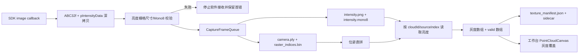

# 连续采集纹理点云与外置光源提示 v1

日期：2026-10-22；owner：主线/Codex。范围是连续采集向导；高级实时预览和固定行数兼容入口不启用纹理采集。

## 数据流程

SDK 的 `MV3D_LP_IMAGE_DATA::pIntensityData` 是本功能唯一亮度来源。驱动同时记录 `intensityWidth/intensityHeight`，队列在 `requireIntensity=true` 时要求亮度数据存在、格式为 Mono8、长度等于宽高乘积，并且栅格尺寸与点云一致。

每个采集帧事务保存 `camera.ply`、`raster_indices.bin`、`intensity.png`、`intensity.mono8` 和 `frame.json`。旧 v1/v2 会话字段不删除；没有亮度文件的旧会话仍可读取，但纹理状态显示为不可用。

## 向导行为

连续采集向导默认勾选“同步采集2D亮度图”。步骤 3 显示最新 Mono8 缩略图、尺寸和保存统计；步骤 4 可预览选中帧亮度图。亮度缺失或尺寸错误会停止软件接收，已保存帧和首个错误保留，不能继续生成无纹理的拼接发布。

“本次使用外置光源”只产生操作员确认项和会话参数：开始前要求确认光源已开启且稳定，停止后提示可以关闭光源。本轮不写入 SDK 光源参数、不控制 PLC、串口或数字 IO。

## 多帧映射

`pcv::texture::mapMultiFrameBrightness` 接收拼接点、`cloudIds`、`sourceIndices` 和每帧 Mono8 栅格，输出与拼接点等长的 `grayscale` 和 `valid` 数组。每个点按 `cloudId` 选择源帧，再按 row-major `sourceIndex` 取像素；重复目标写入按采集顺序后帧覆盖。当前连续向导使用位姿直拼，不改变点数、不做几何去重、不修改正式 PLY schema。

发布前，应用事务写入 `texture_manifest.json`、`stitched_robot_base.intensity.bin` 和 `stitched_robot_base.intensity_valid.bin`。映射失败时不向工作台发布点云或灰度覆盖。成功后 `MainWindow` 先发布点云，再按 revision 设置 `PointCloudCanvas::setTextureGrayOverlay()`。

## 接口与兼容

- `CaptureConfiguration::requireIntensity` 默认关闭，保持旧预览、旧固定行数和旧测试调用兼容；向导连续采集开启。
- `CameraFrame` 增加亮度栅格尺寸；`CaptureFrameData` 增加 Mono8 数据和尺寸。
- `StitchingResult` 增加可选纹理覆盖数组、映射统计和清单路径；点云坐标和拼接算法不变。
- `StitchingPublication` 传递纹理覆盖到主工作台；正式 PLY 仍只写 XYZ/法向。

## 验证与现场边界

## 验证与现场边界

2026-10-22 源码树外 `D:/pcv-build/camera-texture-v1-debug-20261022` 与 `camera-texture-v1-release-20261022` Debug/Release 全量构建成功；两配置完整 CTest 各 `37/37` 通过。最后一处 UI 提示改动后，两配置重新构建成功，并重跑相机/纹理相关 7 项测试，均通过：`mv3d_startup_tests_v1`、`capture_pose_tests_v1`、`capture_sdk_frame_tests_v2`、`camera_capture_panel_tests_v1`、`texture_mapping_tests`、`frame_source_tests`、`intensity_image_tests`。此前全量 CTest 结果不代表最后 UI 改动后的全量套件重跑。

最后 UI 改动后另对 Debug/Release 的 `pointcloudview.exe`、`pointcloudstitch.exe` 执行 Windows 原生自关闭启动冒烟，四次均退出码 0。该冒烟验证应用启动/退出，不打开相机向导，不验证真机采集或人工操作流程。Release 部署输出仍有 Visual Studio redistributable 路径缺失警告，干净 Windows 机器便携部署未验收。

自动化回归覆盖 SDK 替身亮度回调、缺失亮度、重复启停和生命周期，以及纹理映射和向导面板；这些测试不能替代真机。现场至少完成三次扫描，核对 `StartMeasure succeeded`、清缓存成功、亮度图尺寸、PNG/Mono8 可读性、接收/保存/映射数量和工作台灰度覆盖，并分别验证外置光源关闭/开启提示流程。当前未进行真实相机、外置光源或现场 GUI 验收。

真实设备可能返回缺失亮度、不同栅格或与点云不同步的数据；遇到此情况必须保留原始日志并停止验收，不通过静默降级或 Mock 替代。外置光源的亮度稳定性、曝光参数和现场开关动作仍由操作员负责。拼接事务可能已生成正式几何 PLY 后才发现纹理文件损坏；映射失败不会发布工作台点云或灰度覆盖，但磁盘上的拼接产物可能保留用于诊断，不能视为本次完整发布成功。
