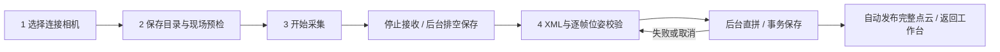

# 相机连续采集四步向导 v1

日期：2026-10-16；owner：主线/Codex；主责：apps/pointcloudview 应用层。

## 首次操作

1. 从相机入口进入连续采集向导。只有一台SDK设备时自动选择；多台时选择设备并连接。没有真实设备时只提供明确标记的Mock调试源，不自动回退或自动启动扫描。
2. 点击“进入采集设置”，明确选择已存在、可写且位于源码树外的保存目录。默认SDK完整图像/自动行数；兼容固定行数位于折叠的“高级设置”。在3DMVS确认当前设备/触发配置一次门控对应一幅完整SDK图像、门控无效且下一次扫描未开始后，勾选一次现场预检。切换边界模式、保存目录或连接状态后重新确认。
3. 点击“进入采集”，再点击“开始采集”。显示实际宽高/行数、接收/待保存/已保存、平均保存吞吐、队列峰值。结束现场门控并确认最后一幅完整图像已接收后，点击“停止并等待保存”。SDK回调先停止，记录器finish/join在后台等待，Draining期间禁止导航和配置。
4. 保存排空后自动进入位姿页。选择有效手眼XML，在每帧Start/End填写[X Y Z A B C]，单位mm/°。选中一行可复制上一行；“复制到选中行”以当前行为来源，将其Start/End同时复制到所有选中行。复制不表示位姿真实正确，必须对照机器人记录。勾选参与帧、校验、调整顺序后点击“拼接并自动发布到工作台”。

有效XML、至少两个参与帧、全部参与行六元有限位姿均有效时才能拼接。行状态实时显示“未填写/格式错误/有效/已排除”；一键校验定位首个错误。失败和取消保留会话及已保存帧；成功经现有stitchingSucceeded发布完整点云、更新revision并返回工作台，状态栏保留点数和输出目录。新一轮采集需重新预检，替换界面列表前确认，原会话目录不删除。

## 实现边界与状态

CameraDialog管理设备源、SDK通知和高级实时预览；CameraCaptureWizard管理四页及状态快照。原camera_capture_panel_v1.h保留类型alias，原cpp承载唯一实现，无复制算法。复用FrameSource/CaptureRecorder/StitchingRequest；模块10/20/30/50、会话schema、点序、PLY/PCVMAP均不改。

状态为Disconnected/Connecting/Connected/Configuring/ReadyToCapture/Capturing/Draining/Reviewing/Publishing/Completed/Error。仅应用GUI线程更新状态和控件。后台排空只持有在join完成前保持存活的记录器指针，不访问设备或QWidget；所有future在关闭前等待。拼接保留取消token、revision门禁和确定性结果发布。

既有FrameSource在start()内才调用OpenDeviceBySN，连接按钮仍是创建/选择设备源，而非提前开启测量。UI明确提示这一点；真正启动失败则解除连接就绪状态、保留错误并返回连接步骤。自动选择不冒充硬件取流成功，也不为探测连接提前启动激光/测量。

“高级实时预览 / 设备设置”保留Range/PointCloud模式、连续/软触发、冻结、断线重连。离开高级预览时停止其取流和重连。向导采集中不可切换入口；图像/触发选项在下次start前应用，SDK整图采集仍沿用原有保留现场触发策略。窗口重新显示默认回到向导，保留当前会话页。

## 验证

- 2026-10-16 用户反馈“测试通过，收尾吧”，据此结束本轮实施，不追加功能修改或重复测试。此结论记录为用户验收反馈，用户未提供逐项测试日志，不推定真机、机器人、吞吐或干净机部署均已验收。
- 源码树外Debug/Release首轮全量构建日志均到达100%，目录分别为`D:/pcv-build/camera-wizard-v1-debug-20261016`、`D:/pcv-build/camera-wizard-v1-release-20261016`，日志为各目录`build.log`。首轮构建期间存在后续局部源码调整，不能仅凭该日志断言最终源码已完成两配置重验。
- 本地此前单项`camera_capture_panel_tests_v1`启动返回`0xc0000135`，直接运行曾出现运行库对话框；没有本地最终通过日志或Release完整CTest日志。本轮不把首轮构建、历史测试或用户反馈改写为自动套件全部通过。SDK运行依赖环境及该启动故障的独立复核仍是验证边界。
- 收尾仅补文档和静态检查；`git diff --check`通过。保留全部原有修改及未跟踪文件，无删除、暂存、提交、推送或上传。

## 风险与回滚

- 人工预检不是硬件边界检测；没有机器人停止控制。真实门控、丢包、吞吐、机器人首末位姿和几何质量仍需现场验收。
- 停止保存已转为后台join，但SDK停止/等待回调仍复用原有同步生命周期；SDK异常阻塞不承诺固定关闭时限。
- 完整拼接结果沿用全量工作台显示，未增加展示抽样或改变数学算法。没有纹理点云、位姿文件导入、自动ICP或几何质量保证。
- 仅反向撤回本轮应用层向导/接入、测试和文档增量；保留原有未提交工作、底层取流和所有原始会话。不得整文件回退或覆盖旧构建。
