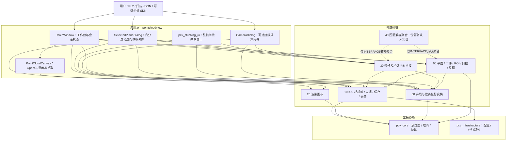
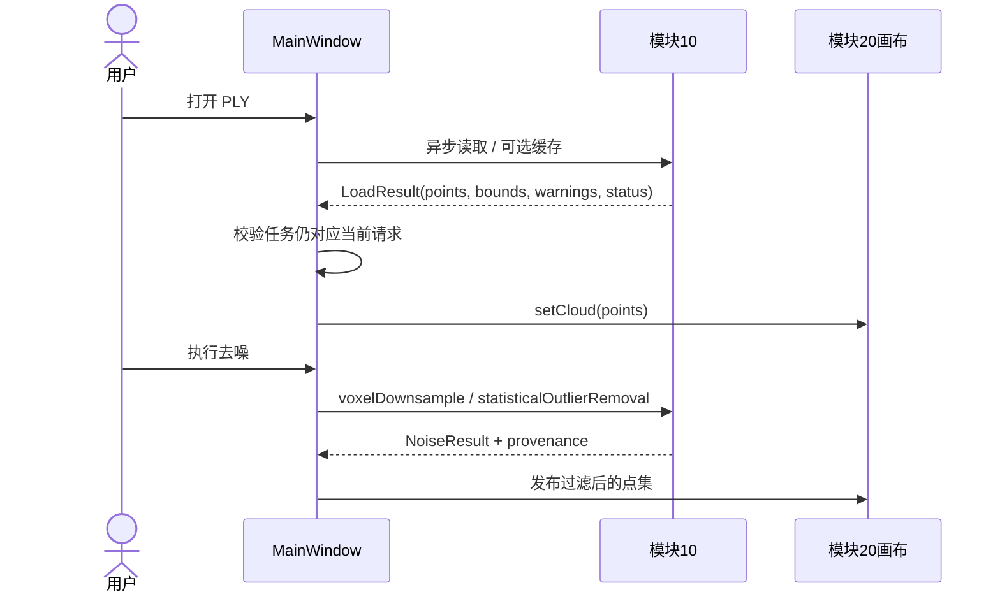
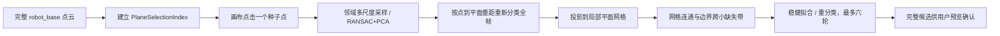
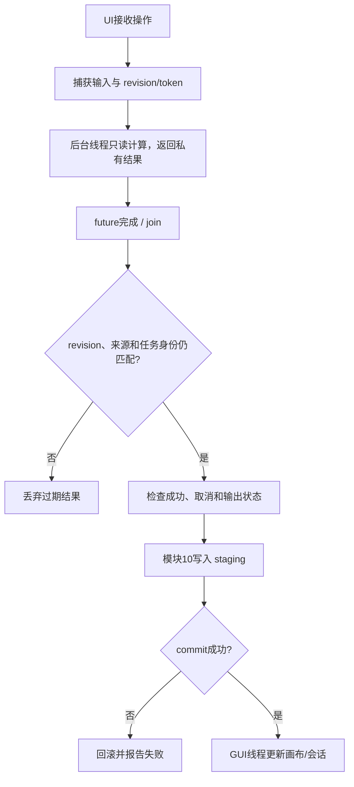

# pointcloudview 架构与算法导读 v1

核对日期：2026-10-22。对象：当前工作区 `pointcloudview` 应用及其直接调用的模块。源码、公共头、CMake 和测试定义实际行为；本文按用户可理解的系统结构说明，不代表发布验收。关键事实可对照[整体架构](../architecture/software_architecture_v0.5.md)、[需求基线](../requirements/pointcloudview_v0.5.md)和各[模块文档](../README.md#模块与应用)。

## 先看全貌

PointCloudView 是 Qt 桌面应用。它负责把文件/相机输入、算法模块和画布串起来。算法主体放在独立模块；应用负责参数、异步任务、取消、结果是否仍有效，以及把成功结果显示给用户。



图中的 `MainWindow`、`SelectedPlaneDialog` 和共享拼接 UI 是应用层代码，不是领域模块。模块间的依赖方向比窗口调用更稳定：`30→10/50`，`60→10/50`，`20→core`。模块不依赖 `apps/`；所选平面由应用把 60 的选区结果整理成 DTO，再交给 30，因此 30 不依赖 60。70/80仅保留公共兼容头，其旧target已清理，不代表额外算法。

## 分层与边界

| 层 | 当前组成 | 读代码时的判断方式 |
|---|---|---|
| 应用入口 | `apps/pointcloudview/main.cpp`、`MainWindow`，以及独立 CLI/拼接程序 | 选择窗口、创建服务、安排用户操作；不应重复领域算法 |
| 应用编排与 UI | `mainwindow.cpp`、`selectedplanedialog.cpp`、`apps/stitching_ui`、`features/` | 维护会话、revision、进度、取消/join、发布到 GUI |
| 领域模块 | `modules/10/20/30/50/60_*` | 实际算法、稳定数据结构和输入校验 |
| 基础层 | `pcv_core`、`pcv_infrastructure` | 通用点类型、取消令牌、预算、配置和运行目录 |
| 外部数据边界 | PLY、JSON、PNG、PCVMAP、相机 SDK | 有格式/坐标/单位约定的输入输出；不是内部模块层 |

当前target名称为`pcv_m10_pointcloud_io`、`pcv_m20_pointcloud_render`、`pcv_m30_pointcloud_stitch`、`pcv_m50_coordinate_conversion`、`pcv_m60_geometry_workpiece`。40是`INTERFACE`聚合层；70/80仅保留兼容头。实际namespace与目录名不完全相同，例如坐标数学仍在`pointcloud::`，不可由头文件路径推断namespace。

## pointcloudview 的窗口与关键函数

### `MainWindow`：主工作台

`MainWindow` 是状态所有者。它持有当前/原始点云、来源上下文、画布 revision、选点、工件会话及后台 watcher。槽函数接收 UI 操作，私有方法做状态检查和任务编排。

| 函数 | 作用 |
|---|---|
| `buildUi()` / `applyConfiguredDefaults()` | 创建工作台控件并加载默认显示/处理参数 |
| `openPointCloud()` / `loadSelectedSource()` / `loadFinished()` | 选择并异步读取点云；完成时校验结果后更新主画布和来源状态 |
| `publishCanvasCache()` | 把新点集、来源信息和 revision 一起发布到画布；按调用场景清理旧派生状态 |
| `applyNoiseRemoval()` / `noiseFinished()` | 启动过滤任务，并在输入 revision 仍匹配时接收结果 |
| `startPlanePointSelection()`、`handleCanvasPointPicked()`、`determinePlaneCandidate()`、`confirmPlaneCandidate()` | 管理三点选面交互、计算候选平面和用户确认 |
| `startWorkpieceAxisSelection()` / `validateSecondPlaneSelection()` | 选取工件坐标轴控制点，并验证第二平面与第一平面的一致性 |
| `runPlaneExtraction()` / `planeExtractionFinished()` | 从当前平面候选生成正式平面数据并更新应用状态 |
| `applyPlaneEdgeSegmentation()` / `extractPlaneImage()` | 分割边缘并生成平面图像/栅格数据 |
| `selectTextureImage()` / `textureMappingFinished()` | 载入灰度图、调 60 映射，并将结果作为覆盖层交给画布 |
| `planScanTrajectory()` / `scanPlanningFinished()` / `exportScanTrajectory()` | 生成、显示并导出扫描轨迹 |
| `createWorkpieceTemplate()` / `openWorkpieceTemplate()` | 启动模板保存/读取表单和后台任务 |
| `stitchingSucceeded()` | 接收共享拼接窗口成功结果，替换当前画布并清理不再适用的旧会话 |
| `closeEvent()` | 关闭时取消并等待工作任务，避免窗口销毁后后台结果回写 |

### `SelectedPlaneDialog`：六分屏选面

该窗口负责多帧选面业务流程，不负责选面几何算法本身。它管理帧列表、六个面板、每帧位姿/选择状态、调度队列、任务取消、轮次确认、拼接及模板保存。

| 函数 | 作用 |
|---|---|
| `appendFiles()` / `moveFrame()` / `removeFrame()` | 管理待处理帧和顺序；顺序同时决定最终拼接顺序 |
| `loadRound()` / `releaseRound()` / `releaseFrameData()` | 载入当前最多六帧的轮次并在提交/跳过后释放缓存 |
| `requestFit()` / `picked()` | 请求选面索引/局部拟合，并接收画布回译的完整点索引 |
| `confirmRound()` / `roundReady()` | 确认当前轮所有帧均已确认或明确跳过，并保存完整快照 |
| `parametersChanged()` / `invalidateFrame()` / `invalidateResult()` | 参数、位姿或输入变化时废弃受影响候选和旧拼接结果 |
| `schedule()` / `startJob()` / `finishJob()` / `finishGlobal()` | 控制后台加载、转换、建索引、选面任务的优先级并统一收敛结果 |
| `prepareDisplayCloud()` / `publishDisplay()` | 完整读取与坐标转换后，抽样显示最多 300,000 个实测点；完整点集仍保留作正式索引及选面 |
| `stitch()` / `saveTemplate()` | 把确认轮次按原帧序形成完整请求交给 30；成功结果交 60 保存模板 |
| `cancelAndWait()` / `closeEvent()` | 取消并 join worker，关闭时不让迟到任务改动会话 |

每帧任务携带 frame id、revision、token 和任务 kind。完成时这些身份仍匹配才可写入状态；活动显示格不会抢占完整选面索引请求。整轮已经完成的确认快照可用于拼接，拼接输入仍是完整点而非显示抽样。

### 画布与共享拼接窗口

`PointCloudCanvas` 在模块 20，承担 GPU 绘制、相机视角、点/边拾取、选区和 overlay 显示。常用入口包括 `setCloud()`（完整点云）、`setDisplayCloud()`（展示子集及索引映射）、`setSelectedIndices()`、`setPlaneResult()`、`setTextureGrayOverlay()`、`setWorkpieceCoordinateSystem()`、`setDisplayOptions()`。它报告用户拾取的显示点索引；选面窗口负责把显示索引映射回完整点集索引。

`pcv_stitching_ui` 是 View 与 Stitch 应用共享的拼接窗口。它组织整帧输入、标定和位姿参数，调用 `pcv::interface::stitch()`，展示日志/取消，并在成功时发出 `stitchingSucceeded`。它是应用共享库，不是算法模块。

可选相机功能由 CMake 的 `PCV_BUILD_EXPERIMENTAL_CAMERA` 控制。`CameraDialog`/采集面板管理开始、停止和操作员确认；模块 10 的相机驱动、帧转换、队列和会话负责设备数据；50 做坐标数学；30 复用“仅转换”路径输出。错误停止软件接收，不向机器人发送控制。

## 关键业务链路

### 文件加载与过滤



PLY 读取先解析头部和字段布局，再读 ASCII 或 binary payload，检查点数/数值有效性并尽量保留法向等属性。可选 canonical cache 避免重复解析。过滤先由体素格聚合点（按配置选择代表点/质心），统计滤波基于每点近邻平均距离和全局距离分布阈值剔除离群点；实际顺序及是否启用由 `NoiseOptions` 控制。

### 手眼与线扫坐标变换

模块 50 是唯一坐标数学实现。机器人位姿采用 `[X,Y,Z,A,B,C]`，角度顺序 `Rz(C)*Ry(B)*Rx(A)`；标定矩阵语义为 `T_flange_depth`。变换关系：

```text
p_robot_base = T_base_flange(scan_progress) * T_flange_depth * p_camera
```

线扫输入点按 `[X,0,Z]` 解释；点自身的 `Y` 用于计算扫描行程比例。行程 `signedTravel` 可为负，表示反向扫描。机器人 Start/End 位姿之间插值后与手眼矩阵组合；法向只乘旋转部分，不加平移。显式 raster-row 模式用原始栅格行号计算进度，过滤掉坏点也不改变其原行号。

关键函数：`loadHandEyeCalibration()` 解析和校验 XML 标定；`robotPoseToMatrix()` / `matrixToRobotPose()` 做位姿和刚体矩阵互转；`interpolateRobotTransform()` 插值 Start/End；`computeScanTravel()` 计算有符号行程；`composeBaseFromDepth()` 组合矩阵；`lineProfileScanRatio()` 计算进度比例；`transformLineScanToRobotBase()` 执行批量转换、过滤、来源索引保留和诊断。

### 单击选面



`preparePlaneSelectionIndex()` 为不可变完整点缓冲准备空间桶/可选加速数据；索引只对对应输入缓冲有效。`selectPlaneAtPoint()` 从点击位置取邻域，通过多尺度局部模型找出初始平面，然后全帧按表面容差分类。投影网格建立平面内邻接关系，先求正常连通区域，再仅允许真实边界附近跨越小缺失带，避免把整格或远处共面点混进来。最后稳健精化模型并重分类，候选点必须满足模型容差；算法不补点、不加厚、不压平。参数变化会废弃预览候选，确认快照独立保留。近邻但物理分离的共面物体仍可能被合并，所以需要人工预览确认。

三点 `fit()` 路径则用用户控制点初始化平面，要求点不同、索引有效且不共线；后续 RANSAC/PCA、阈值分类、RMS/平面度与连通诊断生成候选。它与单击入口不同：三点给出多个空间约束，单击从一个种子附近自动扩展。

### 整帧拼接与所选平面拼接

整帧入口是 `pcv::interface::stitch(StitchingRequest)`。应用传入有序帧、Start/End、手眼标定和 ICP/输出参数。核心阶段包括：每帧坐标转换及无效点/范围过滤；降采样和法向估计；按帧序构造相邻配准；多层级空间索引找对应点；估计刚体增量（含退化/可观测自由度诊断）；用边界覆盖和结构信息检查增量是否可信；必要时按规则回退/重试；累积变换并按序合并完整点；事务写 PLY、map、manifest 等产物。`enabled=false` 时走仅转换流程，不做 ICP。该算法实现较大，具体阶段可从 `modules/30_pointcloud_stitch/src/multiframe_registration.cpp` 的 `stitchRawLineProfiles()` 及内部 `estimateIncrement()`、边界验证和重试逻辑顺读。

所选平面入口是 `pcv::stitching::stitchSelectedPlanes()`，它接收应用已转换到 robot_base 的完整选面点和来源映射，不再次执行手眼变换：

1. 校验至少两帧、点/法向有限、来源索引唯一且有效、种子与选面方法匹配。
2. 对相邻帧调用 `refineSelectedPlanePair()`，仅在有限的小修正预算内做两层局部精配准；不可观测、退化或不可信时依据规则回退到位姿链。
3. 将相邻修正沿帧序累积；按输入帧和帧内点序合并，并同步保留 `cloudIds`、来源索引、扫描比例。
4. 通过模块 10 事务提交正式 PLY、来源 map 和 manifest；取消/失败不返回部分结果。

这一模式的结构限制和参数较整帧 ICP 保守，报告中的 `formal_output` 表示产物事务成功，不代表严格几何质量已通过。所选平面校验为 warn-only；真实平面完整性、漂移及现场误差仍需单独验收。

### 临时工件、纹理与扫描

`prepareTempWorkpiece()` 读取扫描 JSON/PLY 描述并通过模块 50 转到 robot_base，验证来源、点和索引；之后用户提供两组平面控制点。`finalizeTempWorkpiece()` 校验两平面的同面关系和工件坐标方向，生成 baseline、ROI、mask、info 四件套并通过 `ArtifactTransaction` 成套提交。WObj1 与 baseline 是临时工件几何结果，不是模块 40 的位置匹配/移动判定。

`mapPlaneBrightness()` 要求灰度图与原始栅格点数量严格对应，按 `source_raster_index` 把 row-major 像素灰度映射给平面点；provenance 不匹配即拒绝，不做缩放、裁切、翻转或配准。画布只把灰度作为 overlay 展示。

`planScanTrajectory()` 根据 WObj1 XY 范围生成覆盖路径：Global 模式依拟合平面，LocalRoi 模式沿已有 ROI；将相机覆盖宽度、重叠率、扫描高度转成线间距和行程，在局部坐标生成往返扫描线，再转成机器人位姿并输出 JSON/机器人格式。它是相机扫描轨迹生成，不是外部刀路算法，也不执行 IK、碰撞检测或机器人控制。

## 异步、取消与文件发布



`revision` 解决“任务跑完时输入已经变了”的竞态；取消令牌用于请求 worker 尽快停止；关闭窗口时必须取消并等待 worker。Qt Widget/OpenGL 只在 GUI 线程访问。线程内对共享 Qt 容器只读，后台结果先保存在私有结构中，全部任务 join 后按确定顺序合并。

磁盘事务成功和 GUI 发布是两件事：已 commit 的文件不会因为后来画布 revision 改变而被悄悄删除；应用仍会拒绝把过期结果显示成当前结果。10 的 `ArtifactTransaction` 负责 staging、相对路径校验、commit 和回滚；旧 `writePlaneOutput` 仍有自己的回滚实现，事务内部尚未完全统一。

## 主要公共函数速查

| 模块 | 关键函数 | 用途 |
|---|---|---|
| 10 IO | `pcv::detail::io::readPly` | 解析 PLY 并返回点、边界和读取诊断 |
| 10 IO | `pcv::detail::filtering::voxelDownsample`、`removeStatisticalOutliers` | 体素降采样、统计离群点过滤 |
| 10 IO | `ArtifactTransaction::stageBinaryPly`、`stageGrayscalePng`、`stageJson`、`commit`、`abort` | 暂存并原子化发布一组文件 |
| 10 相机 | `convertPointCloudToPoints` / `CaptureRecorder::run` | 将 SDK 帧转换成点云；后台队列完整保存采集帧 |
| 20 渲染 | `PointCloudCanvas::setCloud`、`setDisplayCloud`、`setSelectedIndices`、`setTextureGrayOverlay` | 更新完整/展示点集、选择和纹理显示 |
| 30 整帧 | `pcv::interface::stitch`、`pointcloud::stitchRawLineProfiles` | 请求映射与整帧拼接执行 |
| 30 选面 | `pcv::stitching::stitchSelectedPlanes` | 相邻选面精配准、合并与正式输出 |
| 50 坐标 | `loadHandEyeCalibration`、`robotPoseToMatrix`、`interpolateRobotTransform`、`transformLineScanToRobotBase` | 标定读取、位姿插值和点云统一转换 |
| 60 平面 | `pcv::planefitting::fit`、`preparePlaneSelectionIndex`、`selectPlaneAtPoint` | 三点/多点拟合、建索引、单击扩展平面 |
| 60 工件 | `prepareTempWorkpiece`、`finalizeTempWorkpiece` | 准备 robot_base 点集并输出临时工件四件套 |
| 60 纹理/扫描 | `mapPlaneBrightness`、`planScanTrajectory` | 栅格灰度映射、生成相机扫描轨迹 |
| 60 模板 | `saveWorkpieceTemplate`、`loadWorkpieceTemplate` | 保存/读取带 schema 校验的三维点云模板 |

表中个别旧模块函数名通过兼容头暴露；遇到声明与源码不一致时以 `modules/*/include` 和相应 `.cpp` 为准。本文不是逐个局部 helper 的 API 参考；局部函数通常只服务其所在算法阶段。

## 当前能力与阅读限制

已实现的领域流程包括 PLY/缓存/过滤、GPU 画布、统一手眼转换、整帧拼接、所选平面拼接、几何工件处理、灰度纹理映射、相机扫描规划和模板保存/读取。外部全剖/点剖刀路闭环、模块 40 的移动判定、机器人 IK/碰撞/执行均未实现或未验收，不能从窗口名称或数据文件推断其存在。

本文是静态架构阅读材料，未运行构建、CTest、GUI 或生产数据验证。对于生产精度、相机/机器人现场坐标、真实样本性能和部署，应分别按项目验收记录确认。
